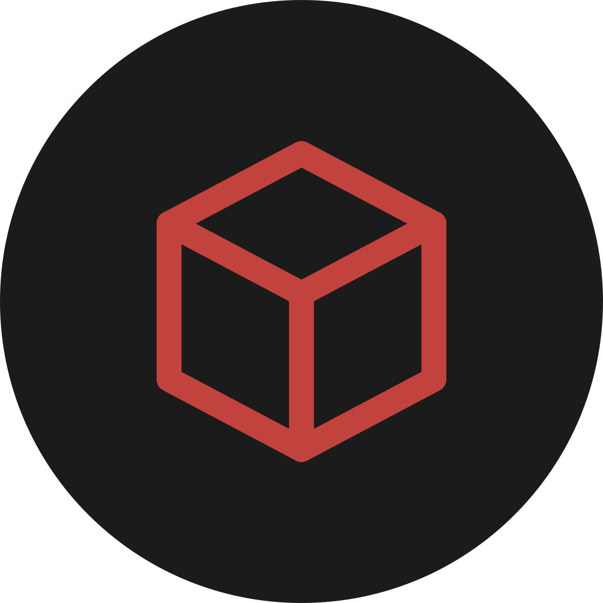
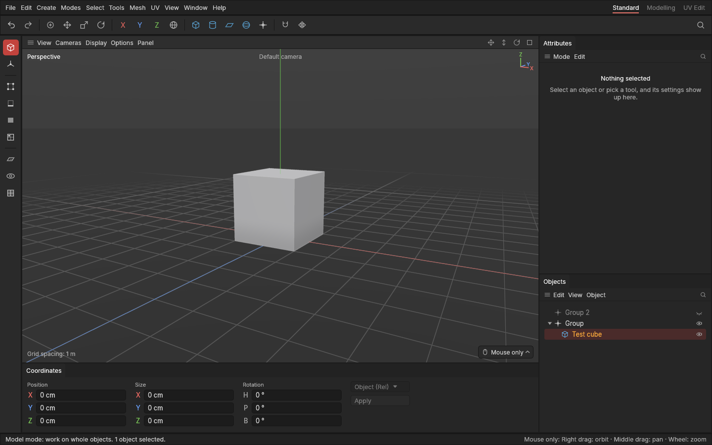
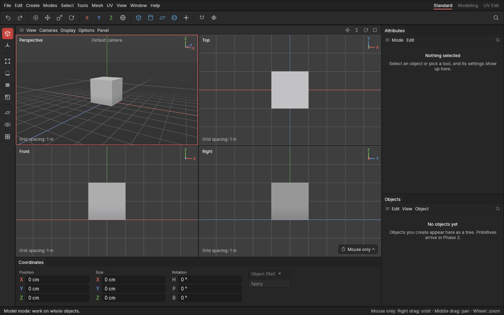
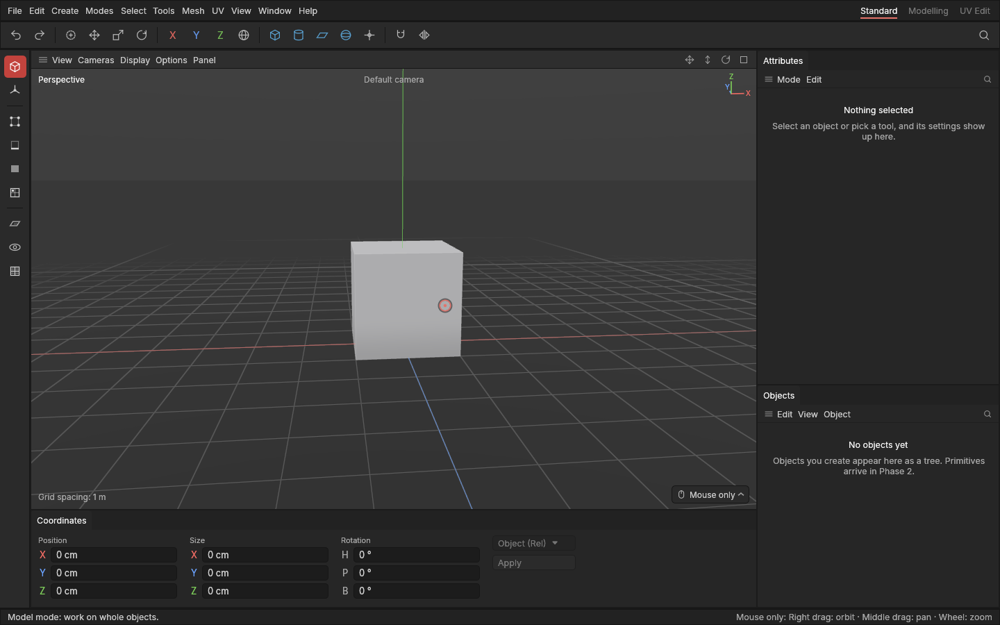
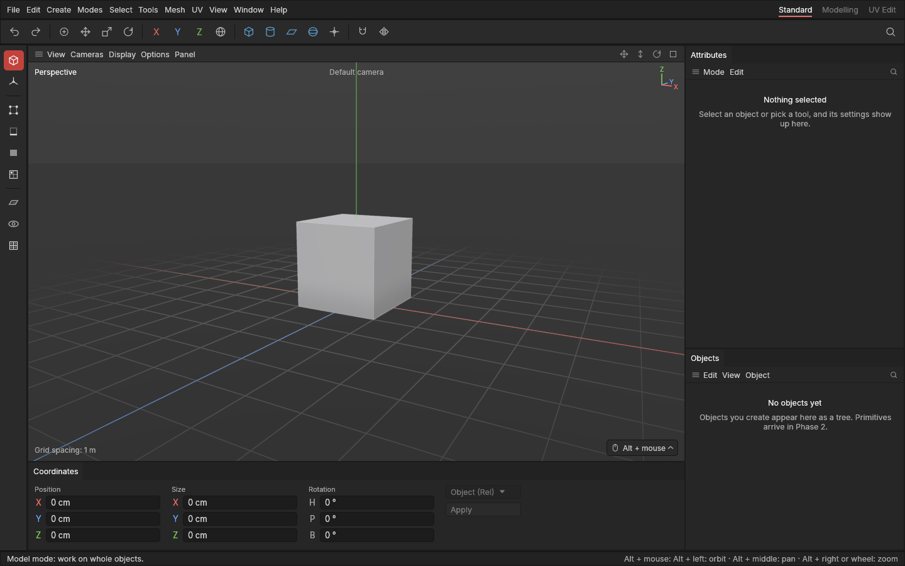
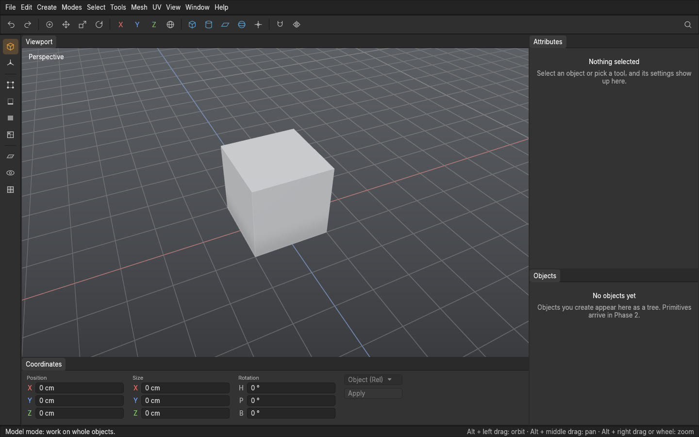
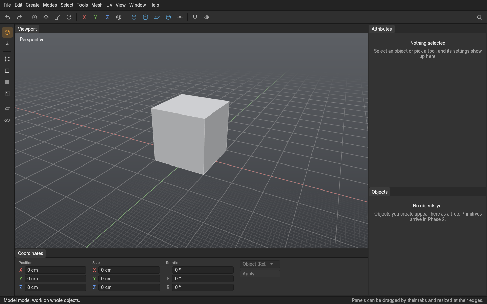
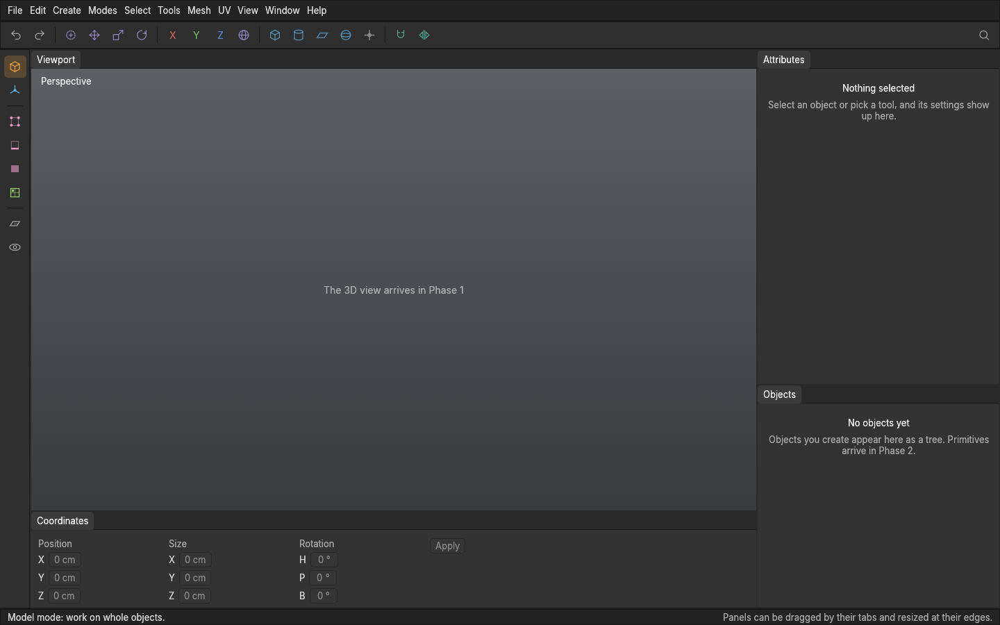
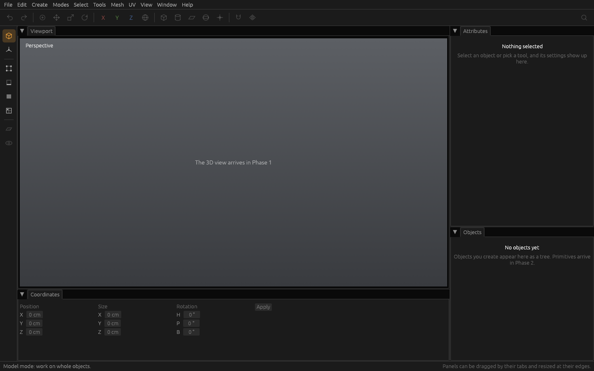

# Aventail 3D

**A calm, easy-to-learn 3D modeller for game assets.**

Aventail 3D is a free, open-source modelling and UV unwrapping tool for **hard-surface game assets**, written in Rust. Model it, unwrap it, and export it to Substance Painter and Godot, all in one app.

> **Status: pre-alpha.** Every Phase 4 modelling tool is in: primitives you can keep changing, points, edges and polygons to edit, extrude and inset, bevel, loop cut, slit, connect, bridge and weld, clean-up, hard and soft edges, symmetry, pipe bends and spirals, with undo for everything and projects that save and reopen. Heavy shapes of millions of polygons stay quick, and backup copies bring your work back after a crash. Every Phase 5 milestone is in too: pivots and project units, glTF and OBJ export (and OBJ import) with materials, presets for Godot, Unity, Unreal Engine and Substance Painter, exporting straight into a game project on every save, a check for what would spoil a bake, kit export with Godot collision, and a splash screen; the phase gate waits for the project lead's test in Godot and Substance Painter. Phase 7, the UVs, is built as well: the UV Editor, seams placed by hand or suggested, unwrapping, packing, checker and stretch views, editing UVs on the model, UVs that survive later modelling, a bake check for UVs and trim sheets; its gate waits for the project lead's bake test. Click **Keys** on the menu bar for every key, and see the [user manual](docs/manual/SUMMARY.md) for how everything works. Follow the progress tracker below.

Created by **Rhyslos**, built with AI assistance (Claude by Anthropic).

## Why

Making a game asset means modelling it, unwrapping it, and getting it into a texturing tool and an engine without surprises. The big general-purpose 3D programs can do all of that, but they are built to do everything, and learning them takes a long time. Aventail 3D does one job: **game assets**, made well, in a tool you can learn quickly.

- **Easy to learn:** a clear layout, tools that say what they do, a manual that explains *why* as well as *how*, and every key on one drawn keyboard.
- **Made for game assets:** hard-surface modelling, clean shading with hard and soft edges, and UVs, the parts a game model needs.
- **Into your pipeline:** export to glTF and OBJ for Godot and Substance Painter, checked before it leaves the app.
- **Never losing work:** undo for everything, and shapes whose settings stay editable after you've modelled on top of them.

Its way of working is inspired by Cinema 4D and 3ds Max, two programs many modellers learned on, but it is not a copy of either: it borrows what made them pleasant to use and grows into its own tool.

Rendering, sculpting and texturing are left to the tools that already do them well. Rigging and animation are planned for much later.

## Progress tracker

Aventail 3D is built in phases. Each ends with a gate the project lead checks before the next phase starts. This tracker is updated by the pull request that finishes each milestone. The full plan is in [DESIGN.md](DESIGN.md).

### Phase 0 · Foundations (v0.0, internal) — 7 of 7

`█████████████` 100%

- [x] Repository set up: license, README, security policy, contribution rules
- [x] Automatic builds for Windows, Linux and macOS on every change
- [x] Quality checks in CI: formatting, lint, tests, license and vulnerability scans
- [x] Documentation setup: architecture, contributing guide, changelog, decision records, pull request template, API reference, user manual
- [x] Workspace split into crates
- [x] Window with the main layout: viewport, Attributes panel, Objects panel, palettes, status bar, all dockable
- [x] Theme: calm dark colours, font and spacing

**Gate:** the app launches into its layout with movable, dockable panels. *Passed 2026-10-10.*

### Phase 1 · Viewport and navigation — 5 of 5

`█████████████` 100%

<details>
<summary>Milestones</summary>

- [x] 3D viewport: soft gradient background, fading grid, a test cube
- [x] Navigation: orbit, pan and zoom with the mouse alone (or another choice of mouse controls)
- [x] Orbit and zoom around the point under the mouse cursor
- [x] Frame selected and frame all
- [x] Perspective, top, front and right views, and the 4-view layout

</details>

**Gate:** navigating feels smooth and calm to the project lead. *Passed 2026-10-10.*

### Phase 2 · Objects, history and saving — 6 of 6

`█████████████` 100%

<details>
<summary>Milestones</summary>

- [x] Objects panel: create, rename, reparent, hide and delete objects (with undo and redo)
- [x] Primitives: cube, plane, cylinder, sphere, disc, tube, cone
- [x] Primitive settings in the Attributes panel
- [x] Object stack foundation: base plus recorded operations
- [x] Undo and redo limited by memory, not steps
- [x] Save and open `.avtl` projects

</details>

**Gate:** a scene of primitives can be built, edited, undone freely, saved and reopened. ✅ *Passed 2026-10-11: tested by the project lead, "it all felt great".*

### Phase 3 · Editable meshes and selection — 5 of 5

`█████████████` 100%

<details>
<summary>Milestones</summary>

- [x] Mesh data structure, fully tested
- [x] Point, edge and polygon modes
- [x] Selection: click, rectangle, lasso, paint select, loop, ring, grow and shrink
- [x] Move, rotate and scale gizmos with axis constraints, snapping and typed values
- [x] Edits recorded on top of the base, so base settings stay editable

</details>

**Gate:** points, edges and polygons can be selected and moved precisely, and a cube's segments can still be changed afterwards. ✅ *Passed 2026-10-12: tested by the project lead.*

### Phase 4 · Core modelling tools — 19 of 19

`█████████████` 100%

<details>
<summary>Milestones</summary>

- [x] Heavy meshes: stays usable with a 2–3 million polygon object, checked at every phase gate
- [x] Autosave and crash recovery: backup copies in the background, offered back after a crash
- [x] Tool menu (E): every tool for the current mode at the mouse, radial or list, from one command list
- [x] Extrude and inset (D, I): drag anywhere to push polygons out or in, inset them, or grow border edges; neighbours together or each on its own
- [x] Bevel (V): edges and points, with width, segments and profile (round, flat or hollow); drag away from the edges
- [x] Foundations: saves that always reopen, fast edits however long the history, extra values per point, edge, polygon and corner (ready for UVs), edits that hold when earlier ones change, limits for damaged files; and our own names (Attributes panel, Objects panel, Paint select)
- [x] Loop cut (F): point at an edge, click or drag; Ctrl + wheel for a tool's count; Z frames the selection
- [x] Slit (X): cut new edges along a line of points over the shape, visible only or through; close it into a loop to cut a shape into a polygon
- [x] Extrude with a bend: pipe bends that keep their size, with an angle, direction, bend radius and segments; past one turn, spirals whose loops clear each other
- [x] Connect (A), Bridge (C, or drag edge to edge) and Weld (M, or Ctrl + M onto a point)
- [x] Clean-up: Delete deletes, Backspace dissolves; fill hole and flip normals, with select flipped, fix normals and select same facing
- [x] Hard and soft edges, by hand or by angle, with hard edges and normals shown from the Display menu
- [x] Symmetry: every edit is made on the other side too, across the shape's own X, Y or Z, through its pivot, its middle or the world centre
- [x] Basics: hide and isolate, slide points and edges, duplicate and instances, split polygons off and join objects
- [x] Keyboard shortcut viewer: every key in one place (Keys on the menu bar), on a drawn keyboard in your layout
- [x] Wireframe: shaded or wireframe, from a button beside the corner axes (now bottom left), with an Edges switch (replacing shaded with wires, [decision 0220](docs/decisions/0220-edges-switch.md))
- [x] Cavity: creases darkened and ridges brightened, so a shape's form reads clearly (on as standard)
- [x] Clickable corner axes: click X, Y or Z to look straight along it (again: from the other side)
- [x] Automatic hard edges: shapes shaded by angle after every change (Mesh menu, on as standard), so extrudes and bends stay smooth

</details>

**Gate:** a simple hard-surface prop (a crate, a sci-fi panel) can be modelled from start to finish, and the heavy-mesh check passes. From here on, every gate includes the heavy-mesh check.

### Phase 5 · Export pipeline — 10 of 10

`█████████████` 100%

<details>
<summary>Milestones</summary>

- [x] Pivot editing and scene units: the Object mode moves and turns pivots, with ready-made places; each project saves its units
- [x] OBJ export and import
- [x] glTF export
- [x] Consistent triangulation and MikkTSpace tangents
- [x] Simple material slots: polygons assigned to a named material with a colour, so engines get their parts
- [x] Export presets for Godot and Substance Painter
- [x] Engine export paths: save straight into a Godot, Unity or Unreal Engine project, exported again on every save
- [x] Bake readiness check: what would spoil a bake, in plain words, with one-click fixes
- [x] Kit export: each piece as its own file, and Godot collision meshes
- [x] Splash screen while the app starts

</details>

**Gate:** a prop exports into Godot and Substance Painter and looks right (shape, hard edges, scale) with no fixes in other software. The full bake round trip comes with UVs (Phase 7).

### Phase 6 · Workflow tools — 6 of 6

`█████████████` 100%

<details>
<summary>Milestones</summary>

- [x] Apply transforms: an object's rotation and scale (and position) made part of its shape while it looks the same
- [x] Stable element names: edits keep their exact points, edges and polygons even when an earlier edit renumbers them
- [x] Edit Layers: a stack of edit layers per object (inspired by 3ds Max's stack of edit modifiers), whose layers find their parts again when a layer below changes, added from a new modifiers palette between the viewport and the Attributes and Objects panels
- [x] Edit list: every recorded edit in order, each one changeable, pinned to stay changeable, frozen to keep big models quick, or switched off
- [x] Snap to and align tools
- [x] Optional quad menu on right-click

</details>

**Gate:** stacking, toggling and editing earlier layers and edits feels right to the project lead.

### Phase 7 · UVs — 12 of 12

`█████████████` 100%

One big phase, aiming to be the best UV tools around. Brought forward before advanced hard-surface at the project lead's request (2026-10-16): it needs nothing from that phase, and that phase's tools can then carry UVs from the start.

<details>
<summary>Milestones</summary>

- [x] Primitives come with ready-made UVs and seams
- [x] UV mode, the UV Editor panel and the UV Edit layout
- [x] Editing UVs by hand: move, rotate, scale, turn and flip, with the E menu's UV tools
- [x] Seams: marking, painting, from hard edges, and suggested seams in hidden places
- [x] Live unwrap, relax and straighten, with hard-surface strips straightened automatically
- [x] Texture size and texel density as scene settings
- [x] Packing: real-pixel padding, nesting, groups, texture sets, stacking identical parts
- [x] Checker texture, and a stretch heatmap with explained fixes
- [x] UV editing directly on the model
- [x] UVs that survive modelling: change the model, keep the UVs
- [x] Bake readiness for UVs: seams, overlaps, padding, texel density
- [x] Trim sheets

</details>

**Gate:** a prop is unwrapped and packed in Aventail 3D, with clean bakes in Substance Painter, and changing the model afterwards keeps its UVs.

### Phase 8 · UV powerhouse and baking — 7 of 28 (paused; resumes after Phase 11)

`███░░░░░░░░░░` 25%

Paused on 2026-10-21 for the rework (Phase 9). On 2026-10-22 the project lead moved advanced modelling (Phase 10) ahead of the rest of it: unwrapping works well enough, and modelling comes first ([decision 0125](docs/decisions/0125-modelling-before-the-rest-of-the-uvs.md)). So the order was Phase 9, Phase 10, then the rest of Phase 8; on 2026-10-28 the project lead moved texture painting (Phase 11) ahead too, bringing forward only the bakes it needs ([decision 0177](docs/decisions/0177-texture-painter-plan.md)).

At the project lead's request (2026-10-16), before advanced hard-surface: everything the other 3D programs do well for UVs, full control over every automatic step, four ideas no other app has, and baking inside the app, so Substance Painter becomes optional for bakes. The aim: the best and most controllable UV tools there are.

<details>
<summary>Milestones</summary>

- [x] Unwrapping: pins (E menu and UV menu, no key: the project lead's choice), unfolding one way only, and angle-based and size-keeping methods beside LSCM, the best picked for each piece
- [x] Fully controllable automation: every automatic tool (suggest seams, unwrap, straighten, pack, mending) shows all its settings, and the same model and settings always give the same result, never a random one
- [x] Seam preferences ("prefer a seam here", "never a seam here") and a stretch budget per piece, obeyed by every automatic tool
- [x] Lock a piece (nothing automatic changes it), and per-piece settings (method, straightening, density) kept for every re-unwrap
- [ ] Straighten any quad piece by its edge flow, and the texture locked in place while moving points
- [ ] Seams: a slider from fewer seams to less stretch, a seam brush, symmetric seams, seams along loops and rings
- [ ] Projections: planar, box, cylindrical and spherical with an on-model gizmo, project from view, and world-aligned UVs for modular kits
- [ ] Editing pieces: stitch and cut in the UV Editor, align and distribute, orient by an edge, lattice warp
- [ ] Precise placement: UV snapping (to texture pixels, other pieces' edges and corners, trim rows, a grid of your own), exact U, V, turn and size in the Coordinates panel, and transform pivots (the selection's middle, each piece's own, a corner, a point you place)
- [ ] UV brushes in the UV Editor: grab, relax and pinch
- [ ] Selection by overlap, mirror, stretch and similarity, grow and shrink in UV, shortest path; isolate the selected pieces; the UV Editor following the viewport's selection or keeping its own; copying UVs between similar pieces and objects
- [ ] Packing: packing groups (kept together, in order, with their own padding or region), locked pieces, packing into a region, keeping the grain's direction, texel density overrides per object, UDIM tiles
- [ ] Several UV sets per object: add, name, copy and switch them, each with its own texture, for high-resolution texturing of big models
- [ ] Lightmap UVs: a UV set made for Godot's baked lighting
- [x] Seeing and checking: always-on warnings for overlapping and mirrored pieces in the UV Editor, stretch, pixel size and texel density shown on each piece, and measuring in texture pixels and real centimetres
- [ ] The numbered checker in each object's own colours (some red, some blue), to tell objects' UVs apart at a glance
- [ ] Seeing textures: a real texture behind the UVs and on the model, UV layout export (PNG, SVG), separate angle and size stretch views, a mipmap preview
- [x] Layout snapshots: named versions of a layout to switch between, compared before and after side by side
- [ ] Explained auto-unwrap: one button for seams, unwrap, straighten, density, pack and lightmap UVs, then every step listed to tweak or undo on its own
- [ ] Unwrap recipes: unwrap a whole kit at once with saved steps
- [ ] Player-view UVs (new): seams hidden and texture detail placed by how the player sees the asset, and a texels-per-screen-pixel view
- [ ] UV intents (new): pieces keep what they were told to be (a strip, on a trim row, a mirror, a density, this way up) after any change
- [x] "Why is this here?" (new): every automatic seam, size and packing choice explains itself and can be changed
- [ ] Paint-aware detail and seam preview (new): more texture on edges and corners where wear gets painted, and bake seams shown before baking
- [ ] The baker: normal (matching Godot's tangent space), ambient occlusion, curvature, thickness, colour ID, position and height
- [ ] High to low: _low / _high pairing, exploded bakes, floating details, an automatic cage shown on the model with a push slider and cage painting
- [ ] Live bake preview, and bake problems shown on the model (missed rays, wrong parts, skew), each explained with a fix
- [ ] Bakes for the pipeline: to vertex colours, a whole kit at once, stacked and mirrored pieces moved aside for the bake, and straight into a Godot material (normal map and an ORM texture)

</details>

The detailed plan for the remaining milestones, with the controls already chosen, is in [docs/plans/phase-8.md](docs/plans/phase-8.md).

**Gate:** a modular kit is unwrapped, packed and baked in Aventail 3D and looks right in Godot; changing a model afterwards keeps its UVs and their intents.

### Phase 9 · Rework and first use (now, before the rest of Phase 8) — 9 of 10

`████████████░` 90%

After a review of the whole app (2026-10-21, [decision 0121](docs/decisions/0121-rework-before-the-rest-of-phase-8.md)), Phase 8 pauses and this comes first: the core stays, what people see and name is reworked, and the quality checks follow what people do.

<details>
<summary>Milestones</summary>

- [ ] Merge and check: the project lead runs the open gate checks of Phases 4 to 7, and what they find is fixed first
- [x] Quick fixes: the selection drawn clearly (with high contrast), one meaning per label, keys that don't bite
- [x] Find and help: command search, a right-click menu by default, Help → User manual, Hide and Isolate in a menu
- [x] Five modes (an Edit pivot switch instead of Object mode), and the edit history shown simply
- [x] Hard edges and symmetry per object: smoothing by angle per object ([#114](https://github.com/Rhyslos/Aventail-3D/issues/114)), symmetry as a modifier at the object's centre
- [x] Tidier menus (each command where people look for it, the Mesh menu grouped, no doubles), one word per idea, and every setting in one home, with the UV settings in their own panel and the UV menu in the UV Editor ([#115](https://github.com/Rhyslos/Aventail-3D/issues/115))
- [x] Labels on everything: a side palette that slides out with names, a dropdown on the selection mode button
- [x] A key audit, asked first (Ctrl adds and Shift removes stays): Slide on Shift + Alt + drag, a second Show everything key, Cmd in Mac texts ([decision 0133](docs/decisions/0133-key-audit.md))
- [x] A safety net: workflow tests, reference images, export checks in CI, an emergency copy on a crash, a newcomer checklist per pull request
- [x] Tidy for growth: the big interface code split up, a short spec, English as the one language package, one development file format until the alpha

</details>

**Gate:** 2–3 people new to the app finish a fixed task list without help, see what is selected on any screen, and no text skips the English package. Then Phase 10, advanced modelling.

### Phase 10 · Advanced hard-surface (after Phase 9, before the rest of Phase 8) — 24 of 24

`█████████████` 100%

Next after the rework, ahead of the rest of the UV phase ([decision 0125](docs/decisions/0125-modelling-before-the-rest-of-the-uvs.md)); Phase 8 continues once it's done. Friends join as testers around here, once there are enough tools to build something. On 24 October the project lead widened it with fourteen more modifiers ([decision 0136](docs/decisions/0136-more-modifiers.md)); each still asks about its controls before it's built. They're built biggest and hardest first, except where one builds on another ([decision 0137](docs/decisions/0137-biggest-first.md)).

<details>
<summary>Milestones</summary>

- [x] Booleans: union, subtract, intersect, with live cutters that stay editable ([decision 0135](docs/decisions/0135-live-booleans.md))
- [x] Curves and splines: sweep and lathe, for pipes, cables and railings ([decision 0138](docs/decisions/0138-curves-sweep-lathe.md)); spline editing: adding, joining, splitting, carrying on, handle types, round corners and even spacing ([decision 0139](docs/decisions/0139-spline-editing.md))
- [x] Improved bevel: rounded corners where bevels meet, and bevels that never overlap ([decision 0141](docs/decisions/0141-improved-bevel.md))
- [x] Remesh: messy geometry rebuilt into even polygons, on the new modifier stack every later modifier plugs into ([decision 0142](docs/decisions/0142-modifier-stack-and-remesh.md))
- [x] Smoothing modifier (subdivision), with creases: **Subdivide**, Catmull-Clark with viewport and export levels, creases set in the Edges mode ([decision 0143](docs/decisions/0143-subdivide-and-creases.md))
- [x] Lattice cage: a box of points that reshapes what's inside smoothly, on the deformer groundwork bend, twist and taper reuse ([decision 0144](docs/decisions/0144-lattice-cage.md))
- [x] Decimate: fewer polygons, the same shape, with seams, hard edges, material borders and open borders kept ([decision 0145](docs/decisions/0145-decimate.md))
- [x] Scatter onto surface: copies of shapes on another's points, polygon centres or spread at random, for bolts, rivets, rocks and vents ([decision 0146](docs/decisions/0146-scatter.md))
- [x] Curve deform and shrinkwrap: **Bend along curve** lays a shape along a live curve (ropes, rails, belts, treads); **Shrinkwrap** presses its points onto another shape's surface (decals, straps, roads) ([decision 0147](docs/decisions/0147-curve-deform-and-shrinkwrap.md))
- [x] Weighted normals: big flat faces shade flat and bevels round, with bigger polygons counting for more; custom normals carried to the viewport, glTF and OBJ exports and their tangents ([decision 0148](docs/decisions/0148-weighted-normals.md))
- [x] Live bevel modifier: every edge sharper than an angle (or the hard or marked ones) bevelled with rounded corners, updating as you model; bevel weights set in the Edges mode ([decision 0149](docs/decisions/0149-live-bevel.md))
- [x] Quadify: triangles joined back into quads, the squarest first, as a live modifier or once with Quadify now (after booleans, decimating or imports) ([decision 0150](docs/decisions/0150-quadify.md))
- [x] Collision hull: Wrapped in parts, a shape split into a few convex parts round its dents for game physics, and every collision shape outlined in the viewport ([decision 0151](docs/decisions/0151-collision-hulls.md))
- [x] Weld by distance: points sitting on top of each other melted into one, closing cracks (imports split along their seams, pieces placed edge to edge), as a live modifier or once with Weld by distance now ([decision 0152](docs/decisions/0152-weld-by-distance.md))
- [x] Array and mirror generators: copies in a line, a grid, or round a centre (radial: wheels, gears, pillars), merged where they touch if asked; symmetry is the per-object mirror generator ([decision 0153](docs/decisions/0153-array.md))
- [x] Shell: a surface given thickness, even into sharp corners, its open borders closed by rims with hard edges, seams and UVs of their own ([decision 0154](docs/decisions/0154-shell.md))
- [x] LOD generator: **Levels of detail**, simpler copies made from the finished shape for distance, previewed in the viewport; Godot makes its own on import (it reads no hand-made levels), so they're exported on request as `name_LOD1` and on, with their distances ([decision 0155](docs/decisions/0155-levels-of-detail.md))
- [x] Game bevel for mid-poly models: a Live bevel with round shading and Weighted normals last, set up in one step; seams stay as the bevel moves them ([decision 0156](docs/decisions/0156-game-bevel.md))
- [x] Displace and noise: points pushed in and out by a hand-written noise (smooth, ridged or cells, in layers), along the normals or an axis, everywhere or round chosen points with a falloff along the surface ([decision 0157](docs/decisions/0157-displace.md))
- [x] Bend, twist and taper: one modifier with a Kind choice, bending a shape into an arc, twisting it or tapering it along one of its axes, from its pivot, between limits, with a helper drawn over the selected shape ([decision 0158](docs/decisions/0158-bend-twist-taper.md))
- [x] Wireframe: **Struts**, every edge made a closed bar with a joint at each point, square or round, with hard corners and UVs of their own, for grates, fences and cages (named apart from the viewport's Wireframe look) ([decision 0159](docs/decisions/0159-struts.md))
- [x] Modular kit helpers: a kit grid saved with the project, shapes sized to it (Size to kit grid) or made at its size (Kit-sized shapes), moves snapped to it, and pivot presets on the shape's box (bottom centre, a bottom corner, centre, top centre) ([decision 0160](docs/decisions/0160-kit-helpers.md))
- [x] Triangulate preview: **Show triangles** draws the export's own cut as faint lines before you export, and a **Triangulate** modifier fixes it in the shape, as the export cuts (Fixed) or evened out (Beauty), keeping Weighted normals ([decision 0161](docs/decisions/0161-triangulate.md))
- [x] Levels panel (added on 25 October at the project lead's request): a **Levels** tab beside Attributes, each level made with its own modifier changes (a modifier off, or simpler settings), reduced automatically, or by hand as its own shape edited in the viewport, with budgets and a note when the model has changed since ([decision 0165](docs/decisions/0165-levels-panel.md))

</details>

### Phase 11 · Texture painting (now, before the rest of Phase 8) — 33 of 33

`█████████████` 100%

Planned with the project lead on 28 October ([decision 0177](docs/decisions/0177-texture-painter-plan.md); working plan in [docs/plans/phase-11.md](docs/plans/phase-11.md)): a texture painter like Substance Painter in most ways, hand-painted work first, with what only an app that owns the modelling and UVs can do (paint that survives modelling, re-packing and resizing). Paint mode shows the 3D view and the UV Editor side by side, the brushes along the bottom, and brush and colour settings in Attributes.

<details>
<summary>Milestones</summary>

- [x] Textures on materials: a texture set per material, the Painted view, images imported as layers, saved with the project ([decision 0178](docs/decisions/0178-textures-on-materials.md))
- [x] Paint mode and the round brush: painting on the model with no seam joins, undo per stroke, brush size in centimetres ([decision 0179](docs/decisions/0179-the-round-brush.md))
- [x] Painting in the UV Editor, live in both views ([decision 0180](docs/decisions/0180-painting-in-the-uv-editor.md))
- [x] The Paint layers panel: paint and fill layers, opacity, blend modes, order, merge, clip, groups; the Paint layout ([decision 0181](docs/decisions/0181-paint-layers.md))
- [x] Masks, and the polygon fill tool ([decision 0182](docs/decisions/0182-masks-and-polygon-fill.md))
- [x] Colour: the colour picker in Attributes (built on Nodelit's), picking with P, palettes ([decision 0183](docs/decisions/0183-colour.md))
- [x] Brush feel: Wacom pressure and tilt, other pens, smoothing, the eraser ([decision 0184](docs/decisions/0184-brush-feel.md))
- [x] The brush bar in Coordinates' place, and the stylised brush set (smudge, blend, blur, hue shift, projection, clone) ([decisions 0185](docs/decisions/0185-brush-bar-and-tips.md) and [0186](docs/decisions/0186-effect-brushes-projection-clone.md))
- [x] Mirror painting: L paints the other side too, across the object's X, Y or Z ([decision 0187](docs/decisions/0187-mirror-painting.md))
- [x] Speed and big textures: 4K and 20 layers stay smooth, checked by the heavy painting check ([decision 0188](docs/decisions/0188-speed-with-big-textures.md))
- [x] Paint survives modelling: paint moves with its polygons after modelling and UV work ([decision 0189](docs/decisions/0189-paint-follows-the-model.md))
- [x] Re-pack or re-unwrap without losing paint ([decision 0190](docs/decisions/0190-repack-and-unwrap-keep-paint.md))
- [x] Change texture size without blur: strokes painted again at the new size ([decision 0191](docs/decisions/0191-texture-size-without-blur.md))
- [x] The baker: position, normals, AO, curvature, ID and thickness from the shape itself ([decision 0192](docs/decisions/0192-the-baker.md))
- [x] Bakes as guides: shown over the paint, added as layers or masks ([decision 0193](docs/decisions/0193-bakes-as-guides.md))
- [x] Gradient fills ([decision 0194](docs/decisions/0194-gradient-fills.md))
- [x] Smart masks ([decision 0195](docs/decisions/0195-smart-masks.md)): edges, cavities, facing up, height, noise
- [x] The light-and-shadow helper, with warm light and cool shade ([decision 0196](docs/decisions/0196-light-and-shade.md))
- [x] Edge highlights ([decision 0197](docs/decisions/0197-edge-highlights.md))
- [x] Previews: unlit, lit, toon, Godot, value check, squint ([decision 0198](docs/decisions/0198-paint-previews.md))
- [x] See it as the player will ([decision 0200](docs/decisions/0200-see-it-as-the-player-will.md))
- [x] Outlines, in the viewport and on export ([decision 0201](docs/decisions/0201-outlines.md))
- [x] Paint trim sheets and kits live ([decision 0202](docs/decisions/0202-paint-trim-sheets-live.md))
- [x] "Why does this look wrong?" ([decision 0203](docs/decisions/0203-why-does-this-look-wrong.md))
- [x] Texture export: PNG and TGA with padding, in glTF and OBJ materials, engine presets, a budget report ([decision 0204](docs/decisions/0204-texture-export.md))
- [x] Vertex colour painting ([decision 0205](docs/decisions/0205-vertex-colour-painting.md))
- [x] Presets and starting layouts ([decision 0206](docs/decisions/0206-presets-and-starting-layouts.md))
- [x] Realism channels and a lit preview ([decision 0207](docs/decisions/0207-realism-channels.md))
- [x] Engine channel packing ([decision 0208](docs/decisions/0208-engine-channel-packing.md)) (Godot ORM, Unity, Unreal)
- [x] Wear, dirt and rust masks ([decision 0209](docs/decisions/0209-wear-dirt-and-rust-masks.md))
- [x] Material layers ([decision 0210](docs/decisions/0210-material-layers.md))
- [x] Height and normal painting ([decision 0211](docs/decisions/0211-height-and-normal-painting.md))
- [x] Live engine preview ([decision 0212](docs/decisions/0212-live-engine-preview.md))

</details>

**Gate:** the project lead paints a stylised prop start to finish in the app and sees it right in Godot (after milestone 27).

**Paint interface overhaul** (after Phase 11, [decision 0213](docs/decisions/0213-paint-interface-overhaul.md); plan in [docs/plans/paint-interface.md](docs/plans/paint-interface.md)): the brush's settings move out of Attributes, nearer the painting.

- [x] The Paint tab beside Attributes
- [x] Floating brush bar, colour pop-up
- [x] Paint tools floating at the viewport's bottom
- [x] Colours tab in the shelf, used colours kept
- [x] Showing one channel, with Height and Glow views
- [x] Setting: paint tools in the left bar
- Part 2, the Paint page like the mockup ([decision 0223](docs/decisions/0223-paint-page-like-the-mockup.md)):
  - [x] Page clean-up: no modelling toolbar or mode column, one view, the grid off
  - [x] Tool row along the viewport's bottom
  - [ ] Brush bar's look
  - [x] Plain UV Editor while painting
  - [ ] Layers on top, new layer rows
  - [ ] Paint tab's folding sections
  - [ ] Shelf tabs and round brush pictures

### Further ahead

In this order, each planned in detail when its time comes ([decision 0119](docs/decisions/0119-roadmap-after-the-uvs.md), [0123](docs/decisions/0123-no-renderer-for-now.md)):

1. **The rest of Phase 8** (UV tools and baking from high-poly shapes), after the texture painter.
   - Then **Source engine import**: File → Import… opens a QC with its SMD or DMX files (Source Filmmaker and Source mod models), shapes and materials first; their bones and weights with rigging, their animations and flexes with animation ([decision 0222](docs/decisions/0222-source-import.md)).
2. **Materials with a node editor** (Phase 12).
3. **Bug fixes and polish** (Phase 13), from what testers find.
4. **Scripting** (Phase 14): LustScript as the default language, plain Lua too; people add their own tools, as undoable commands.
5. **Rigging and skinning** (Phase 15), then **animation** (Phase 16): for game developers, first and third person, exporting cleanly to engines.
6. **Sculpting** (Phase 17): focused on stylised creators; planned when its time comes ([decision 0216](docs/decisions/0216-sculpting-in-alpha-out.md)).
7. **Gauntlet** (Phase 18): effects (physics, particles, simulations), driven by scripts and baked for game engines.

Other languages come when they're wanted: Phase 9 builds English as a language package so they can be added without a rework. Also wanted, not yet scheduled: glTF import, interface size scaling, a first-start welcome with sample projects, and custom hotkeys (added along the way).

### History

Newest first. One line per finished milestone or passed gate.

| Date | Event |
| --- | --- |
| 2026-10-29 | Paint interface overhaul complete: the Paint tab, the floating brush bar, the paint tools in the view (or the left bar), colours in the shelf, one channel at a time; and the shared-paint warning |
| 2026-10-28 | Phase 11 complete: all 33 milestones of the texture painter; the heavy-mesh check run (numbers in the last pull request) |
| 2026-10-28 | Phase 11: live engine preview, the model sent into the game project a moment after the painting rests, so Godot updates as you paint |
| 2026-10-28 | Phase 11: height and normal painting, a Height channel lit as bumps and exported as a normal map, green up or down per engine |
| 2026-10-28 | Phase 11: material layers, brushed metal, wood, stone and paint coat projected from three sides, with roughness and metal |
| 2026-10-28 | Phase 11: wear, dirt and rust smart masks, with ready-made + Dirt, + Wear and + Rust layers |
| 2026-10-28 | Phase 11: engine channel packing, roughness, metal and glow in glTF (ORM, emissive) and as ORM, Unity mask map or separate maps beside the file |
| 2026-10-28 | Phase 11: realism channels (roughness, metal, glow) per layer, and a realistic preview with a turnable light |
| 2026-10-28 | Phase 11: presets and starting layouts, Hand-painted and Realistic starts, and styles, materials and brushes saved as preset files |
| 2026-10-28 | Phase 11: vertex colour painting, with the brush and fill tool, from a painted texture, and out in glTF |
| 2026-10-28 | Phase 11: texture export, PNG or TGA with padding, inside glTF and beside OBJ, with a texture budget |
| 2026-10-28 | Phase 11: "Why does this look wrong?", seams that show, stretched or too few pixels and flat lighting found and fixed |
| 2026-10-28 | Phase 11: trim sheets and kits painted live, strokes kept to their trim row |
| 2026-10-28 | Phase 11: outlines, per object, in the viewport and as a shell on export with a Godot shader |
| 2026-10-28 | Phase 11: see it as the player will, the model shown as small as on a player's screen |
| 2026-10-28 | Phase 11: gradients across parts and UV pieces, and warm and cool light and shade |
| 2026-10-28 | Phase 11: paint previews, lit, unlit, toon, Godot, value check and squint |
| 2026-10-28 | Phase 11: edge highlights, light along the outer edges in one click |
| 2026-10-28 | Phase 11: light and shade, soft sunlight and shade (with shadows) made on the shape as a start to paint over |
| 2026-10-28 | Phase 11: smart masks, edges, cavities, facing up and height, made from the shape and broken up with noise |
| 2026-10-28 | Phase 11: gradient fills, from dark at the bottom to light at the top, made on the shape |
| 2026-10-28 | Phase 11: bakes as guides, baked maps shown over the paint, added as layers or used as masks |
| 2026-10-28 | Phase 11: the baker, position, normals, occlusion, curvature, ID and thickness maps from the shape itself |
| 2026-10-28 | Phase 11: texture size changes without blur, strokes painted again at the new size |
| 2026-10-28 | Phase 11: re-packing and re-unwrapping keep the paint |
| 2026-10-28 | Phase 11: paint follows the model, moving with its polygons as you keep modelling |
| 2026-10-28 | Phase 11: speed with big textures, 4K sets of many layers painted smoothly |
| 2026-10-28 | Phase 11: mirror painting (L), on the model and in the UV Editor |
| 2026-10-28 | Phase 11: effect brushes (smudge, blend, blur, hue shift), projection and clone |
| 2026-10-28 | Phase 11: the brush bar with tips (chalk, bristle, dry brush, spatter) and your own brushes |
| 2026-10-28 | Phase 11: brush feel, pen pressure, pressure curves, smoothing (D) and straight lines (Shift + click) |
| 2026-10-28 | Phase 11: colour, the picker, P to pick from the model, and palettes in and out as GIMP files |
| 2026-10-28 | Phase 11: masks and the polygon fill tool (4), filling polygons, UV pieces or materials |
| 2026-10-28 | Phase 11: the Paint layers panel and Paint layout, paint and fill layers, groups, blend modes, clipping |
| 2026-10-28 | Phase 11: painting in the UV Editor, flat on the texture inside the UV pieces |
| 2026-10-28 | Phase 11: Paint mode and the round brush, painting on the model with no joins across UV seams, hidden sides left alone, Substance Painter's brush keys |
| 2026-10-28 | Phase 11: textures on materials, a texture set per material saved with the project, pictures brought in as paint layers, and the Painted surface on the model and behind the UVs |
| 2026-10-28 | Planned: Phase 11, the texture painter, comes next (before the rest of Phase 8): 33 milestones, hand-painted first, like Substance Painter in most ways |
| 2026-10-25 | Phase 10: the Levels panel, each level of detail with its own modifier changes (a 1-segment bevel, smoothing off), an automatic reduction, or modelled by hand in the viewport, with triangle budgets; exports write each level's real shape |
| 2026-10-24 | Phase 10: triangles, Display → Show triangles drawing where the export cuts polygons into triangles, and a Triangulate modifier fixing that cut in the shape (or an evened-out one), keeping UVs, materials and Weighted normals; the last of Phase 10's 23 milestones |
| 2026-10-24 | Phase 10: modular kit helpers, a kit grid for the project (1, 2 or 4 m or any other), shapes sized to it in one click or made at its size, moves snapped to it, and the pivot put at a shape's bottom centre, bottom corner, centre or top centre |
| 2026-10-24 | Phase 10: Struts, every edge of a shape made a bar with a joint at each point, live, for frames, cages and grilles |
| 2026-10-24 | Phase 10: Bend, twist or taper, a shape bent into an arc, twisted round an axis or tapered towards one end, live, with a helper showing its axis, limits and centre |
| 2026-10-24 | Phase 10: Displace, a shape's points pushed in and out by a noise for rock, ground, cobbles and dents, the same bumps every time for the same seed, everywhere or fading out round chosen points |
| 2026-10-24 | Phase 10: the game bevel, one click for mid-poly game models (a Live bevel on every edge sharper than 30°, its bevels shaded round with the new Soft bevels switch, and Weighted normals last), tested flat and round in glTF on a cube, a cylinder, an arch and booleaned shapes |
| 2026-10-24 | Phase 10: levels of detail, simpler copies of a shape for a game to draw far away (50%, 25%, 12% from 10, 20 and 40 m as standard), previewed in the viewport and exported on request as name_LOD1 and on; Godot makes its own on import |
| 2026-10-24 | Phase 10: Shell, a surface given thickness live (inward, outward or both sides, even into sharp corners), its open borders closed with rims that shade hard and get UVs and seams of their own |
| 2026-10-24 | Phase 10: Array, copies of a shape in a line, a grid or a ring round its pivot or another object, live, welded where they touch if asked, their UVs shared or side by side; symmetry stays the mirror generator |
| 2026-10-24 | Phase 10: Weld by distance, points on top of each other melted into one to close an import's cracks or join pieces placed edge to edge, the UVs kept and joins marked as seams, as a live modifier or a one-off Weld by distance now |
| 2026-10-24 | Phase 10: collision hulls, Wrapped in parts splitting a shape into convex parts round its dents (an arch you can walk through) for Godot, and collision shapes outlined in yellow in the viewport |
| 2026-10-24 | Phase 10: Quadify, pairs of triangles joined back into quads, the squarest first, keeping seams, hard edges and materials, as a live modifier or a one-off Quadify now |
| 2026-10-24 | Phase 10: Live bevel, a shape's sharp, hard or marked edges bevelled with rounded corners and kept live as you model, before Weighted normals for flat big faces |
| 2026-10-24 | Phase 10: Weighted normals, bevelled shapes shaded with their big faces flat and their bevels round, the normals carried into exports and their tangents |
| 2026-10-24 | Phase 10: Bend along curve and Shrinkwrap, a shape bent along a live curve, or its points pressed onto another shape's surface, nearest or along its normals or an axis |
| 2026-10-24 | Phase 10: Scatter onto surface, copies of other shapes spread over a surface's points, polygon centres or at random, with spacing, random turns and sizes, and kept to chosen polygons if wanted |
| 2026-10-24 | Phase 10: Decimate, fewer triangles with the shape kept, its seams, hard edges, material and open borders staying as lines |
| 2026-10-24 | Phase 10: lattice cages: Add lattice fits a cage of points round shapes; move its points in the Points mode and the shapes bend smoothly with them |
| 2026-10-24 | Phase 10: Subdivide, subdivision smoothing (Catmull-Clark) with its own viewport and export levels, and creases on edges to keep them sharp |
| 2026-10-24 | Phase 10: the modifier stack (live changes after the edits, booleans and mirror, switchable, reorderable, baked by Bake into shape) and Remesh, rebuilding a closed shape as even quads |
| 2026-10-24 | Phase 10: improved bevel: rounded corners of quads where bevelled edges meet, and Stop at neighbours narrowing a bevel only where it would overlap |
| 2026-10-24 | Phase 10: spline editing: add points on the line, join ends (M, A, Join objects), carry a curve on, split, reverse, handle types, round corners, even spacing |
| 2026-10-24 | Phase 10: curves, drawn or ready-made (line, circle, arc, spiral), with a live sweep or lathe, for pipes, cables, rails and vases |
| 2026-10-24 | Planned: Phase 10 is built biggest and hardest first (curves, improved bevel, remesh, smoothing...), unless one milestone builds on another |
| 2026-10-24 | Planned: Phase 10 grows to 23 milestones with fourteen more modifiers (live bevel, wireframe, scatter, radial array, bend, twist and taper, lattice, curve deform and shrinkwrap, displace, LODs, collision hulls, triangulate preview, weld, quadify, remesh, decimate) |
| 2026-10-24 | Booleans: Union, Subtract and Intersect with live cutters drawn as outlines; move or edit a cutter and the cut follows; Bake into shape makes it permanent |
| 2026-10-23 | Key audit: Slide on Shift + Alt + drag, Ctrl + Shift + H also shows everything, Cmd in Mac texts; and Ctrl snaps one loop cut to tenths of the edge, the middle included |
| 2026-10-23 | Tidy for growth: the big interface files split up, a short spec and a one-page digest of the rules, and every interface text through one language layer with English as its package |
| 2026-10-23 | Rework: every setting in one home and a slim one-line Coordinates band; the palette names its buttons on hover; a safety net of workflow tests, random action runs, reference images, export checks in Godot and the glTF Validator, and an emergency copy on a crash |
| 2026-10-22 | Rework, first half: the selection drawn clearest, command search (Space), five modes with Edit pivot, one "Bake into shape", smoothing and symmetry per object with Apply mirror, grouped menus, the UV menu in the UV Editor |
| 2026-10-22 | Planned: advanced modelling (Phase 10) comes right after the rework, before the rest of the UV phase (Phase 8) |
| 2026-10-22 | Fixed: Alt + A over the UV Editor selects whole UV pieces, so overlapping pieces can be separated |
| 2026-10-21 | Cut from the plan: the app's own renderer (Solis v1 and its path tracer). Solis is the project lead's game engine, a separate program; later phases move up one |
| 2026-10-21 | A review of the whole app: Phase 8 paused, Phase 9 becomes "Rework and first use", done now |
| 2026-10-20 | Fixed: setting up the next extrude (or bevel, inset, loop cut) no longer changes the last one once something else is selected |
| 2026-10-18 | Planned after the UVs, from the first testers' feedback and the project lead's ideas: a first-use phase (with English as a language package), advanced modelling, Solis (the app's own renderer), texture painting, materials, an alpha release, polish, scripting in LustScript, rigging, animation and Gauntlet (effects); other languages later |
| 2026-10-18 | Select connected (Alt + A): the whole part the selection is on; pieces outside the UV square now warned about too |
| 2026-10-17 | Planned: Phase 9, language support (the whole app in other languages), right after the UVs; advanced hard-surface moves to Phase 10, scripting to 11, rigging to 12 |
| 2026-10-17 | "Why is this here?": with View → Explain choices on, every seam and piece in the UV Editor explains itself and how to change it |
| 2026-10-17 | Seeing and checking UVs: overlapping and mirrored pieces always tinted, numbers on pieces, measuring in pixels and centimetres |
| 2026-10-16 | Layout snapshots: named versions of the UV layout, put back in one step or compared faintly under the current one |
| 2026-10-16 | The UV menu tidied into groups: Seams, Turn and flip, Lay out, Pieces and Settings |
| 2026-10-16 | Locked pieces and per-piece unwrap settings; the rest of Phase 8 planned in detail ([docs/plans/phase-8.md](docs/plans/phase-8.md)) |
| 2026-10-16 | Seam preferences (prefer, never) and stretch budgets, obeyed by Suggest seams and Unwrap |
| 2026-10-16 | Every setting of the automatic UV tools in the UV menu, kept with each edit; the same model and settings always give the same UVs |
| 2026-10-16 | Pins, unfolding one way only, and four unwrap methods (keep shapes, keep shapes smoother, keep sizes, automatic); the E menu's turns and flips grouped |
| 2026-10-16 | Planned: Phase 8, UV powerhouse and baking (UV tools from every 3D app, full control over every automatic step, four new ideas, an in-app baker), before advanced hard-surface (now Phase 9) |
| 2026-10-16 | Numbered checker: labelled cells in the accent colour's gradient, on the model and in the UV Editor |
| 2026-10-16 | Trim sheets: rows made in the UV Editor, strips laid straight along them; every Phase 7 milestone built, the gate waits for the project lead |
| 2026-10-16 | Check for baking covers UVs: hard edges without seams, overlaps, padding, folds and texel density, with one-click fixes |
| 2026-10-16 | UVs survive modelling: new polygons from extrudes, bevels and other edits get fitting UVs, hand work kept |
| 2026-10-16 | UV editing on the model: drag the texture on the shape with W, R and S; pieces light up in both views |
| 2026-10-16 | Checker and Stretch views on the model and in the UV Editor, with each problem explained |
| 2026-10-16 | Pack: pieces fitted by shape into the texture square with pixel padding, texture sets per material, stacking |
| 2026-10-16 | Texture size and texel density saved with the project; Set and Match texel density |
| 2026-10-16 | Unwrap, live as seams change, with strips laid out straight; Relax and Straighten |
| 2026-10-16 | Seams: mark and clear them, seams from hard edges, suggested seams in hidden places, and Select seams |
| 2026-10-16 | Editing UVs by hand: the move, rotate and scale gizmo in the UV Editor, quarter turns and flips, and the UV tools on E over the editor |
| 2026-10-16 | The UV Editor: the UV Edit layout, UVs on the texture square, island selection in the UV mode, seams shown in orange |
| 2026-10-16 | Every shape comes with ready-made UVs and seams; UVs become Phase 7 |
| 2026-10-16 | Optional quad menu: a right-click in the viewport opens Show, Modes, Edit and Tools around the mouse (off as standard) |
| 2026-10-16 | Snap to and Align: put objects onto another object's pivot, or line up their sides and middles along chosen axes, shown live |
| 2026-10-16 | The edit list: open and change any earlier edit in the Attributes panel, switch edits off, keep them editable, freeze old ones into the shape, delete one |
| 2026-10-16 | Edit layers: add, switch off, rename, move, merge and delete layers of edits in a new Edit layers panel, with the first button of the modifiers palette beside the viewport |
| 2026-10-16 | Stable element names (review A3): elements named after where they came from, kept by edits and saved; project files at format version 27 |
| 2026-10-16 | Apply transforms: an object's rotation and scale (and position) back to none while it looks the same; project files at format version 26 |
| 2026-10-16 | The live mirror replaces Symmetry: each object's mirrored twin across the world's planes, drawn and exported with it and welded at the seam, following every edit and move; project files at format version 25 |
| 2026-10-16 | One look for every window: the Export window rebuilt (Made for in the title bar, General and Game project sections, what goes out), Settings, the bake check, About and the questions on the same parts; roomier menus |
| 2026-10-16 | Groove (K): cut a panel line into a shape or raise a ridge along edges in one step; project files at format version 24 |
| 2026-10-16 | Bevel control: even width, skew with flip side, stop at overlaps and weld points; project files at format version 23 |
| 2026-10-16 | View dice: click a face, edge or corner to look from there, Ctrl + click the opposite side; Ctrl while orbiting snaps to its views |
| 2026-10-15 | Consistent triangulation and MikkTSpace tangents: exports cut polygons the viewport's way; glTF carries tangents for shapes with UVs |
| 2026-10-15 | glTF export: binary `.glb`, each object at its pivot, the Export window's standard |
| 2026-10-15 | Splash screen while the app starts: name, version and what it is doing. Every Phase 5 milestone built; the heavy-mesh check run for the gate |
| 2026-10-15 | Kit export and collision: File → Export kit… (each selected piece its own file, pivot at the origin) and a Collision setting Godot reads; project files at format version 20 |
| 2026-10-15 | Check for baking: what in the model would spoil a bake, in plain words, with Select and one-click fixes |
| 2026-10-15 | Engine export paths: a game project folder per project (Godot, Unity or Unreal Engine, found from the folder), exported into on every save and from File → Export to game project; project files at format version 19 |
| 2026-10-15 | Export presets: Made for Godot (glTF) or Substance Painter (OBJ, triangles) in the Export window |
| 2026-10-15 | Material slots: a Materials list in the Attributes panel, Assign, Select by material, colours in the viewport, and materials in OBJ (with a `.mtl` file) and glTF exports; project files at format version 18 |
| 2026-10-15 | OBJ export and import: File → Export… (metres or centimetres, Y or Z up, triangles), Export again, and Import… |
| 2026-10-15 | Extrude freedom: straight out as standard, with Direction, End size, Steps and Flat end; the Scale squares scale equally; project files at format version 17 |
| 2026-10-15 | Orthographic view: P switches any view between perspective and orthographic; flat views orbit into a free orthographic view |
| 2026-10-15 | Pivot editing and scene units: the Object mode moves and turns pivots (Pivot to centre, world origin, another object; Object to world origin), and each project saves its units; project files at format version 16 |
| 2026-10-14 | Clickable corner axes: click X, Y or Z to look along it, again for the other side; Cavity moved beside Hard edges in the Display menu. Every Phase 4 milestone built again; heavy-mesh check run (one background step a little over its target on the test machine) |
| 2026-10-14 | Cavity: ridges brightened and creases darkened on the surfaces, on as standard, from the Display menu and a button beside Shading; Automatic hard edges moved to the Mesh menu |
| 2026-10-14 | Automatic hard edges: every shape shaded by angle (30°) after every change, from a switch on as standard (now in the Mesh menu); edges set by hand kept for when it's off |
| 2026-10-14 | Names tidied: Fix normals, Isolate, Duplicate as instance, Select same facing; the README's introduction rewritten for game developers |
| 2026-10-14 | Four Phase 4 milestones added at the project lead's request (wireframe, cavity, clickable corner axes, automatic hard edges); the first built: Shaded, Shaded with wires and Wireframe, from a button beside the corner axes, which move to the bottom left |
| 2026-10-14 | Spirals: a bend past 360° (up to ten turns) climbs clear of itself, with Rise per turn for more room; project files at format version 15 |
| 2026-10-14 | The Keys window draws a keyboard: used keys lit by situation, point or click a key for its jobs; seven layouts, guessed from the system language |
| 2026-10-14 | Symmetry for every edit (extrude, cut, weld, delete and the rest made on both sides) and a Symmetry menu (axes, where the mirror sits, offsets); project files at format version 14 |
| 2026-10-14 | Closed slits: click the first point to close the line; drawn inside a polygon, it cuts its shape in |
| 2026-10-14 | After testing Phase 4: Tab steps back to the Model mode, Connect on A, Fill hole on J, clicks select in Weld and Bridge, Weld snaps, the bend Angle resets, Dissolve asks before a sharp corner, bent polygons drawn right |
| 2026-10-14 | Keyboard shortcut viewer (Keys on the menu bar). Every Phase 4 milestone built; the heavy-mesh check run for the gate |
| 2026-10-14 | Basics, second part: slide (Alt + drag on the Move gizmo), split off, join objects; project files at format version 13 |
| 2026-10-14 | Basics, first part: hide and isolate (Shift/Ctrl/Alt + H), copies and instances (Ctrl/Alt + C and V, Duplicate and Instance in the E menu); project files at format version 12 |
| 2026-10-14 | Symmetry: a palette switch, with X, Y and Z in the Attributes panel; moving, rotating and scaling points moves their mirrors too |
| 2026-10-14 | Hard and soft edges (E menu, Mesh menu), Hard edges by angle, Select hard edges; the Display menu marks hard edges and shows normals; project files at format version 11 |
| 2026-10-14 | Clean-up: Delete deletes and Backspace dissolves points, edges and polygons; Fill hole, Flip normals, Fix facing, Select flipped and Select similar facing; project files at format version 10 |
| 2026-10-14 | Connect (J), Bridge (C, or drag from edge to edge) and Weld (M at the middle, Ctrl + M onto a point); project files at format version 9 |
| 2026-10-14 | Pipe bends: an extrude turns a corner with Angle, Direction, Bend radius and Segments, as a smooth elbow or a mitre joint, keeping the pipe's full width; project files at format version 8 |
| 2026-10-14 | Slit (X): cut along a line of points clicked over the shape, editable until finished, visible only or through; project files at format version 7. Pipe bends moved into Phase 4 |
| 2026-10-14 | Loop cut (F): a new loop of edges around a shape, shown before you click, slid by dragging; Ctrl + wheel changes a tool's count (Bevel's segments, Loop cut's cuts); Z frames the selection and Shift + X/Y/Z lock axes; project files at format version 6 |
| 2026-10-14 | Our own names: the Attributes panel, the Objects panel and Paint select |
| 2026-10-14 | Foundations, hostile files: damaged or booby-trapped projects are refused with a message instead of crashing or freezing the app; edits that would make a shape impossibly large are skipped; recovery can't get stuck. Foundations complete |
| 2026-10-14 | Foundations, room to grow (part 2): edits keep their ids and switches and hold on to their points when earlier edits change; project files at format version 5 |
| 2026-10-14 | Foundations, room to grow (part 1): shapes can hold extra values per point, edge, polygon and corner, and the tools carry them along (ready for UVs and materials); polygons can be deleted |
| 2026-10-13 | Foundations, fast edits: drags and Last edit changes only work out the one edit, however long the history; bevel and finding edits again fast on big shapes; bevel Profile down to -100% (hollow) |
| 2026-10-13 | Foundations, never lose a project: every save and backup copy is checked to open again before it replaces anything |
| 2026-10-13 | Bevel (V): chamfer or round edges and cut corners, pulling away from the edges; Segments and Profile in the Attributes panel |
| 2026-10-13 | Extrude and inset (D and I): drag anywhere in the view; Keep together; the last one can be changed in the Attributes panel; border edges extrude too |
| 2026-10-12 | The tool menu (E): object or modelling tools at the mouse as a ring or a list; one command list behind every menu |
| 2026-10-12 | Autosave: backup copies of the scene in the background (every 5 minutes, newest 5 kept, both changeable in Settings), offered back after a crash |
| 2026-10-12 | Heavy meshes: a 3-million-polygon shape stays quick to select, hover and edit; Help → Add a heavy test shape to try it |
| 2026-10-12 | Phase 3 gate passed: tested by the project lead |
| 2026-10-11 | Edits find their points again when a shape's settings change, and the Scale gizmo scales along two axes at once. Phase 3 complete |
| 2026-10-11 | Move, rotate and scale (W, R, S, T): gizmos for shapes and for points, edges and polygons, snapping, axis locks, typed values in the Coordinates panel; project files at format version 2 |
| 2026-10-11 | Selecting: click shapes in the viewport; select points, edges and polygons by click, box, lasso or brush (through the shape, or only what's visible), loops, rings, grow and shrink, all with undo |
| 2026-10-11 | Points, Edges and Polygons modes (keys 1, 2, 3): see a selected shape's points and edges, and the one under the mouse lights up |
| 2026-10-11 | Phase 2 gate passed: tested by the project lead, "it all felt great" |
| 2026-10-11 | Phase 3 begins: every mesh's connections (loops, rings, borders, pieces) worked out, and a Mesh section with triangle count and a health check for every shape |
| 2026-10-11 | Saving and opening `.avtl` projects: File menu, safe saving with a backup, a question before unsaved changes are lost. Phase 2 complete |
| 2026-10-11 | Settings window (Edit → Settings…, Ctrl + ,): accent, units, navigation, grid and undo memory in one place |
| 2026-10-11 | Undo limited by memory instead of steps: 2 GB as standard, set in Edit → Undo memory, oldest steps forgotten first |
| 2026-10-11 | Object stack foundation: shapes keep recorded edits apart from their settings, worked out layer by layer and cached; Make editable (then C, now Ctrl + E) bakes a shape into a plain mesh |
| 2026-10-10 | Attributes panel: a shape's settings change as you drag or type, one undo step per drag; copy and paste settings. Also: 1 m standard sizes, step arrows, metres or centimetres, round-end rings and centre points, three grid levels, and the B shape list |
| 2026-10-10 | Primitives: cube, plane, cylinder, sphere, disc, tube and cone, standing on the ground, with hard and soft edges |
| 2026-10-10 | Objects panel: select, rename, group, nest, hide and delete objects, with undo and redo |
| 2026-10-10 | Phase 1 gate passed: tested by the project lead, "worked flawlessly and felt good" |
| 2026-10-10 | Perspective, top, front and right views and the four-view layout (F1 to F5, middle click). Phase 1 milestones complete |
| 2026-10-10 | Frame all (H) and frame selected (then F, now Z), gliding the view until everything fits |
| 2026-10-10 | Orbit and zoom around the point under the mouse, with a marker while orbiting |
| 2026-10-10 | A darker studio look from the approved mockup: horizon, finite grid, menu lines inside panels, a red accent with five others to choose from, and a choice of navigation controls |
| 2026-10-10 | Cinema 4D-style navigation (Alt + drag to orbit, pan and zoom, wheel to zoom) and a grid detail switch, with a calmer 1 m grid by default |
| 2026-10-10 | First 3D viewport: gradient, fading grid on the ground, X and Y axes, and a softly lit test cube |
| 2026-10-10 | Phase 0 gate passed: tested by the project lead. Coordinates fitted to its rows and styled as in the mockup, shape icons in blue, Z set as up |
| 2026-10-10 | Calm dark theme and the Inter font. Phase 0 milestones complete |
| 2026-10-10 | First window: the Cinema 4D-style layout with dockable panels, both palettes and a remembered layout |
| 2026-10-10 | Repository, documentation, quality checks and crate structure in place |
| 2026-10-10 | Project started: design document, roadmap, UI mockups and name |

### Snapshots

Pictures of Aventail 3D at memorable moments, newest first. Kept in [docs/screenshots](docs/screenshots).

**2026-10-10: the first primitives.** All seven shapes side by side (the selected cube outlined in the red accent): smooth round sides, crisp rims, and ends made of single faces.


**2026-10-10: the Objects panel.** The test cube dragged into a group (its name orange while selected), and a second group hidden with its eye.



**2026-10-10: four views.** Perspective, top, front and right side by side, the flat views each looking at their own grid face on; the active view is outlined in red.



**2026-10-10: orbiting around the mouse.** The view turning around the spot grabbed on the cube's side, marked with a small ring.



**2026-10-10: the studio look.** Darker panels, the viewport's own menu line, a grey sky over the ground with a horizon, a grid fading out around the cube, the green Z axis, the red accent on the active mode, and the navigation controls button in the bottom-right corner.



**2026-10-10: moving around.** The view orbited with Alt + drag, over the calmer 1 m grid. The grid detail switch sits at the bottom of the left palette.



**2026-10-10: the first 3D viewport.** The grid on the ground fading into the distance, the red X and blue Y axes, and a 2 m test cube in soft studio light, drawn on the GPU.



**2026-10-10: the calm theme.** The mockups' gentle greys, the orange accent on the active mode, Inter for text, and the viewport filling its panel edge to edge.



**2026-10-10: the first window.** The menu bar and command palette along the top, the mode palette down the left, the viewport's calm grey, Attributes and Objects on the right, Coordinates underneath. Taken by the automatic window test on a virtual screen.



## Building from source

You need [Rust](https://rustup.rs) installed. Then, in this folder:

```
cargo run -p app              # build and start the app
cargo test --workspace        # run every test
```

The first build downloads dependencies and takes a few minutes. Ready-made builds for Windows, Linux and macOS are attached to every pull request and change on GitHub, under the Actions tab.

## Installing

On Windows, download **aventail-setup.exe** from the newest [release](https://github.com/Rhyslos/Aventail-3D/releases) and run it once. It installs just for you (no admin password), and the installed app keeps itself up to date: each new build downloads in the background and installs when you say so. See [Installing and updating](docs/manual/installing-and-updating.md).

## Documentation

- [User manual](docs/manual/SUMMARY.md): how to use the app. New to 3D, or rusty? Start with [Concepts](docs/manual/concepts.md).
- [DESIGN.md](DESIGN.md): what the app is, the interface plan and the full roadmap
- [ARCHITECTURE.md](ARCHITECTURE.md): how the app is put together
- [CONTRIBUTING.md](CONTRIBUTING.md): how it is built and tested, and the ground rules
- [CHANGELOG.md](CHANGELOG.md): what changed
- [docs/decisions](docs/decisions): why major choices were made
- [docs/SPEC.md](docs/SPEC.md) and [docs/RULES.md](docs/RULES.md): what the app does now, in short, and a one-page digest of the rules in force
- [SECURITY.md](SECURITY.md): how to report a vulnerability

## Contributing

**Aventail 3D isn't accepting outside contributions: it is too early in development.** The design is still moving quickly, and the project is built by one person with AI assistance, so pull requests from others won't be merged.

Bug reports and ideas are welcome through [Issues](https://github.com/Rhyslos/Aventail-3D/issues). See [CONTRIBUTING.md](CONTRIBUTING.md) for how the project is developed.

## License

GNU General Public License v3.0 or later; see [LICENSE](LICENSE) and [NOTICE](NOTICE). You may use, change, share and sell the app, as long as versions you distribute stay open under the same license. Anything you make with it is yours.

Aventail 3D is not affiliated with, endorsed by, or based on code from Maxon or Autodesk. Cinema 4D is a trademark of Maxon; 3ds Max is a trademark of Autodesk.
