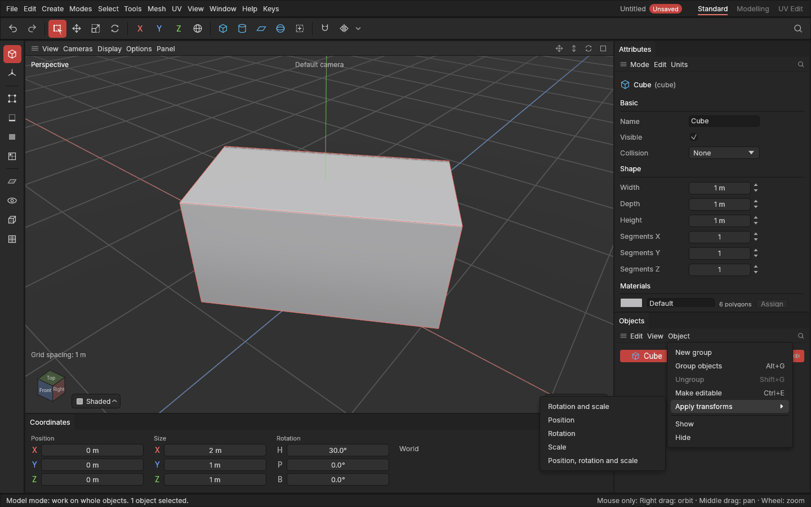

# Apply transforms

> Apply transforms turns an object's rotation back to 0° and its scale back to 100% (and, if you like, its position back to the centre), while it looks exactly the same: its shape takes the change.

Moving, turning and scaling an object in the Model mode doesn't change its shape: the object is just placed differently. That's usually what you want, but it has a cost. On an object scaled unevenly (say, twice as wide as it is deep), edits that measure across the shape have to make up for the stretch, the Size in the Coordinates panel mixes the shape's size with the scale, and a game engine gets an object with a scale on it. Applying the scale and rotation "resets" the object: it keeps its look, but now has no rotation and no scale, so everything measures as it looks. Other programs call this *apply scale*, *freeze transformations* or *reset XForm*.

## When to use it

- **After scaling or turning an object in the Model mode,** before modelling on it: extrudes, bevels and insets then measure exactly as you see them.
- **Before exporting to a game engine,** so each object arrives with a clean rotation and scale of 1, and physics and collision behave.
- **To reset a prop** you've moved, turned and scaled a lot, so its numbers are simple again.

To move the pivot without moving the shape, use [Edit pivot](pivots.md) instead.

## How to use it

1. In the **Model** mode, select the objects.
2. Choose one of these:
   - **Mesh → Shape and object → Apply transforms**, or **Object → Apply transforms** in the Objects panel, then pick what to apply (see below).
   - Press **E** for the [tool menu](tool-menu.md) and pick **Apply rotation and scale** (the last place of the ring), the most common choice.
3. The objects look the same. In the Coordinates panel, their rotation now reads 0° and their scale is gone. It's one undo step: **Ctrl + Z** takes it back.

| Choice | What happens |
|---|---|
| **Rotation and scale** | The usual choice. The object turns back to 0° and 100% and stays where it is; its shape keeps the turn and the size. |
| **Position** | The object's pivot goes to the centre of the world (or of the group it's in); the shape stays where it was. |
| **Rotation** | Only the turn: back to 0°. |
| **Scale** | Only the size: back to 100%. |
| **Position, rotation and scale** | All three: the object's placement back to none, the shape where it was. |

Objects inside a group or another object stay exactly where they are when their parent is applied. If you select both a parent and the objects inside it, each is applied.

## Settings

None: pick what to apply from the menu.

## Shortcuts

| Action | Shortcut |
|---|---|
| Apply rotation and scale | The tool menu (**E**) in the Model mode, last place |
| Every choice | Mesh → Shape and object → Apply transforms, or Object → Apply transforms in the Objects panel |

There is no key of its own yet; Ctrl + A, which other programs use, selects everything here.

## Tips and common problems

- **Tip:** a primitive (a cube, a cylinder...) stays a primitive. The applied change is recorded on top of its settings, like an edit. Its Width, Height and other settings still work, measured as before the change. To bake everything into a plain mesh, use **Bake into shape** afterwards.
- **Problem:** the Size in the Coordinates panel changed after applying a rotation. **Why:** Size is the box around the object along the world's axes; a turned shape takes up more room that way. **Fix:** nothing to fix: the shape didn't change.
- **Problem:** nothing happened to an instance. **Why:** an instance's shape is its original's, so it can't take a change of its own. **Fix:** apply the original, or make the instance a copy of its own first.
- **Problem:** "a value isn't a number". **Why:** the object is scaled to 0 along one axis, flattened to nothing, and that can't be applied. **Fix:** give it some size first.
- **Tip:** a [live mirror](symmetry.md) stands in the world, so applying never moves the mirrored twin.

## Related

- [Move, rotate and scale](transforming.md)
- [Pivots and Edit pivot](pivots.md)
- [Concepts: stretched object, applying transforms](concepts.md#objects-and-scenes)
