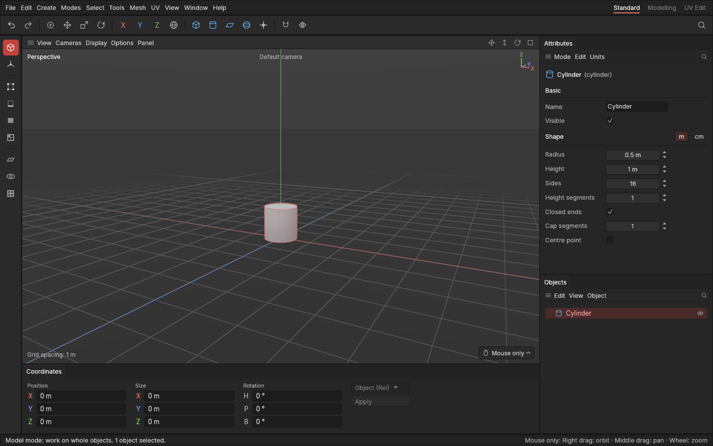
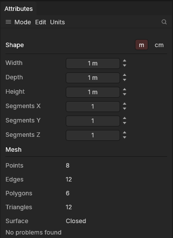

# The Attributes panel

> See and change the settings of the selected object: its name, whether it's shown, and a shape's size and segments.

## When to use it

Whenever you want to change *what* an object is rather than where it is: make a cube taller, give a cylinder more sides so it looks rounder, cut a plane into more pieces, open up a tube. These are the shape's settings (see [Primitive](concepts.md#objects-and-scenes)), and they stay editable for as long as the object exists, so you never have to start a shape again just to change its size.

## How to use it

1. Select one object, in the Objects panel or by creating it. The **Attributes** panel (top right) shows its icon, name and kind at the top.
2. **Basic** settings work for every object: type a new **Name** and press Enter (Esc keeps the old one), or untick **Visible** to hide it.
3. **Shape** settings are there for primitives. There are three ways to change a value:
   - **Drag** the value field left or right: the shape changes as you drag, so you can watch it in the viewport.
   - **Click** the field, type a number, and press **Enter**.
   - **Click the small arrows** beside the field for fine tuning: the up arrow adds one step, the down arrow takes one away. A step is 1 cm for sizes and 1 for segments and sides. Hold **Shift** while clicking for ten steps (10 cm, or 10 segments).

   Switches such as **Closed ends** and **Centre point** change with a click.
4. **Undo** works as everywhere: one drag, one typed value or one click is one step, however long the drag was. **Ctrl + Z** takes it back.

**Metres or centimetres.** Sizes are shown in the project's units: metres as standard (1 m, 1.5 m), which is easiest for whole objects: going from 1 m to 2 m is quicker to read and type than 100 cm to 200 cm. For small details, or a game made in Unreal (which counts in centimetres), you may prefer centimetres. Use the panel's **Units** menu (or **Edit → Settings… → Interface → Units**) to switch. It only changes how sizes are shown and typed, never the shapes themselves. The units are saved with the project, and changing them is an undo step; new projects start in the units chosen in Settings. The [Coordinates panel](interface-tour.md) follows them too. See [Units](pivots.md#units-metres-or-centimetres).

**Copy and paste settings.** To make several shapes match, select the one you like and use the panel's **Edit → Copy settings**, or right-click it in the Objects panel and choose **Copy settings**. Then select the others (any number, in the Objects panel) and use **Edit → Paste cube settings** (or cylinder, and so on), or right-click one of them and choose the same: every selected shape of the same kind gets the same settings, in one undo step. Shapes of another kind are left alone.

**Curves.** A [curve](curves.md) has a **Curve** section: a ready-made curve's settings (Length, Radius, Angle, Climb, Turns) or a drawn curve's **Points** and **Closed**, and **Makes**: Line only, Sweep or Lathe, with a **Sweep** or **Lathe** section of its settings under it. A curve that is only a line has no Collision, Smoothing or Materials: it has no surface.

**Collision.** Under Visible, shapes have a **Collision** row: what a game engine makes the player bump into (None, The shape itself, Wrapped, Wrapped in parts, A box), with **Max parts** and **Detail** under it for Wrapped in parts. The selected objects' collision shapes are outlined in yellow in the viewport; a note in amber says why when they can't be what you chose. Exports made for Godot carry it. See [Collision shapes](collision-shapes.md) and [Kit export and collision](kit-export.md).

**Selected edges.** In the Edges mode, with edges selected, a **Selected edges** section shows how many, their **Crease** (0 to 1): how sharply the [Subdivide](subdivide.md#keeping-edges-sharp-creases) modifier keeps them; and their **Bevel weight** (0 to 1): whether a [Live bevel](live-bevel.md#marking-edges-with-a-bevel-weight) set to *Marked edges* bevels them, and how much of its width. Drag or type a value to give them all that value; one drag is one undo step.

**Smoothing.** Under Collision, shapes have a **Smoothing** row: how the object's shading breaks into crisp edges. With **By angle** ticked (the standard), wherever its polygons meet more sharply than the angle beside it (**30°** as standard; drag or type it), worked out again after every change. Unticked, only the edges marked hard. Each object has its own. Instances follow their original, so they don't show the row. See [Hard and soft edges](hard-and-soft-edges.md#smoothed-by-angle).

**Booleans.** A shape cut by [booleans](booleans.md) has a **Booleans** section: each boolean's kind (Union, Subtract or Intersect, changeable from the list), its cutters by name (click one to select it; **Take out** stops it cutting) and **Remove**. If the cut can't be made (a shape isn't a closed solid), it says why in amber, and the shape is shown uncut. A cutter's own panel says which shapes it **Cuts**.

**Modifiers.** A shape with [modifiers](modifiers.md) has a **Modifiers** section: each modifier, first to last, with its switch (untick to switch it off), **Up**, **Down** and **Remove**, its own settings (for [Remesh](remesh.md), Voxel size and Smooth; for [Subdivide](subdivide.md), Levels, Levels for export and Hard edges stay sharp; for [Array](array.md), Layout, the counts, Relative to size and the offsets or spacing, a ring's Angle, Axis, Centre and Radius, Merge touching copies with its Merge distance, and UVs side by side; for [Shell](shell.md), Thickness, Direction, Even thickness and Fill the rims; for [Live bevel](live-bevel.md), Edges, Angle, Width, Segments, Profile, Stop at neighbours and Soft bevels; for [Decimate](decimate.md), Reduce by, Ratio or Target triangles, what it keeps and Quads where flat, with the **Triangles shown**; for [Quadify](quadify.md), Max angle, Max shape distortion and what it keeps; for [Weld by distance](weld-by-distance.md), Distance (in millimetres), Only at open borders and Keep UV seams; for [Scatter](scatter.md), the shapes scattered, Place on, Count, Seed, Spacing, Align to surface, Random turn, the sizes, Offset and On polygons; for [Bend along curve](bend-along-curve.md), the Curve, Axis, Stretch to fit, Offset and Twist; for [Shrinkwrap](shrinkwrap.md), the Target, Mode, Offset and Points; for [Displace](displace.md), Noise, Strength, Scale, Detail, Seed, Direction, Points and Falloff; for [Weighted normals](weighted-normals.md), Weight by, Face influence, Strength and Keep hard edges, with an amber note when a modifier after it drops its normals), and **Show in viewport**. If a modifier can't do its work (Remesh on an open shape), it says why in amber, and the shape goes on without it.

**Levels of detail.** Every shape has a **Levels of detail** section: **Make levels** switches on simpler copies of the shape for a game to draw far away; then **Levels**, each level's share of the triangles and the distance it's **Shown from**, with its **Triangles**, and **Preview** to draw a level in the viewport. See [Levels of detail](levels-of-detail.md).

**Materials.** Every shape has a **Materials** section: its materials, each with a colour, a name, how many polygons use it and an **Assign** button that gives the selected polygons that material (in the Polygons mode). **Add material** and **Remove last** change the list. See [Materials](materials.md).

**Mesh.** Every shape has a **Mesh** section (scroll down to it below the settings). It says what the shape is made of right now, settings and edits included:
- **Points**, **Edges** and **Polygons**.
- **Triangles**: the number a game engine actually draws, since it cuts every face into triangles. This is the usual measure of how heavy a model is, so keep an eye on it for game assets.
- **Pieces**: only shown when the shape has separate parts that don't touch.
- **Surface**: **Closed** (like a solid, no open borders) or **Open** with how many [border edges](concepts.md#mesh-basics) (normal for a plane or an open pipe).

Below that, the app checks for problems that cause trouble later in modelling, UV unwrapping, baking or a game engine, and lists any it finds in amber: edges shared by three or more faces, faces facing the wrong way, edges with no length, faces with no area, and loose points. Hover over a line for what it means. Shapes made from settings never have these problems; they can come from editing (moving points onto each other, say) or from imported models.

On a [heavy shape](heavy-shapes.md) (from about 50 000 polygons), the check runs in the background so the window doesn't stall, and the section says **Checking the mesh…** until it's done. The numbers under it are from before your last change until then.

**Meshes.** An object that has been [baked into its shape](objects.md#bake-into-shape) has no settings: the panel shows "(mesh)" after its name, and the Mesh section.

**Last edit.** Right after an [extrude or inset](extrude-and-inset.md), a **Last edit** section at the top shows its **Distance** and **Keep together** switch; after a [bevel](bevel.md), its **Width**, **Segments** and **Profile** (from 100% round through 0% flat to -100% hollow); after a [loop cut](loop-cut.md), its **Cuts** and **Position**; after [Quadify now](quadify.md), its **Max angle**, **Max shape distortion** and **Keep** switches; after [Weld by distance now](weld-by-distance.md), its **Distance**, **Only at open borders** and **Keep UV seams**. Change either and the shape follows; each change is one undo step. Once you make another edit on top, the section moves on to the new edit; to change an older one, click it in the [edit list](edit-list.md).

**Selecting something else ends it.** The Last edit can be changed only while the selection it was made with is still selected. Select other polygons (or edges or points) and the panel shows the tool's own settings instead, for your next use of it, so setting up the next extrude never changes the one before. A small line, **Last edit: Extrude 1 polygon** with a **Change it** button, opens the earlier edit if you do want to change it. **Ctrl + wheel** follows the same rule. While Extrude or Inset is the tool in use and there is no such last edit, the top of the panel shows the tool's own **Keep together** switch instead, for the next drag (for Bevel, its **Segments** and **Profile**; for Loop cut, its **Cuts**).

**An opened edit.** Click an edit in the [Edit layers panel's edit list](edit-list.md) and it takes the Last edit's place: **Edit: Extrude 1 polygon**, say, with **On**, its settings, and **Bake into shape up to here** and **Delete edit**. **Close** goes back to the last edit, and so does making a new edit.

**Edits.** Moving, rotating and scaling points, edges and polygons ([Move, rotate and scale](transforming.md)), and extruding and insetting, record your edits on top of a shape instead of changing its settings (see [Base and edits](concepts.md#objects-and-scenes)). When a shape has edits, an **Edits** section says how many, and the settings above stay editable: change them and the edits are made again on the new shape.
- Changing segments renumbers a shape's points. Edits remember where their points, edges and polygons were and find them there again, and a quiet line says so (*1 edit found its points again on the changed shape*; hover over it for why). Nothing needs doing.
- If some edits no longer fully fit (for example, you gave a cube fewer segments, so points an edit moved have no place left), a line in amber says how many. They still apply to what they can find, and going back to the earlier settings brings everything back.
- If an edit would make the shape larger than the app can work with safely (more than 30 million polygons, say a 64-row bevel on every edge of a very dense shape), it is skipped and a line in amber says *1 edit was skipped: the shape would be too large*. Undo it, or use fewer rows or a smaller selection.

See [Changing settings after editing](transforming.md#changing-settings-after-editing).

With nothing selected the panel says so; with several objects selected it counts them (pick one to see its settings).

## Settings

What each shape offers is listed on the [Primitives](primitives.md#settings) page. A few things to know:

| Setting | What it does |
|---|---|
| **Width, Depth, Height** | Sizes along X, Y and Z (up). The shape keeps standing on the ground, so changing the height grows it upwards. |
| **Radius** | Half the width of a round shape. A cone has a bottom and a top radius: a top of zero makes a point, more cuts it off flat. A disc's **Hole radius** of zero means no hole. |
| **Segments, Sides, Rings** | How many pieces the shape is cut into. More pieces make round shapes smoother and give you more to model with, but cost more in a game: keep them as low as looks right. |
| **Closed ends** | Whether a cylinder or cone has flat ends. Open ends are handy for pipes and lamp shades. |
| **Cap segments** (cylinder, cone) and **Ring segments** (disc) | How many rings each flat end is cut into, from the rim inwards. One ring is a single face. More rings give you edges to model with, such as an inset ring for a lid. |
| **Centre point** | How the middle of each end is made. Off (standard): the middle is one face with many corners (an [n-gon](concepts.md#mesh-basics)), which stays clean to model on. On: the middle is cut into triangles that meet at one point in the centre, like slices of a pie, which some game engines and sculpting steps prefer. |

| **Smoothing: By angle**, and its angle | Every shape. Ticked (standard): edges sharper than the angle (30° as standard, 0° to 180°) are crisp, the rest smooth, after every change. Unticked: only the edges marked hard. Marking edges hard or soft on an object smoothed by angle unticks it for you, keeping its look. See [Hard and soft edges](hard-and-soft-edges.md). |

Values are kept within limits (sizes from 1 mm to 10 km; up to 256 segments and 512 sides; holes always smaller than the shape), so dragging too far simply stops at the limit.

## Shortcuts

| Action | Shortcut |
|---|---|
| Keep a typed value or name | `Enter` (or click elsewhere) |
| Ten steps with a step arrow | `Shift` + click |
| Cancel a typed name | `Esc` |
| Undo the last change | `Ctrl + Z` |

## Tips and common problems

- **Tip:** drag slowly for small steps; the value follows the mouse, about half a centimetre per pixel for sizes. For an exact small change, click the step arrows instead.
- **Tip:** typing works in the units shown: with metres showing, type `1.5` for 1.5 m; with centimetres, type `150`.
- **Problem:** the panel says "2 objects selected" and shows no settings. **Why:** only one object's settings can be shown at a time. **Fix:** click one object in the Objects panel; to give several the same settings, use Copy and Paste settings.
- **Problem:** a value won't go lower. **Why:** it has reached its limit (a size can't be less than 1 mm, a round shape needs at least 3 sides). **Fix:** that's as small as it goes.
- **Problem:** the hole of a tube won't get bigger than the outside. **Why:** a hole must be smaller than the shape around it. **Fix:** make the outer radius larger first.

## Related

- [Primitives](primitives.md): every shape and its settings.
- [The Objects panel](objects.md): selecting, naming, hiding, undo, and the right-click menu.
- [Concepts](concepts.md): [primitives](concepts.md#objects-and-scenes) and [n-gons](concepts.md#mesh-basics).
