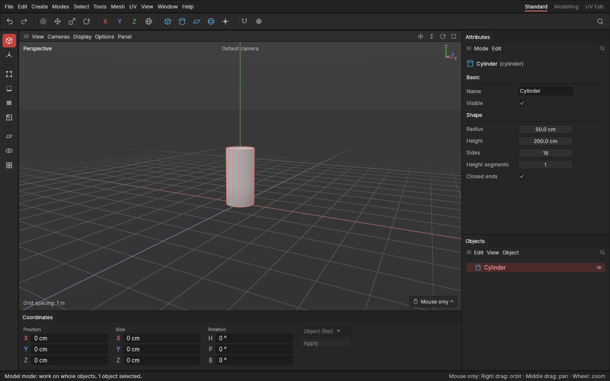

# The Attribute Manager

> See and change the settings of the selected object: its name, whether it's shown, and a shape's size and segments.

## When to use it

Whenever you want to change *what* an object is rather than where it is: make a cube taller, give a cylinder more sides so it looks rounder, cut a plane into more pieces, open up a tube. These are the shape's settings (see [Primitive](concepts.md#objects-and-scenes)), and they stay editable for as long as the object exists, so you never have to start a shape again just to change its size.

## How to use it

1. Select one object, in the Objects panel or by creating it. The **Attributes** panel (top right) shows its icon, name and kind at the top.
2. **Basic** settings work for every object: type a new **Name** and press Enter (Esc keeps the old one), or untick **Visible** to hide it.
3. **Shape** settings are there for primitives. There are two ways to change a value:
   - **Drag** the value field left or right: the shape changes as you drag, so you can watch it in the viewport.
   - **Click** the field, type a number, and press **Enter**.
   Sizes are in centimetres (100 cm = 1 m). Switches such as **Closed ends** change with a click.
4. **Undo** works as everywhere: one drag, one typed value or one click is one step, however long the drag was. **Ctrl + Z** takes it back.

**Copy and paste settings.** To make several shapes match, select the one you like and use the panel's **Edit → Copy settings**. Then select the others (any number, in the Objects panel) and use **Edit → Paste cube settings** (or cylinder, and so on): every selected shape of the same kind gets the same settings, in one undo step. Shapes of another kind are left alone.

With nothing selected the panel says so; with several objects selected it counts them (pick one to see its settings).

## Settings

What each shape offers is listed on the [Primitives](primitives.md#settings) page. A few things to know:

| Setting | What it does |
|---|---|
| **Width, Depth, Height** | Sizes along X, Y and Z (up). The shape keeps standing on the ground, so changing the height grows it upwards. |
| **Radius** | Half the width of a round shape. A cone has a bottom and a top radius: a top of zero makes a point, more cuts it off flat. A disc's **Hole radius** of zero means no hole. |
| **Segments, Sides, Rings** | How many pieces the shape is cut into. More pieces make round shapes smoother and give you more to model with, but cost more in a game: keep them as low as looks right. |
| **Closed ends** | Whether a cylinder or cone has flat ends. Open ends are handy for pipes and lamp shades. |

Values are kept within limits (sizes from 1 mm to 10 km; up to 256 segments and 512 sides; holes always smaller than the shape), so dragging too far simply stops at the limit.

## Shortcuts

| Action | Shortcut |
|---|---|
| Keep a typed value or name | `Enter` (or click elsewhere) |
| Cancel a typed name | `Esc` |
| Undo the last change | `Ctrl + Z` |

## Tips and common problems

- **Tip:** drag slowly for small steps; the value follows the mouse, about half a centimetre per pixel for sizes.
- **Problem:** the panel says "2 objects selected" and shows no settings. **Why:** only one object's settings can be shown at a time. **Fix:** click one object in the Objects panel; to give several the same settings, use Copy and Paste settings.
- **Problem:** a value won't go lower. **Why:** it has reached its limit (a size can't be less than 1 mm, a round shape needs at least 3 sides). **Fix:** that's as small as it goes.
- **Problem:** the hole of a tube won't get bigger than the outside. **Why:** a hole must be smaller than the shape around it. **Fix:** make the outer radius larger first.

## Related

- [Primitives](primitives.md): every shape and its settings.
- [Objects and the Object Manager](objects.md): selecting, naming, hiding and undo.
- [Concepts](concepts.md): [primitives](concepts.md#objects-and-scenes) and [n-gons](concepts.md#mesh-basics).
