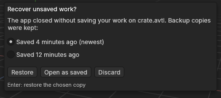
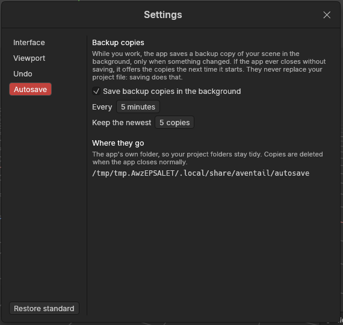

# Backup copies and crash recovery

> While you work, the app saves backup copies of your scene in the background. If it ever closes without saving (a crash, a power cut, a frozen computer), it offers them back the next time it starts.

## When to use it

You don't have to do anything: backups are on as standard. Every 5 minutes, *if something changed since the last copy*, the app saves a [backup copy](concepts.md#objects-and-scenes) of the whole scene. It runs on its own clock, separate from saving: pressing Ctrl + S doesn't restart the countdown. It keeps the newest 5. It works for scenes you have never saved (*Untitled*) as well as for projects.

Backups are a safety net, not a way of saving:
- **They never replace your project file.** Only **File → Save** (Ctrl + S) changes that. If you close the app and choose *Don't save*, your changes are gone, as you asked.
- **They are deleted when the app closes normally.** They only stay behind when the app didn't get the chance to close properly, which is exactly when you need them.

So keep saving as usual. Backups cover the minutes between your saves.

## How to use it

**After a crash**, start the app again. If it finds backup copies left behind, it asks **Recover unsaved work?** before you do anything else. The window names the project (or says *an unsaved scene*) and lists its copies, newest first, with how long ago each was saved.

1. **Choose a copy.** The newest is chosen already, and is usually the one you want. Pick an older one if the newest has a mistake in it, such as something you deleted just before the crash.
2. **Choose what to do with it:**
   - **Restore** (or **Enter**) brings that copy back. It opens as *unsaved* work, marked with the red **Unsaved** badge, and keeps the project's name. Look it over, then press **Ctrl + S** to save it over your project. The status bar says which copy it was ("Restored your work from 4 minutes ago").
   - **Open as saved** ignores the copies and opens the project as you last saved it. It's only offered when the project had been saved somewhere.
   - **Discard** deletes the copies and starts afresh.

   After any of these, the copies from the crashed run are deleted. If two runs crashed (two windows open, say), the app asks about each in turn.

A restored copy is protected straight away: if the app crashes again before you save, the next start offers it again.

**Changing how backups are made:** open **Edit → Settings…** (Ctrl + ,) and choose **Autosave**.

## Settings

In **Edit → Settings… → Autosave**:

| Setting | What it does |
|---|---|
| **Save backup copies in the background** | On as standard. Switch it off only if you have a reason, such as a very slow disk. Your project file is saved the same either way. |
| **Every … minutes** | Minutes between copies, counted from the last copy: 1 to 30, 5 as standard. A shorter time loses less work in a crash; a longer one writes to the disk less often. When nothing has changed since the last copy, nothing is saved. |
| **Keep the newest … copies** | How many copies to keep, 1 to 20, 5 as standard. More copies let you go further back if the newest has a mistake in it. Each copy is as large as a saved project, so heavy scenes with many copies take more disk space. |
| **Where they go** | Shows the folder the copies are kept in. It's the app's own folder, not your project folder, so your project folders stay tidy. |

The folder depends on your system:
- **Windows:** `%LOCALAPPDATA%\aventail\autosave`. Paste that into File Explorer's address bar to open it. It's the *local* application data folder, not the roaming one, because copies of heavy scenes can be large.
- **Linux:** `~/.local/share/aventail/autosave`.
- **macOS:** `~/Library/Application Support/aventail/autosave`.

Inside, each run of the app has its own `session-…` folder. The copies are ordinary project files (`copy-1.avtl`, `copy-2.avtl` and so on, the highest number the newest), so in an emergency you can open one with **File → Open…**.

## Shortcuts

| Action | Shortcut |
|---|---|
| In "Recover unsaved work?": restore the chosen copy | `Enter` |
| Open Settings | `Ctrl + ,` (`Cmd + ,` on macOS) |

## Tips and common problems

- **Tip:** after restoring, check the scene before saving over your project. If something is missing, use **File → Open…** to look at your last save, or open an older copy from the backup folder.
- **Problem:** the status bar says "Couldn't save a backup copy: …". **Why:** the backup folder couldn't be written to, for example because the disk is full. **Fix:** free some disk space. The app tries again at the next interval, and your work in the window is unaffected.
- **Problem:** the app didn't offer anything after a crash. **Why:** either it crashed before the first copy was due (nothing had been copied yet), or it didn't really crash: it closed normally and tidied its copies away. **Fix:** open the project as usual. A shorter interval in Settings narrows that window.
- **Testing it yourself on Windows:** Task Manager's **End task** on the *Processes* tab doesn't crash the app. It asks the app to close, like clicking ×, so the app closes normally and deletes its copies. To end it the hard way, as a crash would, use the *Details* tab instead (right-click the app → **End task**), or type `taskkill /F /IM aventail.exe` in a Command Prompt.
- **Problem:** "Couldn't restore the backup copy: …". **Why:** the copy was damaged or deleted. **Fix:** the copies are kept when this happens: start the app again and choose an older one, or Open as saved.
- **Problem:** the question says "One newer copy is left out: restoring it closed the app last time". **Why:** that copy closed the app while it was being restored, so it isn't offered again, and you won't get stuck in a loop. The file itself is kept in the backup folder. **Fix:** restore one of the copies offered, or open the project as saved.

## Related

- [Saving and opening projects](saving-and-opening.md): saving, and the `.bak` copy kept beside each project.
- [Settings](settings.md): every preference.
- [Concepts](concepts.md): [backup copy](concepts.md#objects-and-scenes), [project file](concepts.md#objects-and-scenes).
