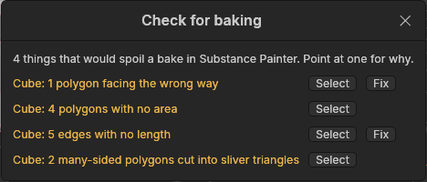
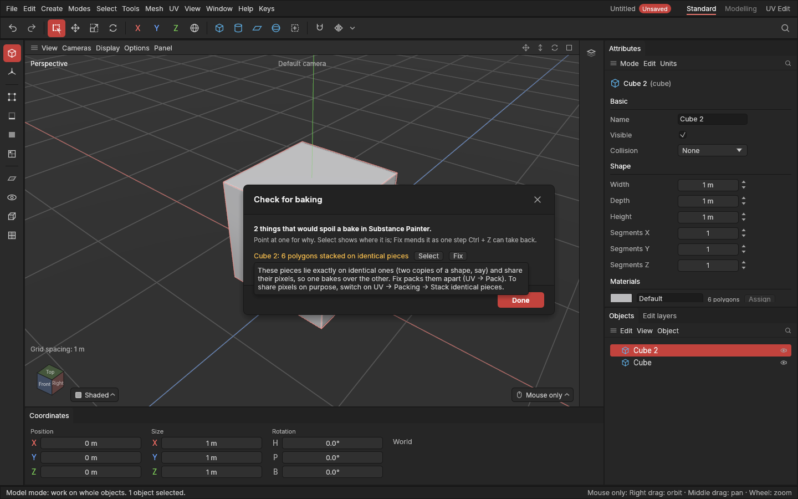

# Check for baking

> List what in your model and its UVs would spoil a bake in Substance Painter, in plain words, and fix most of it in one click.

## When to use it

[Baking](concepts.md#the-game-asset-pipeline) turns the shape of your model into a normal map. Some things that look fine in the viewport come out badly in a bake: black specks, streaks, inside-out patches, lines along hard edges, and pieces of texture painted over each other. They are much quicker to fix in the model than to track down from a broken normal map. Run the check before exporting for Substance Painter.

## How to use it

1. Choose **File → Check for baking…** or **UV → Check for baking…**. (With **Made for: Substance Painter** in the [Export window](export-and-import.md), there is a **Check for baking…** button under its file settings too.)
2. The window lists each problem as *Object: what is wrong*. Point at one to read why it spoils a bake and what to do.
3. Click **Select** to see it: the object is selected and, in the right mode, the polygons, edges or points concerned.
4. Click **Fix** where there is one. The fix is one undo step: **Ctrl + Z** takes it back.
5. Close the window with **Done**, the **×**, **Enter** or **Esc**.
6. The list updates as you work. When it says *Nothing found that would spoil a bake*, export.

## What it checks

| Problem | Why it spoils a bake | Fix |
|---|---|---|
| **Polygons facing the wrong way** | The baker sees them from behind: the normal map comes out inverted or black there. | **Fix** turns them round (as Mesh → Fix normals). |
| **Edges shared by three or more polygons** ([non-manifold](concepts.md#mesh-basics)) | They can't be unfolded or baked cleanly. | Select them, then delete or [split off](split-and-join.md) the extra polygons. |
| **Polygons with no area** | No direction to bake along: a black speck or a streak. | Select them, then [weld](connect-bridge-weld.md) their points (M) or delete them. |
| **Edges with no length** (points on the same spot) | They make polygons with no area and break the shading. | **Fix** welds each group of points into one. |
| **Many-sided polygons bent out of flat** | An [n-gon](concepts.md#mesh-basics) with a corner lifted shades unevenly across its triangles. | Select them and cut them up with [Connect](connect-bridge-weld.md) (J) or [Slit](slit.md) (X). |
| **Many-sided polygons cut into sliver triangles** | Very thin triangles shade badly and leave streaks. | Select them and cut them up with Connect (J) so the triangles are fuller. |
| **Points no polygon uses** | They go into the file for nothing and can confuse the baker. | **Fix** deletes them. |
| **A `_low` object without its `_high`** (or the other way round) | Substance Painter pairs a low-poly object with its [high-poly](concepts.md#mesh-basics) one by name: `crate_low` with `crate_high`. | Rename one, or make the missing partner. |

Only many-sided polygons (five or more corners) are checked for bends and slivers. A thin four-sided strip, like a bevel, is normal, and a slightly bent one shades predictably.

### The UVs

The bake is painted into the texture through the [UVs](concepts.md#uvs-and-texturing), so they're checked too. Pieces that share a texture are checked together: by standard, every object with the same material shares one, as [Pack](packing.md) arranges them. Pieces on a [trim sheet](trim-sheets.md)'s rows repeat and overlap on purpose, so they aren't checked for overlaps, gaps, the square's edges or texel density.

| Problem | Why it spoils a bake | Fix |
|---|---|---|
| **No UVs** | There's nowhere on the texture for the bake to go. | **Fix** places [seams](seams.md) where they show least, [unwraps](unwrapping.md) the shape and packs it, in one step. |
| **Hard edges that aren't UV seams** | A [hard edge](hard-and-soft-edges.md) turns the shading sharply. A normal map can only hold that turn where the UVs are split too; otherwise a dark or light line shows along it. | **Fix** marks them as seams and unwraps the pieces around them. |
| **Polygons folded over or squashed flat in the UVs** | They get no pixels of their own, so the bake smears or comes out back to front there. (A whole piece mirrored is fine.) | **Fix** unwraps their pieces. |
| **Polygons outside the texture square** | A bake fills only the square: parts outside get nothing, or wrap round onto other parts. | **Fix** packs the pieces into the square. |
| **Polygons lying over other UVs** | Pieces on top of each other share pixels, so one bakes over the other. | **Fix** packs them apart. |
| **Polygons stacked on identical pieces** | Identical pieces lying exactly on each other share pixels. Right for identical parts if you meant it (**UV → Settings → Packing → Stack identical pieces**), but shadow bakes (ambient occlusion) see only one. | With stacking off, **Fix** packs them apart. With it on, it's listed so you know; there's no Fix. |
| **Polygons closer than 8 px to other pieces** | Pieces need a gap of empty pixels. The baker spreads each piece's colours into it so seams don't show. A game also shows smaller copies of the texture at a distance ([mipmaps](concepts.md#uvs-and-texturing)), where close pieces blur into each other. | **Fix** packs them with the gap set in **UV → Settings → Packing**. |
| **Polygons on the trim sheet sharing a texture with other pieces** | Pieces laid on a [trim sheet](trim-sheets.md)'s rows share a material (and so a texture) with pieces that aren't: the trim texture would land on those too. | Select them and give them a material of their own ([Materials](materials.md)). |
| **Polygons with uneven texel density** | Pieces with twice (or half) the [texel density](texture-and-density.md) of the rest of the object look sharper or blurrier than the rest. | **Fix** scales them to the object's usual density. They may then overlap: Pack after. |

## Settings

None of its own. Every shown shape is checked; an [instance](copies-and-instances.md) is checked through its original. The UV checks follow your other settings:

| Setting | What it changes here |
|---|---|
| **UV → Settings → Packing → Padding** | The gap pieces need (8 px as standard). |
| **UV → Settings → Packing → A texture per material / per object** | Which pieces share a texture, and so are checked together. |
| **UV → Settings → Packing → Stack identical pieces** | Whether stacked identical pieces are on purpose (no Fix) or not. |
| **UV → Texture** | The texture size the gap is measured in. |
| **Automatic hard edges** (Mesh menu) | Which edges count as hard, as the export shades them. |

## Shortcuts

None: use the File or UV menu.

## Tips and common problems

- **Problem:** after **Fix**, the status bar says something else got worse (*but now: 3 edges shared by three or more polygons*). **Why:** welding points can squash polygons together. **Fix:** Ctrl + Z, then select the points and fix that spot by hand.
- **Problem:** a problem keeps coming back after Fix. **Why:** an edit further down in the object's list of edits makes it again. **Fix:** Select it, then look at what you did there last.
- **Problem:** two separate props are listed as lying over each other. **Why:** they have the same material, so they share one texture. **Fix:** give each its own material (for separate texture sets), switch on **UV → Settings → Packing → A texture per object**, or let Fix pack them together.
- **Problem:** after fixing uneven texel density, pieces overlap. **Why:** scaling makes pieces bigger or smaller where they lie. **Fix:** Fix the overlap too (it packs).
- **Tip:** with the list empty, the UVs are ready to bake: no lines along hard edges, nothing painted twice, and gaps wide enough for the game's distant views.

## Related

- [Export and import](export-and-import.md): the Substance Painter preset.
- [Clean-up](clean-up.md): delete, dissolve, fill holes, flip and fix normals.
- [Seams](seams.md), [Unwrap](unwrapping.md), [Packing](packing.md) and [Texture size and texel density](texture-and-density.md).
- [Connect, Bridge and Weld](connect-bridge-weld.md).
- [Concepts: baking, normal maps, high-poly and low-poly](concepts.md#the-game-asset-pipeline).
