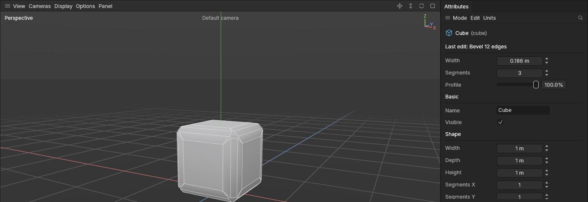
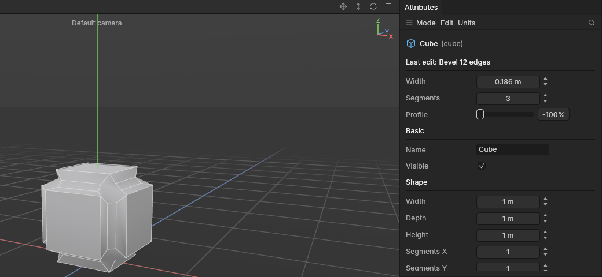
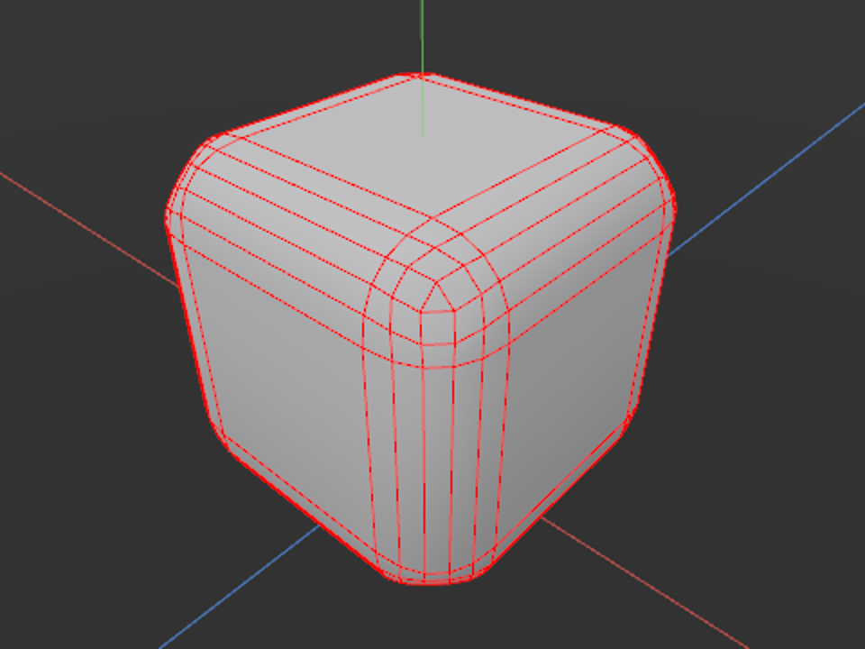
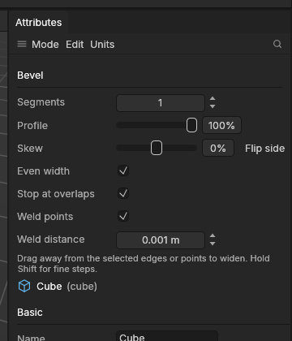

# Bevel

> Bevel cuts a sharp edge or corner away and puts a strip of new polygons in its place: a flat chamfer, a rounded edge, or a hollow curve (a cove) with more segments.

Real objects almost never have perfectly sharp edges. A slightly bevelled edge catches the light, which is one of the quickest ways to make a game prop look solid and well made instead of like a box. Bevels also make baking and shading behave better on hard-surface models.

## When to use it

- **Soften a hard edge** so it catches the light, like the rim of a crate or the edge of a panel: bevel its edges with one segment (a [chamfer](concepts.md#mesh-basics)) or a few (rounded).
- **Round a corner off**, like a rounded box or a worn edge: more segments, Profile at 100%. Where three or more bevelled edges meet, the corner is rounded too.
- **Carve a hollow curve** along an edge, like a cove moulding on furniture or a scooped edge on a stone block: more segments, Profile at -100%. The bevel curves inward instead of bulging out.
- **Cut a corner off** with a single flat face: bevel a point in Points mode.

To push polygons out or make frames, use [Extrude and inset](extrude-and-inset.md) instead.

## How to use it

### Bevel edges

1. Select a shape and press **2** for the [Edges mode](modes.md).
2. [Select](selecting.md) the edges to bevel. Double-click selects a whole loop, and **Ctrl + A** selects every edge.
3. Press **V** (or pick **Bevel** from the [tool menu](tool-menu.md) **E**, or **Mesh → Build**).
4. Drag **away from the selected edges** anywhere in the viewport: the further you pull away from the nearest one, the wider the bevel. Pull back towards them to narrow it. A label by the mouse says how wide. This follows the app's rule that [drags follow the pull](interface-tour.md#drags-follow-the-pull).
5. Let go. The whole drag is one undo step.

### Bevel points (cut a corner off)

1. Press **1** for the Points mode and select the corner points.
2. Press **V** and drag away from them. Each point is replaced by a flat polygon cutting the corner off, as far along each edge as the width.

### Segments and profile

Before you drag, the top of the **Attributes panel** shows the tool's **Segments** and **Profile** for the next bevel. After a bevel, the same settings and its **Width** show under **Last edit**, and changing them reshapes the bevel you just made. This works until you make another edit on top.

**Ctrl + mouse wheel** changes Segments without leaving the viewport: up for more, down for fewer. It does what the arrows beside Segments do. Before a drag it sets the next bevel. While dragging it changes the bevel you're making. Afterwards it reshapes the bevel you just made, one undo step per notch.

### While you drag

- Hold **Shift** for ten times finer steps.
- Press **Esc** or **right-click** to cancel.
- Let go where you started, or closer to the edges than where you started, and nothing is recorded.
- A **click** without dragging still selects.

### Rounded or hollow

With 2 or more segments, the **Profile** decides which way the bevel curves. At **100%** it bulges out, like a worn edge. At **0%** the rows lie flat, like a wide chamfer. Below 0 it curves the other way, into the shape: at **-100%** each edge is scooped out along a quarter circle, a *cove*, the kind of hollow edge you see on furniture mouldings and carved stone. You can change it on the bevel you just made, under **Last edit**, and watch the edge go from round through flat to hollow.

### Where bevels meet: rounded corners

Bevel every edge of a box with 2 or more segments and look at a corner: three rounded edges meet there, and the corner between them is filled with a small **rounded patch**, like a piece of a ball, so the rounding carries on smoothly all the way round. The same happens wherever three or more bevelled edges meet, such as the tip of a pyramid or the rim of a cylinder whose side edges are bevelled too.

Why it matters: a corner filled with one big flat polygon looks like a dent on a rounded box, shades badly and gets cut into thin triangles when it is exported. The rounded patch is made of four-sided polygons (quads), which shade smoothly, cut into triangles cleanly in the game engine and Substance Painter, and keep working with tools like [Loop cut](loop-cut.md).

- With an **even** number of segments, the patch is a grid of quads meeting at one point in the middle.
- With an **odd** number, there is a small polygon in the middle (a triangle on a box's corner), with quads all round it.
- It follows the **Profile**: round at 100%, flat at 0% (a flat, many-sided corner), hollow below 0.
- With **1 segment** (a chamfer), the corner is one flat triangle, as it always was.
- It takes the materials and UVs of the polygons around it, and stays smooth inside even when the bevelled edges were hard.

Where two bevelled edges turn a corner (round a box's top), the two bevels meet in a clean diagonal line, as before. Where only some edges at a corner are bevelled, with plain edges side by side among them, the corner is closed with one flat polygon.

### Even, skewed and tidy bevels

Bevels on a real prop rarely sit on neat right angles, and where they meet the lines can go uneven. Four settings under **Profile** keep them under control. They are there before you drag, for the next bevel, and under **Last edit** afterwards. A new bevel has Even width, Stop at neighbours and Weld points switched on.

- **Even width.** A bevel reaches the same distance into the polygons on each side, so on a flat edge (a gentle bend in a curved surface) its new polygon comes out much wider than on a sharp, right-angled one, and a bevelled prop looks blotchy. With Even width on, each edge's bevel is sized by the angle its polygons meet at, so **every bevelled edge's new polygon is the same width**: the width a right-angled edge gets. On a box nothing changes; on curved and angled parts the lines look even.
- **Skew** (−100% to 100%). Puts more of the bevel on one side of the edges than the other, like a bevel that eats into the top of a panel but barely into its side. At 0% it's even. Along a loop of edges the skew stays on the **same side all the way round**. **Flip side** swaps which side gets more. Even at 100%, the other side keeps a sliver, so the bevel never collapses.
- **Stop at neighbours** (Blender calls the same idea Clamp Overlap). A bevel wider than the polygons next to it would make its corners pass each other and fold over, a mess that is hard to see and harder to clean up. With this on, each corner of the bevel stops where it would meet a neighbour: corners going towards each other meet halfway along an edge instead of crossing, and a corner sliding along a plain edge stops short of its end. **Only the points that need it are narrowed**: on a part with one thin face, the bevel is narrower next to that face and keeps its full width everywhere else, so its strip tapers between the two. Switch it off for a bevel that goes exactly as wide as you drag, even if it folds over.
- **Weld points** (Weld overlapping points) with **Weld distance**. Where bevels meet, new points can land on top of each other (corners that met halfway, say). With this on, new points closer than the weld distance (1 mm as standard) become one, so there are no doubled points, zero-length edges or slivers left to clean up. Raise the distance to tidy up points that land very close but not quite together.

Bevels made before these settings existed keep their old look, with none of these on; switch them on under Last edit to tidy one up.

### Bevels in older projects

A project never changes shape when you open it. Bevels made before rounded corners keep their old corners (one flat polygon) and their old way of stopping at overlaps (the whole bevel narrowed by its tightest spot). As soon as you change one of a bevel's settings under **Last edit** (or its segments with Ctrl + wheel), it is worked out the new way: rounded corners, stopping at neighbours point by point.

### On a stretched object

On an object stretched in the Model mode (scaled more along one axis than another), a bevel's **Width** is measured as you see it, so a chamfer is equally wide on every edge, whichever way the edge runs. The bevel remembers the stretch the object had when you made it or last changed it; see [Extrude and inset: on a stretched object](extrude-and-inset.md#on-a-stretched-object) for what happens if you stretch the object again later.

## Settings

| Setting | What it does |
|---|---|
| **Width** | How far the bevel reaches into each polygon next to the edge, in the object's own size. A typical bevel on a game prop is a few millimetres to a couple of centimetres. |
| **Segments** | How many rows the bevel has (**Ctrl + wheel** in the viewport changes it too). **1** is a flat cut (a chamfer), cheap and very common in game art. **2–4** make a rounded edge. More look smoother but cost polygons. |
| **Profile** | The shape across the bevel, from **100%** (round, bulging out like a worn edge) through **0%** (flat) to **-100%** (hollow, curving inward like a [cove](concepts.md#mesh-basics)). Values in between are gentler curves. It only shows with 2 or more segments. |
| **Skew** | −100% to 100%: more of the bevel on one side of the edges than the other (0%: even). It stays on the same side along a loop. Edges only. |
| **Flip side** | Swaps which side of the edges the skew favours. |
| **Even width** | On as standard. Every bevelled edge's new polygon the same width (a right-angled edge's), however sharp or flat the edge. Edges only. |
| **Stop at neighbours** | On as standard. Each corner of the bevel stops where it would meet a neighbour, so corners meet instead of crossing over; only the points that need it are narrowed. Edges only. |
| **Weld points** | On as standard. New points that land within the weld distance of each other become one. Edges only. |
| **Weld distance** | How close points must be to weld: 1 mm as standard, up to 10 cm. |

## Shortcuts

| Action | Shortcut |
|---|---|
| Bevel | `V` |
| Set the width | Left drag away from the selected edges or points |
| Finer steps | Hold `Shift` while dragging |
| More or fewer segments | `Ctrl` + wheel up / down |
| Cancel the drag | `Esc` or a right-click |
| Back to selecting | `Q` |

## Tips and common problems

- **Tip:** while Bevel is in use, Ctrl + wheel changes Segments instead of growing the selection. To grow or shrink the selection, use the **Select** menu, or press **Q** first.
- **Tip:** a single-segment chamfer on every hard edge of a prop is the classic look of mid-poly game art: it shades nicely and costs few polygons.
- **Tip:** the cube's hard edges carry over. A chamfered cube stays crisp; a rounded bevel's inner rows are smooth so it looks round.
- **Where several bevelled edges meet** (a cube's corner), the corner is rounded with a patch of quads when the bevel has 2 or more segments, and is one flat triangle with 1 segment. See [Where bevels meet](#where-bevels-meet-rounded-corners).
- **Problem:** an old bevel's corner is one flat, many-sided polygon. **Why:** it was made before rounded corners, and projects keep their shape when opened. **Fix:** change any of its settings under Last edit (nudge Segments up and back down) and it is made the new way.
- **Problem:** pressing V does nothing but the status bar talks about modes. **Why:** Bevel works in the Edges and Points modes. **Fix:** press **2** (or **1**) and try again.
- **Problem:** the drag does nothing. **Why:** you started away from the edges and pulled towards them, or nothing is selected. **Fix:** start near the edges and pull away.
- **Problem:** an edge on a plane's border wasn't bevelled. **Why:** a bevel needs a polygon on each side of the edge. Border edges are skipped.
- **Problem:** a bevel made before this version is wider on some edges than others on a stretched object. **Why:** older bevels ignored the object's stretch. **Fix:** change its Width (or Segments) under Last edit, and it is worked out again as the object is seen.
- **Problem:** a wide bevel folds over itself. **Why:** it reached further than the polygons next to it are wide, and **Stop at neighbours** is off (as it is on the oldest bevels). **Fix:** switch on Stop at neighbours under Last edit, or lower the Width.
- **Problem:** my bevelled lines are different widths on a curved part. **Why:** Even width is off, so flatter edges get wider bevels. **Fix:** switch on **Even width**.
- **Problem:** the bevel won't get any wider in one place, or it tapers. **Why:** **Stop at neighbours** keeps it from crossing over: next to a narrow polygon it's as wide as fits, while elsewhere it keeps the width you dragged. **Fix:** that's usually what you want; switch it off to let it go further, or make the narrow part wider first.
- **Problem:** two points that should have joined stayed apart. **Why:** they're further apart than the **Weld distance**. **Fix:** raise the weld distance a little.
- **Tip:** a skewed bevel along a panel's outline gives a sloped bevel that's mostly on the face, as on machined parts; Flip side moves it onto the walls instead.

## Related

- [Extrude and inset](extrude-and-inset.md): the other tools for building shape.
- [Selecting](selecting.md): loops and rings for picking edges quickly.
- [Concepts](concepts.md): [bevel and chamfer](concepts.md#mesh-basics), [hard edges and normals](concepts.md#shading-and-normals).
