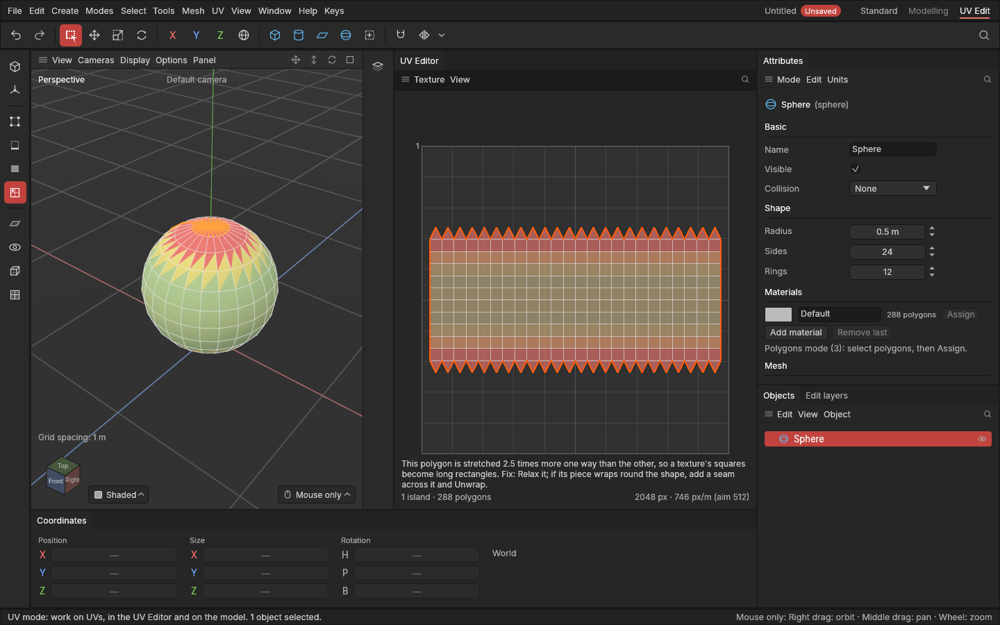
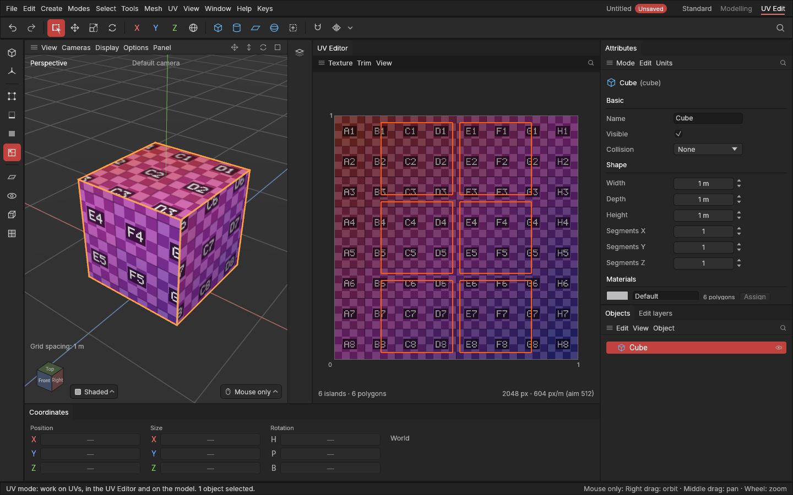

# Checker and Stretch views

> See how a texture would sit on your model (a plain or numbered checker laid on by the UVs), where the UVs stretch (green to red), and what to do about each problem.

## When to use it

Before you paint or bake, check the UVs on the model itself:

- **Checker** shows how a texture would sit: where the squares stay square and the same size, a texture will too. Long rectangles mean stretching, small and big squares mean uneven density, and the tint (red across, green up the texture) shows when a piece is turned or mirrored against its neighbours.
- **Numbered checker** lays on a texture of 8 × 8 labelled cells, **A1** at the top left of the texture square to **H8** at the bottom right. Each cell holds a checker of light and dark squares, and the cells run through a gradient of colours from your accent colour (**Edit → Settings…**). The labels tell you at a glance which part of the texture each part of the shape uses. They also show when a piece is turned or mirrored, because the text turns or reads backwards with it. While it's on, the [UV Editor](uv-editor.md) shows the same cells behind the UVs, so you can match the two views by their labels.
- **Stretch** colours the problems directly: **green** where the UVs lie evenly, **yellow** where they're 1.5 times off, **red** where they're twice off or more, and **purple** where a polygon has no room on the texture at all. "Off" means stretched more one way than the other, or getting more or less texture for its size than the rest of the object.

## How to use it

1. In the viewport's **Display** menu, under **Surface**, choose **Checker**, **Numbered checker** or **Stretch** (**Colours** goes back to your materials' colours).
2. With **Stretch**, open the [UV Editor](uv-editor.md) too: its polygons are coloured the same way. In the UV mode (or the Polygons mode), **point at a polygon** in the editor and it says what's wrong and what to do, for example:
   - "is stretched 2.5 times more one way than the other… Fix: Relax it; if its piece wraps round the shape, add a seam across it and Unwrap."
   - "has no room on the texture: its UVs are squashed flat… Fix: select it and Unwrap."
   - "gets 2.4 times more texture for its size than the rest of the shape… Fix: Unwrap its piece, or Set texel density."

   With nothing under the mouse, it counts how many polygons are 1.5 times off or more.
3. Fix them with the UV tools ([Unwrap, Relax and Straighten](unwrapping.md), [Seams](seams.md), [Texture size and texel density](texture-and-density.md)); the views update as you go.

## Settings

| Setting | What it does |
|---|---|
| **Surface** (viewport **Display** menu) | **Colours** (standard): materials' colours. **Checker**: a checker by the UVs, one square per 128 texture pixels. **Numbered checker**: 8 × 8 labelled cells across the texture square, in your accent colour's gradient (shown in the UV Editor too). **Stretch**: green to red by how evenly the UVs lie. Remembered, for every view. |

The checker's squares follow the texture size in the UV Editor's **Texture** menu. The numbered checker always has 8 × 8 cells, whatever the texture size, and changes colour with the accent colour.

## Shortcuts

| Action | Shortcut |
|---|---|
| Choose the surface | Viewport **Display** menu → Surface |

No key yet; ask if you'd like one.

## Tips and common problems

- **Tip:** with the **Numbered checker**, read the labels on the model to find a piece in the UV Editor: a side showing C2 lies in cell C2 of the texture square. A label that reads backwards means the piece is mirrored; **Flip left to right** turns it back.
- **Problem:** a ready-made sphere shows red at its top and bottom. **Why:** its ready-made UVs are laid out like a world map, squeezing the poles. **Fix:** **UV → Suggest seams** (which unwraps it in one piece), or keep it: it's often fine for small props.
- **Problem:** everything is purple. **Why:** the shape has no UVs, or they're all squashed flat. **Fix:** Unwrap it.
- **Problem:** the checker's squares look the same everywhere but the Stretch view shows yellow. **Why:** the piece gets more or less texture than the rest of the object (its squares are bigger or smaller than elsewhere). **Fix:** Unwrap it, or **UV → Match texel density** across the object.
- **Tip:** a checker's tint changes from dark red at a texture's left to light red at its right, and from dark green at the bottom to light green at the top. Two neighbouring pieces whose tints run opposite ways are turned or mirrored against each other.

## Related

- [The UV Editor](uv-editor.md)
- [Unwrap, Relax and Straighten](unwrapping.md)
- [How shapes are drawn](viewport-display.md)
- [Concepts: stretching, texel density](concepts.md#uvs-and-texturing)
