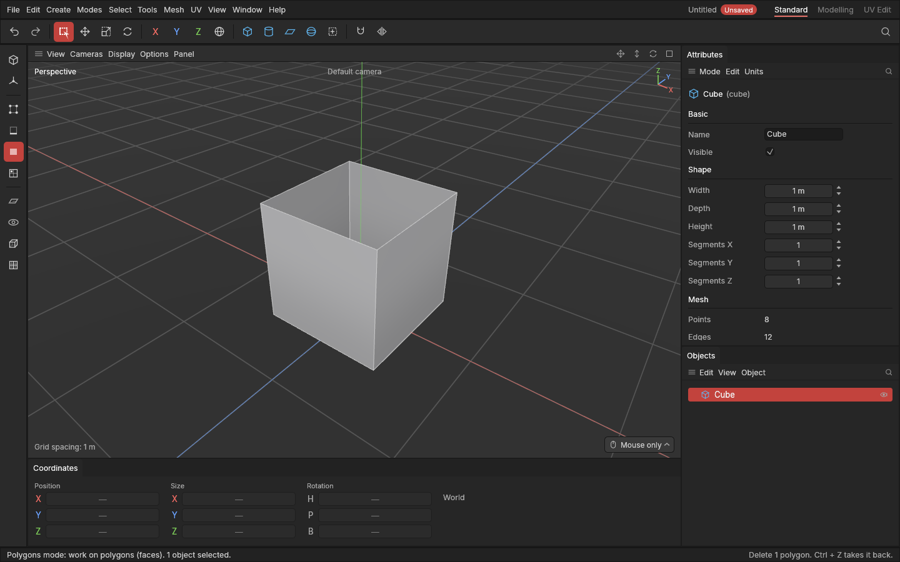

# Clean-up: delete, dissolve, fill holes and fix normals

> Take points, edges or polygons away (leaving a hole, or keeping the surface closed), close holes, and turn polygons that face the wrong way.

Modelling leaves bits to tidy: an edge you no longer need, a corner of points in the way, a hole where a polygon was deleted, or a polygon that ended up inside out. These commands clean that up.

## When to use them

- **Delete:** cut a hole on purpose (a window, an opening for a pipe), or remove a part of the shape you don't want.
- **Dissolve:** remove an extra edge or point without leaving a hole. The polygons around it merge into one. Use it to simplify a flat area, or to take back a cut you made too many times.
- **Fill hole:** close an opening with one polygon, like a lid.
- **Flip normals, Fix normals, Select flipped:** find and turn polygons that face the wrong way. A [flipped normal](concepts.md#shading-and-normals) shades wrongly and can vanish in a game engine.
- **Select same facing:** pick every polygon facing roughly the same way, like the whole top of a shape or every wall facing one way.

## How to use them

### Delete and dissolve (Delete, Backspace)

1. In the **Points**, **Edges** or **Polygons** mode, select what should go.
2. Press **Delete** to delete it. Every polygon using it goes too, and a hole is left.
3. Or press **Backspace** to dissolve it. The surface stays closed:
   - a dissolved **edge** merges the two polygons beside it into one;
   - a dissolved **point** merges the polygons around it into one;
   - dissolved **polygons** merge into one where they touch.

Both are also in the [tool menu](tool-menu.md) (**E**) and **Mesh → Remove**. Points left in the middle of a straight line by a dissolve go too, so no needless corners are left. A [hard edge](hard-and-soft-edges.md) that is dissolved away loses its hard mark too, and two hard edges joined into one stay hard.

#### Dissolving across a sharp corner

Dissolve is meant for flat areas. Across a sharp corner, such as a cube's edge, it would merge the two sides into one **bent polygon**: one polygon that isn't flat. It shades badly and can look creased, and it's rarely what you want; usually **Delete** (to make a hole) is.

So when the polygons being merged meet more sharply than 30°, the app asks first. The **Dissolve** button stays locked until you tick **I know what I'm doing, proceed**; **Cancel** (or **Esc**) changes nothing. Tick **Don't warn me again** to stop the question; switch it back on in [Settings](settings.md) → Interface → Warnings.

If you do make a bent polygon, it's drawn cut along its fold, so it still looks like the two sides it came from.

In the **Model** mode, Delete and Backspace delete the selected objects, as before.

### Fill hole

1. In the **Edges** or **Polygons** mode, select an edge on the hole's rim (or a polygon beside it).
2. Press **J**, or pick **Fill hole** from the tool menu (**E**) or **Mesh → Build**.

One polygon closes each hole touching the selection. With nothing selected, every hole of the selected objects is filled. Where the new polygon meets the sides at a sharp corner (sharper than 30°), like the cap of an open cylinder, the rim comes out [hard](hard-and-soft-edges.md), so it looks crisp.

To close the two ends of an open tube, select their rims and press **J**: each end gets its own cap. (**C** would instead [bridge](connect-bridge-weld.md) them, building a tube between the two rims.)

### Flip normals

In the **Polygons** mode, select polygons and pick **Flip normals** from the tool menu or **Mesh → Shading**. They turn inside out.

### Fix normals and Select flipped

- **Select → Select flipped** selects the polygons facing the wrong way, so you can see them first. It switches to the Polygons mode.
- **Mesh → Shading → Fix normals** turns every one of them, in each selected object, the right way round.

"The wrong way" means against their neighbours, or, in a closed shape, facing inward instead of out.

### Select same facing

In the **Polygons** mode, select one or more polygons and pick **Select → Select same facing**. Every polygon facing within 30° of a selected one is added.

## Settings

None: each command applies at once and is one undo step (Ctrl + Z).

## Shortcuts

| Action | Shortcut |
|---|---|
| Delete the selected points, edges or polygons | `Delete` (Points, Edges or Polygons mode) |
| Dissolve them | `Backspace` (Points, Edges or Polygons mode) |
| Delete the selected objects | `Delete` or `Backspace` (Model mode) |
| Fill hole | `J` (Edges or Polygons mode), the tool menu `E`, or Mesh → Build |
| Flip normals | Tool menu `E`, or Mesh → Shading |
| Fix normals | Mesh → Shading |
| Select flipped, Select same facing | Select menu |

## Tips and common problems

- **Tip:** the Mesh section of the Attributes panel tells you whether a shape is closed and whether any polygons face the wrong way.
- **Tip:** dissolving makes polygons with many sides (n-gons). They're fine on flat areas; on curves, cut them up again with [Connect](connect-bridge-weld.md) or [Slit](slit.md).
- **Problem:** Backspace did nothing, and the status bar says nothing can go. **Why:** an edge or point on an open border can't be dissolved without opening a hole, and neither can polygons that wouldn't merge into one simple polygon. **Fix:** use Delete instead, or select something else.
- **Problem:** a box appeared asking about a sharp corner. **Why:** dissolving there would make one bent polygon (see above). **Fix:** press Esc and use Delete instead, or tick "I know what I'm doing, proceed" if a bent polygon is what you want.
- **Problem:** Fill hole says no hole touches the selection. **Why:** the selected edges or polygons aren't on a hole's rim. **Fix:** select an edge on the rim, or select nothing to fill every hole.
- **Problem:** Fix normals turned a whole plane over. **Why:** an open sheet has no inside, so the polygons are made to agree with most of them. **Fix:** Flip normals on the whole sheet turns it back.

## Related

- [Connect, Bridge and Weld](connect-bridge-weld.md): Bridge closes holes too, with a band of polygons.
- [Selecting](selecting.md): loops select a hole's whole rim.
- [Concepts](concepts.md): [borders](concepts.md#mesh-basics), [dissolve](concepts.md#mesh-basics), [flipped normals](concepts.md#shading-and-normals).
