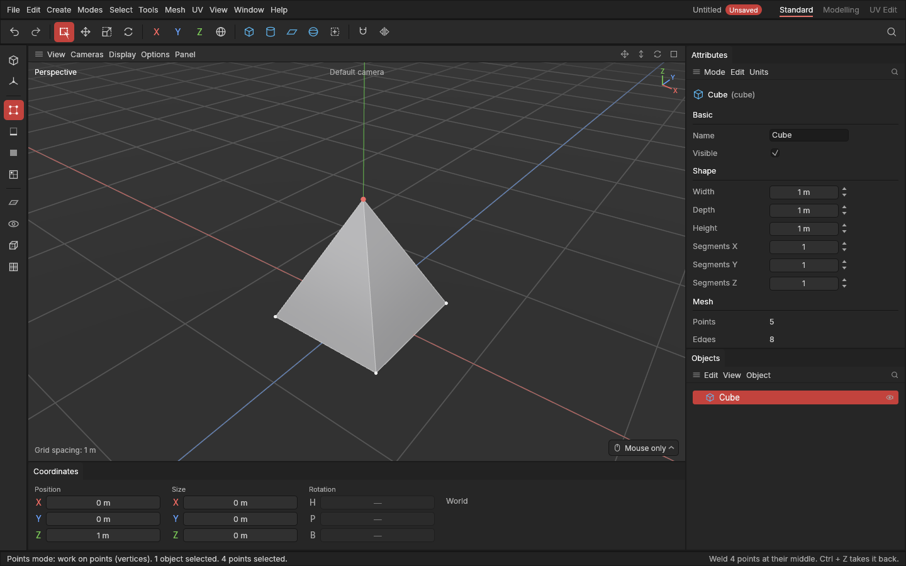

# Connect, Bridge and Weld

> Three ways to join parts of a shape: **Connect** draws a new edge across a polygon, **Bridge** builds polygons between two openings, and **Weld** melts points into one.

These are the tools for tidying up and joining. Connect splits polygons where you need an extra edge. Bridge fills the gap between two edges, two borders, or two polygons facing each other, like a tube between two holes. Weld closes up gaps by melting points together, or collapses a detail you don't need.

## When to use them

- **Connect:** split a polygon from corner to corner, or run a new edge across a row of polygons by selecting the edges it should cross. On a ring of edges it adds a whole loop, like [Loop cut](loop-cut.md).
- **Bridge:** join two separate pieces at their open borders, close a gap in a surface, or punch a tunnel between two polygons on opposite sides of a shape.
- **Weld:** close a seam where two pieces meet, collapse a narrow polygon, or pull a corner of points together into one.

## How to use them

### Connect (A)

1. In the **Points** mode, select two or more points on the same polygon. Or in the **Edges** mode, select two or more edges of the same polygons.
2. Press **A** (or pick **Connect** from the [tool menu](tool-menu.md) **E**, or the **Mesh** menu).

Points are joined straight across each polygon holding them. With three or more on one polygon, they're joined all the way round. Edges are cut in the middle and the cuts joined, so a ring of selected edges gets a loop through it. Under **Last edit**, **Cuts** makes more than one cut along each edge.

### Bridge (C)

**At once:**
- In the **Edges** mode, select two open borders: edges with a polygon on one side only, like the rims of two pipes facing each other. Double-click selects a whole border.
- In the **Polygons** mode, select two polygons facing each other (or both facing away, for a tunnel through the inside).

Then press **C**. The polygons are removed and a band of new polygons joins their borders.

**By dragging:** with nothing to bridge selected, **C** makes Bridge the tool. Press on an open edge (it lights up under the mouse) and drag to another one; the line snaps onto the edge it would join, which is ringed. Let go and a polygon joins the two. Do it edge by edge to fill a gap your way.

Where the band turns a sharp corner (sharper than 30°), its new edges come out [hard](hard-and-soft-edges.md), so a band between two boxes keeps crisp corners instead of a smeared look.

### Weld (M, Ctrl + M)

- In the **Points** mode, select two or more points and press **M**: they melt into one at their middle.
- Press **Ctrl + M** to make Weld the tool. Then drag a point onto another: as you get close, the line **snaps onto the point** under the mouse and rings it, so you see exactly where it will go. Let go and it melts into that one, which stays where it is. Drag one of the selected points and the whole selection goes there.

While Bridge or Weld is the tool, a **click still selects**, with the usual light-red highlight under the mouse, and a drag from empty space still draws a selection box. Only a drag that starts on a point (Weld) or an open edge (Bridge) is the tool's. **Tab** puts the tool away.

Polygons squeezed to fewer than three corners disappear.

## Settings

| Setting | What it does |
|---|---|
| **Cuts** (Connect, Last edit) | How many cuts along each selected edge, spread evenly. |
| **Segments** (Bridge) | How many rows the band has. More rows let a long bridge bend or be shaped later. **Ctrl + wheel** changes it while Bridge is the tool. |
| **Twist** (Bridge) | Turns a band between two closed loops round by whole steps, if its points paired up wrongly and the band looks twisted. |

## Shortcuts

| Action | Shortcut |
|---|---|
| Connect | `A` |
| Bridge the selection, or pick the Bridge tool | `C` |
| Bridge two edges | With the Bridge tool, drag from one open edge to another |
| Select while Bridge or Weld is the tool | Click, or drag from empty space |
| Put the tool away, back to the Model mode | `Tab` |
| Weld at the middle | `M` |
| Weld onto a point | `Ctrl + M`, then drag a point onto another |
| Bridge's segments | `Ctrl` + wheel (Bridge tool) |

## Tips and common problems

- **Tip:** two borders with the same number of edges give a neat band of four-sided polygons. With different numbers, the band zips them with triangles.
- **Tip:** after welding two pieces, check the Mesh section of the Attributes panel: "closed" means the shape has no holes left.
- **Problem:** C picked the Bridge tool instead of bridging. **Why:** the selection isn't two open borders or two polygons. **Fix:** select exactly two borders (Edges mode) or two polygons (Polygons mode), or drag from edge to edge.
- **Problem:** Bridge did nothing when dragging. **Why:** it joins open edges only, with a polygon on one side. Edges inside the surface already have polygons on both sides.
- **Problem:** I used to press J for Connect. **Why:** Connect moved to **A**, which is easier to reach; J now fills holes ([Clean-up](clean-up.md)).
- **Problem:** Connect did nothing. **Why:** the points are already joined by an edge (neighbours on the polygon), or they aren't on the same polygon.

## Related

- [Loop cut](loop-cut.md) and [Slit](slit.md): other ways to add edges.
- [Selecting](selecting.md): loops for selecting whole borders.
- [Concepts](concepts.md): [borders, edges and polygons](concepts.md#mesh-basics).
