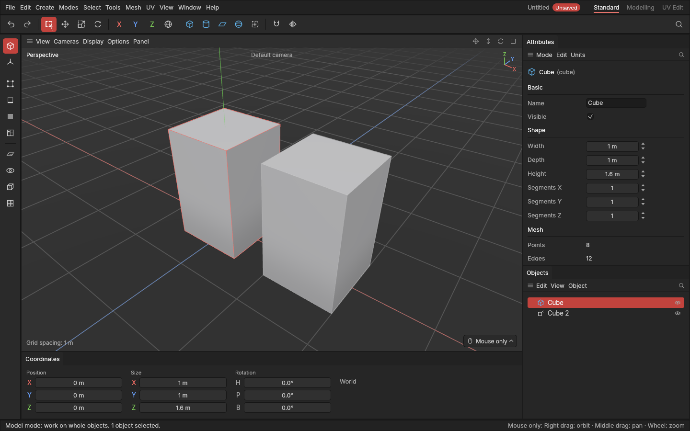

# Copies and instances

> Copy objects, or make instances: copies that stay the same as their original.

Many models repeat parts: bolts, wheels, panels, chair legs. A **copy** is a separate object you can change on its own. An **instance** shows its original's shape, wherever you put it and however you turn or scale it: change the original, and every instance changes with it.

## When to use it

- **Copy:** when the parts start the same but will end up different.
- **Instance:** when the parts should stay the same: change one, they all change. It also keeps the project small.

## How to use it

In the **Model** mode, select the objects, then:

- **Ctrl + C**, then **Ctrl + V**: paste copies.
- **Alt + C** (or Ctrl + C), then **Alt + V**: paste instances.
- Or press **E** and pick **Duplicate** or **Duplicate as instance**, or use the **Edit** menu: they copy and paste in one go.

Each copy or instance goes right on top of its original (and just below it in the Objects panel), and becomes the selection: press **W** and move it away, or type a new position in the Coordinates panel. Copies take everything: settings, edits and whatever is inside a group. They're named like the original, with a number.

In the same project, pasting copies the objects as they are when you paste, not when you copied. If they were deleted in between, there's nothing to paste.

### Into another project

Copied objects also paste into another project open in a [tab](working-on-several-projects.md): select them, press **Ctrl + C**, click the other tab and press **Ctrl + V**. What you copied comes along whole, as it was when you copied it:

- what is inside them (a group's objects), their edits, UV sets, modifiers, booleans, mirror and levels of detail;
- their [materials](materials.md) with their **paint** (the whole texture set: layers, masks and all), the [material graphs](material-graphs.md) any graph fill layers run, and the **boxes of your own** those graphs use;
- the objects they need that you didn't select: a boolean's cutter (still hidden), a lattice's cage, the curve or shape a modifier follows, a sweep's cross-section.

They go at the end of the Objects panel's list, where they were in the world, and become the selection. **One Ctrl + Z** in that tab takes the whole paste back; the project you copied from isn't changed at all. Because copying keeps its own copy, you can paste even after the tab you copied from has gone to sleep or been closed, as many times as you like, until you copy something else.

**Nothing clashes with what the project already has.** Objects get names of their own ("Cube 2" if there's already a Cube). A material whose name the project already uses for something else (another paint, say) comes in under a numbered name ("Stone 2"), so neither project's paint gets mixed up; the status bar lists any renamed. A graph or own box the project already has exactly is used as it is, so pasting the same thing twice doesn't fill the project with copies; a different one with the same name or inner id comes in as one of its own ("Cobbles 2"). The project's own settings (units, texture size, trim sheet) stay as they are, and so do its palettes: the only palettes that come along are those a pasted graph's **Palette map** boxes use and the project has none of by that name (one it has by that name is its own, so the material takes on that project's colours).

**Alt + V into another project** pastes plain copies: an instance has to show an object in the same project, and the original is in the other one. The status bar says so. (An instance you copy *together with* its original stays an instance of the pasted original; an instance copied without its original becomes a copy of its shape.)

### Working with instances

- An instance has a white icon in the Objects panel, and the Attributes panel says which object it shows.
- It can be moved, turned and scaled on its own, but its shape can't be edited: edit the original instead.
- **Bake into shape** (Ctrl + E) turns an instance into a plain mesh of its own, no longer linked.
- Deleting an original turns its instances into plain meshes, so they don't disappear.
- An instance of an instance shows the same original.
- An instance of a shape with modifiers that read another object (Lattice, Bend along curve, an Array round a centre, Scatter, Shrinkwrap) shows exactly its original's final shape, wherever you move it: the cage, curve, centre or target works on the original where it stands, and the instance shows the result.

## Settings

None.

## Shortcuts

| Action | Shortcut |
|---|---|
| Copy the selected objects | `Ctrl + C` (or `Alt + C`) |
| Paste copies (also in another tab) | `Ctrl + V` |
| Paste instances | `Alt + V` |
| Duplicate, Duplicate as instance (copy and paste at once) | Tool menu `E`, or the Edit menu |

## Tips and common problems

- **Problem:** Ctrl + C does nothing in the Points, Edges or Polygons mode. **Why:** copying works on whole objects. **Fix:** go back to the Model mode first.
- **Problem:** an edit on an instance is refused. **Why:** an instance always shows its original's shape. **Fix:** edit the original, or make the instance editable to give it its own shape.
- **Problem:** the pasted copy seems missing. **Why:** it's exactly on top of its original. **Fix:** move it with **W**.
- **Problem:** after pasting from another project, a material is called "Stone 2". **Why:** this project already had a different material called Stone (other paint, or none), and pasting never changes what was there. **Fix:** nothing is wrong; rename either one in Attributes → Materials if you like (the paint follows its own material).
- **Problem:** Alt + V in another tab didn't make instances. **Why:** instances can only show objects in the same project. **Fix:** paste with Ctrl + V, then make instances of the pasted objects in this project.
- **Tip:** copying puts a short note on your system clipboard (that's how the app hears Ctrl + V). Copy your text again afterwards if you needed it.

## Related

- [The Objects panel](objects.md)
- [Working on several projects: tabs](working-on-several-projects.md)
- [Move, rotate and scale](transforming.md)
- [Concepts: instance](concepts.md#objects-and-scenes)
