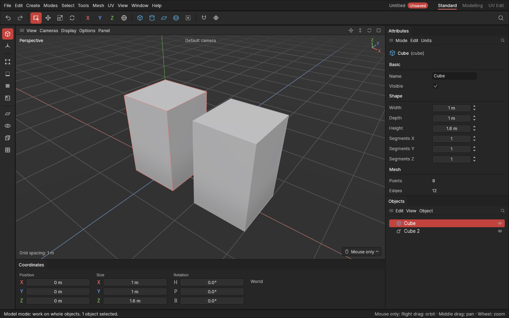

# Copies and instances

> Copy objects, or make instances: copies that stay the same as their original.

Many models repeat parts: bolts, wheels, panels, chair legs. A **copy** is a separate object you can change on its own. An **instance** shows its original's shape, wherever you put it and however you turn or scale it: change the original, and every instance changes with it.

## When to use it

- **Copy:** when the parts start the same but will end up different.
- **Instance:** when the parts should stay the same: change one, they all change. It also keeps the project small.

## How to use it

In the **Model** mode, select the objects, then:

- **Ctrl + C**, then **Ctrl + V**: paste copies.
- **Alt + C** (or Ctrl + C), then **Alt + V**: paste instances.
- Or press **E** and pick **Duplicate** or **Duplicate as instance**, or use the **Edit** menu: they copy and paste in one go.

Each copy or instance goes right on top of its original (and just below it in the Objects panel), and becomes the selection: press **W** and move it away, or type a new position in the Coordinates panel. Copies take everything: settings, edits and whatever is inside a group. They're named like the original, with a number.

Pasting copies the objects as they are when you paste, not when you copied. If they were deleted in between, there's nothing to paste.

### Working with instances

- An instance has a white icon in the Objects panel, and the Attributes panel says which object it shows.
- It can be moved, turned and scaled on its own, but its shape can't be edited: edit the original instead.
- **Bake into shape** (Ctrl + E) turns an instance into a plain mesh of its own, no longer linked.
- Deleting an original turns its instances into plain meshes, so they don't disappear.
- An instance of an instance shows the same original.
- An instance of a shape with modifiers that read another object (Lattice, Bend along curve, an Array round a centre, Scatter, Shrinkwrap) shows exactly its original's final shape, wherever you move it: the cage, curve, centre or target works on the original where it stands, and the instance shows the result.

## Settings

None.

## Shortcuts

| Action | Shortcut |
|---|---|
| Copy the selected objects | `Ctrl + C` (or `Alt + C`) |
| Paste copies | `Ctrl + V` |
| Paste instances | `Alt + V` |
| Duplicate, Duplicate as instance (copy and paste at once) | Tool menu `E`, or the Edit menu |

## Tips and common problems

- **Problem:** Ctrl + C does nothing in the Points, Edges or Polygons mode. **Why:** copying works on whole objects. **Fix:** go back to the Model mode first.
- **Problem:** an edit on an instance is refused. **Why:** an instance always shows its original's shape. **Fix:** edit the original, or make the instance editable to give it its own shape.
- **Problem:** the pasted copy seems missing. **Why:** it's exactly on top of its original. **Fix:** move it with **W**.
- **Tip:** copying puts a short note on your system clipboard (that's how the app hears Ctrl + V). Copy your text again afterwards if you needed it.

## Related

- [The Objects panel](objects.md)
- [Move, rotate and scale](transforming.md)
- [Concepts: instance](concepts.md#objects-and-scenes)
