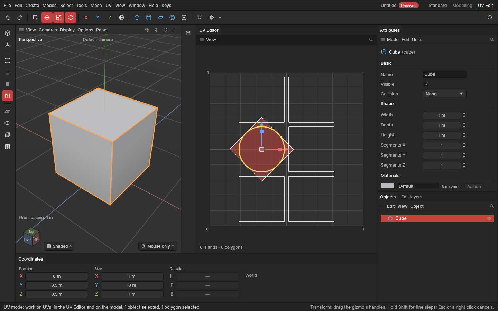

# Editing UVs by hand

> Move, turn, scale and flip the selected UVs in the UV Editor, with the same gizmo and keys as the viewport.

## When to use it

A shape's [UVs](concepts.md#uvs-and-texturing) decide where a texture lands on it. Every shape in the app comes [unwrapped](primitives.md#ready-made-uvs), but you'll often want to place pieces yourself:

- move an [island](concepts.md#uvs-and-texturing) onto the part of the texture it should use (a label, a panel of a trim sheet);
- turn a piece so its texture runs the right way, for example wood grain along a plank;
- scale a piece up so it gets more texture pixels (more detail), or down so it takes less room;
- flip a piece that shows its texture mirrored.

For laying pieces flat automatically, see [Unwrap, Relax and Straighten](unwrapping.md); to arrange them all, [Packing](packing.md).

## How to use it

1. Open the UV Editor: click **UV Edit** on the right of the menu bar (or **Window → UV Editor**). See [The UV Editor](uv-editor.md).
2. Select what to change, in the editor or on the model:
   - in the **UV mode**, click an island to take all of it;
   - in the **Points**, **Edges** or **Polygons** mode (**1**, **2**, **3**), select single points, edges or polygons.
3. Press a gizmo key, just as in the viewport. The gizmo sits in the middle of the selection, in the editor:
   - **W** (Move): drag the **red arrow** to move across, the **blue arrow** to move up and down, or the **square in the middle** to move freely.
   - **R** (Rotate): drag the **ring** to turn.
   - **S** (Scale): drag the **red** or **blue box** to stretch in that direction only, or the **square in the middle** to scale evenly (drag right or up to grow).
   - **T**: all of them at once.

   You see the change while you drag, on the texture square and in the numbers of the model's UVs. Each drag is **one undo step**: **Ctrl + Z** takes it back. In the UV mode you can also drag in the viewport to move the texture right on the shape: see [Editing UVs on the model](uvs-on-the-model.md).
4. For an exact quarter turn or a mirror, press **E** with the mouse over the editor and choose **Turn left 90°**, **Turn right 90°**, **Flip left to right** or **Flip upside down**. They turn or mirror the selection about its middle.

**Islands stay in one piece.** When you move a polygon, its neighbours in the same island keep their shared corners with it: the island bends rather than tearing. Corners on the other side of a [seam](concepts.md#uvs-and-texturing) belong to another island and stay where they are. (Other programs call this "sticky selection, shared location".)

**The E menu follows the mouse.** With the mouse over the UV Editor, **E** shows the UV tools, in any of the Points, Edges, Polygons and UV modes; over the viewport, the modelling tools. In the UV mode it always shows the UV tools. [Mark seams and Clear seams](seams.md), [Unwrap, Relax and Straighten](unwrapping.md) and [Pack](packing.md) are there too. See [The tool menu](tool-menu.md).

**Your UV changes are edits.** Like moving points, a change to UVs is recorded on the object's [edit list](edit-list.md), saved with the project, and made again if you change the shape's settings before it.

## Settings

The gizmo uses the viewport's snapping settings (the magnet button on the palette, **Tools → Snapping**, and **Edit → Settings… → Viewport → Snapping**):

| Setting | What it does in the UV Editor |
|---|---|
| **Snapping** (on or off) | When on, moves put the gizmo's middle on the texture square's grid, every tenth. Hold **Ctrl** while dragging to do the opposite (unless **Holding Ctrl while dragging flips snapping** is off). Snapping to texture pixels comes with the texture size setting. |
| **Turns snap every** | Turns step by this many degrees (15° as standard). |
| **Scaling every** | Scaling steps by this part (10% as standard). |

## Shortcuts

| Action | Shortcut |
|---|---|
| Move, Rotate, Scale, all three | **W**, **R**, **S**, **T** (the same as the viewport) |
| Finer drag (ten times slower) | Hold **Shift** while dragging |
| Snap, or not when snapping is on | Hold **Ctrl** while dragging |
| Cancel a drag | **Esc** or a right click |
| UV tools (turn, flip and those to come) | **E** with the mouse over the editor |
| Frame the selection's UVs | **Z** with the mouse over the editor |
| Undo | **Ctrl + Z** |

The turn and flip commands have no keys yet; ask for them if you use them often.

## Tips and common problems

- **Problem:** pressing W shows no gizmo in the editor. **Why:** nothing is selected in a mode that works on UVs, or you're in the Model mode. **Fix:** pick the UV mode (or press 1, 2 or 3) and select something.
- **Problem:** a corner on a seam didn't follow the move. **Why:** it belongs to the island on the other side of the seam. **Fix:** select that island too, or move it separately.
- **Problem:** a drag stopped by itself. **Why:** something else changed the scene while you dragged (an undo, say). What was done stays. **Fix:** drag again.
- **Problem:** the viewport's 3D gizmo doesn't show in the UV mode. **Why:** that's intended: in the UV mode W, R and S work on UVs, so they never move the shape by accident. **Fix:** press 3 (Polygons) to move the shape's polygons.
- **Tip:** to give a piece more detail on the texture, select its island and scale it up with **S**; to see it fill the view, press **Z** over the editor.
- **Tip:** while a texture isn't on the model yet, turning pieces so their long side runs across makes them easier to compare and pack.

## Related

- [The UV Editor and the UV mode](uv-editor.md)
- [Editing UVs on the model](uvs-on-the-model.md): the same changes by dragging the texture on the shape
- [Move, rotate and scale](transforming.md) (the same gizmo in 3D)
- [The tool menu (E)](tool-menu.md)
- [Concepts: UV map, seam, island, corner](concepts.md#uvs-and-texturing)
