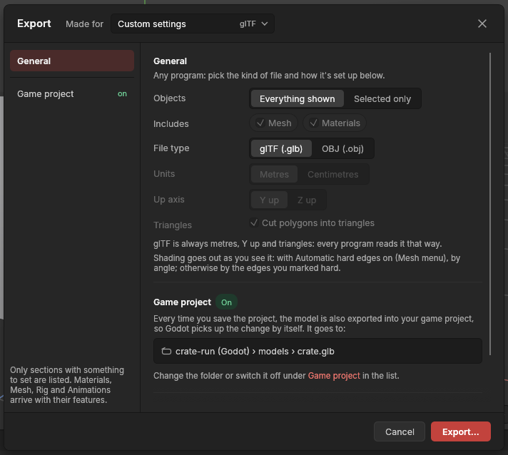
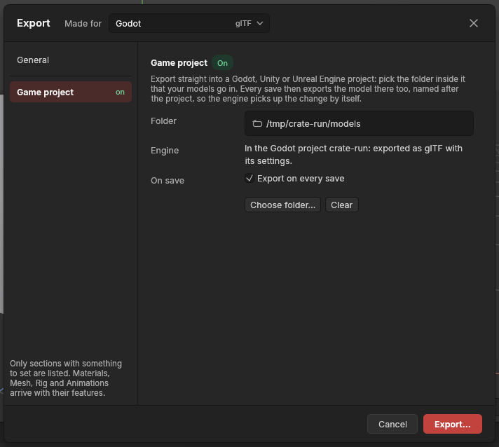

# Export and import

> Write your models to a glTF or OBJ file for a game engine or Substance Painter, and bring models in from OBJ files.

## When to use it

Your project file (`.avtl`) keeps everything the app needs to go on working: settings, recorded edits, undo-ready shapes. Other programs can't read it. To use a model elsewhere, **export** it to a common file:

- **glTF** (`.glb`, the standard): the open format Godot and Substance Painter read best, and Unity and Unreal Engine read too. Each object arrives as its own piece **placed at its [pivot](pivots.md)**, so the engine places, turns and snaps it by the pivot you set. It's always metres, Y up, and triangles, as the format requires.
- **OBJ** (`.obj`): plain text, read by almost every 3D program, including Godot, Unity, Unreal Engine, Blender and Substance Painter. It holds the shapes (points, polygons, normals and UVs), not where each object's pivot is: every object is written where it stands in the scene.

**Made for**, in the Export window's title bar, chooses a [preset](concepts.md#the-game-asset-pipeline), the right settings for **Godot**, **Unity**, **Unreal Engine**, **Solis** or **Substance Painter**, in one click. The app remembers the settings of your last export, so a new project (or the next time you open the app) starts the Export window with them.

**Import** does the reverse: it brings shapes in from an OBJ file made elsewhere, as plain meshes you can edit.

## How to use it

### Export

The Export window has a **side list** on the left. **General** holds everything most exports need; **Game project** sets up exporting straight into a game engine's project. More sections (Materials, Mesh, Rig, Animations) join the list once the app has those features; until then they aren't shown, so there is nothing to hunt through.

1. Choose **File → Export…**. The Export window opens on **General**.
2. In the title bar, open **Made for** and pick where the model is going (see [Presets](#presets) below): **Godot** (the standard on first use), **Unity**, **Unreal Engine**, **Solis** or **Substance Painter**. Each shows its kind of file on the right. The preset's file settings then show as one locked line, such as *glTF · metres · Y up · triangles*: skip to step 4. Or pick **Custom settings** at the bottom of the list and carry on.
3. With **Custom settings**, the file settings appear as rows to choose from:
   - **File type**: **glTF (.glb)** or **OBJ (.obj)**.
   - **Units**: **Metres** for Godot, Unity and Substance Painter; **Centimetres** for Unreal Engine.
   - **Up axis**: **Y up** for nearly every program. The app is Z up, so it turns the model on the way out and it arrives standing upright. **Z up** keeps the app's own axes.
   - **Triangles**: tick **Cut polygons into triangles** if the model will be baked in Substance Painter: the file then holds exactly the triangles the game will draw, cut the same way the viewport cuts them, so the bake matches. Game engines cut polygons themselves otherwise, not always the same way.

   glTF is always metres, Y up and triangles, so with glTF those three rows are greyed out.
4. Pick the **Objects**: **Everything shown** (hidden objects stay out), or **Selected only** (the selected objects and what's inside them). Presets leave this as you set it. Shapes go out as you see them: cut by their [booleans](booleans.md), with the cutters left out, and with their [modifiers](modifiers.md) (every one that is on, even one hidden in the viewport). A [curve](curves.md) goes out as its sweep or lathe; a curve that is only a line has no surface, so it goes out as nothing.
5. Check **What goes out** at the bottom: how many objects, triangles and materials the file will hold, and under them a line about [collision](collision-shapes.md): how many objects take collision out and of which kinds (*Collision goes out for 3 objects: A box × 2, Wrapped in parts (convex) × 1*), or that only **Made for Godot** writes it into the file. If nothing would go out (everything hidden, say), the footer says so and **Export…** can't be pressed. (If your computer's file window can't open when you press **Export…**, the app asks you to type the path instead; see [Saving and opening](saving-and-opening.md).)
6. Click **Export…** (or press **Enter**), choose where to save, and the status bar says how many objects and triangles went out (and for an OBJ, the `.mtl` file is written beside it). **Cancel**, the **×** or **Esc** closes the window without exporting.

**Includes** shows what goes into the file: the mesh and its materials. They always go out; once the app has skeletons and animations, they will be listed here too, to leave out when you don't need them. **Levels of detail** there puts each object's [levels of detail](levels-of-detail.md) in the file too, beside it, as `name_LOD1`, `name_LOD2` and so on. It starts ticked when anything going out has levels made, and unticked otherwise; once you tick or untick it yourself, the app keeps your choice from then on (Godot makes its own levels, so you may not want them). The numbers under *What goes out* count the objects themselves, not their levels.

The **Game project** part of General says whether every save also exports into your game project, and where the file goes, for example *crate-run (Godot) › models › crate.glb*. Click **Game project** in that sentence (or in the side list) to set it up or change it: see [Export into a game project](#export-into-a-game-project).

**Exporting happens in the background.** A big scene takes a few seconds to export; meanwhile the status bar says *Exporting crate.glb…* with a small turning wheel, and you can keep working (what you change meanwhile goes out next time). One export (or save) at a time: another waits until this one is done, and closing the app waits too. The same goes for **Export to game project**, the export after every save, and **Export kit…**.

**File → Export again** repeats the last export, to the same file, the same way: handy while you go back and forth between the app and the engine.

**Shading goes out as you see it.** Each object goes out with its own [smoothing](hard-and-soft-edges.md#smoothed-by-angle): smoothed by angle (the standard), edges sharper than its angle (30° unless changed) go out crisp and the rest smooth; shaded by its marks, the edges you marked [hard](hard-and-soft-edges.md). Each corner gets the [normal](concepts.md#shading-and-normals) the viewport shows, so a model shades the same in the engine.

**Materials go out by name.** Each [material](materials.md) some polygon uses goes out once, by its name, with its colour: materials of the same name on different objects are one. glTF holds them in the file; an OBJ export also writes a **`.mtl` file** with the same name beside it (`crate.obj` and `crate.mtl`), which other programs read for the colours. Keep the two files together. In an OBJ, spaces in a name become underscores.

Each object's points stay joined in the file: a smooth surface is one connected piece, as Substance Painter wants for baking. Every edit and setting is applied; the file holds the shape as it is now.

**Triangles and tangents: why bakes match.** A normal map baked in Substance Painter only looks right in the game if both programs agree on two things:

- **The same triangles.** A four-sided or bigger polygon can be cut into triangles more than one way, and each way shades a little differently. glTF is always cut, and OBJ is cut when you tick *Cut polygons into triangles*: always the same way the viewport cuts it ([triangulation](concepts.md#the-game-asset-pipeline)), so Substance Painter and the engine get exactly the triangles you see. **Display → Show triangles** draws that cut on your shapes before you export, and the **Triangulate** modifier can fix it in the shape ([Triangles](triangulate.md)).
- **The same tangents.** A normal map is read along each surface's *tangents*. When a shape has UVs, a glTF export carries **MikkTSpace** tangents, the [standard](concepts.md#the-game-asset-pipeline) Substance Painter, Godot, Unity and Unreal Engine all use. Every shape has UVs: primitives come with them, imported files bring theirs, and the [UV tools](uv-editor.md) change them. OBJ can't hold tangents; the program reading it works them out.

**Outlines.** An object with an [outline](outlines.md) gets a shell beside it, *Name-outline*, that draws the line in any engine; a Godot export also writes an outline shader beside the file.

### Presets

| Made for | What it chooses | Why |
|---|---|---|
| **Godot** (standard) | glTF, metres, Y up, triangles | glTF is Godot's favourite: each object arrives at its [pivot](pivots.md) with its [materials](materials.md) and its [collision](kit-export.md), and Godot re-imports the file by itself whenever you export again into its project folder. |
| **Unity** | glTF, metres, Y up, triangles | The same file; Unity reads it once its *glTFast* package is installed. |
| **Unreal Engine** | glTF, metres, Y up, triangles | The same file; Unreal Engine 5 reads it and turns it into its own centimetres and Z up. |
| **Solis** | glTF, metres, Y up, triangles | The same file, for Solis, the game engine being made beside this app. Objects keep their own names: Godot's [collision](kit-export.md) endings (`-col`) are left off, as they mean nothing to Solis. |
| **Substance Painter** | OBJ, metres, Y up, cut into triangles | The usual way into Substance Painter; a **Check for baking…** button appears under the file settings and runs the [bake check](bake-check.md). Each [material](materials.md) becomes a texture set, and the triangles are the viewport's, the same ones the glTF for the game holds, so the bake matches. |
| **Custom settings** | whatever you choose | For anything else, such as an OBJ in centimetres for an older Unreal Engine. It starts from the settings of the preset you had, so you only change what's different. |

A preset's settings are locked, so the window never claims a preset it isn't following: to change one, pick **Custom settings**. The status bar names the preset after exporting: *Exported 3 objects for Godot (240 triangles, 2 materials) to crate.glb.*

**Your last export is remembered.** Whenever you export (with Export…, Export again or Export kit…), the app keeps that export's Made for and file settings, also after you close it. New projects and the next launch start there, so if you always export for Solis, or with your own Custom settings, you set it up once. Only an export is remembered: changing Made for and then pressing Cancel leaves the remembered settings as they were. **Objects** isn't remembered and always starts at *Everything shown*, because what is selected belongs to the moment. The very first time, Made for starts at Godot.

### Export into a game project

Instead of choosing where to save every time, tell the app which folder of your game project the model goes in. It then exports there in one click, and again **every time you save the project**, so the engine picks up each change.

1. Choose **File → Export…** and click **Game project** in the side list (its word on the right says **on** or **off**). Click **Choose folder…** and pick the folder inside your game project the models go in (for example `models` in a Godot or Solis project, `Assets/Models` in Unity, `Content/Models` in Unreal Engine).
2. The window says which engine's project the folder is in, and **Made for** switches to that engine. **Export on every save** is ticked.
3. Save the project (**Ctrl + S**). The status bar says *Saved crate.avtl. Exported crate.glb (240 triangles) into models.*

**File → Export to game project** exports there straight away, without saving.

How it works:

- **One file per project, named after it.** Saving `crate.avtl` exports `crate.glb`, with everything shown, using the engine's settings: glTF for every engine, so pivots and materials come along.
- **The engine is worked out from the folder.** A Godot project has a `project.godot` file, a Solis project a `project.solis` file, a Unity project `Assets` and `ProjectSettings` folders, an Unreal Engine project a `.uproject` file, in the folder or one above it. A folder in none of them gets the settings of the engine chosen in **Made for**, or Godot's if Made for is set to Substance Painter or Custom settings.
- **Unity** reads glTF once its *glTFast* package is installed (Window → Package Manager). **Unreal Engine 5** reads glTF and turns it into its own centimetres and Z up.
- **The folder is saved with the project.** Untick **Export on every save** to stop exporting when you save, or click **Clear** to forget the folder. Each change is an undo step.

It is careful with your game project:

- It **never creates folders**. If the folder has gone (moved, renamed, a drive unplugged), the status bar says so, and the save still happens.
- It **only replaces files it wrote itself.** If a file of that name is already there and another program made it, it is left alone and the status bar says why. Rename one of them.
- Backup copies (autosave) don't export.

### Import

1. Choose **File → Import…** and pick an OBJ file.
2. Each object in the file (named by its `o` lines, or `g` lines if it has none) becomes a plain mesh at the top of the Objects panel, selected, and the view frames it. One **Ctrl + Z** takes the whole import back.

The app reads an OBJ as metres with Y up, the usual way, and turns it to centimetres with Z up; a file this app exported says how it was written, and is read back that way. Where the file gives two polygons different normals along an edge they share, that edge is made **hard**, so a model shaded crisp elsewhere stays crisp. UVs come along too, ready for the UV tools in Phase 7. Each material the file names (`usemtl`) becomes one of the object's [materials](materials.md), its polygons given it, coloured from the `.mtl` file when it is beside the OBJ (otherwise grey). Lines the app doesn't use (curves, groups of settings) are skipped, and broken polygons are left out and counted in the status bar.

## Settings

| Setting | What it does |
|---|---|
| **Made for** (title bar) | **Godot** (standard on first use), **Unity**, **Unreal Engine**, **Solis** or **Substance Painter** choose the file settings for you and lock them; **Custom settings** lets you choose. The last export's choice is remembered between projects and launches. |
| **Objects** | **Everything shown** (standard), or **Selected only**: the selected objects and what's inside them. Groups have no shape of their own; only shapes are exported. |
| **Includes** | What goes into the file: the mesh and its materials, always, and with **Levels of detail** ticked, each object's [levels of detail](levels-of-detail.md) beside it (on when anything going out has levels, until you set it; then remembered). |
| **Realism maps** (while a painted material uses the [realism channels](painting-textures.md#realism-channels)) | How roughness, metal and glow go out. A glTF always holds them in its own way (an [ORM](concepts.md#the-game-asset-pipeline) map for roughness and metal, an emissive map for glow), which Godot, Unity, Unreal, Blender and Solis read. **In the file** (standard) sends nothing more (an OBJ gets an ORM beside it); **ORM beside it** adds an ORM file for Godot's and Unreal's materials; **Unity mask map beside it** adds the [mask map](concepts.md#the-game-asset-pipeline) Unity's HDRP wants (the Unity preset chooses it); **Separate maps beside it** adds roughness and metal as two grey files. Remembered. |
| **Textures** | How your painted textures go out: **PNG** (standard), **TGA**, or **Leave out**. A glTF file holds them inside, always as PNG (the format glTF wants); an OBJ gets them beside it, named *crate_Material.png* and listed in its *.mtl*. Each texture is your layers mixed over the material's colour. Remembered. |
| **Padding** | How many pixels each UV piece's colours are spread past its edges (8 standard). Games read far-away surfaces from smaller copies of the texture, which mix neighbouring pixels: without padding, the colour around a piece creeps in as a thin line along its seams. |
| **File type** (Custom settings) | **glTF (.glb)**, standard: each object at its pivot; always metres, Y up, triangles. **OBJ (.obj)**: plain shapes where they stand. |
| **Units** (Custom settings) | The file's units. **Metres**: 1 unit = 1 m, for Godot, Unity and Substance Painter (standard). **Centimetres**: 1 unit = 1 cm, for Unreal Engine. |
| **Up axis** (Custom settings) | **Y up** (standard) turns the model so its height runs along Y, as nearly every program expects. **Z up** keeps the app's own axes. |
| **Triangles** (Custom settings) | Off: polygons go out as they are (an OBJ for most programs). On (the presets): every polygon is cut into triangles the same way the viewport cuts them. |
| **Game project** (side list) | The folder in your game project this project exports into (saved with the project), with **Export on every save** (on once a folder is chosen). |

**Realistic materials.** With the realism channels, the occlusion part of the ORM and the mask map is white for now (it darkens nothing): engines add their own ambient occlusion, and you can paint a baked one in with **Bakes → Occlusion → Add as a layer**. Normal maps come with height and normal painting.

**Texture budget.** Under *What goes out*, the Export window lists each painted texture going out (its material, which map it is (colour, ORM, glow...) and its size) and how much memory it takes on the graphics card, with the smaller copies games make, and the total. A 2048 × 2048 texture takes about 21 MB; halving its size takes a quarter of that. Keep an eye on it for games that run on modest machines.

The Export window keeps its choices while the app is open, and the app remembers the last export's Made for and file settings for next time.

## Shortcuts

| Action | Shortcut |
|---|---|
| Export (in the Export window) | `Enter` |
| Close the window without exporting | `Esc` |

To open the window, use **File → Export…**.

## Tips and common problems

- **Problem:** in Godot, an object turns around the wrong point. **Why:** its pivot is where the app has it. **Fix:** move the pivot with [Edit pivot](pivots.md) and export again (glTF keeps pivots; OBJ doesn't).
- **Tip:** glTF splits a point where its shading breaks into one per side, as every game engine does, so a crisp cube has 24 corners in the file, not 8. That's normal.
- **Problem:** the model arrives lying on its back. **Why:** the file was written Z up, and the program expected Y up (or the other way round). **Fix:** export again with the other choice.
- **Tip:** not sure which settings? Pick **Godot** or **Substance Painter** under **Made for**.
- **Problem:** a new project's Export window doesn't start at Godot. **Why:** the app remembers your last export's settings. **Fix:** pick the one you want in Made for; it's remembered from your next export.
- **Problem:** exports into a game project get Godot's settings. **Why:** the folder isn't inside a project the app recognises (it looks for `project.godot`, `project.solis`, a `.uproject` file, or Unity's `Assets` and `ProjectSettings`), so it uses the engine in Made for, and Made for wasn't on an engine. **Fix:** choose a folder inside the game project, or pick the engine in Made for.
- **Problem:** the file settings can't be changed. **Why:** a preset is chosen under Made for, and its settings are locked so the file is what that program expects. **Fix:** pick **Custom settings** in Made for.
- **Problem:** the model is 100 times too big or too small. **Why:** metres and centimetres were mixed up. **Fix:** Godot, Unity and Substance Painter want **Metres**; Unreal Engine wants **Centimetres**.
- **Problem:** the footer says there is nothing to export, and Export… can't be pressed. **Why:** everything is hidden, or *Selected only* was chosen with only groups selected. **Fix:** show the objects, or choose Everything shown.
- **Problem:** an imported model looks faceted all over. **Why:** the file had no normals, so the app couldn't tell which edges were meant to be hard. **Fix:** tick **By angle** on the object's Smoothing row in the [Attributes panel](attributes.md) (or **Mesh → Shading → Smooth by angle**), or mark edges with [Hard and soft edges](hard-and-soft-edges.md).
- **Problem:** an OBJ's colours are missing in the other program. **Why:** the `.mtl` file was left behind. **Fix:** copy or move the `.obj` and `.mtl` files together.
- **Tip:** an imported object is a plain mesh: there are no settings to change, but every modelling tool works on it.

## Related

- [Materials](materials.md)
- [Check for baking](bake-check.md)
- [Kit export and collision](kit-export.md): each piece its own file, and Godot collision
- [Saving and opening projects](saving-and-opening.md) (Export on every save)
- [Hard and soft edges, and normals](hard-and-soft-edges.md)
- [Pivots and Edit pivot](pivots.md) (the units of the project)
- [Concepts: triangulation, glTF and the game-asset pipeline](concepts.md#the-game-asset-pipeline)
- [Saving and opening projects](saving-and-opening.md)
