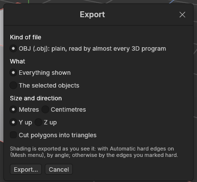

# Export and import

> Write your models to a glTF or OBJ file for a game engine or Substance Painter, and bring models in from OBJ files.

## When to use it

Your project file (`.avtl`) keeps everything the app needs to go on working: settings, recorded edits, undo-ready shapes. Other programs can't read it. To use a model elsewhere, **export** it to a common file:

- **glTF** (`.glb`, the standard): the open format Godot and Substance Painter read best, and Unity and Unreal Engine read too. Each object arrives as its own piece **placed at its [pivot](pivots.md)**, so the engine places, turns and snaps it by the pivot you set. It's always metres, Y up, and triangles, as the format requires.
- **OBJ** (`.obj`): plain text, read by almost every 3D program, including Godot, Unity, Unreal Engine, Blender and Substance Painter. It holds the shapes (points, polygons, normals and UVs), not where each object's pivot is: every object is written where it stands in the scene.

Ready-made settings for Godot and Substance Painter arrive in the next updates of Phase 5.

**Import** does the reverse: it brings shapes in from an OBJ file made elsewhere, as plain meshes you can edit.

## How to use it

### Export

1. Choose **File → Export…**. The Export window opens.
2. Pick the **kind of file**: **glTF** (standard) or **OBJ**.
3. Pick **What**: **Everything shown** (hidden objects stay out), or **The selected objects** (and what's inside them).
4. For OBJ, check **Size and direction** for where the file is going (glTF is always metres, Y up and triangles, so these are greyed out):
   - **Metres** for Godot, Unity and Substance Painter; **Centimetres** for Unreal Engine.
   - **Y up** for nearly every program. The app is Z up, so it turns the model on the way out and it arrives standing upright. **Z up** keeps the app's own axes.
5. Tick **Cut polygons into triangles** if the model will be baked in Substance Painter: the file then holds exactly the triangles the game will draw, cut the same way the viewport cuts them, so the bake matches. Game engines cut polygons themselves otherwise, not always the same way.
6. Click **Export…**, choose where to save, and the status bar says how many objects and triangles went out (and for an OBJ, the `.mtl` file is written beside it).

**File → Export again** repeats the last export, to the same file, the same way: handy while you go back and forth between the app and the engine.

**Shading goes out as you see it.** With **Automatic hard edges** on (Mesh menu, the standard), edges sharper than 30° go out crisp and the rest smooth; with it off, the edges you marked [hard](hard-and-soft-edges.md). Each corner gets the [normal](concepts.md#shading-and-normals) the viewport shows, so a model shades the same in the engine.

**Materials go out by name.** Each [material](materials.md) some polygon uses goes out once, by its name, with its colour: materials of the same name on different objects are one. glTF holds them in the file; an OBJ export also writes a **`.mtl` file** with the same name beside it (`crate.obj` and `crate.mtl`), which other programs read for the colours. Keep the two files together. In an OBJ, spaces in a name become underscores.

Each object's points stay joined in the file: a smooth surface is one connected piece, as Substance Painter wants for baking. Every edit and setting is applied; the file holds the shape as it is now.

**Triangles and tangents: why bakes match.** A normal map baked in Substance Painter only looks right in the game if both programs agree on two things:

- **The same triangles.** A four-sided or bigger polygon can be cut into triangles more than one way, and each way shades a little differently. glTF is always cut, and OBJ is cut when you tick *Cut polygons into triangles*: always the same way the viewport cuts it ([triangulation](concepts.md#the-game-asset-pipeline)), so Substance Painter and the engine get exactly the triangles you see.
- **The same tangents.** A normal map is read along each surface's *tangents*. When a shape has UVs, a glTF export carries **MikkTSpace** tangents, the [standard](concepts.md#the-game-asset-pipeline) Substance Painter, Godot, Unity and Unreal Engine all use. Shapes get UVs from an imported file now, and from the UV tools in Phase 8. OBJ can't hold tangents; the program reading it works them out.

### Import

1. Choose **File → Import…** and pick an OBJ file.
2. Each object in the file (named by its `o` lines, or `g` lines if it has none) becomes a plain mesh at the top of the Objects panel, selected, and the view frames it. One **Ctrl + Z** takes the whole import back.

The app reads an OBJ as metres with Y up, the usual way, and turns it to centimetres with Z up; a file this app exported says how it was written, and is read back that way. Where the file gives two polygons different normals along an edge they share, that edge is made **hard**, so a model shaded crisp elsewhere stays crisp. UVs come along too, ready for the UV tools in Phase 8. Each material the file names (`usemtl`) becomes one of the object's [materials](materials.md), its polygons given it, coloured from the `.mtl` file when it is beside the OBJ (otherwise grey). Lines the app doesn't use (curves, groups of settings) are skipped, and broken polygons are left out and counted in the status bar.

## Settings

| Setting | What it does |
|---|---|
| **Kind of file** | **glTF** (`.glb`, standard): each object at its pivot; always metres, Y up, triangles. **OBJ** (`.obj`): plain shapes where they stand. |
| **What** | Everything shown (standard), or the selected objects and what's inside them. Groups have no shape of their own; only shapes are exported. |
| **Metres / Centimetres** | The file's units. 1 unit = 1 m for Godot, Unity and Substance Painter (standard); 1 cm for Unreal Engine. |
| **Y up / Z up** | Y up (standard) turns the model so its height runs along Y, as nearly every program expects. Z up keeps the app's own axes. |
| **Cut polygons into triangles** | Off (standard): polygons go out as they are. On: every polygon is cut into triangles the same way the viewport cuts them. |

The Export window remembers its choices while the app is open.

## Shortcuts

None yet: use the File menu.

## Tips and common problems

- **Problem:** in Godot, an object turns around the wrong point. **Why:** its pivot is where the app has it. **Fix:** move the pivot in the [Object mode](pivots.md) and export again (glTF keeps pivots; OBJ doesn't).
- **Tip:** glTF splits a point where its shading breaks into one per side, as every game engine does, so a crisp cube has 24 corners in the file, not 8. That's normal.
- **Problem:** the model arrives lying on its back. **Why:** the file was written Z up, and the program expected Y up (or the other way round). **Fix:** export again with the other choice.
- **Problem:** the model is 100 times too big or too small. **Why:** metres and centimetres were mixed up. **Fix:** Godot, Unity and Substance Painter want **Metres**; Unreal Engine wants **Centimetres**.
- **Problem:** the status bar says there is nothing to export. **Why:** everything is hidden, or *The selected objects* was chosen with only groups selected. **Fix:** show the objects, or choose Everything shown.
- **Problem:** an imported model looks faceted all over. **Why:** the file had no normals, so the app couldn't tell which edges were meant to be hard. **Fix:** keep **Automatic hard edges** on (Mesh menu), or mark edges with [Hard and soft edges](hard-and-soft-edges.md).
- **Problem:** an OBJ's colours are missing in the other program. **Why:** the `.mtl` file was left behind. **Fix:** copy or move the `.obj` and `.mtl` files together.
- **Tip:** an imported object is a plain mesh: there are no settings to change, but every modelling tool works on it.

## Related

- [Materials](materials.md)
- [Hard and soft edges, and normals](hard-and-soft-edges.md)
- [Pivots and the Object mode](pivots.md) (the units of the project)
- [Concepts: triangulation, glTF and the game-asset pipeline](concepts.md#the-game-asset-pipeline)
- [Saving and opening projects](saving-and-opening.md)
