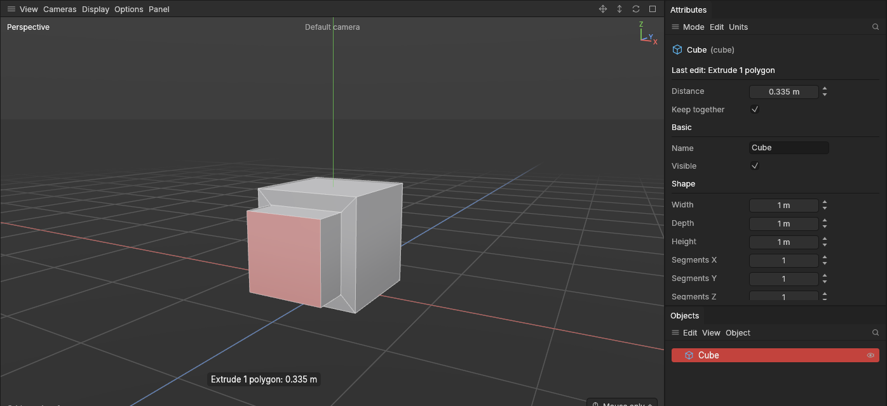
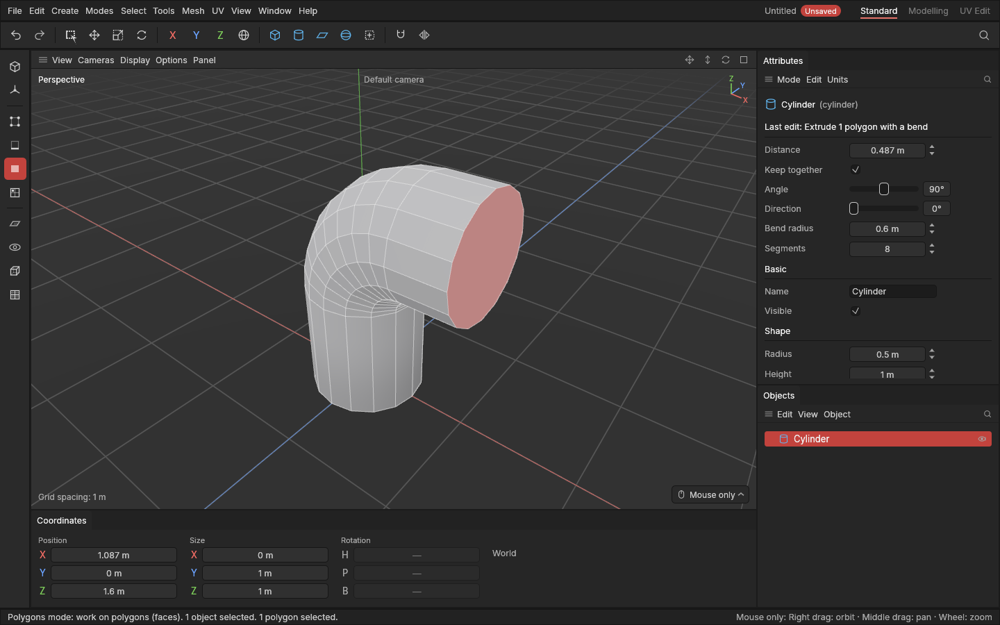
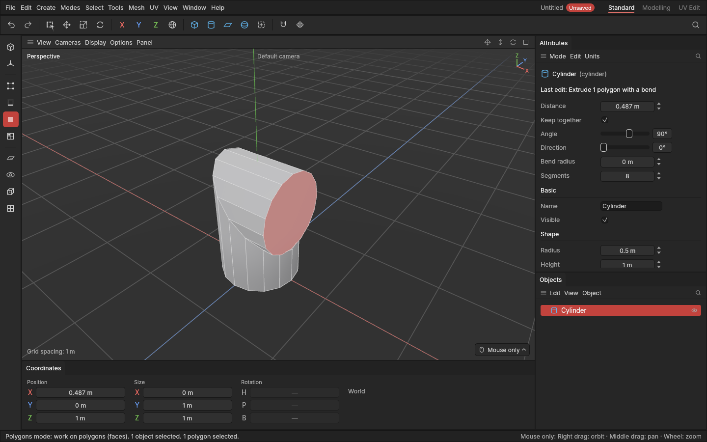
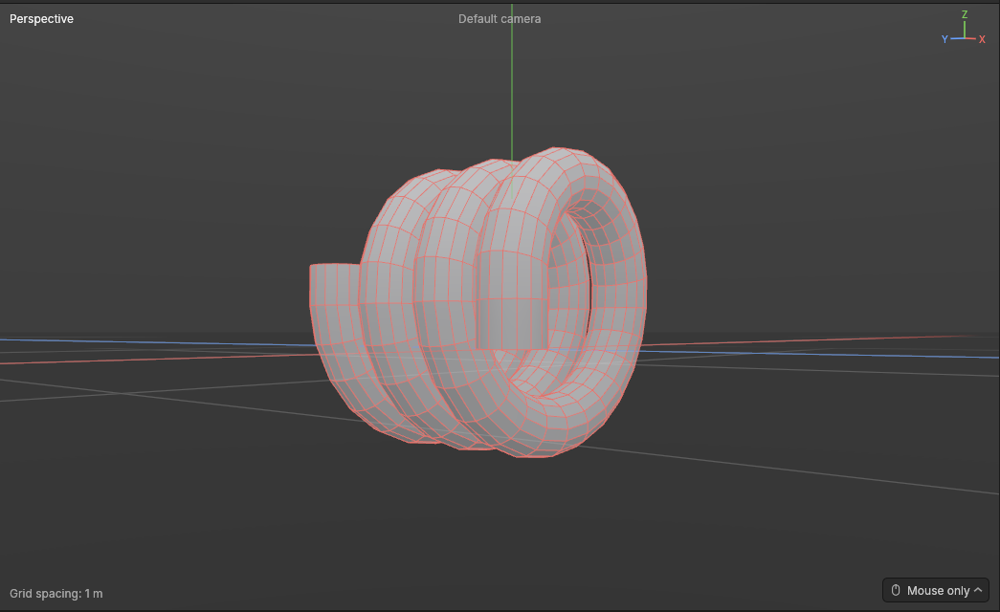

# Extrude and inset

> Extrude pushes polygons out (or in) and builds new sides behind them; Inset shrinks polygons inward and leaves a ring of new polygons around them.

These two are the bread and butter of hard-surface modelling. Almost every panel, button, vent and handle on a game prop starts with them:

- **Extrude** grows the shape: pull a polygon out of a cube and you get a block sticking out, with four new [polygons](concepts.md#mesh-basics) as its walls.
- **Inset** adds detail without changing the outline: the polygon gets smaller where it is, flat on the surface, and a ring of new polygons fills the gap. It's how you draw a frame or a border onto a surface before pushing something in or out.

**Inset, then extrude** is the classic pair. Inset a cube's top a little, then extrude it inward: you have a recessed panel with a crisp rim.

## When to use it

- **Pull something out of a shape**, like a handle, a vent box or a pipe stub: extrude its polygons outward.
- **Push something in**, like a recess, a screen or a slot: extrude inward (drag the other way).
- **Make a frame or a lip** around a polygon before extruding it: inset first.
- **Grow a flat sheet at its edge**, like extending a plane: extrude its [border edges](concepts.md#mesh-basics) in Edges mode.

To move polygons without building new ones, use [Move](transforming.md) instead.

## How to use it

### Extrude polygons

1. Select a shape and press **3** for the [Polygons mode](modes.md).
2. [Select](selecting.md) the polygons to extrude.
3. Press **D** (or pick **Extrude** from the [tool menu](tool-menu.md) **E**, or the **Mesh** menu).
4. Drag **anywhere in the viewport**, the way you want the polygons to go. Drag the way they face on screen and they come out, following the mouse; drag the other way and they sink in. A polygon on the left side comes out when you drag left, the top when you drag up. A label by the mouse says how far.
   - When the polygons face you straight on, there is no "way" on screen to follow, so drag **right** to bring them out and left to push them in.
   - **Start the drag on another polygon** and that polygon becomes the selection first, so you can extrude it straight away without clicking it. Starting on a selected polygon, or on empty space, extrudes what is selected.
5. Let go. The whole drag is one undo step.

The polygons stay selected, so you can drag again straight away to extrude another step. Each drag is its own extrude.

### Inset polygons

1. In the Polygons mode, select the polygons.
2. Press **I** (or pick **Inset** from the tool menu or the Mesh menu).
3. Drag anywhere in the viewport **towards the middle of the polygons**: they shrink inward, following the pull. Pulling away from the middle again lets them grow back; it never grows them past where they started.
   - It doesn't matter which side you start on: from the left of the polygons you pull right, from above you pull down.
   - If you start the drag right on their middle, there's no way to pull towards, so drag right to shrink them.

### Extrude border edges

1. Press **2** for the Edges mode and select edges on an **open border**: edges with a polygon on one side only, like the rim of a [plane](primitives.md).
2. Press **D** and drag the way you want the edge to grow. A new strip of polygons grows outward from each edge, flat with the polygon it belongs to.
3. The selection moves to the new outer edges, so you can drag again to keep growing.

Edges with polygons on both sides have nothing to grow from and are left alone; the status bar doesn't count them.

### Bend it: pipes that turn a corner

An extrude can turn a corner before it goes on, like a pipe's elbow. Unlike simply turning a pipe's end, the pipe **keeps its full width** all the way through the turn.

1. Select the end polygon of a pipe (a cylinder's top, say) in Polygons mode.
2. Press **D** and drag out as usual.
3. Under **Last edit** in the Attributes panel, set **Angle** (90° for a right angle). The extrude now turns first, then goes on straight for its Distance.
4. Set **Bend radius** for a smooth elbow: how far the middle of the turn is from the middle of the pipe. With **0** the turn is a sharp corner, cut at the halfway angle like a mitred pipe fitting.
5. **Direction** turns the bend round the pipe: 0° turns up (an upright pipe turns towards +X), 90° a quarter of the way round, and so on.
6. **Segments** is how many rows a smooth elbow has. **Ctrl + mouse wheel** changes it too.

#### Spirals: going round more than once

With a **Bend radius**, the **Angle** can go past 360°, up to 3600° (ten full turns). Past one turn the pipe would run into itself, so each loop **climbs sideways just far enough to clear the loop before**, like a coiled spring or a [spiral](concepts.md#mesh-basics). You don't have to work anything out: 720° gives two loops side by side, 1080° three.

- **Rise per turn** adds extra room between the loops: how much further each full turn climbs. At **0** the loops are just apart (a small gap, so they never touch); more makes an open, stretched spring. Under one turn it tilts the bend into a ramp instead, like a spiral staircase's handrail. It needs a Bend radius; without one it's greyed out.
- **Segments** counts the rows in **each full turn** once a bend goes past one turn, so a spiral stays as smooth as one loop of it. A whole spiral has at most 256 rows, so changing it stays quick: very long spirals get a little fewer per turn.
- **Under one turn nothing changes**: an elbow stays exactly as it was.
- The spiral climbs along the line the turn goes round: sideways, across the way it turns. For an upright pipe turning up towards +X (Direction 0°), the loops stand upright and climb along Y. **Direction** turns the whole spiral round the pipe.
- With **Symmetry** on, the copy on the other side is the spiral's true mirror image: it winds the other way round, as a mirrored spring would.

Big angles are easiest to type: click the Angle number and type 1080, rather than dragging.

You can also set the bend before dragging (at the top of the Attributes panel, while Extrude is in use), and the next drag bends. Once that extrude is done, or you pick another tool, **Angle goes back to 0**, so the extrude after it starts straight and nothing turns by surprise. The finished extrude keeps its bend, and you can still change it under Last edit. Direction, Bend radius and Segments stay as you set them. To build a pipe, extrude its end again and again, straight or bent.

Each bend setting is a number field, like the ones further down the panel: drag the number, click and type one, or click the small arrows beside it (with **Shift**, ten steps at a time). The bend rows sit under a small **Bend** heading, below the extrude's **Distance**.

### Change it afterwards

Right after an extrude or inset, the **Attributes panel** shows it at the top, under **Last edit**:

- **Distance**: type an exact value, drag the number, or use the arrows. The shape follows as you change it.
- **Keep together**: switch it to change how neighbouring polygons were treated (see Settings below).
- **Angle**, **Direction**, **Bend radius**, **Segments** and **Rise per turn**: bend it, or coil it into a spiral (see above).

This works until you make another edit on top. After that, the extrude is fixed in place, like any other edit.

### While you drag

- Hold **Shift** for ten times finer steps.
- Press **Esc** or **right-click** to cancel: everything goes back as it was.
- Let go where you started and nothing is recorded.
- A **click** without dragging still selects, so you can pick other polygons without leaving the tool. Press **Q** to go back to selecting with the box, lasso or brush.

## Settings

| Setting | What it does |
|---|---|
| **Keep together** (Attributes panel) | **On** (the standard): polygons that touch move as **one piece**, like a slab pulled out of a wall; the edges between them stay and no walls form between them. **Off**: **each polygon on its own**, so every one becomes a separate bump (extrude) or gets its own ring (inset). The switch shows at the top of the Attributes panel while Extrude or Inset is the tool in use, and on the last edit; changing it on the last edit also sets it for the next one. For edges, on means edges that meet at a point grow as one strip. |
| **Distance** (Attributes panel, Last edit) | How far the polygons were pushed or shrunk, in the object's own size. Negative extrudes push inward. With a bend, how far it goes on straight after the turn. |
| **Angle** | How far an extrude turns before going on: 0° is straight. With a Bend radius up to 3600° (past 360° it spirals); with none, up to 150°. |
| **Direction** | Which way round the pipe it turns: 0° turns up (an upright pipe turns towards +X). |
| **Bend radius** | From the middle of the turn to the middle of the pipe. 0 is a sharp mitre corner; more is a smooth elbow. Below the pipe's own radius, the inside of the turn folds over. |
| **Segments** | How many rows a smooth turn has; for a spiral, how many each full turn has. **Ctrl + wheel** changes it while Extrude is in use. |
| **Rise per turn** | Extra room between a spiral's loops: how much further each full turn climbs. 0 leaves the loops just apart. Under one turn, it tilts the bend into a ramp. Needs a Bend radius. |

## Shortcuts

| Action | Shortcut |
|---|---|
| Extrude | `D` |
| Inset | `I` |
| Set the distance | Left drag anywhere in the viewport: Extrude the way the polygons face, Inset towards their middle |
| Finer steps | Hold `Shift` while dragging |
| A bend's segments | `Ctrl` + wheel (while Extrude is in use) |
| Cancel the drag | `Esc` or a right-click |
| Back to selecting | `Q` |

## Tips and common problems

- **Tip: inset, then extrude inward** makes a recessed panel. **Inset, then extrude outward** makes a raised plate with a border round it.
- **Tip:** for a pipe that keeps turning, give each new extrude its Angle under Last edit right after dragging it. Angle goes back to 0 after every extrude, so a straight piece never turns by surprise; Bend radius and Segments carry on, so each elbow matches the last.
- **Tip:** for a spring, start from a small cylinder's top: Angle in whole turns (720°, 1080°…), a Bend radius a few times the cylinder's radius, and Rise per turn for how open the coils are.
- **Problem:** my spiral's loops cut into each other. **Why:** the Bend radius is smaller than the pipe's own radius, so the inside of each turn folds over (the same as with a single elbow). **Fix:** make the Bend radius bigger than the pipe's radius.
- **Tip:** to push several separate panels in at once, select them all with **Keep together** off; with it on, touching polygons go in as one big panel.
- **Tip:** the cube's hard edges carry over: an extruded block on a cube has crisp edges, and one on a sphere stays smooth. To change them, see [Hard and soft edges](hard-and-soft-edges.md).
- **Problem:** I switched from Extrude to Inset and the extrude's rows are gone from the Attributes panel. **Why:** while a tool is in use, the panel shows that tool's own settings, and the last edit only when the same tool made it. **Fix:** press **D** again (or **Tab** to put the tool away) and the extrude shows under Last edit again.
- **Problem:** pressing D or I does nothing but the status bar talks about modes. **Why:** Extrude works in the Polygons and Edges modes, Inset only in Polygons. **Fix:** press **3** (or **2** for edges) and try again.
- **Problem:** the drag does nothing. **Why:** nothing of the right kind is selected; the status bar says so. **Fix:** select polygons (or border edges) first.
- **Problem:** extruding edges does nothing. **Why:** the edges aren't on an open border; a cube has none. **Fix:** use a plane, or extrude polygons instead.
- **Problem:** an inset crossed over itself and looks folded. **Why:** it went further than the polygon is wide. **Fix:** undo, or lower the Distance in the Attributes panel.
- **Problem:** after changing the cube's segments, the extrude went somewhere odd or the Attributes panel says an edit no longer fits. **Why:** edits find their polygons again by where they were ([Attributes: Edits](attributes.md)); a big change can leave nothing at that spot. **Fix:** go back to the earlier settings, or undo.
- **Problem:** the extrude is too fast or too slow to control. **Why:** the polygons follow the mouse, so a small drag goes a long way when zoomed out. **Fix:** zoom in, hold Shift, or type the Distance.
- **Problem:** neighbouring polygons came out as separate blocks with a gap between them, even with Keep together on. **Why:** Keep together joins polygons that share an edge. Polygons made by separate extrudes (or with Keep together off) sit side by side but each has its own copy of the points along the seam, so they aren't joined. **Fix:** for now, select the polygons together before the first extrude. Welding points back together arrives with Connect, bridge and weld later in Phase 4.

## Related

- [Selecting](selecting.md): picking the polygons and edges to work on.
- [Move, rotate and scale](transforming.md): moving extruded polygons further.
- [The tool menu](tool-menu.md): Extrude and Inset are in the top-right group.
- [Concepts](concepts.md): [polygons, borders and manifold shapes](concepts.md#mesh-basics), [extrude and inset](concepts.md#mesh-basics).
