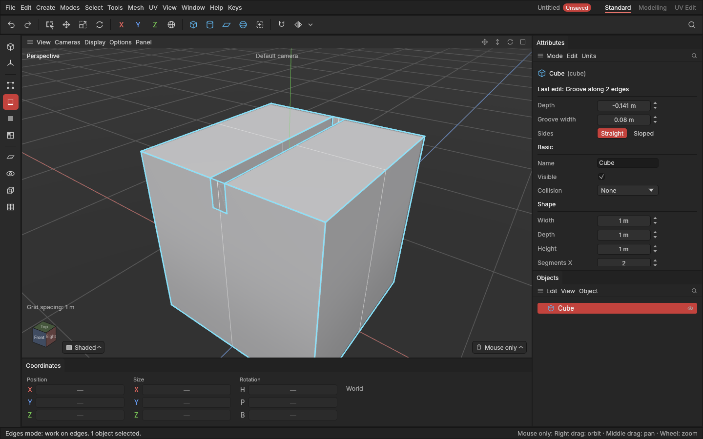

# Groove

> Groove cuts a thin line into a shape along edges, or raises one out of it as a ridge, in one step: a panel line, a seam, a slot or a raised strip.

Hard-surface props are covered in thin lines: the seams between panels on a gun or a spaceship, the slots in a vent, the rim around a hatch. They break up big flat areas and make a model read as something built from parts. Without Groove you would [bevel](bevel.md) the edges to get a thin strip, select the strip, and [extrude](extrude-and-inset.md) it inward. Groove does all of that at once, and keeps it as one edit you can still change.

## When to use it

- **Panel lines and seams:** cut a groove along a loop of edges, like the line where a lid meets a box or the seams across a gun's body. Straight sides give a crisp line.
- **A V-shaped cut**, like a score line in wood or a chevron: choose sloped sides.
- **A raised strip or rib**, like a weld bead, a trim along an edge or the ribs on a grip: drag out instead of in, and Groove raises a ridge.

For a wide recess or a step, use [Extrude and inset](extrude-and-inset.md) on polygons instead. For softening an edge, use [Bevel](bevel.md).

## How to use it

1. Select a shape and press **2** for the [Edges mode](modes.md).
2. [Select](selecting.md) the edges the line should follow. **Double-click** selects a whole loop, and **Ctrl + click** adds edges one at a time. The edges need a polygon on each side; edges on an open border are skipped, as Bevel skips them.
3. Press **K** (or pick **Groove** from the [tool menu](tool-menu.md) **E**, or the **Mesh** menu).
4. Drag anywhere in the viewport **into the surface** to cut a groove, or **out of it** to raise a ridge. The further you drag, the deeper (or higher) it goes, and a label by the mouse says how far. It follows the app's rule that [drags follow the pull](interface-tour.md#drags-follow-the-pull).
5. Let go. The whole drag is one undo step.

Before you drag, the top of the **Attributes panel** shows the next groove's **Groove width** and **Sides**. After a groove, they show under **Last edit** with its **Depth**, and changing any of them reshapes the groove you just made, until you make another edit on top.

### While you drag

- Hold **Shift** for ten times finer steps.
- Press **Esc** or **right-click** to cancel.
- Let go where you started and nothing is recorded.
- A **click** without dragging still selects.

### Where a groove ends

- **Inside a surface** (a line of edges that stops in the middle of a face), the groove is closed off with a clean wall, like the end of a slot.
- **At the edge of a face** (the line reaches a corner of the shape), the groove's end wall sits flush with the side, so the slot looks closed from the side. To carry the line on round the corner, select the edges on the side too.
- **Round a loop**, it has no ends: the groove goes all the way round.

## Settings

| Setting | What it does |
|---|---|
| Groove width | How wide the line is, half on each side of the edges. Panel lines on a game prop are usually a few millimetres to a centimetre: thin enough to read as a seam, wide enough to show up in a normal map bake. Standard 1 cm, up to 1 m. |
| Depth | How far in (below 0: a groove) or out (above 0: a ridge) the line goes. The drag sets it; change it under Last edit. |
| Sides | **Straight:** walls square to the surface and a flat bottom, a crisp panel line. **Sloped:** the sides slope down to a fold along the middle, a V. |

On a [stretched object](concepts.md#objects-and-scenes), the width and depth are measured as you see them, so a groove is as wide on the tall side as on the short side.

With [Symmetry](symmetry.md) on, the groove is cut on both sides, and its settings under Last edit belong to both.

## Shortcuts

| Action | Shortcut |
|---|---|
| Groove tool | `K` |
| Finer steps while dragging | Hold `Shift` |
| Cancel while dragging | `Esc` or right-click |

## Tips and common problems

- **Problem:** pressing K says Groove works on edges. **Why:** you're in the Points, Polygons or Model mode. **Fix:** press **2** for the Edges mode.
- **Problem:** nothing happens on some edges. **Why:** they're on an open border (a polygon on one side only), and a groove needs a surface on each side. **Fix:** [fill the hole](clean-up.md) first, or pick edges inside the surface.
- **Problem:** the groove looks too thin or invisible. **Why:** the standard width is 1 cm, which is small on a big object. **Fix:** change **Groove width** under Last edit; the groove reshapes.
- **Problem:** two grooves crossing look messy where they meet. **Why:** they were cut one after the other. **Fix:** select both lines' edges and cut them as one groove: where they cross, they share one corner.
- **Tip:** for a groove with soft, rounded edges, cut it, then [bevel](bevel.md) the groove's rim edges with a couple of segments.

## Related

- [Bevel](bevel.md) and [Extrude and inset](extrude-and-inset.md), the two steps Groove does in one.
- [Selecting](selecting.md) for picking loops of edges.
- [Concepts](concepts.md): [panel line](concepts.md#mesh-basics), [edge](concepts.md#mesh-basics), [bevel and chamfer](concepts.md#mesh-basics), [stretched object](concepts.md#objects-and-scenes).
