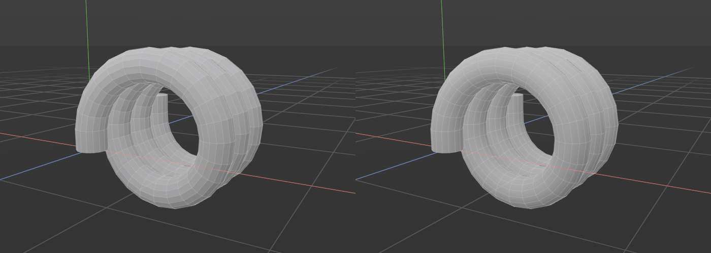
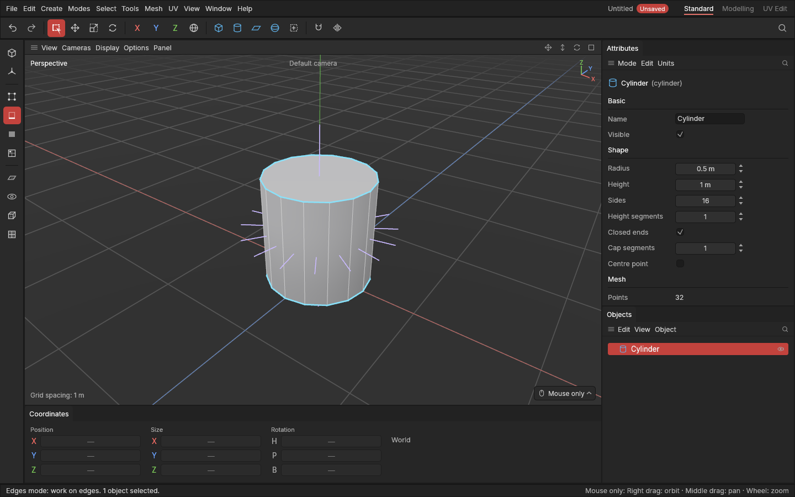

# Hard and soft edges, and normals

> Choose where the shading breaks into a crisp edge and where it flows smoothly, and see which way polygons face.

A shape is made of flat polygons, but it doesn't have to look faceted. Across a **soft** edge the light flows smoothly, so a cylinder made of 16 flat sides looks round. Across a **hard** edge the light breaks, so a box's corner looks crisp. Getting this right is a big part of making a game model look good, and it changes nothing about the shape itself: only how it's lit. See [hard and soft edges](concepts.md#shading-and-normals).

## When to use it

- **Smoothed by angle** (each object's standard): let the app decide, from how sharply polygons meet. Right for most hard-surface shapes.
- **Mark hard edges / Mark soft edges:** for edges the angle gets wrong: a soft edge on a low-poly curve, a hard edge across a gentle curve where a texture seam will go.
- **Hard edges by angle:** to mark a whole object's edges at once from an angle, as a starting point to fix by hand.
- **Show normals:** to check which way polygons face, and to spot [flipped](concepts.md#shading-and-normals) ones.

**Most of the time you don't need to set anything.** Every new object is **smoothed by angle** (see [below](#smoothed-by-angle)), and marking an edge by hand takes care of the rest.

## How to use it

### Smoothed by angle

Each object has its own **smoothing**, shown on the **Smoothing** row of the [Attributes panel](attributes.md) when the object is selected: a **By angle** checkbox and, while it's ticked, the angle (**30°** as standard).

While an object is smoothed by angle, wherever two of its polygons meet more sharply than the angle the shading breaks into a crisp edge, and everywhere else it flows smoothly. This is worked out again after every change, so a cylinder's sides stay smooth and its caps crisp however you extrude, bend or cut it. Without it, edits can leave edges marked hard where the shape is meant to be round: every ring of a bent extrude would come out hard, and the pipe would look faceted.

It changes only the shading, never the shape or its edits. The cyan lines of **Show hard edges** show the edges that are hard right now, so on an object smoothed by angle they follow the angle.

To change it:

- **One object:** tick or untick **By angle** on its Smoothing row, and drag or type the angle. Dragging the angle is one undo step.
- **Several objects at once:** select them and use **Mesh → Shading → Smooth by angle**. Ticked, the selected objects are smoothed by the standard 30°; unticked, they're shaded only by the edges you mark. The tick shows when every selected object is smoothed by angle.

Untick it when you want edges the angle wouldn't choose, or just mark edges by hand (next section): that switches the object over for you.

### By hand

1. In the **Edges** mode, select edges. Or in the **Polygons** mode, select polygons: their edges are used.
2. Press **E** and pick **Mark hard edges** or **Mark soft edges** (or use **Mesh → Shading**).

Softening a group of polygons makes them shade as one smooth surface. Hardening them gives them a crisp outline.

**On an object smoothed by angle**, marking edges first keeps the look the angle gave it, by marking those edges hard and the rest soft, then switches the object to its marked edges (unticks By angle), and then makes your marks. So your marks always show, and nothing else about the shading changes. It's all one undo step: **Ctrl + Z** puts the object back to smoothed by angle. The status bar says when this happens.

### Hard edges by angle

1. Select the objects.
2. Pick **Mesh → Shading → Hard edges by angle**.

Every edge whose two polygons meet more sharply than the **Angle** is marked hard, and every other one soft. Change the **Angle** under **Last edit** in the [Attributes panel](attributes.md), and the shape follows. This marks the edges once; it doesn't change the object's smoothing, so on an object smoothed by angle you'll see the difference only once it's shaded by its marks.

### Seeing them

In the viewport's **Display** menu:

- **Show hard edges** (on as standard): while editing points, edges or polygons, the edges where the shading breaks are drawn in light cyan.
- **Show normals**: each polygon of the selected objects shows a short violet line from its middle, the way it faces. A line pointing into a shape means that polygon is flipped: see [Clean-up](clean-up.md).

**Select → Select hard edges** selects every hard edge, to check them or to change them all at once.

### When you export

[Export](export-and-import.md) uses each object's own smoothing, so the model looks in the game engine as it does here.

## Settings

| Setting | What it does |
|---|---|
| **Smoothing: By angle** (Attributes panel, per object) | Ticked (the standard for new objects): the object is shaded by angle after every change, edges sharper than the angle crisp and the rest smooth, whatever they are marked. Unticked: shaded only by the edges marked hard. Saved with the project. |
| **Smoothing angle** (Attributes panel, per object) | Edges whose polygons meet more sharply than this are crisp. 0° is flat. **30°** (the standard) makes a box's corners crisp and curves of 12 or more sides smooth. Raise it for curves with fewer sides. |
| **Smooth by angle** (Mesh → Shading) | Sets the selected objects to smoothed by angle at 30°, or (unticked) to their marked edges. |
| **Angle** (Hard edges by angle, Last edit) | Edges whose polygons meet more sharply than this are marked hard, the rest soft. |

## Shortcuts

| Action | Shortcut |
|---|---|
| Mark hard edges, Mark soft edges | Tool menu `E`, or Mesh → Shading |
| Smooth by angle, Hard edges by angle | Mesh → Shading |
| Select hard edges | Select menu |
| Show hard edges, Show normals | The viewport's Display menu |
| Any of these by name | `Space` ([command search](command-search.md)) |

## Tips and common problems

- **Tip:** a cylinder with few sides (say 8) has sides meeting at 45°. With the standard 30° they come out crisp and it looks faceted: raise the object's smoothing angle to 50° in the Attributes panel to make it round again.
- **Tip:** soft edges between polygons at a sharp angle look smeared and dark. If a corner looks muddy, mark that edge hard, or bevel it.
- **Tip:** new polygons from [Bridge](connect-bridge-weld.md) and [Fill hole](clean-up.md) get hard edges by themselves where they meet the shape at more than 30°, so on an object shaded by its marks a band between two boxes or a cap on a tube looks crisp straight away.
- **Problem:** I marked edges and the object's By angle tick went off. **Why:** marks only show on an object shaded by its marks, so the app switched it over, keeping the look the angle gave it. **Fix:** nothing to fix; **Ctrl + Z** undoes the whole step if you didn't want it.
- **Tip:** Smoothing only shades the shape. To make the shape itself smoother, with more polygons, add a [Subdivide](subdivide.md) modifier; on an object shaded by its marked edges, its hard edges stay sharp there too.
- **Problem:** Hard edges by angle changed nothing on screen. **Why:** the object is smoothed by angle, which ignores marks. **Fix:** untick **By angle** on its Smoothing row to see the marks.
- **Problem:** Mark hard edges did nothing, and the status bar says they already are. **Why:** every selected edge is already hard. **Fix:** nothing to do, or pick Mark soft edges.
- **Problem:** Smooth by angle is greyed out. **Why:** nothing with a shape is selected. **Fix:** select the objects first.
- **Problem:** the hard edges or normals don't show on a very detailed shape. **Why:** they're drawn only for shapes of up to 50,000 polygons, to keep the view quick.

## Related

- [Bevel](bevel.md): a small bevel on a hard edge catches the light.
- [Weighted normals](weighted-normals.md): soft bevels with big faces that still shade flat, instead of hard edges.
- [Clean-up](clean-up.md): flip polygons and fix facing.
- [The Attributes panel](attributes.md): each object's Smoothing row.
- [Concepts](concepts.md): [hard and soft edges, normals, smoothing by angle](concepts.md#shading-and-normals).
