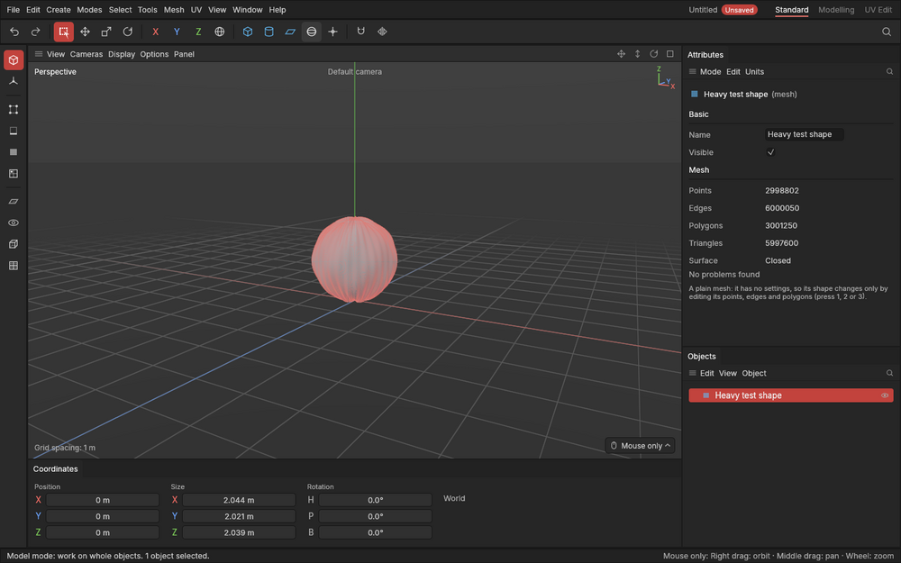

# Heavy shapes

> Shapes of millions of polygons, like a detailed model you might bring in to model on top of, stay quick to look at, select and edit.

## When to use it

Game assets are usually light: a prop has a few thousand to a few hundred thousand [polygons](concepts.md#mesh-basics). Sometimes you'll want something much heavier in the scene:
- a high-poly sculpt or a 3D scan, to model a clean, light version on top of (*retopology*);
- a detailed part from another model, as a reference for size.

The app is built to cope with that: one shape of 2–3 million polygons stays usable. Heavy work happens in the background, so the window never freezes while it's going on. It's a safety net rather than the everyday case. Most of what you build stays far lighter, and should, for a game.

Bringing in models from other programs (import) arrives with export in Phase 5. Until then you can try a heavy shape with the test shape below.

## How to use it

### Try the heavy test shape

1. Choose **Help → Developer → Add a heavy test shape**. A bumpy ball of 3 million polygons appears at the middle of the scene, named *Heavy test shape*, and is selected.
2. For a moment the view says **Preparing a heavy shape for drawing…**, and the Attributes panel says **Checking the mesh…**. This work happens in the background: you can keep orbiting and working meanwhile. On a typical computer it takes a second or two.
3. Try what you'd normally do:
   - orbit around it;
   - click it, and click something else;
   - press `3`, hover over its polygons, click one and move it with `W`;
   - press `1` and drag a box over some points.

   Each of these should respond at once.
4. **Ctrl + Z** takes the shape away again (the whole addition is one undo step).

### What you'll notice with a heavy shape

- **Its edges fade out from afar.** Seen from a distance, its edges are so close together that drawing them would cover the shape in a solid block of lines. So edges that would be only a pixel or two apart fade out, and the shape reads as a surface. Zoom in and they come back. The same goes for its points in Points mode.
- **When it's selected**, it keeps a faint tint of the accent colour from afar, so you can still tell.
- **The first time you use a mode on it**, it may take a moment longer. For example, the first hover in Points mode on a 3-million-point shape takes about a third of a second while the app sorts its points.
- **Saving and opening** a project holding one takes a second or so, and the project file is larger (about 50 MB for 3 million polygons).

## Settings

None. The app decides on its own what to do in the background (anything from about 50 000 polygons).

## Shortcuts

| Action | Shortcut |
|---|---|
| Add a heavy test shape | **Help → Developer → Add a heavy test shape** (no key) |
| Take it away again | `Ctrl + Z` |

## Tips and common problems

- **Problem:** the shape doesn't appear straight away, and the view says *Preparing a heavy shape for drawing…*. **Why:** its drawing data is being worked out in the background. **Fix:** nothing to do; it appears within a few seconds. You can keep working meanwhile.
- **Problem:** the Attributes panel says *Checking the mesh…*. **Why:** the health check of a heavy shape runs in the background. The numbers below it are from before your last change until it finishes. **Fix:** nothing to do.
- **Problem:** I can't see the edges of a heavy shape. **Why:** from afar they're too dense to draw usefully, so they fade out. **Fix:** zoom in closer to the part you're working on.
- **Tip:** to model a light shape on top of a heavy one, keep the heavy one unselected while you work on the other. Then nothing about it changes, and it costs almost nothing to keep on screen.
- **Tip:** if your computer struggles with the test shape, tell the project lead what was slow. How fast the shape is *drawn* depends on your graphics card, which the app's own checks can't measure.

## Related

- [Concepts: polygons and triangle count](concepts.md#mesh-basics)
- [The Attributes panel: the Mesh section](attributes.md)
- [Points, Edges and Polygons modes](modes.md)
