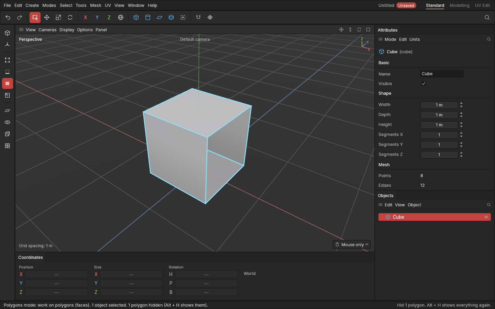

# Hide and isolate

> Get things out of the way: hide what's selected, show only what's selected, and show everything again.

When a model gets busy, parts of it hide what you want to work on: the inside of a box, a panel behind another, one object among many. Hiding takes them out of view for a moment. Isolating does the opposite: everything but the selection goes.

## When to use it

- **Hide (Shift + H):** a part is in the way. Hide it, work behind it, show it again.
- **Isolate (Ctrl + H):** work on one object, or one part of a shape, without the rest around it.
- **Show everything (Alt + H):** bring it all back.

## How to use it

1. Select what to hide, or what to keep.
2. Press **Shift + H** to hide it, or **Ctrl + H** to isolate it (or click **Show only the selection** on the left palette, the icon under the mode buttons).
3. Press **Alt + H** to show everything again.

What gets hidden depends on the mode:

- **In the Model mode**, whole objects. This is the same as clicking their eye in the [Objects panel](objects.md), so it is saved with the project and **Ctrl + Z** takes it back. Hidden objects are unselected.
- **In the Points, Edges and Polygons modes**, polygons of the selected objects: the selected polygons, or the ones touching the selected points or edges. Hidden polygons aren't deleted: they're only out of view. You can't see, click or select them (**Select all** takes only what is shown), so no tool changes them by accident. This is a view setting, like where the camera is: it isn't saved, and undo doesn't change it. The status bar says how many polygons are hidden.

**Alt + H** shows the hidden polygons again in every mode; in the Model mode it shows hidden objects too.

## Settings

None.

## Shortcuts

| Action | Shortcut |
|---|---|
| Hide the selection | `Shift + H` |
| Isolate the selection (hide everything else) | `Ctrl + H`, or the Show only the selection button |
| Show everything | `Alt + H` |

## Tips and common problems

- **Tip:** to work inside a box, select its top polygon in the Polygons mode and press **Shift + H**.
- **Problem:** an object is missing after opening a project. **Why:** hidden objects stay hidden when saved. **Fix:** press **Alt + H** in the Model mode, or click its closed eye in the Objects panel.
- **Problem:** a tool says nothing is selected after hiding. **Why:** hiding unselects what it hides. **Fix:** select what you can still see.
- **Problem:** polygons came back after reopening the app. **Why:** hidden polygons are only a view setting and aren't saved.

## Related

- [The Objects panel](objects.md): the eye on each object.
- [Selecting](selecting.md)
- [Concepts: isolate](concepts.md#viewing-the-scene)
