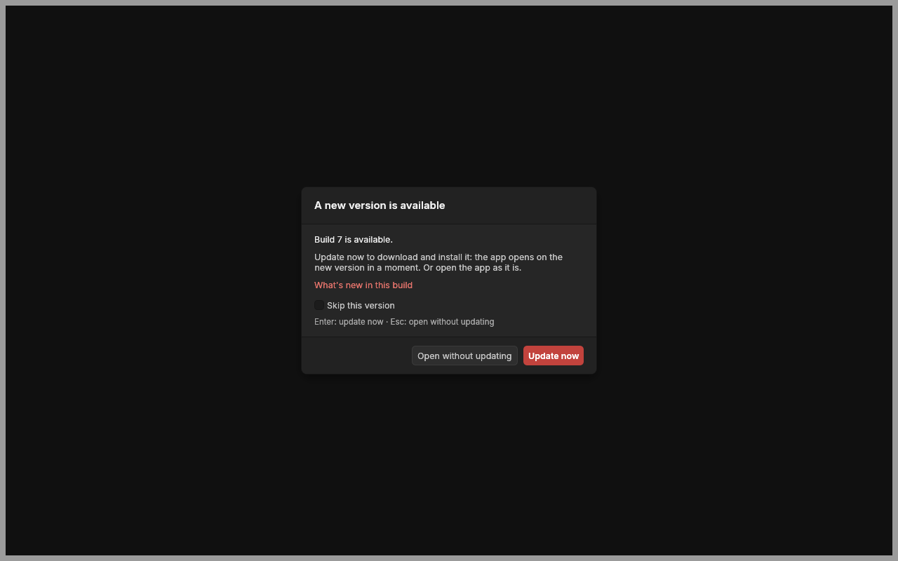
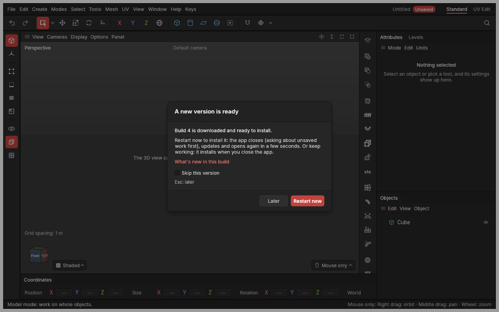

# Installing and updating

> Install the app once on Windows, and it keeps itself up to date: a new version downloads while you work and installs when you say so.

## When to use it

Use the setup program whenever you want the app on your computer like any other program: in the Start menu, in Windows' list of installed apps (to uninstall it), and opening your projects when you double-click them. Once it's installed, every new version reaches you by itself; there's nothing more to download by hand.

Each time a change is finished and its automatic checks pass, a new **build** is published on the project's [Releases page](https://github.com/Rhyslos/Aventail-3D/releases), with its own **build number** (412, 413 and so on: higher is newer). The number is in **Help → About**: *Version 0.0.1 (build 413)*.

The plain program files (a zip with the program in it) are still attached to every change on GitHub, under the Actions tab, for trying a change that isn't finished yet. A copy run from a zip never changes itself.

## How to use it

### Installing (once)

1. Open the [Releases page](https://github.com/Rhyslos/Aventail-3D/releases) and, under the newest release, download **aventail-setup.exe**.
2. Your browser or Windows may warn that the file isn't commonly downloaded: the app isn't [code-signed](concepts.md#code-signing) yet. In Edge, click **⋯ → Keep → Keep anyway**; in Chrome, **Keep**. When Windows says **Windows protected your PC**, click **More info → Run anyway**.
3. The setup program asks **where to install**. It suggests your own Programs folder on C:; click **Browse…** to pick another drive or folder, such as `D:\Apps\Aventail 3D`. Any folder you can save files in works, with no admin password.
4. Choose whether you'd like a desktop icon, check the folder on the last page, and click **Install**. At the end, tick **Launch** to open the app.

You get a Start menu entry with the app's logo (a red cube on a dark disc), and projects (`.avtl` files) open in the app when you double-click them. The app opens as a normal window, with no terminal window behind it. Updates go into the same folder, without asking again.

Only the program goes into the folder you chose. Your settings, panel layout, backup copies and downloaded updates stay in your own app-data folder (`%LOCALAPPDATA%`), where Windows keeps every program's.

### Updating

**When the app starts**, its splash screen looks for a new version: *Looking for a new version…*. The look takes a moment, and gives up after a few seconds without internet, so starting never hangs. Then one of two things happens:

- **No new version** (or one you skipped): the app opens as usual.
- **A new version**: the splash screen asks before the app opens.

- **Update now** (or **Enter**) downloads it, with the bar filling (*Downloading build 7… 40%*), installs it and opens the app on the new version.
- **Open without updating** (or **Esc**) opens the app as it is. Nothing is installed; you're asked again the next time the app starts.
- **Skip this version**, ticked before **Open without updating**: you're not asked about this version again, only when a newer one comes out. **Settings → Interface → Updates** shows the skipped version, with **Ask about it again**.
- **What's new in this build** opens the release's page, which says what changed.

**While the app is open**, it looks again every six hours. A new version found then downloads in the background, and a window asks:

- **Restart now** closes the app (asking about unsaved changes first, as any close does), installs the new version, and opens it again. It takes a few seconds.
- **Later** (or **Esc**) puts the window away. Keep working; the new version installs quietly the next time you close the app.
- **Skip this version**, ticked before **Later**: it isn't installed, and you're not asked about it again.

The update keeps your settings, layouts, recent projects and backup copies: only the program changes.

**To stop looking altogether**, untick **Settings → Interface → Updates → Look for new versions**. The app then never asks GitHub, and starts without the look.

### Uninstalling

**Windows Settings → Apps → Installed apps**, find the app, and choose **Uninstall**. Your projects, settings and backup copies stay where they are.

## Settings

| Setting | What it does |
|---|---|
| **Settings → Interface → Updates → Look for new versions** | On (standard): the installed app looks for new versions as described above. Off: it never looks, and starts without the look; download new versions from the Releases page instead. Under the switch, a line says what the last look found: up to date, a build ready, or why it couldn't look. |
| **Skip this version** (in the update questions) | Not asked about that version again; a newer one is offered. Settings shows the skipped version, with **Ask about it again**. |

## Shortcuts

Updating has no keys of its own.

## Tips and common problems

- **Problem:** the update window never appears. **Why:** only a copy installed with the setup program updates itself, and only on Windows; a copy run from a zip, or built from the source code, doesn't. **Fix:** Settings → Interface → Updates says which. Install with the setup program once.
- **Problem:** Settings says it couldn't look for a new version. **Why:** no internet connection, or GitHub asked it to wait. **Fix:** nothing: it tries again in a few hours, and every time the app starts.
- **Problem:** Windows warns about the setup program. **Why:** it isn't code-signed yet, so Windows doesn't know who made it. **Fix:** see step 2 of *Installing*. The installed app downloads its updates itself, so the warning only comes the first time.
- **Problem:** I clicked **Restart now**, then **Cancel** in "Save changes?". **Why:** the app stays open, so nothing installs yet. **Fix:** the update installs, and the app opens again, when you next close it.
- **Problem:** I want the app in another folder. **Why:** updates go back into the folder chosen on the first install. **Fix:** uninstall it, then run the setup program again and pick the new folder: it asks again after an uninstall.
- **Tip:** started from a terminal, `aventail --version` and `aventail --help` print there; the prompt comes back first, as with any window program on Windows.
- **Tip:** **Help → About** shows the build you're running: *Version 0.0.1 (build 413)*.
- **Tip:** Linux and macOS don't have a setup program yet: download the zip for them from GitHub's Actions tab.

## Related

- [Backup copies and crash recovery](autosave.md)
- [Settings](settings.md)
- [Concepts: code-signing](concepts.md#code-signing)
