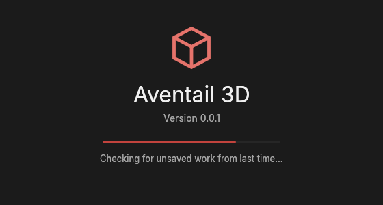
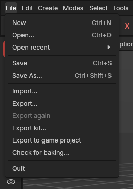

# Interface tour

> The app's window: what each area is for, how to rearrange it, and how to change its accent colour.

## When to use this page

Start here if you're opening the app for the first time, or if you've moved panels around and want to know how to get the standard layout back.

## Starting the app

While the app starts, the window shows a **splash screen**: the app's name and version, a progress bar, and what it is doing right now (*Starting the graphics…*, *Opening crate.avtl…*, *Checking for unsaved work from last time…*). It goes as soon as everything is ready, and if your last session ended in a crash, the offer to bring your work back follows straight after (see [Backup copies](autosave.md)).

## The areas of the window

From top to bottom, left to right:

1. **Menu bar.** Every command lives in a menu, in this order: File, Edit, Create, Modes, Select, Tools, Mesh, UV, View, Window, Help. Commands that aren't built yet are greyed out; hover over one to see which phase brings it. The **File** menu saves and opens projects (see [Saving and opening projects](saving-and-opening.md)), and the project's name is shown on the right of the menu bar, with a red **Unsaved** badge when there are changes you haven't saved (and in the window's title). **File → Quit** closes the app; it has no key on purpose, so a slip can't close it. The **UV** menu is grouped: point at **Seams**, **Turn and flip**, **Lay out**, **Pieces** or **Settings** to see what's in each, with Texture, Trim sheet and Check for baking in between. The **Mesh** menu's **Make editable** already works: it turns the selected shapes into plain meshes (see [Objects](objects.md#make-editable)). **Help → Add a heavy test shape** adds a 3-million-polygon shape to try how your computer copes (see [Heavy shapes](heavy-shapes.md)). On the right are the **layouts**: arrangements of the window for different kinds of work. *Standard* is the one in use (underlined); *Modelling* and *UV Edit* are greyed out until they arrive.
2. **Command palette** (the row of icons under the menus). One-click access to the tools you use most: undo and redo, the selection and transform tools, axis locks, primitives, groups, snapping and symmetry. Undo, redo, the select tool button (it shows Box, Lasso or Paint select; click it or press **Q** for the next, see [Selecting](selecting.md)), Move, Scale and Rotate (**W**, **S**, **R**), the X, Y and Z axis locks, the world or object axes button, snapping (see [Move, rotate and scale](transforming.md)), symmetry (see [Symmetry](symmetry.md)), the blue shape buttons (cube, cylinder, plane, sphere) and the group button work now (press **B** anywhere for a list of every shape; see [Primitives](primitives.md)); the others are dimmed, and hovering shows when each arrives.
3. **Mode palette** (the column of icons down the left side). Decides *what kind of thing* your tools work on; see [Modes](#modes) below. At the bottom are switches for the viewport: **Select only visible** (a box with faint hidden edges; filled with the accent colour when on, so a box, lasso or brush only selects what you can see; see [Selecting](selecting.md)), and the grid button steps through three grid levels, from a line every metre (standard) to every 50 cm and every 10 cm, and back (filled with the accent colour while it shows more than the metre lines). See [Navigating the view](navigating-the-view.md#settings).
4. **Viewport** (the large area in the middle). The 3D view of your scene, with its own menu line along the top (View, Cameras, Display, Options, Panel) and buttons on the right of that line that you can drag to pan, zoom and orbit. The view shows a calm grey sky over a slightly darker ground, with the horizon where they meet. A grid lies on the ground around the point you're looking at, a line every metre, fading out at its edges. The red line is the X axis, the blue one the Y axis, and the green line rising from the middle is Z, which points up. It can also show the top, front and right views, one at a time or all four at once (press **F5**). Labels in the corners tell you the view (*Perspective*, *Top*, ...) and the camera. In the bottom-left corner, the view dice, a small cube that turns with the scene, shows which way you're looking (click a face, edge or corner to look from there; see [Navigating the view](navigating-the-view.md#the-view-dice)), with the grid spacing above it and a button beside it that picks how shapes are drawn (shaded, shaded with wires or wireframe; see [How shapes are drawn](viewport-display.md)); the button in the bottom-right corner picks how the mouse moves the view. A new scene is empty; shapes you create appear at its centre, and selected ones are outlined in the accent colour. See [Navigating the view](navigating-the-view.md) and [Primitives](primitives.md).
5. **Modifiers palette** (the thin column on the right of the viewport). Buttons for things that change a shape without destroying it. Its first is **Add edit layer** (a stack of sheets); see [Edit layers](edit-layers.md).
6. **Attributes** panel (top right). Shows the settings of whatever is selected: its name and whether it's shown, and for a shape its size, segments and so on. Drag or type a value and the model updates as you go. Sizes show in the project's units, metres or centimetres; the small arrows beside each value nudge it one step for fine tuning. Its menu line has Mode, Edit (copy and paste settings) and Units. See [The Attributes panel](attributes.md).
7. **Objects** panel (below Attributes). A tree of every object in your scene: click to select, double-click to rename, drag to put objects inside each other (see [Hierarchy](concepts.md#objects-and-scenes)), and click the eye to show or hide. Its menu line has Edit, View and Object menus. See [The Objects panel](objects.md). Beside it, as a second tab, is **Edit layers**: the selected object's layers of edits; see [Edit layers](edit-layers.md).
8. **Coordinates** (under the viewport). The selection's position, size and rotation: type a value and press Enter, or drag the number sideways (positions are in the world; sizes and positions in the project's units, metres as standard). See [Move, rotate and scale](transforming.md#typing-exact-values). In this app **Z is up**: X and Y are the ground directions and Z is height (see [Axes](concepts.md#objects-and-scenes)). Rotation uses H, P and B: **heading** turns left and right around Z, **pitch** tilts up and down, **bank** rolls sideways. The panel is just tall enough for its rows; drag the gap above it to make it bigger or smaller.
9. **Status bar** (the bottom line). Says which mode you're in and how many objects are selected, reminds you which navigation controls are in use, and shows short messages, for example what was just undone or why something couldn't be done.

## Modes

The mode palette sets what you're working on. The button filled with the accent colour is the active mode.

| Mode | You work on |
|---|---|
| Model | Whole objects, with everything inside them |
| Object | Whole objects, including moving their axis (the [pivot](concepts.md#objects-and-scenes)) without moving the object: see [Pivots and the Object mode](pivots.md) |
| Points | The [vertices](concepts.md#mesh-basics) of a mesh |
| Edges | The edges of a mesh |
| Polygons | The faces of a mesh |
| UV | The [UV map](concepts.md#uvs-and-texturing), in the UV Editor and on the model: a click selects a whole island ([The UV Editor](uv-editor.md)) |

You can also switch modes from the **Modes** menu, or press **1**, **2** or **3** for Points, Edges or Polygons (the same key again goes back to Model). Press **E** in any mode for that mode's tools ([The tool menu](tool-menu.md)). Points, Edges and Polygons show the parts of the selected shapes; see [Points, Edges and Polygons modes](modes.md). In the Object mode, Move and Rotate move and turn the selected objects' pivots instead of the objects ([Pivots and the Object mode](pivots.md)). In the UV mode, clicks select whole UV islands and seams show in orange ([The UV Editor and the UV mode](uv-editor.md)).

## Drags follow the pull

One habit works with every tool: **pull the thing where you want it to go**. A drag in the viewport is measured from what it changes, not from a fixed direction on screen:
- a gizmo's arrow moves along its axis;
- an [extruded](extrude-and-inset.md) polygon comes out the way it faces, following the mouse;
- an [inset](extrude-and-inset.md) shrinks as you pull towards the polygon's middle;
- a [bevel](bevel.md) widens as you pull away from the edges.

Only when there's no way to follow (a polygon facing you straight on, or a drag that starts right on the middle) does dragging right mean "more".

## Rearranging panels

Attributes, Objects and Coordinates are **panels** you can rearrange around the viewport:

- **Move a panel:** drag it by its tab (the name at its top-left) and drop it where the highlight shows. Dropping it onto another panel's tab area stacks them as tabs.
- **Resize:** drag the gap between two panels, including the gaps around the viewport. A panel can be made as small as its tab and a little room.
- **Get the standard layout back:** **View → Reset panel layout** on the main menu bar.
- **Layouts:** the tabs on the right of the menu bar switch between whole arrangements: **Standard**, and **UV Edit** (the viewport and the [UV Editor](uv-editor.md) side by side). Each keeps its own changes; Reset panel layout resets the one in use. **Window → UV Editor** adds the editor to the layout you're in, or puts it away.

The viewport has no tab (its menu line takes that place), so it stays where it is while the others move around it. Panels can't be closed or pulled out into separate windows, so you can't lose one by accident. Your arrangement and the window size are remembered the next time you open the app.

## Windows and menus

Every window the app opens (Export, Settings, Check for baking, About, and the questions it asks) is built the same way, so once you know one you know them all:

- **The title bar** names the window. Anything that decides the rest sits beside the name: Export's **Made for**. The **×** on the right closes it.
- **A side list** on the left, in windows with more than one part (Export, Settings). Click a section to show it. A word on the right of a section tells you its state, such as **on** or **off**. Sections only appear once there is something in them.
- **Settings in rows**: the name on the left, the control on the right, under small headings. Two to four choices sit side by side in one box (*Metres | Centimetres*): click the one you want. Longer lists open from a box with a small arrow. A setting with a small lock is fixed by another choice (an export preset); the window says where to change it.
- **The footer** at the bottom: the main button on the right, filled in the accent colour (**Export…**, **Done**, **Save**), with **Cancel** beside it. **Enter** presses the main button and **Esc** cancels, unless you are typing in a box.

A question (such as *Save changes?*) dims the rest of the app until you answer it, so nothing changes behind it.

The menus on the menu bars have the same calm look: roomy rows, keys lined up on the right, and lines between groups of entries.

## Accent colour

One colour marks what's active: the current mode (and later the current tool), the chosen option in a list, the layout in use, and selected text. It's red unless you pick another: **Edit → Settings… → Interface** offers Red, Blue, Marine green, Plum, Olive and Petrol blue (see [Settings](settings.md)). The whole app changes at once, and your choice is remembered.

## Shortcuts

Every key is listed in the **Keys** window: click **Keys** on the menu bar, after Help (see [Keyboard shortcuts](keyboard-shortcuts.md)). The most used:

| Action | Shortcut |
|---|---|
| New, open, save, save as | `Ctrl + N`, `Ctrl + O`, `Ctrl + S`, `Ctrl + Shift + S` |
| Settings | `Ctrl + ,` |
| The tool menu: every tool for what you're working on | `E` (see [The tool menu](tool-menu.md)) |
| Undo / redo | `Ctrl + Z` / `Ctrl + Y` (or `Ctrl + Shift + Z`) |
| Points, Edges, Polygons mode (again: back to Model) | `1`, `2`, `3` |
| Select, add, remove; box, lasso or brush | Click, `Ctrl` + click, `Shift` + click; drag, `Ctrl` + drag, `Shift` + drag (the standard pattern; see [Selecting](selecting.md)) |
| Move / rotate / scale / Transform (all three); back to selecting | `W` / `R` / `S` / `T`; `Q` (see [Move, rotate and scale](transforming.md)) |
| Next select tool (Box, Lasso, Paint select) | `Q` (while selecting) |
| Lock X / Y / Z; world or object axes | `Shift + X` / `Shift + Y` / `Shift + Z`; `L` |
| While dragging the gizmo: fine, snap, cancel | Hold `Shift`; hold `Ctrl`; `Esc` or right-click |
| Slide points along their edges | `Alt` + drag the Move gizmo (Points, Edges, Polygons modes) |
| Loop / ring | Double-click / `Alt` + double-click |
| Grow / shrink the selection | `Ctrl` + wheel (with a tool that has a count, like Bevel's segments, Loop cut's cuts or Extrude's bend segments: that count) |
| Select all / invert | `Ctrl + A` / `Ctrl + I` |
| Select connected (the whole part; over the UV Editor or in the UV mode, whole pieces) | `Alt + A` |
| Delete the selection | `Delete` or `Backspace` (in the Points, Edges and Polygons modes, `Delete` deletes elements and `Backspace` dissolves them) |
| Frame everything / the selection | `H` / `Z` |
| Hide / isolate / show everything | `Shift + H` / `Ctrl + H` / `Alt + H` (see [Hide and isolate](hide-and-isolate.md)) |
| Copy; paste copies; paste instances | `Ctrl + C`; `Ctrl + V`; `Alt + V` (see [Copies and instances](copies-and-instances.md)) |
| Connect / Bridge / Weld (Weld onto a point) / Fill hole | `A` / `C` / `M` (`Ctrl + M`) / `J` |
| Straight back to the Model mode, tool put away | `Tab` |
| Perspective, top, right, front view; all four | `F1`, `F2`, `F3`, `F4`; `F5` |
| Perspective or orthographic | `P` |
| Orbit, pan, zoom the view | Depends on your navigation controls; as standard right drag to orbit, middle drag to pan and the mouse wheel to zoom (`Alt` + left, middle or right drag work too). See [Navigating the view](navigating-the-view.md) |

## Tips and common problems

- **Colours:** the app is always dark, whatever your system prefers. The accent colour marks what's active. Palette icons are soft white, except the shapes you can create (cube, cylinder, plane, sphere), which are blue. The axes are always X red, Y blue, Z green, in the viewport, the palette's axis locks and next to the Coordinates fields; their letters are always shown too, so colour is never the only clue. Slightly dimmed icons are commands that aren't built yet.
- **Problem:** the panels are in a strange arrangement after an update. **Why:** a saved layout from an older version didn't fit. **Fix:** the app replaces it with the standard layout automatically and says so in the status bar; if it still looks wrong, use **View → Reset panel layout**.
- **Problem:** the viewport shows a tab after you dropped another panel onto it. **Why:** when two panels share the space, both keep their tabs so neither gets lost. **Fix:** drag the other panel back out, or use **View → Reset panel layout**.
- **Problem:** on Linux, the app says a library "could not be loaded". **Fix:** install the library it names with your package manager (on Ubuntu, for example, `libxkbcommon-x11-0` and `mesa-vulkan-drivers`).

## Related

- [Navigating the view](navigating-the-view.md): orbit, pan and zoom, the navigation controls, and the grid settings.
- [The Objects panel](objects.md): selecting, naming, grouping, hiding, deleting and undo.
- [Concepts](concepts.md): the ideas behind the tools.
