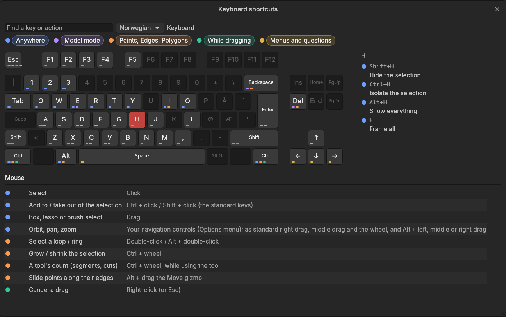

# Keyboard shortcuts

> Every key on a drawn keyboard: click **Keys** on the menu bar, then point at a key to see what it does.

The app has a lot of keys, and it's easy to forget one, especially when coming back after a break. The **Keyboard shortcuts** window draws your keyboard with every key the app uses lit up, so you can see at a glance which keys do something, and where on the keyboard your hand needs to go. The mouse actions are listed underneath.

## When to use it

- You remember a tool but not its key.
- You want to know what a key does before pressing it.
- You're choosing which hand position suits a tool: the drawing shows the keys close together.
- You're learning: leave it open beside the viewport.

## How to use it

1. Click **Keys** on the menu bar, right after **Help**. The window opens over most of the screen, so the keys and text are easy to read.
2. **Point at a key** on the drawing. The panel on the right lists its jobs, each with the full keys to press (such as **Shift+H**) and a coloured dot saying where it works.
3. **Click a key** to keep its jobs listed while you move the mouse away. Click it again to let go.
4. Point at or click **Shift**, **Ctrl** or **Alt** to see what holding it does (such as "Ten times finer" while dragging), and under **Held with**, every shortcut that uses it.
5. To find a key by what it does, type in **Find a key or action**: "weld", "hide", "ctrl". The matching keys get a coloured outline, the rest go dark, and the matches are listed on the right.
6. Click **Keys** again, or the window's ×, to close it.

### What the colours mean

Keys that do something are lit; dark keys aren't used. The small coloured marks along the bottom of a key say where its jobs work, because many keys do different things in different places:

| Colour | Where |
|---|---|
| Blue | **Anywhere**: in every mode |
| Purple | **Model mode**: with whole objects |
| Orange | **Points, Edges, Polygons**: the element modes, where you edit a shape's [points, edges and polygons](concepts.md#mesh-basics) |
| Green | **While dragging** a gizmo or a tool |
| Yellow | **Menus and questions**: the shape list (B), the tool menu (E) and questions such as "Save changes?" |

The chips at the top have the same colours. Click a chip to hide that situation's keys, for example to see only what works in the Model mode; click it again to bring them back.

### Your keyboard

The window draws the keyboard that goes with your system language: Norwegian for a Norwegian system, German (QWERTZ) for German, French (AZERTY) for French, and so on. If it guessed wrong, pick yours from the **Keyboard** list beside the search field; the app remembers your choice. The choices are US, UK, Norwegian, Danish, Swedish / Finnish, German and French.

Why it matters: the app reads letter keys **by what is printed on them**. On a German keyboard, Z (frame the selection) is where an American keyboard has Y, and on a French one, A (Connect) is where others have Q. The drawing shows where the key is on *your* keyboard. The number row is the exception: it always works as 1 to 0, even on a French keyboard where you'd normally hold Shift to type a number, so pressing the **& 1** key gives the Points mode.

Every key the app uses exists on every one of these keyboards, so nothing is out of reach.

The keys are written the way your system writes them: **Ctrl** on Windows and Linux, **⌘** (Cmd) on a Mac, where the drawing's Ctrl and Alt keys read **Cmd** and **Option**. The list always matches what the keys really do: it comes from the same place the app reads them from.

## Settings

| Setting | What it does |
|---|---|
| **Keyboard** | Which keyboard is drawn. Guessed from your system language until you pick one; remembered after that. |

Keys can't be changed yet; custom keys are planned.

## Shortcuts

| Action | Shortcut |
|---|---|
| Open or close the window | Click **Keys** on the menu bar |
| See a key's jobs | Point at it on the drawing |
| Keep a key's jobs shown | Click it on the drawing (again to let go) |

## Tips and common problems

- **Tip:** the window opens big, sized to fit your screen (on a very wide monitor it stays about twice as wide as it is tall, so it doesn't stretch). Everything in it, keys and text alike, grows and shrinks with it: drag its corner to make it bigger or smaller, and move it by its title.
- **Tip:** a key with several marks does several jobs: Esc, for example, deselects, cancels a drag, finishes a slit and closes menus. Point at it to see which is which.
- **Problem:** typing in the search field does nothing in the viewport. **Why:** while you type there, keys go to the field, not the tools. **Fix:** click the viewport to use the keys again.
- **Problem:** a key doesn't work in some mode. **Why:** many keys belong to a mode. **Fix:** check its coloured dot: orange keys work in the Points, Edges and Polygons modes, purple ones in the Model mode.
- **Problem:** the drawn keyboard isn't mine. **Fix:** pick yours from the **Keyboard** list. If yours isn't there, pick the closest: the letters are what matter, and they're the same on most keyboards that use the same alphabet.

## Related

- [Interface tour](interface-tour.md): the most used keys.
- [The tool menu (E)](tool-menu.md): every tool for the mode, with its key.
