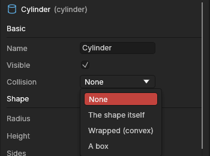

# Kit export and collision

> Export each piece of a modular kit as its own file, ready to place in a game engine, and tell Godot what each piece collides as.

## When to use it

Game levels are often built from a **kit**: a set of pieces (walls, floors, doors, crates) placed again and again. A game engine wants each piece as **its own file**, with its [pivot](pivots.md) at the file's origin, so it snaps neatly when you place it. In Godot, each piece also needs a **collision shape** so the player bumps into it instead of walking through.

Use **Export kit** when you have several pieces in one project. For a single model, use [Export](export-and-import.md) as usual.

## How to use it

### Give pieces a collision shape (Godot)

1. Select a piece. In the [Attributes panel](attributes.md), under **Basic**, open **Collision**.
2. Pick what the player should bump into:
   - **The shape itself**: exactly the shape. Accurate; for walls, floors and other parts that don't move.
   - **Wrapped (convex)**: the shape wrapped tightly with its dents filled in. Cheaper, and the piece can move.
   - **Wrapped in parts (convex)**: the shape split into a few wrapped parts, so its dents stay open (an arch you can walk through). Nearly as cheap. See [Collision shapes](collision-shapes.md).
   - **A box**: a box around the shape. The cheapest.
   - **None** (the standard): no collision.
3. Export for **Godot** (Made for: Godot in the Export window, or a Godot game project folder). Godot makes the collision when it imports the file.

The selected piece's collision shape is outlined in yellow in the viewport (Display → Show collision outlines every piece's). The app tells Godot through the names in the file: *The shape itself* adds `-col` to the piece's name, *Wrapped* adds `-convcol`, *A box* adds a box called `name-convcolonly` beside it, and *Wrapped in parts* adds each part beside it as `name-part1-convcolonly` and on. Godot recognises these endings. You can also make a collision shape of your own: put an object inside the piece and name it ending in `-colonly` (for example `Door-colonly`).

### Export each piece as its own file

1. Make each piece one object, or a [group](objects.md) holding its parts. Set its pivot where it should snap, for example the bottom corner of a wall (see [Pivots](pivots.md)).
2. Select the pieces (in the Objects panel, or in the viewport in the Model mode).
3. Choose **File → Export kit…**.
   - If the project has a [game project folder](export-and-import.md#export-into-a-game-project), the pieces go there.
   - Otherwise, pick a folder.
4. The status bar says how many pieces went out: *Exported 6 pieces into models.*

Each piece:

- is named after its object (`Wall corner.glb`). Characters a file name can't hold become `_`, and two pieces of the same name get a number;
- holds the piece and everything inside it, with the piece's **pivot at the file's origin**, turned and sized as in the scene;
- with **Levels of detail** ticked under *Includes* in the Export window, holds each object's [levels of detail](levels-of-detail.md) beside it too, at the same pivot, named `Wall corner_LOD1` and on;
- uses the Export window's settings (**Made for**, or with Custom settings the file type, units and so on).

## Settings

| Setting | What it does |
|---|---|
| **Collision** (Attributes panel) | The collision shape Godot makes for the object: None, The shape itself, Wrapped (convex), Wrapped in parts (convex), or A box. Saved with the project. Only exports made for Godot carry it. See [Collision shapes](collision-shapes.md). |
| **Export window settings** | Export kit uses them: Made for, or with Custom settings the file type, units, up axis and triangles. |

## Shortcuts

None: use the File menu and the Attributes panel.

## Tips and common problems

- **Problem:** in Godot, the player walks through a piece. **Why:** its Collision is None, or the export wasn't made for Godot. **Fix:** set Collision, choose **Made for: Godot**, and export again.
- **Problem:** a piece lands away from where you place it. **Why:** its pivot isn't where it should snap. **Fix:** move the pivot with [Edit pivot](pivots.md) (Pivot to centre, or snap it to a corner), then export again.
- **Problem:** the status bar says a piece's file is already there. **Why:** another program wrote a file of that name; the app never replaces other programs' files. **Fix:** rename the piece, or move the other file.
- **Tip:** a piece made of several parts? Group them (Ctrl + G), set the group's pivot, and select the group: the whole group goes into one file.
- **Tip:** Unity and Unreal Engine get the pieces, but not the collision: set it up there.

## Related

- [Export and import](export-and-import.md): Made for, and game project folders.
- [Collision shapes](collision-shapes.md): every choice, the outlines, and Wrapped in parts.
- [Pivots and Edit pivot](pivots.md).
- [Modular kit helpers](modular-kits.md): pieces sized to a kit grid, and pivot presets.
- [The Attributes panel](attributes.md).
