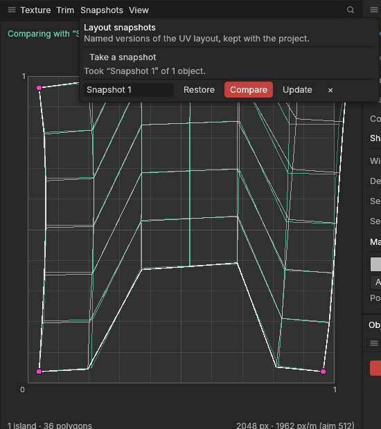

# Layout snapshots

> Keep named versions of your UV layout in the project, put one back in one step, or see it faintly under the current layout to compare.

## When to use it

UV work is a lot of trying: unwrap with one method, then another, pack tighter, move a piece by hand, relax. Undo takes you back, but only in order, and only one way. A **layout snapshot** is a [UV layout](concepts.md#uvs-and-texturing) you keep under a name, like "Before packing" or "Straight strips". You can:

- **put it back** later, whatever you did in between, as one step you can undo;
- **compare** it with what you have now: its outlines are drawn faintly under the current UVs, so you can see what moved, grew or turned;
- **update** it with the current layout when you're happier with it.

A snapshot keeps every polygon's UVs and the [seams](concepts.md#uvs-and-texturing) of the objects it was taken of. It's saved with the project. It doesn't keep the model's shape: if you model after taking one, putting it back gives the old polygons their old UVs and leaves new polygons as they are (see the tips).

## How to use it

1. Select the objects whose UVs you want to keep. The UV Editor shows them.
2. In the **UV Editor**, open the **Snapshots** menu and choose **Take a snapshot**. It's named "Snapshot 1", "Snapshot 2" and so on; click the name to change it. Each name must be different.
3. Work on the UVs as usual.
4. Open **Snapshots** again. For each snapshot:
   - **Restore** puts its UVs and seams back on the objects it was taken of, as one step (Ctrl + Z takes it back). The snapshot stays.
   - **Compare** draws its layout as faint teal lines under the current UVs. Click it again to stop.
   - **Update** replaces it with the current layout of the objects shown.
   - **×** removes it. Your UVs don't change.

The menu stays open while you use it; click anywhere outside it to close it. Taking, renaming, updating and removing snapshots are steps you can undo, too.

## Settings

| Setting | What it does |
|---|---|
| Name | What the snapshot is called. Names are on one line, at most 64 letters, and each different. |

A project keeps up to 32 snapshots. Each holds the UVs of every polygon of its objects, so very heavy shapes make bigger project files: remove snapshots you no longer need.

## Shortcuts

| Action | Shortcut |
|---|---|
| Take, restore, compare, update or remove a snapshot | **Snapshots** menu in the UV Editor |

No keys of their own (the project lead's choice); ask if you'd like some.

## Tips and common problems

- **Problem:** Restore is greyed out. **Why:** the objects the snapshot was taken of have been deleted. **Fix:** nothing to put back; remove the snapshot.
- **Problem:** after Restore, some polygons kept the new UVs. **Why:** they were made after the snapshot (by an extrude, say), or their number of corners changed, so the snapshot has no UVs for them. **Fix:** unwrap or place those polygons by hand, then **Update** the snapshot.
- **Problem:** Compare shows nothing. **Why:** it draws only the objects shown in the UV Editor. **Fix:** select the objects the snapshot was taken of.
- **Problem:** Restore changed seams too. **Why:** a snapshot keeps the seams between its polygons, so the layout and its cuts match. Seams next to newer polygons are left alone.
- **Tip:** take a snapshot before trying a different unwrap method or a tighter pack. Then you can flip between the two with Restore, comparing as you go, instead of undoing a long way back.
- **Tip:** [locked pieces](locked-pieces.md) protect a piece from the automatic tools; a snapshot puts back a whole layout. Use both: lock what's finished, snapshot before an experiment.

## Related

- [The UV Editor](uv-editor.md)
- [Unwrap, Relax and Straighten](unwrapping.md)
- [Pack](packing.md)
- [Locking pieces and piece settings](locked-pieces.md)
- [Concepts: UVs and texturing](concepts.md#uvs-and-texturing)
