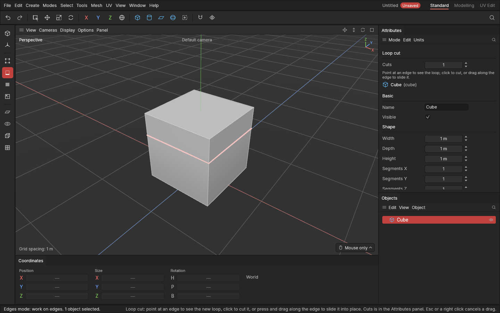
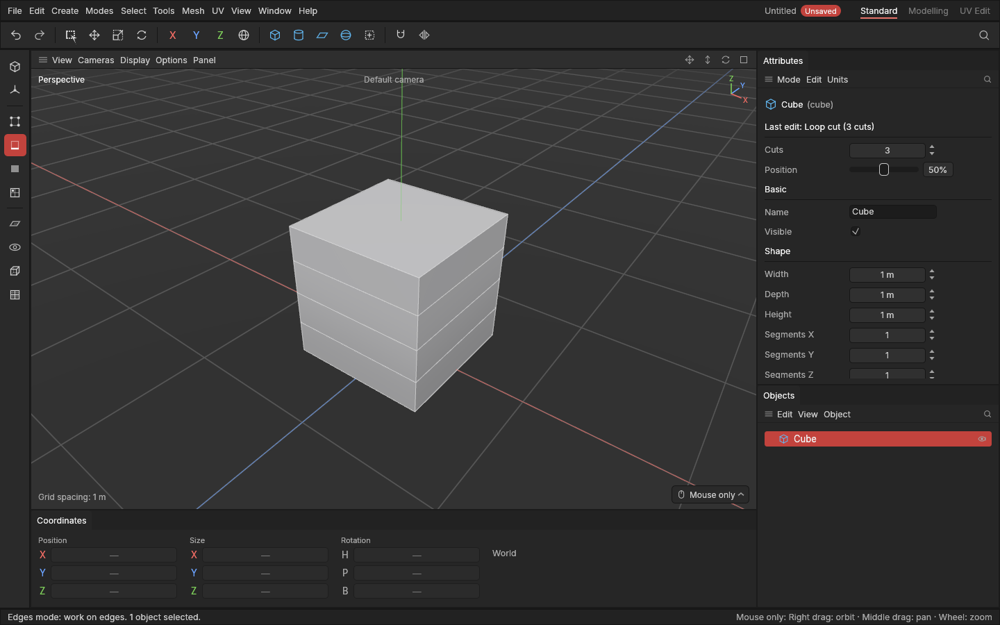

# Loop cut

> Loop cut adds a new [edge loop](concepts.md#mesh-basics) all the way around a shape: point at an edge, see where the loop will go, and click.

A shape only bends, bevels and holds detail where it has edges. Loop cut is the quickest way to add them exactly where you need them: an extra row around a crate to inset a panel into, a loop near a corner to keep it crisp when the shape is smoothed later, or more rows along a pipe so it can bend.

## When to use it

- **Add rows to model with**: a loop around a box to pull out a band, or several to shape it.
- **Hold an edge sharp**: a loop close to a corner keeps it tight when the shape is smoothed later.
- **Add detail in one place only**, instead of raising a shape's segments everywhere. Segments add rows evenly across the whole shape; a loop cut adds them just where you want.

## How to use it

1. Select a shape and press **1**, **2** or **3** for the Points, Edges or Polygons [mode](modes.md). Loop cut works in all three.
2. Press **F** (or pick **Loop cut** from the [tool menu](tool-menu.md) **E**, or **Mesh → Cut and join**).
3. **Point at an edge.** The new loop shows across every polygon it will cut, running at right angles to the edge you point at. Move along the edge and the loop follows the mouse.
4. **Click** to cut it there. Or **press and drag** along the edge to slide it into place, then let go.

The cut and any sliding are one undo step: **Ctrl + Z** takes it back.

### Several cuts at once

Before you cut, hold **Ctrl** and turn the **mouse wheel**: up for more cuts, down for fewer. The loops shown follow at once. You can also type the number in **Cuts** at the top of the **Attributes panel**. Several cuts are spread evenly across the polygons (two cuts at a third and two thirds), and dragging slides them together.

### Change it afterwards

After a cut, the Attributes panel shows it under **Last edit**, with its **Cuts** and **Position**. Change either and the cut you just made follows; **Ctrl + wheel** changes its Cuts too, one undo step per notch. This works until you make another edit on top. Changing Cuts there also sets it for your next cut.

### While you drag

- Hold **Shift** for ten times finer steps.
- **Ctrl + wheel** changes the number of cuts on the cut you're placing.
- Press **Esc** or **right-click** to cancel.
- While Loop cut is in use, clicking never selects, and Ctrl + wheel changes the cuts instead of growing the selection. Press **Q** to go back to selecting.

## How far the loop goes

The loop runs through four-sided polygons ([quads](concepts.md#mesh-basics)), from each one into the next across the edge opposite, both ways from where you point:

- On a closed band of quads, like the sides of a box, it goes **all the way round**.
- It **stops** at a polygon that isn't four-sided (a triangle, or a cylinder's cap), at an open border (the edge of a plane), and at an edge shared by three or more polygons.
- Where it stops, the polygon there gets the new point added to its corners, so the surface stays closed. A cylinder's cap gains a corner; a triangle becomes a four-sided polygon.

Every edge the loop crosses is cut at the same share of its length, measured from the same side, so the loop runs straight across polygons of different sizes.

## Settings

| Setting | What it does |
|---|---|
| **Cuts** | How many new loops are cut at once, from 1 to 64, spread evenly across the polygons. **Ctrl + wheel** in the viewport changes it too. |
| **Position** | Where the cut sits across the polygons: 50% is the middle. With several cuts, it slides them all together; they stay inside the polygons. Shown under Last edit. |

## Shortcuts

| Action | Shortcut |
|---|---|
| Loop cut | `F` |
| Cut | Click an edge |
| Slide, then cut | Left drag along the edge |
| More or fewer cuts | `Ctrl` + wheel up / down |
| Finer steps | Hold `Shift` while dragging |
| Cancel the drag | `Esc` or a right-click |
| Back to selecting | `Q` |

`F` used to frame the selection: that is **`Z`** now. The axis locks moved to **Shift + X / Y / Z**.

## Tips and common problems

- **Tip:** give a shape its basic rows with its segments first, then add loops only where you need more. Fewer edges keep a game model light.
- **Tip:** change a shape's segments after a loop cut and the cut is found again on the new shape, on the same side.
- **Problem:** pointing at an edge shows no loop. **Why:** the edge has no four-sided polygon next to it (for example, it runs only between triangles), or the object isn't selected. **Fix:** select the object, and point at an edge between four-sided polygons.
- **Problem:** the loop stops partway round. **Why:** it reached a triangle, a many-sided polygon or an open border, as described above.
- **Problem:** pressing F does nothing but the status bar talks about modes. **Why:** Loop cut works in the Points, Edges and Polygons modes. **Fix:** press **1**, **2** or **3** first.
- **Problem:** pressing F no longer frames the selection. **Why:** F is Loop cut now. **Fix:** press **Z**.

## Related

- [Bevel](bevel.md): rounding or chamfering the edges you've added.
- [Extrude and inset](extrude-and-inset.md): pushing the new rows out or in.
- [Primitives](primitives.md): segments, for rows spread across the whole shape.
- [Concepts](concepts.md): [edge loops and rings](concepts.md#mesh-basics), [quads](concepts.md#mesh-basics).
