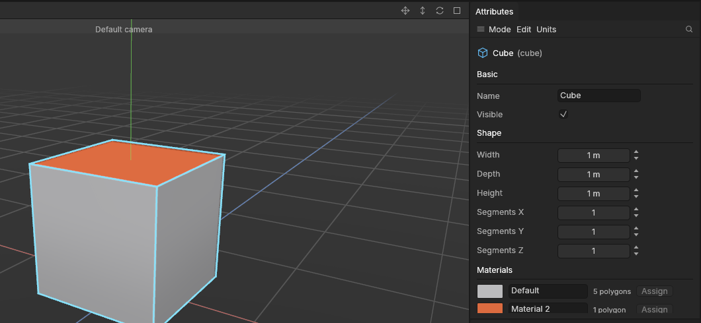

# Materials

> Split a model into parts that get different materials, such as painted metal, rubber and glass, so Substance Painter and game engines treat each part on its own.

## When to use it

A game asset is rarely one material all over. A crate might be wood with metal corners; a lamp has a metal body and a glass shade. Give each part its own [material slot](concepts.md#the-game-asset-pipeline):

- **Substance Painter** makes one *texture set* per material, so you paint the wood and the metal on their own.
- **Godot** (and Unity and Unreal Engine) makes one *surface* per material, each with its own material you can swap.

For now a material is a **name** and a **colour**. The colour lets you see the parts in the viewport; the name is what Substance Painter and the engine know it by. Real materials (textures, roughness, metal) come with texturing in a later phase.

Keep the number of materials small: each one is an extra texture set to paint and an extra draw call in the game. Two or three per asset is typical.

## How to use it

Every object starts with one material, **Default**, in the viewport's grey. Its polygons all use it.

### Add materials

1. Select the object. The **Materials** section is in the [Attributes panel](attributes.md), under Shape.
2. Click **Add material**. A new material appears with its own colour, called *Material 2* (then *Material 3*, and so on).
3. Click its name and type a better one, such as *Metal*, then press Enter. Use the names you want to see in Substance Painter and the engine.
4. Click its colour swatch to pick a colour.

### Give polygons a material

1. Switch to the **Polygons** mode (**3**), see [Modes](modes.md).
2. [Select](selecting.md) the polygons that should use the material. Loops (double-click an edge) and **Grow selection** help pick whole parts.
3. Click the material's **Assign** button. The polygons take its colour in the viewport, and the polygon counts in the list change.

**Ctrl + Z** takes an assignment back like any other edit. With [Symmetry](symmetry.md) on, the polygons on the other side get the material too.

Polygons you make from others keep their material: an [extrude](extrude-and-inset.md)'s walls get the material of the polygon they grew from, and a [loop cut](loop-cut.md) keeps the material of the polygons it cuts.

### Find the polygons using a material

Choose **Select → Select by material** and pick a material: its polygons on the selected objects are selected, in the Polygons mode.

### Remove a material

**Remove last** removes the last material in the list. It is refused while a polygon still uses it: give those polygons another material first (Select by material finds them). The first material can't be removed.

### Materials across objects

Each object has its own list. Two materials with the **same name** are **one material** when you export, even on different objects: name both *Metal* and Substance Painter gets one *Metal* texture set for both. **Join objects** merges the lists the same way, by name.

An [instance](copies-and-instances.md) uses its original's materials; change them on the original. *Make editable* gives it its own copy.

## Settings

| Setting | What it does |
|---|---|
| **Colour swatch** | The colour the material is shown in, and the colour it is exported with. Click to pick. |
| **Name** | What Substance Painter and the engine call it. In an OBJ file, spaces become underscores (*Rusty metal* goes out as *Rusty_metal*). |
| **Polygon count** | How many of the object's polygons use it. (Not counted on shapes of over 50,000 polygons.) |
| **Assign** | Gives the selected polygons this material. Needs the Polygons mode and some selected polygons. |
| **Add material** | Adds a material, up to 64 per object. |
| **Remove last** | Removes the last material, if no polygon uses it. |

## Shortcuts

None: use the Attributes panel's buttons and the Select menu.

| Action | Where |
|---|---|
| Polygons mode | `3` |
| Select by material | Select → Select by material |

## Tips and common problems

- **Problem:** Assign is greyed out. **Why:** you're not in the Polygons mode, or no polygons are selected. **Fix:** press **3** and select polygons.
- **Problem:** Remove last says a polygon uses it. **Why:** removing it would leave those polygons pointing at nothing. **Fix:** Select → Select by material, pick it, then Assign another material.
- **Problem:** Substance Painter shows two texture sets where you wanted one. **Why:** the materials have different names (perhaps a typo, or *Metal* and *metal*). **Fix:** give them exactly the same name.
- **Tip:** name materials before you export to Substance Painter: its texture sets take the names, and renaming later means rewiring them.
- **Tip:** a material only goes out in an export if some polygon uses it.

## Related

- [Export and import](export-and-import.md): how materials go out in glTF and OBJ files
- [The Attributes panel](attributes.md)
- [Selecting](selecting.md) and [Modes](modes.md)
- [Concepts: material slots and texture sets](concepts.md#the-game-asset-pipeline)
