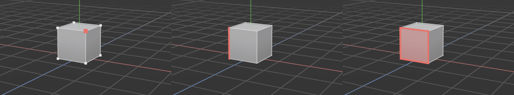

# Points, Edges and Polygons modes

> Switch from working on whole objects to working on the parts a mesh is made of: its points, edges or polygons.

## When to use it

Most modelling happens on the parts of a shape rather than on the whole thing: pulling a corner out, sliding an edge, pushing a face in. Each of these parts is an [element](concepts.md#mesh-basics) of the mesh, and each mode picks which kind of element your tools will work on:

- **Points mode** for the [vertices](concepts.md#mesh-basics), the corners of the mesh.
- **Edges mode** for the edges, the lines between points.
- **Polygons mode** for the [polygons](concepts.md#mesh-basics), the faces.

**Model mode** works on whole objects, as before.

In these modes you can see a shape's points and edges, see which one is under the mouse, select them ([Selecting](selecting.md)), and move, rotate and scale them ([Move, rotate and scale](transforming.md)).

## How to use it

1. **Select the shape** you want to work on, in the viewport or the Objects panel. The modes only show the parts of *selected* objects, so other shapes stay out of the way. You can select several.
2. **Press `1`, `2` or `3`** for Points, Edges or Polygons mode. You can also click the mode's button on the left palette, or use the **Modes** menu. The button turns red to show the active mode.
3. **Move the mouse over the shape.**
   - In **Points** mode, every point shows as a small white dot. The one nearest the mouse turns light red and grows.
   - In **Edges** mode, every edge is drawn as a thin white line. The one nearest the mouse turns light red and thick.
   - In **Polygons** mode, the face under the mouse is tinted light red, with an outline.
   Selected ones are drawn in the full accent red, larger and thicker than anything else and on top of it, so you can tell them apart from the one under the mouse and they never hide behind seams or hard edges. If they're still hard to see, switch on **High contrast** in **Edit → Settings… → Interface**: a larger selection with a dark rim ([Settings](settings.md)).
   The status bar names what's under the mouse, for example *Under the mouse: point 4 of Cube*.
4. **Click, drag or double-click to select** points, edges or polygons: see [Selecting](selecting.md).
5. **Press the same key again** (or pick Model) to go back to working on whole objects.

   **With a modelling tool in use** (Extrude, Slit, Weld and the like), the mode keys work differently: they put the tool away and you're back to selecting, in that mode. So in the Edges mode with Slit in use, **2** keeps you in the Edges mode and lets you select edges again; **3** goes to the Polygons mode, selecting. Press the tool's key to pick it up again. (Move, Rotate and Scale aren't put away: you can select with them anyway.) Or press **Tab** from anywhere: it steps straight back to the Model mode, finishing a [Slit](slit.md) line and putting a modelling tool away on the way (Move, Rotate and Scale stay, as they work on objects too). Handy when you've forgotten you're still in the Edges mode and a click won't select the object.

Only what you can see counts. A point or edge hidden behind the shape, or behind another object, isn't drawn and can't light up. Turn the view to reach the other side; this is the usual behaviour in 3D programs and keeps you from grabbing something by mistake.

A primitive (a cube with its Width, Segments and so on) works in these modes too: you see the points and edges it currently has. Change its segments and they update straight away.

## Shortcuts

| Action | Shortcut |
|---|---|
| Points mode (again: back to Model; with a tool in use: put it away and select) | `1` |
| Edges mode (again: back to Model; with a tool in use: put it away and select) | `2` |
| Polygons mode (again: back to Model; with a tool in use: put it away and select) | `3` |
| Straight back to the Model mode, tool put away | `Tab` |

The keys don't work while you're typing in a field, such as renaming an object; there, Tab moves to the next field as usual.

## Tips and common problems

- **Problem:** nothing shows in Points, Edges or Polygons mode. **Why:** no object is selected. **Fix:** select a shape; the status bar says *Select an object to see its points* (or edges, or polygons) as a reminder.
- **Problem:** a point I can see in my mind doesn't light up. **Why:** it's on the far side of the shape, or behind another object. **Fix:** orbit the view until it faces you.
- **Problem:** the red outline around the selected shape disappeared. **Why:** in these modes the shape's own edges are drawn instead, so the outline would only get in the way. It comes back in Model mode.
- **Problem:** I can't see the points or edges of a very detailed shape. **Why:** seen from afar they would be only a pixel or two apart, so they fade out rather than cover the shape. **Fix:** zoom in closer; see [Heavy shapes](heavy-shapes.md). What's under the mouse still lights up.
- **Tip:** in a busy scene, the four-view layout (`F5`) lets you reach points from the front, side and top without orbiting.

## Related

- [Selecting](selecting.md)
- [Interface tour: Modes](interface-tour.md#modes)
- [Objects: selecting and Bake into shape](objects.md)
- [Concepts: mesh basics](concepts.md#mesh-basics) (vertex, edge, polygon, element)
