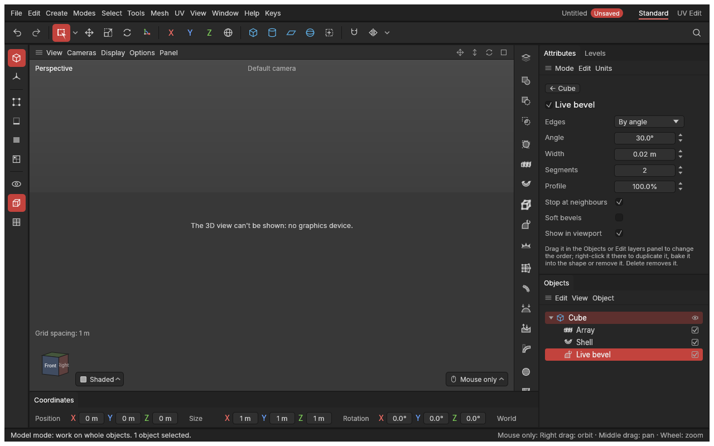

# Modifiers

> Live changes on top of a shape: add one, change its settings any time, switch it off, reorder it or take it away, and the shape you modelled underneath never changes.

A [modifier](concepts.md#objects-and-scenes) is a change the app works out from your shape every time it's shown or exported, instead of a change made to its points once and for all. Rebuild a shape as even quads with [Remesh](remesh.md), and keep modelling the original: the remeshed version follows each edit. Don't like it? Switch it off, or remove it: nothing is lost. Happy? **Bake into shape** makes it permanent.

Each object has its own list of modifiers, its **modifier stack**, worked out first to last: each modifier gets the result of the one before. So far there are seventeen kinds, **[Subdivide](subdivide.md)**, **[Array](array.md)**, **[Shell](shell.md)**, **[Struts](struts.md)**, **[Live bevel](live-bevel.md)**, **[Scatter](scatter.md)**, **[Lattice](lattice.md)**, **[Bend along curve](bend-along-curve.md)**, **[Shrinkwrap](shrinkwrap.md)**, **[Displace](displace.md)**, **[Bend, twist or taper](bend-twist-taper.md)**, **[Remesh](remesh.md)**, **[Decimate](decimate.md)**, **[Quadify](quadify.md)**, **[Weld by distance](weld-by-distance.md)**, **[Weighted normals](weighted-normals.md)** and **[Triangulate](triangulate.md)**, and they all work the way this page describes.

## When to use it

- When you want a result that would be slow or impossible to make by hand (an even surface of quads), but still want to keep editing the shape underneath.
- When you want to try something and compare with and without it: one click switches a modifier off.
- When you're done with a modifier's settings, bake it ([Bake into shape](objects.md#bake-into-shape)) to edit the result point by point.

For a change you want to make once, at one spot, an ordinary tool (extrude, bevel, loop cut) is the better choice: it becomes an [edit](edit-list.md) you can still change later.

## How to use it

1. **Select one or more shapes** (in the viewport or the Objects panel). Groups are left out; an [instance](copies-and-instances.md) shows its original's modifiers, so give them to the original.
2. **Add a modifier**, from any of these:
   - its button on the **modifiers palette**, the thin column of buttons beside the Attributes panel, below the [booleans](booleans.md);
   - **Mesh → Modifiers**, where they're grouped by what they do (Generate: Subdivide, Array, Shell, Struts, Live bevel, Scatter onto surface; Deform: Add lattice, Bend along curve, Shrinkwrap onto, Displace, Bend, twist or taper; Clean up: Remesh, Decimate, Quadify, Weld by distance; Game ready: Weighted normals, Triangulate, and the [Game bevel](game-bevel.md), which adds a Live bevel and Weighted normals in one step);
   - **Space** ([command search](command-search.md)), then type its name (*remesh*) and press **Enter**.
3. The modifier goes at the end of each selected shape's list, on, and the viewport shows the result. (A **Live bevel** goes before any Subdivide or Weighted normals already there, the order that works; see [Live bevel](live-bevel.md). A **Quadify** goes before any Live bevel, Subdivide, Weighted normals or Struts; see [Quadify](quadify.md). A **Weld by distance** goes before any Decimate, Quadify, Live bevel, Subdivide, Weighted normals, Shell or Struts; see [Weld by distance](weld-by-distance.md). A **Shell** or **Struts** goes before any Live bevel, Subdivide or Weighted normals; see [Shell](shell.md) and [Struts](struts.md). Every kind that changes the shape (all but Weighted normals and Triangulate) goes before any **Weighted normals**, which would otherwise lose its shading to the change; see [Weighted normals](weighted-normals.md). So a Lattice, Array or Scatter added after a [Game bevel](game-bevel.md) goes above its Weighted normals. Every kind goes before a **Triangulate**, the finishing step; see [Triangulate](triangulate.md). **Scatter onto surface** is an exception: it goes on the shape selected *first*, and scatters the others over it; see [Scatter](scatter.md). **Bend along curve** and **Shrinkwrap onto** too: select the shape first, then Ctrl + click the curve or the target; see [Bend along curve](bend-along-curve.md) and [Shrinkwrap](shrinkwrap.md).) It's listed under its shape in the [Objects panel](objects.md), and the [Attributes panel](attributes.md) shows its settings at once.

If the button or menu entry is greyed out, hover over it: it says what's missing (nothing selected, or an instance selected).

### Changing modifiers later

A shape's modifiers are listed **under it in the Objects panel**, first to last, each with its icon and a tick, a step in from the shape (click the shape's small arrow to fold them away). That's their one home: the [Edit layers](edit-layers.md) panel lists your edits only.

- **Click a modifier** to see **only its settings** in the Attributes panel. Its shape is selected too. Click the shape's own row, the **← *shape name*** button at the top of the Attributes panel, or anywhere in the viewport to go back to the shape's own settings.
- **The tick** at the end of its row switches it on or off. Off, the shape is as if it weren't there; it keeps its settings until you tick it again.
- **Drag** a modifier up or down to change the order it's worked out in (a line shows where it will go). Order matters: a remesh followed by a coarser one gives a different shape from the other way round, and later modifiers (smoothing, weighted normals) will usually want to come last.
- **Delete** (or **Backspace**) removes the modifier you clicked, not its shape. **Ctrl + Z** brings it back. Any [level of detail](levels-of-detail.md) that switched it off or gave it its own settings loses that change too (undo brings both back).
- **Right-click** a modifier for **Switch off** (or on), **Duplicate** (a copy with the same settings, just after it), **Move up**, **Move down**, **Bake into shape up to here** (see below) and **Remove**.

With a modifier clicked, the Attributes panel shows:

- **its switch**, the box before its name, the same as the tick.
- **its settings**: drag or type, and the shape follows. One drag is one undo step.
- **Show in viewport**: untick it and the viewport skips the modifier, while exports and Bake into shape still use it. Handy for a slow modifier while you model; tick it again to check the result.

With the shape itself selected, its Attributes have a short **Modifiers** section instead: the modifiers' names, first to last, each a link to its settings. A switched-off one is struck through; one that can't do its work is amber.

If a modifier can't do its work, it says why in amber ("Not worked out: …"), and the shape goes on without it, as if it were switched off. Fix the cause and it works again. When a modifier simply has nothing to do on this shape (Weld by distance finds no points close enough, Quadify no triangles to join, Triangulate no polygon to cut), the note is grey instead, "Nothing to do: …": nothing is wrong.

A note about a later modifier keeps its place when you switch that modifier off: Weighted normals' amber note (*Array comes after this and changes the shape…*) turns into a grey one saying what switching it on would do, so the rows below don't jump under the mouse. Long notes wrap to the panel's width.

### Where modifiers come in

The app works out a shape in this order:

1. its starting shape (a primitive's settings, or a mesh) and your edits, layer by layer;
2. its [booleans](booleans.md);
3. its [mirror](symmetry.md);
4. its modifiers, first to last.

So a modifier sees the whole shape: cut by its booleans, with both halves of a mirrored shape. The Points, Edges and Polygons modes still work on the shape **before** the modifiers: what you select and edit are your own points, and the modifiers are worked out again after every change, so in those modes you see your points over the modified result.

### Making them permanent

**Bake into shape** (**Ctrl + E**, or **Mesh → Shape and object**) turns the shape as an export would get it (for [Subdivide](subdivide.md), at its export levels) into a plain mesh: edits, booleans, mirror and the modifiers that are on, all in one. Those modifiers go; any switched off, or that couldn't do their work, stay. A mirror goes too, as its other half is now part of the mesh. One **Ctrl + Z** undoes it all.

**Bake into shape up to here**, in a modifier's right-click menu, bakes only that modifier and those above it (the ones that are on) into the shape; the ones below stay live, worked out on the new shape. Use it when you're done with the first steps (a Remesh, say) but still want to change the last ones (a Live bevel). Baking up to the last modifier is the same as Ctrl + E.

**Apply mirror** on a shape with modifiers bakes only what comes before them (edits, booleans and mirror); the modifiers stay live on the result.

### Saving and exporting

Modifiers are saved with the project, live, and come back as they were. [Export](export-and-import.md) sends out each shape with its modifiers that are on, including those hidden in the viewport: what goes to the game engine or Substance Painter is the finished shape.

Each [level of detail](levels-of-detail.md) can switch modifiers off or give them simpler settings for that level only, in the **Levels** panel: a far level with a 1-segment bevel, or without its smoothing. Moving a modifier up or down keeps those changes with it.

## Settings

| Setting | What it does |
|---|---|
| **The tick** (in the Objects panel) or **the switch** (before its name in Attributes) | On: the modifier does its work. Off: the shape is as if it weren't there; it keeps its settings. |
| **Its place in the list** | Drag it in the Objects panel, or right-click → Move up / Move down. Modifiers are worked out first to last, each on the one before's result. |
| **Show in viewport** | Off: the viewport skips it (the shape draws faster while you model), but exports and Bake into shape still use it. On as standard. |
| Its own settings | See its page: [Subdivide](subdivide.md), [Live bevel](live-bevel.md), [Scatter](scatter.md), [Lattice](lattice.md), [Bend along curve](bend-along-curve.md), [Shrinkwrap](shrinkwrap.md), [Remesh](remesh.md), [Decimate](decimate.md), [Weighted normals](weighted-normals.md). |

## Shortcuts

| Action | Shortcut |
|---|---|
| Find a modifier by name | `Space`, then type the name |
| Make the modifiers permanent (Bake into shape) | `Ctrl + E` |
| Remove the modifier clicked in a list (Model mode) | `Delete` or `Backspace` |
| Undo adding, changing, moving or removing one | `Ctrl + Z` |

In the Objects panel: **click** to see its settings, **drag** to reorder, **right-click** for more.

## Tips and common problems

- **Problem:** the result appears a moment after a change. **Why:** heavy modifiers (a fine remesh of a big shape) are worked out on another thread, so the window stays smooth; the last result is shown meanwhile. **Fix:** nothing to fix. While modelling, a coarser setting, or **Show in viewport** off, keeps things quick.
- **Problem:** a shape that another object's modifier reads (a Shrinkwrap target, Scatter's shapes) has heavy modifiers of its own, and the result appears a moment late. **Why:** its modifiers are worked out on another thread too, along with the one reading it, so the window never waits for them. **Fix:** nothing to fix.
- **Problem:** a modifier with **Show in viewport** off (or Subdivide's export levels) shows its amber *Not worked out* note a moment after you select the object, or not at all on a very heavy shape. **Why:** what an export would get is worked out on another thread only to find those notes, and only when that's quick; a heavy one is worked out when you export or bake. **Fix:** nothing to fix; switch **Show in viewport** on to see the result itself.
- **Problem:** "Not worked out: the shape isn't closed". **Why:** that modifier needs a [closed solid](concepts.md#mesh-basics). **Fix:** see [Remesh](remesh.md#tips-and-common-problems).
- **Problem:** the Points, Edges or Polygons modes show different points from the shape drawn. **Why:** they edit your own shape, before the modifiers. **Fix:** that's how it should be; bake the modifiers to edit the result itself.
- **Problem:** hiding polygons doesn't hide them from a modifier's result. **Why:** modifiers work on the whole shape, hidden polygons included (as booleans do); hiding is for editing. **Fix:** switch the modifier off while you work on the hidden part.
- **Tip:** a modifier on an object is copied with it (Ctrl + C, Ctrl + V, Duplicate); an instance follows its original's modifiers.

## Related

- [Game bevel](game-bevel.md): a Live bevel and Weighted normals set up together, in one step
- [Subdivide](subdivide.md), [Live bevel](live-bevel.md) (before Subdivide and Weighted normals), [Lattice](lattice.md), [Remesh](remesh.md), [Decimate](decimate.md) and [Weighted normals](weighted-normals.md) (best last in the list)
- [Concepts: modifiers](concepts.md#objects-and-scenes)
- [The Attributes panel](attributes.md), [Bake into shape](objects.md#bake-into-shape)
- [Booleans](booleans.md) and [Symmetry](symmetry.md), which come before the modifiers
- Why it works this way: [decision 0142](../decisions/0142-modifier-stack-and-remesh.md)
