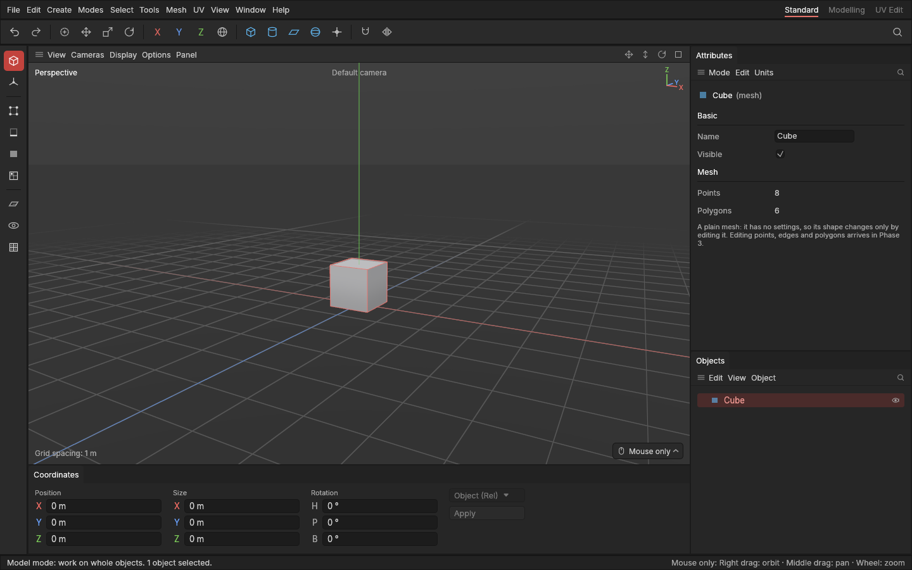

# Objects and the Object Manager

> List, select, rename, nest, show, hide and delete the objects in your scene, and undo any change.

## When to use it

Every model is built from [objects](concepts.md#objects-and-scenes), and the **Objects** panel (the Object Manager, bottom right) lists them all as a tree. Use it to keep a scene tidy as it grows: give parts clear names ("Barrel", "Handle"), gather the parts of one asset into a [group](concepts.md#objects-and-scenes) so they move and hide together, and hide what's in the way while you work on something else.

A new scene is empty. Add [primitives](primitives.md) (cubes, cylinders and the rest) from the **Create** menu or the shape buttons on the command palette, and **groups**: empty objects whose job is to hold others.

## How to use it

**Select.** Click a name to select that object (or click the shape itself in the viewport; see [Selecting](selecting.md)); its name and its outline in the viewport take on the [accent colour](interface-tour.md#accent-colour) (red, unless you've picked another). **Ctrl + click** adds an object to the selection, or takes it out again. **Shift + click** selects every row from the last one you clicked to this one. Click the empty space below the list, or press **Esc**, to select nothing. The status bar says how many objects are selected.

**Create a group.** Use **Create → Group**, the group button on the command palette (the cross with a circle, after the shapes), or **Object → New group** in the panel's own menu. New objects appear at the top of the list, already selected, and are named *Group*, *Group 2* and so on.

**Put objects in a group.** Select them and press **Alt + G** (or **Object → Group objects**): they go into a new group, which takes the place of the first of them. To take them out again, select the group and press **Shift + G** (**Object → Ungroup**): its contents go back where the group was, and the empty group is removed. Ungroup only ever works on groups: anything else in the selection, like a cube, is left exactly as it is.

**Drag to rearrange.** Drag a row (press on its name and move the mouse):
- onto the **middle** of another row to put it **inside** that object (an outline shows where it will go);
- onto the **top or bottom edge** of a row to put it **above or below** that row, beside it (a line shows where);
- onto the **empty space** below the list to move it back to the top level.

If several objects are selected and you drag one of them, they all move, keeping their order. An object can't be dropped inside itself or inside something it contains; the mouse pointer shows a "no" sign there.

**Fold.** Objects with something inside have a small arrow on the left. Click it to fold the contents away, and again to show them. **View → Collapse all** and **Expand all** fold or open everything.

**Rename.** Double-click a name (or select one object and use **Edit → Rename**, or type in the **Name** field of the [Attributes panel](attributes.md)), type the new name and press **Enter**. Clicking elsewhere keeps the new name too; **Esc** keeps the old one. Names can't be empty.

**Show and hide.** Click the eye at the right of a row to hide that object from the viewport; click the closed eye to show it again. If the object is part of the selection, the whole selection is shown or hidden. Hiding a group hides everything inside it too: their own eyes stay open but turn faint, so you can see they're only hidden because of the group. **Object → Show** and **Hide** work on the selection. Hidden objects are left out when you frame with **H** or **F**.

**Delete.** Press **Delete** or **Backspace** (or use **Edit → Delete**) to delete the selected objects, together with everything inside them.

**Right-click** a row for the same commands in one menu. (Right-clicking a row that isn't selected selects it first.) For shapes, the menu also has **Copy settings** and **Paste … settings**: copy one shape's settings (size, segments and so on), then right-click another shape of the same kind, or a selection of them, and paste to make them match. See [The Attribute Manager](attributes.md).

**Undo and redo.** Every change to the scene can be taken back: creating, renaming, moving, grouping, showing, hiding and deleting. Press **Ctrl + Z** to undo and **Ctrl + Y** (or **Ctrl + Shift + Z**) to redo, or use the arrows at the left of the command palette or the **Edit** menu, which names what would be undone ("Undo: Delete object"). Undo brings back exactly the same objects, in the same places. The status bar confirms what was undone. Changing only the selection is not an undo step (yet). Opening a project starts a fresh undo history; saving keeps it.

**How far back undo goes.** There's no limit on the number of steps. Instead, undo keeps steps until they fill a set amount of memory, 2 GB as standard, and then forgets the oldest ones first. Small changes like renames take almost no memory, so you can undo thousands of them; steps that hold whole meshes take more. The newest step is always kept. To see how much is in use or change the limit, open **Edit → Settings…** and pick **Undo**: choose from 256 MB to 8 GB, or Unlimited (see [Settings](settings.md)). The first time old steps start being forgotten, the status bar tells you. Your choice is remembered next time.

**Framing.** With objects selected, **F** (*frame selected*) fits them in the view; with nothing selected it fits everything shown, like **H**. See [Navigating the view](navigating-the-view.md).

### Make editable

A primitive is built from its settings, so its shape can only change through them. **Make editable** turns it into a plain mesh: what you see becomes a fixed set of points and polygons, ready to be edited freely, and the settings are gone. (Editing points, edges and polygons arrives in Phase 3; see [Base and edits](concepts.md#objects-and-scenes) for why you usually won't need this before then.)

Select one or more shapes and press **Ctrl + E**, or use **Object → Make editable** in the Objects panel (also in the right-click menu) or **Mesh → Make editable** on the main menu bar. The objects keep their names and places; their icon becomes the polygon icon, and the [Attributes panel](attributes.md) shows "(mesh)" with how many points and polygons they have instead of their settings. Groups are left alone. **Ctrl + Z** brings the settings back.

## Settings

The Object Manager has no settings of its own yet. Its menus:

| Menu | Entries |
|---|---|
| **Edit** | Undo, Redo, Rename, Delete, Select all, Deselect |
| **View** | Expand all, Collapse all |
| **Object** | New group, Group objects, Ungroup, Make editable, Show, Hide |

The main menu bar's **Edit** menu has the same entries as the panel's Edit menu, and **Create → Group** makes a group.

## Shortcuts

| Action | Shortcut |
|---|---|
| Undo | `Ctrl + Z` |
| Redo | `Ctrl + Y` or `Ctrl + Shift + Z` |
| Delete the selection | `Delete` or `Backspace` |
| Select nothing | `Esc` |
| Put the selection in a new group | `Alt + G` |
| Take the contents out of the selected groups | `Shift + G` |
| Make the selected shapes editable (plain meshes) | `Ctrl + E` |
| Add to or take out of the selection | `Ctrl` + click |
| Select a run of rows | `Shift` + click |
| Rename | Double-click the name |

On macOS, use `Cmd` instead of `Ctrl` and `Option` instead of `Alt`. They don't act while you're typing a name.

## Tips and common problems

- **Tip:** name and group as you go. A tidy tree makes exporting easier later, because objects become the separate parts Godot and Substance Painter see.
- **Problem:** something vanished from the viewport but is still in the list. **Why:** it, or a group it's inside, is hidden. **Fix:** look for a closed eye on the object or on the groups above it, and click it.
- **Problem:** a row won't drop where you want. **Why:** an object can't go inside itself or one of its own children. **Fix:** drag the child out first, or drop the parent somewhere else.
- **Problem:** Delete or Backspace does nothing. **Why:** nothing is selected, or you're typing a name. **Fix:** click the object first, or press Enter to finish the name.
- **Problem:** you deleted something by mistake. **Fix:** press **Ctrl + Z**. Undo keeps your steps for as long as the app is open, up to the undo memory limit.
- **Problem:** undo stops before you got back to where you wanted. **Why:** the oldest steps were forgotten to stay within the undo memory (the status bar said so when it started). **Fix:** for long sessions with large meshes, raise the limit in **Edit → Settings… → Undo**, if your computer has the memory to spare.
- **Problem:** pressing **Ctrl + E** does nothing, and the status bar says "Nothing to make editable". **Why:** only shapes with settings (or with recorded edits) can be made editable; groups and meshes have nothing to bake. **Fix:** select the shapes themselves.
- **Problem:** the Attributes panel no longer shows a shape's size and segments. **Why:** it was made editable, so it's a plain mesh now. **Fix:** press **Ctrl + Z** to get the settings back, if you need them.

## Related

- [Concepts](concepts.md): [objects, groups and hierarchy](concepts.md#objects-and-scenes), and [undo](concepts.md#objects-and-scenes).
- [Interface tour](interface-tour.md): where the Objects panel sits, and how to move it.
- [Navigating the view](navigating-the-view.md): framing the selection with **F**.
