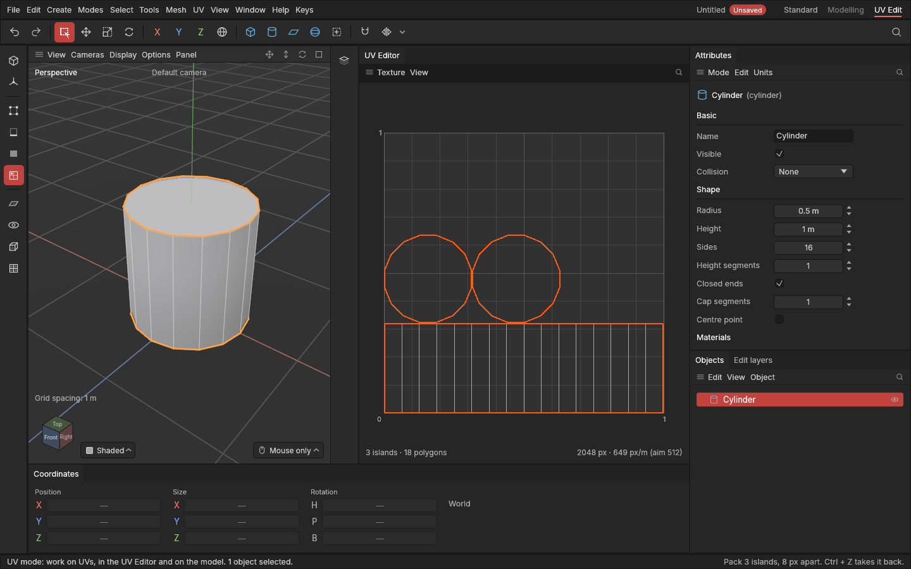

# Packing

> Fit every piece into the texture square as large as it can go, with a gap of real texture pixels between pieces.

## When to use it

After [unwrapping](unwrapping.md), pieces sit where they were: they can overlap, and leave much of the texture empty. A texture's pixels are precious, so **Pack** arranges the pieces to fill the square:

- every piece gets the same scale, so their [texel density](texture-and-density.md) stays matched;
- pieces are fitted by their **shapes**, so a small piece can sit in the dent or hole of a big one;
- a gap (**padding**) of real texture pixels keeps colours from bleeding from one piece into the next when the game shows the texture smaller.

Pack last, once seams and unwrapping are done: changing seams afterwards unwraps the pieces around them again, in place.

## How to use it

1. Select the objects to pack together (they'll share one texture), or, in the UV mode, the pieces to pack.
2. Press **E** with the mouse over the UV Editor and choose **Pack**, or choose **UV → Pack**.
3. It's one undo step (**Ctrl + Z**), saved with the project and recorded on each object's edit list.

**Texture sets:** with **A texture per material** on (the standard), each material's pieces fill a square of their own, matching how Substance Painter makes one texture set per material. With **A texture per object** on, each object fills its own square.

**Stacking:** with **Stack identical pieces** on, pieces of exactly the same shape (four identical bolts, say) share the same pixels, so each gets more of the texture. Leave it off when the copies need their own baked shading.

**Locked pieces** ([Locking pieces and piece settings](locked-pieces.md)) stay where they are; the others are packed as if they weren't there, so check for overlaps, or move the locked piece aside first. (Packing around them comes later in this phase.)

## Settings

In **UV → Packing**, in the menu's settings section (remembered between sessions):

| Setting | What it does |
|---|---|
| **Padding** | The gap between pieces, in texture pixels, and half of it to the square's edges. 8 px suits a 2048 texture; use more if the texture will be shown much smaller. |
| **Turn pieces to fit** | On (standard): pieces may be turned (lined up with the square, and a quarter turn) to fit better. Off: they keep their turn. |
| **Stack identical pieces** | Off (standard). On: identical pieces share pixels. |
| **A texture per material** | On (standard): each material packs into its own square. |
| **A texture per object** | Off (standard). On: each object packs into its own square. |
| **Fit** | How finely pieces are fitted together. **Standard**: on a grid as fine as half the padding. **Fast**: a coarser grid, quicker, a little looser. **Best**: the finest grid, the tightest fit, slowest. The same pieces and settings always pack exactly the same way. |

The texture size the padding is measured in is in the UV Editor's **Texture** menu ([Texture size and texel density](texture-and-density.md)).

## Shortcuts

| Action | Shortcut |
|---|---|
| Pack | **E** over the UV Editor (or in the UV mode), or the UV menu |

No key of its own; ask if you'd like one.

## Tips and common problems

- **Tip:** pieces on a [trim sheet](trim-sheets.md)'s rows stay where they are when you Pack.
- **Problem:** two objects' pieces came out different sizes. **Why:** packing keeps each piece's texel density as it was; they started different. **Fix:** select both, **UV → Match texel density**, then Pack.
- **Problem:** the pieces don't fill the whole square. **Why:** the largest piece decides how big everything can get (a long strip spans the width). **Fix:** cut the long piece with a seam, or turn off **Turn pieces to fit** and on again to let it lie the other way; some space is always left between shapes.
- **Problem:** pieces from other objects overlap mine. **Why:** only the selected objects were packed together. **Fix:** select every object that shares the texture, then Pack.
- **Problem:** Pack takes a moment. **Why:** hundreds of pieces take a second or two. **Fix:** nothing needed; it's one step.

## Related

- [Unwrap, Relax and Straighten](unwrapping.md)
- [Texture size and texel density](texture-and-density.md)
- [Seams](seams.md)
- [Concepts: packing, padding](concepts.md#uvs-and-texturing)
