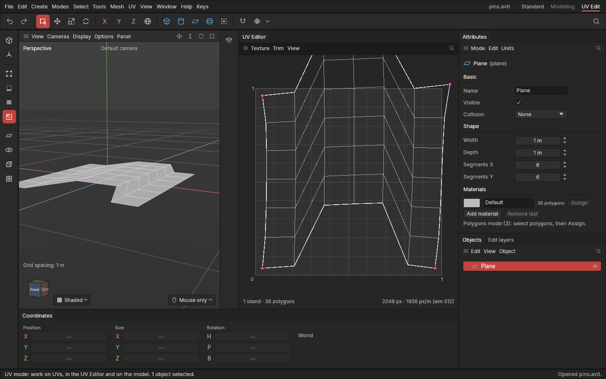

# Pinning UVs

> Hold chosen UVs where they are, so unwrapping lays the rest of the piece out around them and relaxing leaves them alone.

## When to use it

A [pin](concepts.md#uvs-and-texturing) is a UV you've nailed to the texture. Pin UVs when part of a piece must stay put:

- a piece's corners lined up with a decal or a panel on the texture, while you unwrap the curved part between them;
- the ends of a strip, held exactly where they are, while the strip in between is laid out again;
- a part you've carefully placed by hand that Relax shouldn't touch.

If you just want a whole piece left alone, wait for **Lock a piece** (coming in this phase); pins are for holding *some* of a piece.

## How to use it

1. In the UV Editor, pick the **Points**, **Edges** or **Polygons** mode (press **1**, **2** or **3**) or the **UV** mode, and select the UVs to hold.
2. Press **E** with the mouse over the UV Editor and choose **Pin** (or **UV → Pin**). The pinned UVs show as **magenta dots** in the UV Editor, in every mode.
3. Unwrap, Relax or Straighten as usual (see [Unwrap, Relax and Straighten](unwrapping.md)):
   - **two or more pins:** Unwrap lays the piece out around them. The pins don't move, and the piece keeps its place, size and turn. A mirrored piece stays mirrored;
   - **one pin:** the piece is unwrapped as usual, then moved so the pin is back where it was;
   - **Relax** never moves pinned UVs;
   - **Straighten** lays the piece out as a straight grid, then moves it so its first pin is back (a straight grid can't bend to meet several pins).
4. To let them move again, select them and choose **Unpin** (E or the UV menu).

Pinning a point pins it in every piece it touches at that spot: the UVs that sit together in the texture are held together. Pinning and unpinning are each one undo step (**Ctrl + Z**), saved with the project and listed on the object's [edit list](edit-list.md).

## Settings

None of their own. The **Unwrap method** (UV menu) decides how the rest of the piece is laid out around the pins; see [Unwrap, Relax and Straighten](unwrapping.md#settings).

## Shortcuts

| Action | Shortcut |
|---|---|
| Pin, Unpin | **E** over the UV Editor (or in the UV mode), or the **UV** menu |
| Select UVs | **1**, **2**, **3** or the UV mode, then click or drag in the UV Editor |
| Undo | **Ctrl + Z** |

No keys of their own (the project lead's choice); ask if you'd like some.

## Tips and common problems

- **Problem:** Pin says "select some UVs first". **Why:** pins go on UVs, which you select in the Points, Edges, Polygons or UV mode. **Fix:** press 1, 2 or 3 (or pick the UV mode) and select in the UV Editor.
- **Problem:** after unwrapping with pins, the piece looks squashed. **Why:** pins far from where the piece would naturally lie force it to bend to reach them. **Fix:** move the pins (W in the UV Editor) to where they'd sit on an even piece, or pin fewer points.
- **Problem:** a strip with pins didn't come out straight. **Why:** the pins win over straightening. **Fix:** Unpin, or use Straighten, which keeps only the first pin.
- **Tip:** pin the two ends of a long strip, then **UV → Unfold across only**: the strip evens out along its length while every point keeps its height.

## Related

- [Unwrap, Relax and Straighten](unwrapping.md)
- [Editing UVs by hand](editing-uvs.md)
- [The UV Editor and the UV mode](uv-editor.md)
- [Concepts: pin, UV map, island](concepts.md#uvs-and-texturing)
