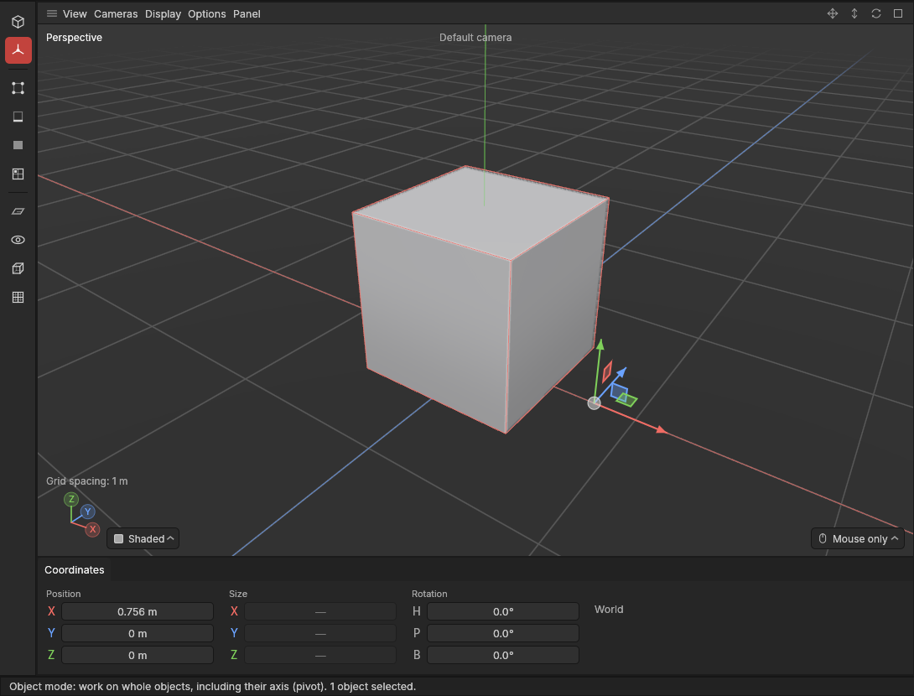
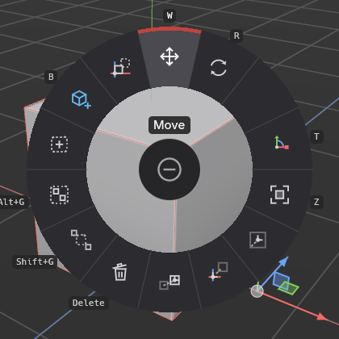

# Pivots and the Object mode

> Move or turn an object's pivot without moving the object, or put it somewhere ready-made: the middle of the shape, the world origin, or another object's pivot.

## When to use it

Every object has a [pivot](concepts.md#objects-and-scenes): the point it turns and scales around, where the gizmo sits. A game engine such as Godot places, turns and snaps the asset by that same point, so where it sits matters once the model leaves this app:

- A **door** should turn around its hinge, so its pivot belongs on the hinge edge, not in its middle.
- A **wall piece** for a modular kit snaps best with its pivot at a bottom corner, so pieces line up on a grid.
- A **prop** that stands on the floor wants its pivot at the middle of its base (what every new shape here starts with).
- A **wheel** should turn around its axle: pivot in the middle.

The **Object mode** is for exactly this. In it, the Move and Rotate gizmos move and turn the **pivot only**: the shape stays where it is. Back in the **Model mode**, moving, turning and scaling work on the whole object again, now around its new pivot.

## How to use it

### Move or turn a pivot by hand

1. **Select the object** (or several).
2. **Switch to the Object mode**: click its button on the mode palette on the left (the second one, three short arms), or **Modes → Object**. It has no key yet.
3. **Press W** for Move or **R** for Rotate, and drag the gizmo as usual (see [Move, rotate and scale](transforming.md)). The gizmo moves; the shape doesn't.
   - With **snapping** on (or Ctrl held), the pivot snaps to points, edges and polygons, including the object's own: drag the gizmo's middle onto a corner to put the pivot exactly there.
   - Turning the pivot changes which way the object's own axes point (press **L** for the object's axes to see them). Handy for a shape built at an angle.
4. **Type exact values** in the Coordinates panel if you prefer: Position and Rotation move and turn the pivot. Size shows a dash, because a pivot has no size; scaling does nothing in this mode.
5. Switch back to the **Model mode** to move the object around its new pivot.

Each drag or typed value is one undo step, called *Move Cube's pivot*: **Ctrl + Z** puts the pivot back.

Objects inside the selected one (its children) stay where they are too.

### Ready-made places

In the Object mode, press **E** for the [tool menu](tool-menu.md); the four pivot commands sit where the Model mode has Duplicate, Make editable, Duplicate as instance and Join. They're also in the **Tools** menu, in every mode.

| Command | What it does |
|---|---|
| **Pivot to centre** | Puts each selected object's pivot in the middle of its shape (the middle of its box). For a group, the middle of everything in it. The shape stays. |
| **Pivot to world origin** | Puts the pivot at the centre of the world, where the red and blue lines cross. The shape stays. Good for a model built around the middle of the scene. |
| **Pivot to object…** | Then **click another object**: the selected objects' pivots jump to that object's pivot. The shapes stay. The pointer becomes a cross while it waits; **Esc** cancels. Use it to line up pivots, for example so a lid and a box turn around the same hinge. |
| **Object to world origin** | Moves each selected object, shape and pivot together, so its pivot sits at the centre of the world. Handy before export: a game engine expects an asset to sit at the origin. |

The ready-made places move the pivot but keep its turn. Each is one undo step.

### Units: metres or centimetres

Each project is measured in **metres** (the standard) or **centimetres**, saved with the project. Every size and position is shown and typed in the project's units; the shapes don't change, only how their sizes read (1 m is 100 cm). Godot and Unity count in metres; Unreal counts in centimetres. When export arrives, the export will be scaled for the engine you pick.

To change this project's units, use the **Units** menu of the [Attributes panel](attributes.md), or **Edit → Settings… → Interface → Units**. Changing them is an undo step. In Settings you also choose the units **new projects** start with.

## Settings

| Setting | What it does |
|---|---|
| **Units** (this project) | Metres (standard) or centimetres, saved with the project. Attributes panel → Units, or Settings → Interface → Units. |
| **Units for new projects** | What a new project starts in. Settings → Interface → Units → New projects. Remembered between sessions. |

## Shortcuts

| Action | Shortcut |
|---|---|
| Move the pivot | `W`, in the Object mode |
| Turn the pivot | `R`, in the Object mode |
| Pivot commands | `E` in the Object mode, or the Tools menu |
| Cancel Pivot to object | `Esc` |
| Back to the Model mode | `Tab`, or the palette |

The Object mode has no key of its own yet.

## Tips and common problems

- **Problem:** I moved the gizmo but the whole object moved. **Why:** you're in the Model mode. **Fix:** switch to the Object mode first; the status bar says which mode you're in.
- **Problem:** pressing S in the Object mode does nothing. **Why:** a pivot has no size. **Fix:** switch to the Model mode to scale the object.
- **Problem:** the pivot won't snap onto a corner. **Why:** snapping is off. **Fix:** hold **Ctrl** while dragging, or turn snapping on.
- **Problem:** after Pivot to object…, clicking empty space does nothing. **Why:** it waits for a click on an object. **Fix:** click an object, or press **Esc** to stop.
- **Problem:** a shape I turned the pivot of looks slightly squashed. **Why:** the object was stretched unevenly (scaled more along one axis than another) before its pivot was turned, and such a stretch can't be described exactly around a turned pivot. **Fix:** undo, and turn the pivot before stretching the object, or make it editable first so the stretch is part of the shape.
- **Tip:** Symmetry's **Object's pivot** mirrors through the pivot, so moving the pivot moves the mirror. For a shape modelled around its middle, put the pivot back with **Pivot to centre**.
- **Tip:** a project opened from before this version shows every shape on its pivot, as before, in metres.

## Related

- [Move, rotate and scale](transforming.md)
- [The tool menu](tool-menu.md)
- [Symmetry](symmetry.md)
- [Settings](settings.md)
- [Concepts: pivot, origin and units](concepts.md#objects-and-scenes)
