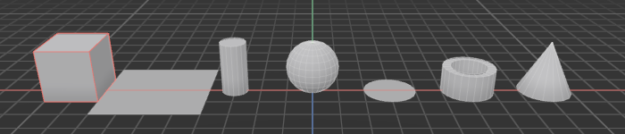
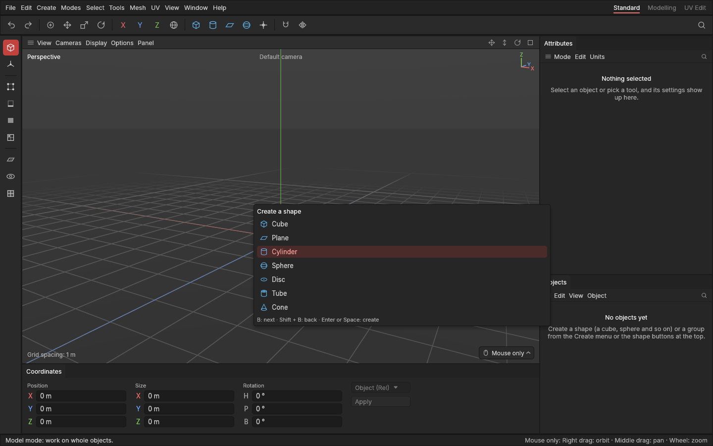
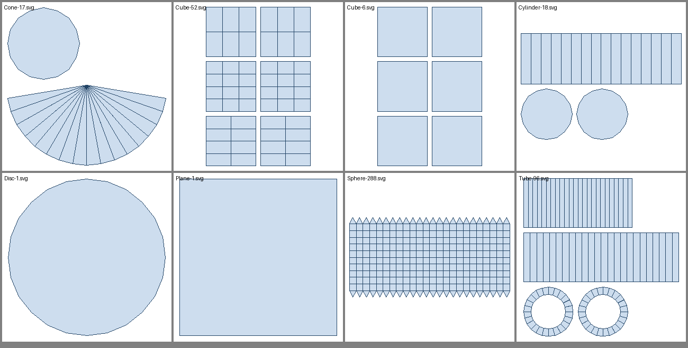

# Primitives

> Ready-made shapes to start a model from: cube, plane, cylinder, sphere, disc, tube and cone.

## When to use it

Almost every hard-surface model starts as a simple shape: a crate starts as a cube, a barrel as a cylinder, a lamp shade as a cone or a tube. These starting shapes are called [primitives](concepts.md#objects-and-scenes). Each one is made from a few settings, such as its size and how many pieces it's cut into. Those settings stay editable in the [Attributes panel](attributes.md), so you can change a cube's size or segments long after you've started modelling it.

## How to use it

1. Press **B** to open the shape list next to the mouse. Press **B** again to move down the list (**Shift + B**, or the arrow keys, to move back up), then **Enter** or **Space** to create the highlighted shape. You can also click a shape in the list. **Esc**, or a click elsewhere, closes it without creating anything.

   Or open the **Create** menu and pick a shape, or click one of the blue shape buttons on the command palette (cube, cylinder, plane, sphere).
2. The new shape appears at the centre of the scene, selected (its edges in the viewport and its name in the Objects panel take on the accent colour). It's added at the top of the Objects list, named after its kind: *Cube*, then *Cube 2* for the next one, and so on.
3. Rename, group, hide or delete it in the Objects panel like any other object (see [The Objects panel](objects.md)). **Ctrl + Z** takes the new shape away again.

Every shape **stands on the ground** with its [pivot](concepts.md#objects-and-scenes) at the middle of its base, and the plane and disc lie flat on it. That's how game engines like to place things: put the asset on the floor and it sits there, instead of being half sunk in.

New shapes all appear at the centre of the scene, so they overlap. Move them apart with the Move tool (**W**; see [Move, rotate and scale](transforming.md)), or type a position in the Coordinates panel.

## The shapes

| Shape | What you get | Hard and soft edges |
|---|---|---|
| **Cube** | A box 1 m on each side, one piece per side. | All twelve edges are hard, so it shades with crisp corners. |
| **Plane** | A flat 1 m square on the ground, facing up, one piece. | Flat, so it has no shading breaks. |
| **Cylinder** | An upright cylinder, 1 m across and 1 m tall, with 16 sides and closed ends. | The side is soft (it shades as a smooth curve); the rims where it meets the ends are hard. |
| **Sphere** | A ball 1 m across resting on the ground, 24 pieces around and 12 from top to bottom. | All soft: one smooth surface. |
| **Disc** | A flat circle 1 m across on the ground, made of 24 straight pieces. | Flat. |
| **Tube** | A pipe 1 m across and 1 m tall, with a 70 cm hole and 24 sides. | The inside and outside are soft; the four rims are hard. |
| **Cone** | A cone 1 m across and 1 m tall, with 16 sides and a closed base. | The side is soft; the rim of the base is hard. |

Every shape is **1 m across** as standard, a handy size to start from: it's easy to read and to scale (2 m is twice as big, 50 cm half).

The ends of cylinders and cones, and the disc, are **one face with many corners** (an [n-gon](concepts.md#mesh-basics)) as standard, rather than a fan of triangles. That keeps them clean to model on, and they stay flat, so they shade correctly. Two settings change this (tube ends are always a single ring between the inside and outside):

- **Cap segments** (**Ring segments** on a disc) cuts each end into rings from the rim inwards, giving you edges to model with, such as an inset ring for a lid.
- **Centre point** makes the middle of each end from triangles meeting at one point in the centre, like slices of a pie, instead of one n-gon.

### Ready-made UVs

Every shape comes already **unwrapped**: its surface is laid flat in the texture square ([UV map](concepts.md#uvs-and-texturing)), cut open along **seams** the way you'd do it by hand. So a texture or a checker pattern goes on straight away, and exports carry UVs from the start.

| Shape | How it's laid flat |
|---|---|
| **Cube** | Each side on its own, six squares side by side. |
| **Plane, disc** | As seen from above, in one piece. |
| **Cylinder, tube** | The round side unrolled into a strip, cut open down the back (the −X side); each end on its own. A tube's inside is a strip of its own. |
| **Cone** | The side unrolled into a fan around its tip; the base on its own. |
| **Sphere** | Unrolled like a map of the world, cut open down the back. |

The pieces keep their real sizes against each other, so the texture is equally sharp everywhere. The UVs follow your edits: an extrude stretches them up its new walls, a bevel across its strip. The UV tools to change them (the UV Editor, marking your own seams, unwrapping, packing) come in the next updates.

Faces are drawn from both sides, so you can see the underside of a plane or look inside an open shape; from behind, a face is a little darker.

## Settings

Each shape has its own settings, set to the standard values above when it's created:

| Shape | Settings |
|---|---|
| Cube | Width, depth and height; segments along each |
| Plane | Width and depth; segments along each |
| Cylinder | Radius, height, sides, height segments, closed ends, cap segments, centre point |
| Sphere | Radius, pieces around, pieces from top to bottom |
| Disc | Radius, hole radius, sides, ring segments, centre point (when there is no hole) |
| Tube | Outer and inner radius, height, sides, height segments |
| Cone | Bottom and top radius (a top above zero cuts the point off), height, sides, height segments, closed ends, cap segments, centre point |

Change them in the [Attributes panel](attributes.md): select the shape, then drag or type a value, or click the step arrows beside it. Sizes are kept between 1 mm and 10 km, and segments and sides between sensible limits, so a typing slip can never make a shape vanish or freeze the app.

## Shortcuts

| Action | Shortcut |
|---|---|
| Open the shape list, or move down it | `B` |
| Move up the list (or open it at the bottom) | `Shift + B`, or the arrow keys |
| Create the highlighted shape | `Enter` or `Space` |
| Close the list without creating | `Esc`, or click elsewhere |

The shape keys don't work while you're typing a name or a value, so a "b" you type stays a letter.

## Tips and common problems

- **Tip:** a shape keeps its settings until you choose otherwise. To turn it into a plain mesh with no settings, select it and press **Ctrl + E** (*Bake into shape*; see [Objects](objects.md#bake-into-shape)).
- **Tip:** start with the fewest segments you need. Low-poly game assets stay light, and you can always add segments later.
- **Problem:** a new shape seems to be missing. **Why:** it's inside another shape at the centre of the scene (a cube hides a cylinder, for example). **Fix:** hide the other shape with its eye in the Objects panel, or press **Z** with the new shape selected to frame it.
- **Tip:** a seam down the back of a cylinder or sphere is where the texture's edges meet. Turn the shape so it faces away from where it will be seen.
- **Problem:** a plane or disc vanishes when you look at it edge on. **Why:** it's perfectly flat, with no thickness. **Fix:** orbit a little higher or lower.

## Related

- [The Objects panel](objects.md): select, rename, group, hide and delete shapes.
- [Concepts](concepts.md): [primitives and pivots](concepts.md#objects-and-scenes), [n-gons](concepts.md#mesh-basics), and [hard and soft edges](concepts.md#shading-and-normals).
