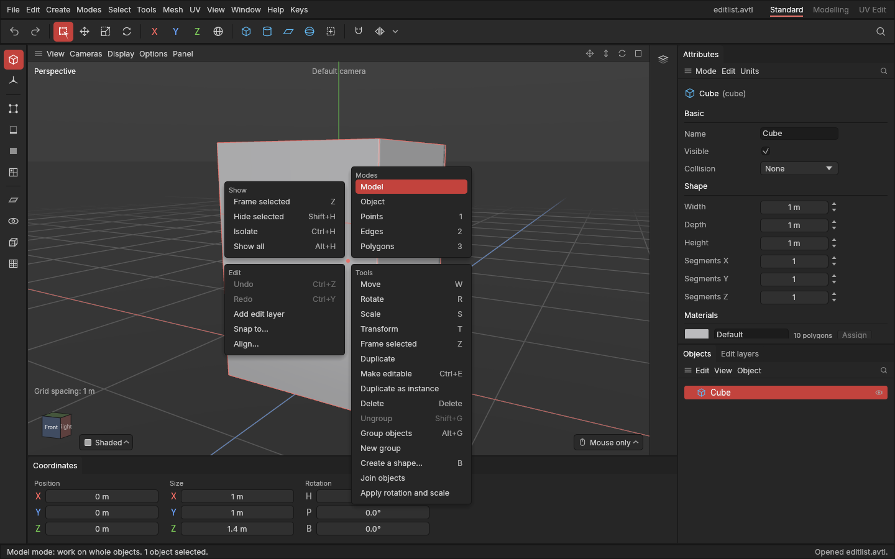

# The quad menu

> A right-click in the viewport opens four short lists around the mouse: what to show, the modes, undo and edit layers, and the tools for what you're working on.

3ds Max users reach for a right-click out of habit. The quad menu gives that habit something useful to do: the commands you need most, right where you're looking, without moving to the menu bar. It's **on as standard**; if you'd rather a right-click did nothing, switch it off in Settings. The [tool menu](tool-menu.md) (**E**) stays the quickest way to the tools; the quad menu adds modes, showing and hiding, and undo around them.

## When to use it

- If you're used to 3ds Max's right-click menu.
- To switch modes, hide things or undo without looking away from the model.

## How to use it

1. Right-click in the viewport. Click the button without dragging: a right *drag* still turns the view if your navigation controls use it.
2. Click an entry. **Esc** or a click anywhere else closes the menu.

| List | Where | What's in it |
|---|---|---|
| **Show** | Top left | Frame selected, Hide selected, Isolate, Show all ([Hide and isolate](hide-and-isolate.md)) |
| **Modes** | Top right | Model, Model (Edit pivot), Points, Edges, Polygons; the current one highlighted. *Model (Edit pivot)* is the Model mode with [Edit pivot](pivots.md) on |
| **Edit** | Bottom left | Undo, Redo, Add edit layer ([Edit layers](edit-layers.md)), and in the Model mode (with or without Edit pivot) Snap to… and Align… ([Snap to and Align](snap-to-and-align.md)) |
| **Tools** | Bottom right | The current mode's tools, the same as the [tool menu](tool-menu.md) (E) |

Greyed-out entries can't be used right now; hover over one to see why. Each entry shows its key on the right, so the menu also helps you learn the keys.

## Settings

| Setting | What it does |
|---|---|
| **Right-click opens the quad menu** | On (standard): right-clicks in the viewport open the quad menu. Off: they do nothing. In **Edit → Settings… → Interface → Quad menu**. |

## Shortcuts

| Action | Shortcut |
|---|---|
| Open the quad menu | Right-click in the viewport |
| Close it | **Esc**, or click elsewhere |

## Tips and common problems

- **Problem:** a right-click doesn't open it. **Why:** it was switched off in Settings, or something else had the right-click: it cancelled a drag, the app was waiting for you to click an object (Snap to, Align, Pivot to object), or a window was open. **Fix:** switch it back on in Settings, and finish what's under way first.
- **Tip:** with the **Mouse only** navigation controls, a right *drag* turns the view; only a right *click* (no movement) opens the menu.

## Related

- [The tool menu (E)](tool-menu.md)
- [Settings](settings.md)
- [Keyboard shortcuts](keyboard-shortcuts.md)
