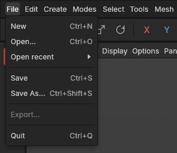
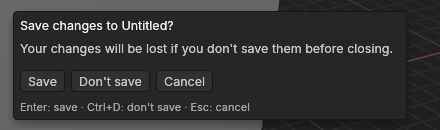

# Saving and opening projects

> Save your scene as a project file (`.avtl`) and open it again later, exactly as you left it.

## When to use it

Whenever you want to keep your work. A project file holds everything in your scene:
- every object, its name, where it sits in the Objects panel, and whether it's hidden;
- each shape's settings (so a cube is still a cube with editable size and segments when you open it again);
- plain meshes made with Make editable;
- edits recorded on top of shapes;
- what was selected.

Project files are only for this app. To take a model into Substance Painter or Godot, you'll *export* it (Phase 5); the project file stays your working copy.

## How to use it

1. **Save** with **File → Save** or **Ctrl + S**. The first time, a window asks for a name and a folder; the app adds `.avtl` to the name if you leave it out. After that, Ctrl + S saves to the same file without asking.
2. **Save under a new name** (to keep the old version, say) with **File → Save As…** or **Ctrl + Shift + S**.
3. **Open** a project with **File → Open…** or **Ctrl + O**, or pick one from **File → Open recent**, which lists the last eight projects you saved or opened (hover over one to see where it is). The opened scene replaces the current one, and the view frames it.
4. **Start again** with **File → New** or **Ctrl + N**: an empty scene.

The project's name is shown on the right of the menu bar. When there are changes you haven't saved, a red **Unsaved** badge appears next to it, and the window's title gets a dot in front and "(unsaved)" after the name (for example "● crate.avtl (unsaved) — Aventail 3D"), so you can see it even in the taskbar. Before the first save the project is called *Untitled*.

**Closing the app:** use **File → Quit** or the window's **×**. There's no key for quitting, on purpose: the keys you use all the time shouldn't be able to close the app by accident.

**You won't lose changes by accident.** If you start a new project, open another, or close the app with unsaved changes, the app asks first:

- **Save** (or **Enter**) saves, then carries on. If the project has never been saved, it asks where first; closing that window without choosing cancels everything.
- **Don't save** (or **Ctrl + D**) throws the changes away and carries on.
- **Cancel** (or **Esc**) goes back to your work.

**Saving is safe.** The app writes the new file next to the old one, checks it arrived whole, and only then puts it in place. So a crash or a full disk while saving never leaves you with a damaged project. The previous save is kept as a backup beside it, named like `crate.avtl.bak`: if you ever need it, rename it to end in `.avtl` and open it.

**Backup copies cover the time between saves.** While you work, the app also saves backup copies of your scene in the background (every 5 minutes as standard, only when something changed). They never replace your project file. If the app ever closes without saving, it offers them back the next time it starts. See [Backup copies and crash recovery](autosave.md).

**Undo starts fresh** when you open a project: the undo history isn't saved in the file (yet). Saving doesn't clear it, so you can still undo after saving.

You can also open a project by giving it to the app when it starts (for example, from a terminal: `aventail crate.avtl`). Once the app has an installer, double-clicking a project file will do the same.

## Settings

None of its own. Your preferences (accent colour, units, navigation and so on) are not part of a project: they belong to you, not the scene, and are kept in [Settings](settings.md).

## Shortcuts

| Action | Shortcut |
|---|---|
| New project | `Ctrl + N` |
| Open | `Ctrl + O` |
| Save | `Ctrl + S` |
| Save As | `Ctrl + Shift + S` |
| In "Save changes?": save / don't save / cancel | `Enter` / `Ctrl + D` / `Esc` |

On macOS, use `Cmd` instead of `Ctrl`.

## Tips and common problems

- **Tip:** save often, and use Save As with a number (crate-01.avtl, crate-02.avtl) before big changes, so you can always go back.
- **Problem:** "Couldn't open … it was saved by a newer version of the app". **Why:** the project was saved by a newer version, in a format this version doesn't know yet. **Fix:** update the app. (Newer versions always open projects from older ones. Projects with extrudes, insets or bevels need a version from October 2026 on.)
- **Problem:** "Couldn't open … the file is damaged". **Why:** the file was cut short or changed by something else (an interrupted copy, a sync tool). **Fix:** open the backup: rename `name.avtl.bak` so it ends in `.avtl`, and open that.
- **Problem:** the app crashed, or the power went, before you saved. **Fix:** start the app again: it offers the backup copies it saved in the background ([Backup copies and crash recovery](autosave.md)).
- **Problem:** "Couldn't open … it isn't a project file". **Why:** the file isn't one of this app's projects. **Fix:** to bring in a model from elsewhere, use import (from Phase 5).
- **Problem:** a project in Open recent is gone from the list. **Why:** it couldn't be found when you tried to open it (moved, renamed or deleted). **Fix:** use **File → Open…** to find it where it is now.

## Related

- [Objects and the Object Manager](objects.md): undo and redo.
- [Backup copies and crash recovery](autosave.md): autosave, and what happens after a crash.
- [Settings](settings.md): preferences that belong to you, not the project.
- [Concepts](concepts.md): [project file](concepts.md#objects-and-scenes).
