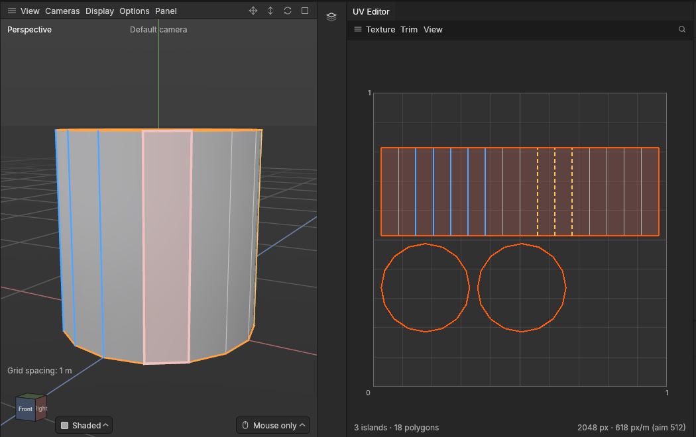

# Seam preferences and stretch budgets

> Tell the automatic tools where seams should and shouldn't go, and how much stretching a piece may have.

## When to use it

[Suggest seams](seams.md) and [Unwrap](unwrapping.md) make cuts by themselves: Suggest seams to cut a shape into pieces, and Unwrap to cut a closed piece open so it can lie flat. They hide those cuts as well as they can, but they can't know your model:

- the label on a bottle must stay in one piece, so no seam may cross it;
- the back of a backpack sits against the character, so that's where seams belong;
- a piece that bends round a lot (a helmet, a dome) stretches when laid flat, and you'd rather it got one more cut than a blurry texture.

**Seam preferences** say this for edges. **Never seams here** keeps cuts off them, and **Prefer seams here** is where needed cuts go first. They don't make seams themselves: they guide the tools whenever those cut. A seam you mark by hand always goes where you put it.

A **stretch budget** says how much stretching a piece may have. "Off" here means a [polygon](concepts.md#mesh-basics) stretched one way more than the other, or bigger or smaller on the texture than the rest of its piece. 1.5× means nearly all of the piece is within one and a half times of perfect. A piece over its budget gets cut further, a slit at a time, from where it's most squeezed to its edge along the most hidden way. This continues until it's within the budget, or more cuts don't help.

## How to use it

**Seam preferences:**

1. Press **2** (Edges) and select edges, or **1** (Points) for the edges between selected points, or **3** (Polygons) for a whole area.
2. In **UV → Seams**, choose:
   - **Prefer seams here**: around the selected polygons, or on the selected edges;
   - **Never seams here**: on every edge of the selected polygons, or on the selected edges;
   - **Clear seam preference**: back to free.
3. **Look for** the marks: in the UV Editor, and on the model in the UV mode (or with **Display → Seams**). "Never" edges are blue; "prefer" edges are pale orange, dashed in the UV Editor.
4. Run **UV → Seams → Suggest seams** (or Unwrap) to see the tools follow them.

**Stretch budget for some pieces:**

1. Select the pieces (or parts of them; whole objects with nothing selected inside them).
2. **UV → Pieces → Stretch budget**: set **Budget** (1.5× is strict; 2×, where the Stretch view turns red, is loose), then **Give the selection this budget**.
3. Suggest seams and Unwrap now cut those pieces further when needed. **Clear the selection's budget** takes it away.

**Stretch budget for every piece:** tick **UV → Settings → Seam suggestions → Stretch budget for every piece** and set its value. Pieces with a budget of their own keep theirs.

Each of these is one undo step, saved with the project and listed on the object's [edit list](edit-list.md).

## Settings

| Setting | What it does |
|---|---|
| **UV → Pieces → Stretch budget → Budget** | The budget **Give the selection this budget** gives: 1.05× to 10×, 1.5× as standard. |
| **UV → Settings → Seam suggestions → Stretch budget for every piece** | Off (standard). On: every piece without its own budget is held to this one (2× as standard). |

"Nearly all" means all but the worst 5% of a piece's area: one squeezed sliver, or the tip of a cut, doesn't hold a whole piece over its budget.

## Shortcuts

| Action | Shortcut |
|---|---|
| Prefer seams here, Never seams here, Clear seam preference | **UV → Seams** |
| Stretch budget | **UV → Pieces → Stretch budget** |
| Edges, Points, Polygons modes | **2**, **1**, **3** |

No keys of their own; ask if you'd like some.

## Tips and common problems

- **Problem:** Suggest seams still put a seam on a "never" edge. **Why:** a piece that can't lie flat in one go (a tube, a closed shape) needs at least one cut, and every way was marked "never". **Fix:** leave some edges free (or preferred) for the cut.
- **Problem:** a "prefer" edge didn't get a seam. **Why:** preferences guide cuts the tools need; they don't make extra ones. **Fix:** mark it as a seam yourself if you want it cut anyway.
- **Problem:** a piece is still over its budget. **Why:** more cuts stopped helping (a very twisted piece), or it hit 24 cuts. **Fix:** add a seam yourself, or use **UV → Settings → Unwrapping → Keep sizes**.
- **Problem:** the budget made lots of little cuts. **Why:** the budget is strict for that shape. **Fix:** raise it a little (1.5× to 1.8×, say).
- **Tip:** Seams from hard edges also keeps off "never" edges.

## Related

- [Seams](seams.md)
- [Unwrap, Relax and Straighten](unwrapping.md)
- [Checker and Stretch views](checker-and-stretch.md): see the stretching a budget limits
- [Settings of the automatic UV tools](uv-settings.md)
- [Concepts: seam, stretching](concepts.md#uvs-and-texturing)
