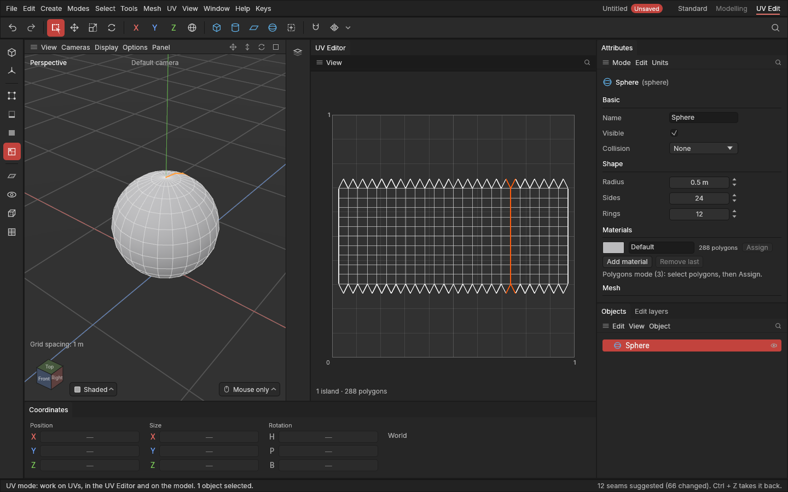

# Seams

> Mark where the surface is cut open to lie flat: by hand, along the hard edges, or let the app suggest seams in hidden places.

## When to use it

To texture a shape, its surface is laid flat on the texture square, like unfolding a cardboard box. A [seam](concepts.md#uvs-and-texturing) is where it's cut so it can unfold. Where you put seams decides:

- **how many pieces** ([islands](concepts.md#uvs-and-texturing)) the shape is laid out in;
- **how much the texture stretches**: a piece that can't lie flat (a whole ball, a tube) stretches a lot until it's cut;
- **where the texture has a visible join**: a seam is where two parts of the texture meet, so you want them where nobody looks.

For hard-surface game assets, the usual rule is: **a seam on every hard edge**, plus a few more so each piece lies flat. A normal-map bake (in Substance Painter, say) needs the UVs split wherever the shading breaks, or it shows lines.

Every shape in the app comes with seams already, where its [ready-made UVs](primitives.md#ready-made-uvs) are cut. Change them when you've modelled further.

**The UVs follow as you mark seams:** the pieces either side are [unwrapped](unwrapping.md) again at once (switch **UV → Unwrapping → Unwrap as seams change** off to only change the marks).

## How to use it

Seams show in **orange**: in the UV Editor, in the viewport in the UV mode, and in the other modes with **Display → Seams**.

**Mark or clear seams by hand:**
1. Press **2** for the Edges mode and select edges. To paint along edges, use the **Paint select** brush (press **Q** until it's chosen).
2. Choose **UV → Mark seams**, or press **E** with the mouse over the UV Editor and pick **Mark seams**. **Clear seams** takes them off.

With **polygons** selected (Polygons or UV mode), **Mark seams** marks the edges **around** the selection: select a region and it's cut out as its own piece. **Clear seams** clears every edge of the selected polygons. In the Points mode, it uses the edges between selected points.

**Seams from hard edges:** select objects and choose **UV → Seams from hard edges**. Every edge shading hard becomes a seam (the hard edges as shown: by angle while Automatic hard edges is on).

**Suggest seams:** select objects and choose **UV → Suggest seams**. The app replaces their seams with suggested ones:
1. along hard edges and sharp corners (more than 66°);
2. then whatever each piece still needs to lie flat: a tube's side gets one cut along its length, a ball one cut from bottom to top;
3. those extra cuts go where they're least seen: facing down or to the back (away from the Front view), and in corners rather than across flat stretches.

All of these are one undo step each, the unwrapping included (**Ctrl + Z**), are saved with the project, and are recorded on the object's [edit list](edit-list.md), so they're made again if you change the shape's settings before them.

**Select seams:** **Select → Select seams** (or **UV → Select seams**) selects every seam, in the Edges mode, to check or change them.

**Guide the automatic seams.** Mark edges **Prefer seams here** or **Never seams here** (UV menu), and give pieces a **stretch budget**: Suggest seams and Unwrap follow them. See [Seam preferences and stretch budgets](seam-preferences.md).

## Settings

In **UV → Seam suggestions** (remembered between sessions):

| Setting | What it does |
|---|---|
| **Cut corners sharper than** | Edges where the surface bends more sharply than this get a seam: 66° standard. A piece bent far round one edge stretches when laid flat. Raise it for fewer, bigger pieces; 180° cuts no corners. |
| **Cut along hard edges** | On (standard): every hard edge gets a seam, as a normal-map bake needs. Off: only corners, and what pieces need to lie flat. |
| **Stretch budget for every piece** | Off (standard). On: pieces stretching more than this once laid flat get cut further ([Seam preferences and stretch budgets](seam-preferences.md)). |
| **Hide cuts** | Where the extra cuts go that only make a piece lie flat (here, and when Unwrap cuts a closed piece open). **Underneath and at the back** (standard): where a prop is least seen. **Underneath**, or **At the back**, only. **Anywhere (shortest cuts)**: as short as can be, for shapes seen from all round. |

The same shape and settings always give exactly the same seams. "Underneath" and "the back" are the object's own down (−Z) and back (+Y, away from the Front view): turn the object, not the world, to change which side counts as the back.

## Shortcuts

| Action | Shortcut |
|---|---|
| Mark seams, Clear seams | **E** over the UV Editor (or in the UV mode), or the UV menu |
| Seams from hard edges, Suggest seams, Select seams | UV menu |
| Suggest seams' settings | **UV → Seam suggestions** |
| Edges mode | **2** |
| Paint select (to paint along edges) | **Q** until it's chosen |

No keys of their own, as chosen for seams; ask if you'd like some.

## Tips and common problems

- **Problem:** I marked seams but the UV Editor looks the same apart from orange lines. **Why:** **Unwrap as seams change** is off (**UV → Unwrapping**), or the piece was flat anyway: a flat piece cut in two comes back just where it was. **Fix:** switch it on, or choose Unwrap.
- **Tip:** seams survive modelling: bevel an edge that is a seam and the seam stays, along one side of the bevel; an extrude's new walls get seams of their own. See [UVs while you keep modelling](uvs-and-modelling.md).
- **Problem:** Mark seams says the edges are seams already. **Why:** they are, or they're open edges (the side of a hole), which are cut already.
- **Problem:** Suggest seams changed seams I had placed by hand. **Why:** it replaces all seams of the selected objects. **Fix:** Ctrl + Z, then use Seams from hard edges and Mark seams instead, or select only the objects to suggest for.
- **Problem:** nothing happens on an instance. **Why:** an instance has no edits of its own; it shows its original's seams. **Fix:** mark seams on the original.
- **Tip:** start with Suggest seams, then fix the few you don't like with Mark and Clear seams.
- **Tip:** hide seams where the model meets something else in the game (a wall, the floor, another part), where a texture join won't show.

## Related

- [The UV Editor and the UV mode](uv-editor.md)
- [Seam preferences and stretch budgets](seam-preferences.md)
- [Unwrap, Relax and Straighten](unwrapping.md)
- [Editing UVs by hand](editing-uvs.md)
- [Hard and soft edges](hard-and-soft-edges.md)
- [Selecting](selecting.md) (Paint select)
- [Concepts: UV map, seam, island](concepts.md#uvs-and-texturing)
