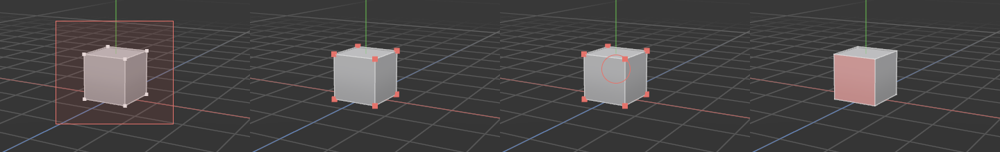

# Selecting

> Pick the shapes, points, edges or polygons you want to work on: click them, drag a box or a lasso around them, or paint over them.

## When to use it

Every modelling tool works on what is selected, so selecting comes first. What gets selected depends on the [mode](modes.md):
- In **Model** mode you select whole shapes.
- In **Points**, **Edges** and **Polygons** mode you select those [elements](concepts.md#mesh-basics) of the shapes that are already selected.

So the usual order is:
1. Select a shape.
2. Press `1`, `2` or `3`.
3. Select its points, edges or polygons.

For now you can only select. Moving what you selected arrives with the next update (the move, rotate and scale gizmos).

## How to use it

### Click

- **Click** a shape (in Model mode) or a point, edge or polygon (in the other modes) to select just that.
- **Ctrl + click** adds it to the selection, or takes it out again if it was already selected.
- **Shift + click** only adds, never takes out.
- **Click on empty space** to unselect everything of that kind.

A click always takes the thing you can see under the mouse, the one that lights up.

### Drag: box, lasso or brush

Hold the left mouse button and drag. What the drag draws depends on the **select tool**:

- **Box selection** (the standard): drag a rectangle. Everything inside it is selected.
- **Lasso selection**: draw a loop around what you want, freehand. Useful for odd shapes a box would cut through.
- **Live selection** (the brush): paint over what you want with a circle that follows the mouse. Everything the circle touches is selected as you go.

Press **Q** to step through the three (Box → Lasso → Live selection → Box). The button near the left end of the top palette shows the active tool. You can click that button too, or pick a tool in the **Select** menu.

While dragging, the keys you hold decide what happens to what was already selected:

| Drag | Result |
|---|---|
| Plain drag | Replaces the selection |
| **Shift** + drag | Adds to it |
| **Ctrl** + drag | Removes from it |

### What counts as "inside"

- **Points:** the point is inside.
- **Edges:** both ends are inside a box or lasso; with the brush, the brush only has to touch the edge.
- **Polygons:** the polygon's middle is inside. The brush also takes the polygon right under its centre, so painting across a big polygon selects it.
- **Whole shapes** (Model mode): any part of the shape is inside.

### Selecting through, or only what you can see

As standard, a box, lasso or brush **selects through the shape**: the points, edges and polygons on its far side are caught too. That's what you want for, say, selecting the whole top half of a model in one go.

Sometimes you only want the side facing you. Switch on **Select only visible**:
- the button on the left palette, just above the grid button (a box with faint hidden edges, filled red when on);
- or **Select → Select only visible**;
- or **Edit → Settings… → Viewport → Selecting**.

The choice is remembered between sessions.

Elements selected on the far side aren't drawn (the shape hides them), but the status bar counts them: *8 points selected*.

### Loops and rings

A **double-click** selects a whole [loop](concepts.md#mesh-basics), the belt running around the shape. **Shift + double-click** selects the **ring**, the rungs across that belt.

- **Edges mode:** double-click an edge.
- **Points mode:** double-click on an edge between two points; you get the points along its loop.
- **Polygons mode:** double-click inside a polygon, near the edge the band should cross. The loop is the band of polygons running across that edge; the ring runs the other way.

**Ctrl + double-click** adds the loop or ring to what's already selected. Loops stop where the mesh isn't made of four-sided polygons, or at a corner where three or five edges meet. That's how loops work everywhere, so on a plain cube a loop is just one edge. Give the cube more segments to see them go around.

### Grow, shrink, all, invert

- **Ctrl + mouse wheel up** grows the selection by one step: everything touching it is added. **Ctrl + wheel down** shrinks it by one step, taking away its outer rim. (With the brush active, Ctrl + wheel changes the brush's size instead; use the Select menu to grow and shrink then.)
- **Ctrl + A** selects everything: all shapes in Model mode, or all points, edges or polygons of the selected shapes.
- **Ctrl + I** inverts: what was selected is unselected, and the rest selected.
- **Esc** unselects the points, edges or polygons, but keeps the shape selected, so you can keep working on it. In Model mode, Esc unselects the shapes.

### Undo

Selecting points, edges and polygons can be undone with **Ctrl + Z**, like any other change. A whole brush stroke is one step. Selecting whole shapes isn't an undo step, as in the Objects panel.

Each mode remembers its own selection. Select some points, switch to Polygons mode and select polygons, and the points are still selected when you go back.

## Settings

| Setting | What it does |
|---|---|
| **Select only visible** | Off (standard): the box, lasso and brush select through the shape, the far side too. On: only what you can see. Left palette, Select menu or Settings. |
| **Brush size** | How big the live selection brush is. Ctrl + mouse wheel while the brush is active. The circle around the mouse shows it. |

## Shortcuts

| Action | Shortcut |
|---|---|
| Select (replace) | Click |
| Add or remove one | `Ctrl` + click |
| Box, lasso or brush: replace / add / remove | Drag / `Shift` + drag / `Ctrl` + drag |
| Next select tool (Box → Lasso → Live selection) | `Q` |
| Loop / ring | Double-click / `Shift` + double-click (`Ctrl` to add) |
| Grow / shrink the selection | `Ctrl` + wheel up / down |
| Brush size (with the brush active) | `Ctrl` + wheel |
| Select all | `Ctrl + A` |
| Invert the selection | `Ctrl + I` |
| Unselect points, edges or polygons (Model mode: shapes) | `Esc` |
| Undo / redo a selection | `Ctrl + Z` / `Ctrl + Y` |

## Tips and common problems

- **Problem:** dragging a box selects nothing in Points mode. **Why:** no shape is selected, so there are no points to select (the status bar says so). **Fix:** press `1` again to go back to Model mode, click the shape, then press `1`.
- **Problem:** a box selected points on the back I didn't want. **Why:** selecting through is the standard. **Fix:** switch on **Select only visible**, or Ctrl + drag over the unwanted ones.
- **Problem:** a double-click only selects one edge. **Why:** the loop can't continue: it reached a corner where three edges meet (every corner of a plain cube), a triangle or an n-gon. **Fix:** this is normal; add segments, or select the rest with Ctrl + click.
- **Problem:** dragging with the left button moves the view instead. **Why:** you're holding Alt, which navigates in some control schemes. **Fix:** let go of Alt.
- **Tip:** to select one side of a model cleanly, use a flat view (`F2`, `F3`, `F4`) and a box: in a flat view, a box through the model takes the front and back alike.

## Related

- [Points, Edges and Polygons modes](modes.md)
- [Objects: selecting in the Objects panel](objects.md)
- [Concepts: mesh basics](concepts.md#mesh-basics) (element, edge loop, edge ring)
- [Settings](settings.md)
