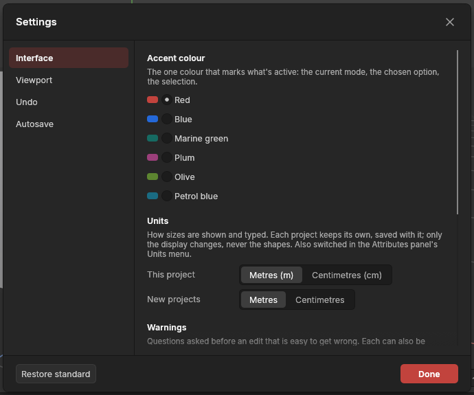

# Settings

> Every app-wide preference in one place: the accent colour, how the selection is drawn, metres or centimetres, the tool menu's look, how the mouse moves the view, the grid, how much undo may keep, and backup copies.

## When to use it

Whenever you want to change how the app behaves for you, rather than something in your scene. Your choices are remembered the next time you open the app.

A few of these settings also have a quick switch where you use them while working. They show and change the same value as Settings, so use whichever is closer:
- The **Units** menu in the [Attributes panel](attributes.md) (this project's units: metres or centimetres).
- The **navigation controls** button in the viewport's bottom-right corner (see [Navigating the view](navigating-the-view.md)).
- The **grid button** at the bottom of the left palette.

## How to use it

Every setting has its home here. Menus that hold settings too (the viewport's **Display** and **Options** menus) end with **All settings…**, which opens this window.

1. Open **Edit → Settings…** on the main menu bar, or press **Ctrl + ,** (Ctrl and the comma key).
2. Pick a section on the left: **Interface**, **Viewport**, **Undo** or **Autosave**.
3. Click a choice. It takes effect at once: there is nothing to confirm.
4. Close the window with **Done**, the **×** in its corner, **Enter** or **Esc**, or press **Ctrl + ,** again.

**Restore standard** (bottom left of the footer) puts every setting back as it was when the app was new. Your panel layout is kept; to reset that, use **View → Reset panel layout**.

## Settings

| Section | Setting | What it does |
|---|---|---|
| Interface | **Accent colour** | The one colour that marks what's active: the current mode, the chosen option, the selection. Red as standard; Blue, Marine green, Plum, Olive or Petrol blue instead. |
| Interface → Seeing the selection | **High contrast** | Off (standard): the selection is drawn thicker and brighter than anything else, on top. On: selected and hovered points, edges and polygons are drawn larger still, with a dark rim, in the viewport and the UV Editor, so they stand out on any colour. Handy on a busy model, a bright texture, or a screen that's hard to read. Also found by [command search](command-search.md). |
| Interface → Radial menu | **Look** | How the tool menu (E) looks: **Continuous ring** (standard), **Inner edge**, **Outlined**, **Solid tiles**, or a **List** like the shape list. Same tools, same places, same keys. See [The tool menu](tool-menu.md). |
| Interface → Radial menu | **Show keys around the ring** | On (standard): each tool's key sits just outside its button. Off: the key shows in the middle, with the tool's name. |
| Interface → Radial menu | **Tap E to open** | On (standard): a tap opens the menu and keeps it open. Off: it shows only while you hold E. |
| Interface → Quad menu | **Right-click opens the quad menu** | On (standard): a right-click in the viewport opens four lists of commands around the mouse. Off: a right-click does nothing. See [The quad menu](quad-menu.md). |
| Interface → Paint tools | **Paint tools in the left bar** | Off (standard): in Paint mode the paint tools float along the bottom of the viewport. On: they sit in the left bar under the modes, so nothing floats over the view. See [The paint tools](painting-textures.md#the-paint-tools). |
| Interface → Warnings | **Ask before dissolving across a sharp corner** | On (standard): [Dissolve](clean-up.md#dissolving-across-a-sharp-corner) asks first when it would merge polygons meeting more sharply than 30° into one bent polygon. Off: it goes ahead. Also switched off by **Don't warn me again** in the question. |
| Interface → Updates | **Look for new versions** | On (standard): an installed copy looks for a new version while its splash screen shows (asking there: Update now or Open without updating) and every six hours (downloading it, then asking: Restart now or Later). Off: it never looks. A line under the switch says what the last look found; a version you skipped is named, with **Ask about it again**. See [Installing and updating](installing-and-updating.md). |
| Interface → Units | **This project** | Show and type this project's sizes in **metres** (standard) or **centimetres**. Saved with the project, not as a preference; changing it is an undo step. Only the display changes, never the shapes. See [Units](pivots.md#units-metres-or-centimetres). |
| Interface → Units | **New projects** | The units a new project starts with: **Metres** (standard) or **Centimetres**. Remembered between sessions. |
| Viewport | **Look** | How the viewport draws the scene; the layout stays the same. **Default** (standard): one smooth grey gradient, a clear grid, shapes lit mostly from the camera so their fronts read bright. **Studio**: a lighter grey studio with a horizon, a stronger light from above, a soft shine and soft shadows under objects, so shapes show their form. **Dusk**: a cool blue-grey sky, a warm light from above with cool blue shade, and soft shadows. **Classic**: the darker, softly lit look the viewport had before. **Custom**: your own backdrop colours (top, horizon, bottom, with or without a horizon line), grid colour and strength, light from above, light from the camera, shine, warmth and soft shadows; **Start from** copies another look's settings to change them. Remembered; **Restore standard** goes back to Default and keeps your custom colours. See [How shapes are drawn](viewport-display.md#the-viewports-look). |
| Viewport | **Steady frame rate** | **While painting** (standard): on the Paint page the app draws at your screen's own steady pace instead of only when something changes. **Always**: on every page. **Off**: only when something changes, the least power. Screens with a *variable refresh rate* (FreeSync, G-Sync, most gaming monitors over 60 Hz) follow the app's pace, and some flicker in brightness when it jumps about; drawing steadily stops that. It uses a little more power, and stops while another window is in front. |
| Viewport | **Navigation controls** | Which mouse buttons orbit, pan and zoom. **Mouse only** is the standard; see [Navigating the view](navigating-the-view.md) for each scheme. |
| Viewport | **Alt + mouse works in every scheme** | Keeps the Alt + mouse moves working whichever controls you pick. |
| Viewport | **Orbit and zoom around the point under the mouse** | On (standard): turn around, and zoom towards, whatever is under the mouse. Off: the middle of the view. |
| Viewport | **Invert orbit direction** | Orbiting turns the other way. |
| Viewport | **Grid lines** | Every 1 m (standard), every 50 cm, or every 10 cm. |
| Viewport → Viewport display | **Cavity**, **Show hard edges**, **Show seams**, **Show normals**, **Show collision**, **Show triangles**, **Switch to orthographic when clicking the dice** | What the viewport draws over your shapes, and whether clicking the view dice also makes the view flat. The same switches as in the viewport's **Display** menu; see [How shapes are drawn](viewport-display.md). |
| Viewport | **Selection keys** | Which key adds to the selection and which takes away, for clicks, boxes, lassos, the brush and double-clicks alike: **Ctrl adds, Shift removes** (standard), **Shift adds, Ctrl removes**, **Ctrl flips**, or **Ctrl adds, Alt removes** (Alt + drag still moves the view while Alt + mouse works in every scheme). See [Selecting](selecting.md). |
| Viewport | **Snapping** | Whether moves, turns and resizing snap; whether holding Ctrl while dragging flips it for that drag (standard) or only the button does; what moves snap to (points, edges, polygons, grid lines); whether grid snapping uses the project's [kit grid](modular-kits.md#snap-pieces-onto-the-grid) instead of the lines shown; and the steps for turning (15°) and scaling (10%). See [Move, rotate and scale](transforming.md#snapping). |
| Viewport → Selecting | **Back to the Model mode when nothing is selected** | Off (standard): with nothing selected in the Points, Edges or Polygons mode, click a shape in the viewport to select it and carry on in the mode. On: when the selection becomes empty in one of those modes, the app goes back to the Model mode, where a click selects a shape. See [Modes](modes.md). |
| Viewport | **Select only visible** | On (standard): the box, lasso and brush select only what you can see. Off: they select through shapes, catching their far side too. Also the button above the grid button on the left palette. See [Selecting](selecting.md). |
| Undo | **Undo memory** | How much memory undo may use before it starts forgetting the oldest steps: 256 MB to 8 GB, or Unlimited. 2 GB is the standard. There's no limit on the *number* of steps, and the newest step is always kept. The line above the choices shows how much is in use now and how many steps that is. |
| Autosave | **Backup copies** | Whether the app saves backup copies of your scene in the background (on as standard), how often (every 5 minutes as standard, 1 to 30), and how many it keeps (5 as standard, 1 to 20). Also shows the folder they go to. See [Backup copies and crash recovery](autosave.md). |

## Shortcuts

| Action | Shortcut |
|---|---|
| Open or close Settings | `Ctrl + ,` (`Cmd + ,` on macOS) |

## Tips and common problems

- **Tip:** if you work on very large meshes for hours, check **Undo** now and then: if "In use" is close to the limit and your computer has memory to spare, a higher limit lets you undo further back.
- **Problem:** undo stops before you got back to where you wanted. **Why:** the oldest steps were forgotten to stay within the undo memory (the status bar said so when it started). **Fix:** raise **Undo memory**, if your computer has the memory to spare.
- **Problem:** a setting seems to have changed by itself. **Why:** the quick switches (the Attributes panel's Units menu, the navigation button, the grid button) change the same settings. **Fix:** this is intended; set it back from either place.

## Related

- [Interface tour](interface-tour.md): where everything is.
- [Navigating the view](navigating-the-view.md): the navigation schemes in detail.
- [The Objects panel](objects.md): undo and redo.
- [Backup copies and crash recovery](autosave.md): the Autosave section in detail.
- [Concepts](concepts.md): [undo history](concepts.md#objects-and-scenes).
