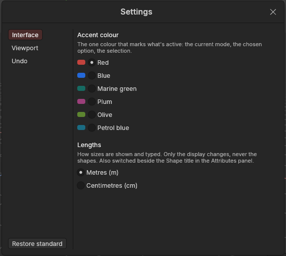

# Settings

> Every app-wide preference in one place: the accent colour, metres or centimetres, how the mouse moves the view, the grid, and how much undo may keep.

## When to use it

Whenever you want to change how the app behaves for you, rather than something in your scene. Your choices are remembered the next time you open the app.

A few of these settings also have a quick switch where you use them while working. They show and change the same value as Settings, so use whichever is closer:
- The **Units** menu in the [Attributes panel](attributes.md) (metres or centimetres).
- The **navigation controls** button in the viewport's bottom-right corner (see [Navigating the view](navigating-the-view.md)).
- The **grid button** at the bottom of the left palette.

## How to use it

1. Open **Edit → Settings…** on the main menu bar, or press **Ctrl + ,** (Ctrl and the comma key).
2. Pick a section on the left: **Interface**, **Viewport** or **Undo**.
3. Click a choice. It takes effect at once; there's no OK button to press.
4. Close the window with the **×** in its corner, or press **Ctrl + ,** again.

**Restore standard** (bottom left) puts every setting back as it was when the app was new. Your panel layout is kept; to reset that, use **View → Reset panel layout**.

## Settings

| Section | Setting | What it does |
|---|---|---|
| Interface | **Accent colour** | The one colour that marks what's active: the current mode, the chosen option, the selection. Red as standard; Blue, Marine green, Plum, Olive or Petrol blue instead. |
| Interface | **Lengths** | Show and type sizes in **metres** (standard) or **centimetres**. Only the display changes, never the shapes. |
| Viewport | **Navigation controls** | Which mouse buttons orbit, pan and zoom. **Mouse only** is the standard; see [Navigating the view](navigating-the-view.md) for each scheme. |
| Viewport | **Alt + mouse works in every scheme** | Keeps the Alt + mouse moves working whichever controls you pick. |
| Viewport | **Orbit and zoom around the point under the mouse** | On (standard): turn around, and zoom towards, whatever is under the mouse. Off: the middle of the view. |
| Viewport | **Invert orbit direction** | Orbiting turns the other way. |
| Viewport | **Grid lines** | Every 1 m (standard), every 50 cm, or every 10 cm. |
| Viewport | **Selection keys** | Which key adds to the selection and which takes away, for clicks, boxes, lassos, the brush and double-clicks alike: **Ctrl adds, Shift removes** (standard), **Shift adds, Ctrl removes**, **Ctrl flips**, or **Ctrl adds, Alt removes** (Alt + drag still moves the view while Alt + mouse works in every scheme). See [Selecting](selecting.md). |
| Viewport | **Snapping** | Whether moves, turns and resizing snap; whether holding Ctrl while dragging flips it for that drag (standard) or only the button does; what moves snap to (points, edges, polygons, grid lines); and the steps for turning (15°) and scaling (10%). See [Move, rotate and scale](transforming.md#snapping). |
| Viewport | **Select only visible** | Off (standard): the box, lasso and brush select through shapes, catching their far side too. On: only what you can see. Also the button above the grid button on the left palette. See [Selecting](selecting.md). |
| Undo | **Undo memory** | How much memory undo may use before it starts forgetting the oldest steps: 256 MB to 8 GB, or Unlimited. 2 GB is the standard. There's no limit on the *number* of steps, and the newest step is always kept. The line above the choices shows how much is in use now and how many steps that is. |

## Shortcuts

| Action | Shortcut |
|---|---|
| Open or close Settings | `Ctrl + ,` (`Cmd + ,` on macOS) |

## Tips and common problems

- **Tip:** if you work on very large meshes for hours, check **Undo** now and then: if "In use" is close to the limit and your computer has memory to spare, a higher limit lets you undo further back.
- **Problem:** undo stops before you got back to where you wanted. **Why:** the oldest steps were forgotten to stay within the undo memory (the status bar said so when it started). **Fix:** raise **Undo memory**, if your computer has the memory to spare.
- **Problem:** a setting seems to have changed by itself. **Why:** the quick switches (the Attributes panel's Units menu, the navigation button, the grid button) change the same settings. **Fix:** this is intended; set it back from either place.

## Related

- [Interface tour](interface-tour.md): where everything is.
- [Navigating the view](navigating-the-view.md): the navigation schemes in detail.
- [Objects and the Object Manager](objects.md): undo and redo.
- [Concepts](concepts.md): [undo history](concepts.md#objects-and-scenes).
