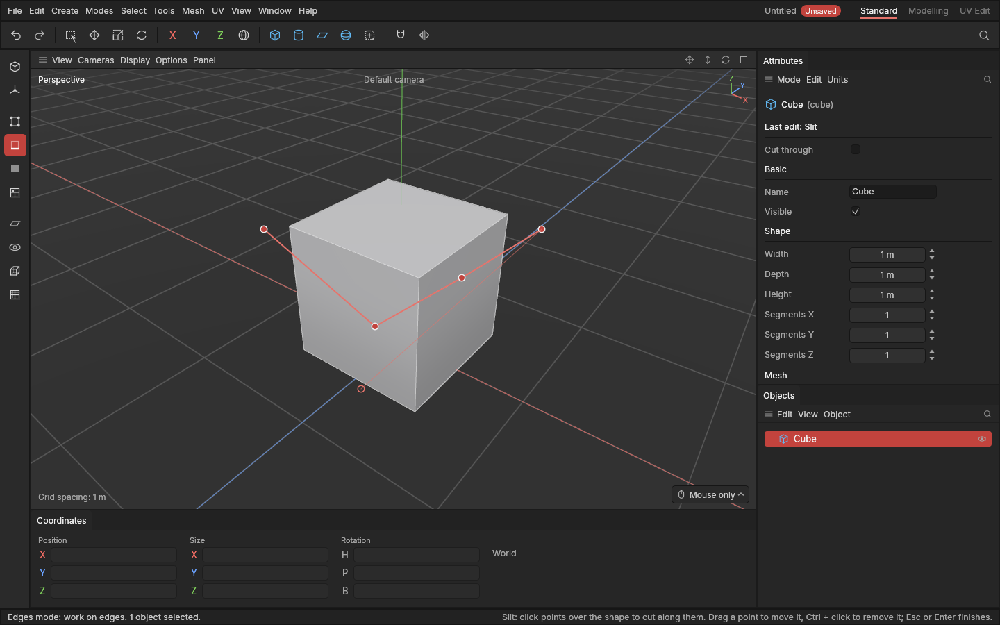
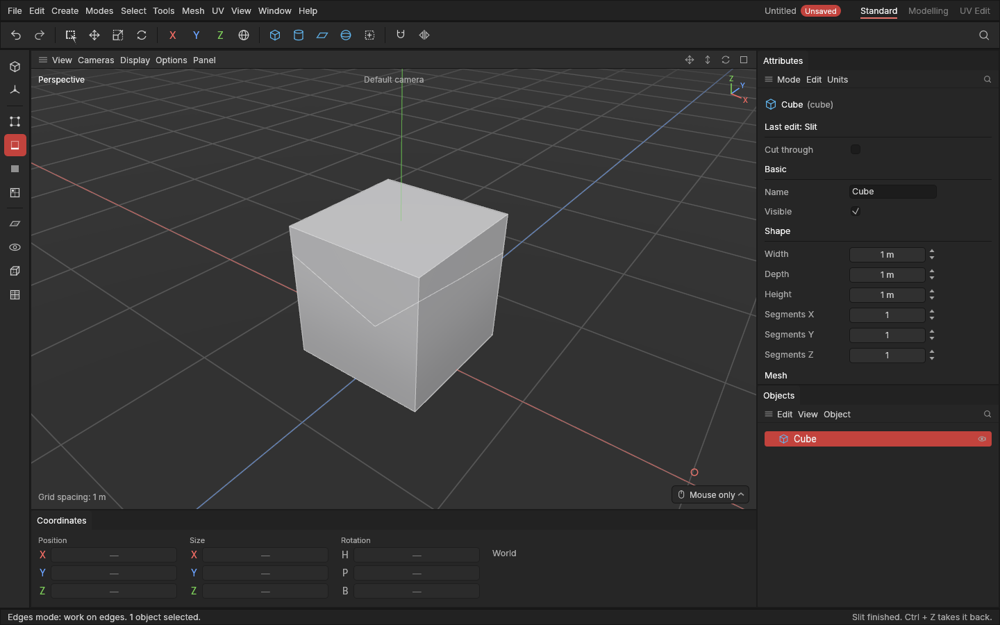
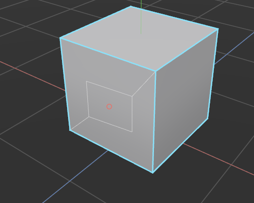

# Slit

> Slit cuts new edges wherever you draw a line over a shape: click points across it, and it is cut along the line as you go.

Loop cut adds a whole loop through a ring of four-sided polygons. Slit is the free-hand cut: across any polygons, at any angle, turning wherever you like. Use it to mark out a panel, cut a diagonal, add an edge where you need a new point, or split a polygon so part of it can be pulled out.

## When to use it

- **Mark out a shape to extrude or inset**, like a hatch or a vent on a box: cut its outline, then [extrude](extrude-and-inset.md) the polygon inside.
- **Cut a shape into the middle of a polygon**, like a window in a wall or a button on a panel: draw it as a closed loop (see below).
- **Add an edge exactly where you need it**, such as a diagonal across a polygon, or a new point on an edge to move.
- **Cut across polygons Loop cut can't**: triangles, many-sided polygons, or a line that turns.

For a loop all the way round, [Loop cut](loop-cut.md) is quicker.

## How to use it

1. Select a shape and press **1**, **2** or **3** for the Points, Edges or Polygons [mode](modes.md). Slit works in all three.
2. Press **X** (or pick **Slit** from the [tool menu](tool-menu.md) **E**, or the **Mesh** menu).
3. **Click** where the line should start, then click the next point, and the next. Each point snaps to a point, an edge or a polygon under the mouse. Off the shape, it floats in space, which is handy for starting a cut beside the shape. The shape is cut along the line as it grows: wherever the line crosses a polygon, as you see it.
4. Press **Esc** or **Enter** when the line is done. Or, with three or more points, **click the first point** again to close the line into a loop (see below).

The whole line is one undo step: **Ctrl + Z** takes the cut back.

A cut has to go into a polygon and out again. Where the line ends inside a polygon, that polygon isn't cut until the line goes on and out of it. A point inside a polygon, with the line going on, makes the cut turn there.

### Cut a shape into a polygon: closed loops

To cut a shape into the middle of a polygon, like a window in a wall, draw its outline and close it:

1. With Slit in use, click three or more points inside the polygon, round the shape you want.
2. Move back over the **first point**. The faint line shows the stretch that closes the loop.
3. **Click the first point.** The line closes and is finished.

The shape becomes a polygon of its own, ready to [extrude](extrude-and-inset.md), [inset](extrude-and-inset.md) or delete for a hole. A polygon can't have a hole in it, so the ring of polygon left round the shape is cut in two, by two new edges from the polygon's corners to the shape.

Points of the loop may sit on the polygon's border too (snapped to an edge or a corner): the shape is still cut in, sharing that spot.

A closed loop doesn't have to stay inside one polygon. Across several polygons it cuts like any line, the stretch back to the start included, so you can cut a shape over an edge or round a corner.

### Change the line before you finish

- **Drag a point** to move it. The cut follows. A click on a point without moving the mouse leaves it where it is.
- **Click the line** between two points to add a point there.
- **Ctrl + click a point** to remove it.
- Hold **Shift** while placing or dragging a point to keep the stretch to it at steps of 15° on screen: straight across, straight up, or at 45°.
- **Right-click** or **Esc** while dragging a point puts it back where it was.

The line also finishes by itself when you pick another tool, go back to Model mode, or undo.

### Visible only, or through

As standard, Slit cuts only what you can see: polygons facing you that aren't hidden behind others. Switch **Cut through** on at the top of the Attributes panel to cut everything under the line, the far side of the shape too, like a knife going all the way through. After a slit, the switch shows under **Last edit**, and changing it re-cuts the slit you just made.

## Settings

| Setting | What it does |
|---|---|
| **Cut through** | Off: only polygons you can see are cut. On: every polygon under the line is cut, including the back of the shape. |

## Shortcuts

| Action | Shortcut |
|---|---|
| Slit | `X` |
| Add a point | Click (or drag to place it carefully) |
| Move a point | Drag it |
| Add a point on the line | Click the line |
| Remove a point | `Ctrl` + click it |
| Keep to 15° steps | Hold `Shift` |
| Finish the line | `Esc` or `Enter` |
| Close the line into a loop (and finish it) | Click its first point (three or more points) |
| Take the cut back | `Ctrl + Z` |
| Back to selecting | `Q` |

`X` used to lock the X axis: that is **Shift + X** now.

## Tips and common problems

- **Tip:** start and end the line just off the shape, so the cut goes cleanly across the polygons at the edge.
- **Tip:** click right on a point or an edge to cut exactly to it. The line point snaps there.
- **Tip:** the slit is worked out from the shape as it is. Change a shape's segments afterwards and the slit cuts the same place on the new shape.
- **Problem:** the last stretch didn't cut. **Why:** the line ends inside a polygon. **Fix:** add a point beyond its edge, or click the first point to close the line into a loop.
- **Problem:** clicking the first point moved it instead of closing the line. **Why:** the mouse moved while pressing, which counts as dragging the point. **Fix:** Ctrl + Z, or drag it back, then click without moving. With only two points the line can't close yet.
- **Tip:** after closing a loop, press **3** and click the new shape to select it, then **D** to extrude it or **Delete** to make a hole.
- **Problem:** the back of the shape wasn't cut. **Why:** Slit cuts only what you can see as standard. **Fix:** switch on **Cut through**.
- **Problem:** pressing X does nothing but the status bar talks about modes. **Why:** Slit works in the Points, Edges and Polygons modes. **Fix:** press **1**, **2** or **3** first.

## Related

- [Loop cut](loop-cut.md): a whole loop through a ring of four-sided polygons.
- [Extrude and inset](extrude-and-inset.md): pull out or push in what you've cut out.
- [Concepts](concepts.md): [polygons, n-gons and triangles](concepts.md#mesh-basics).
