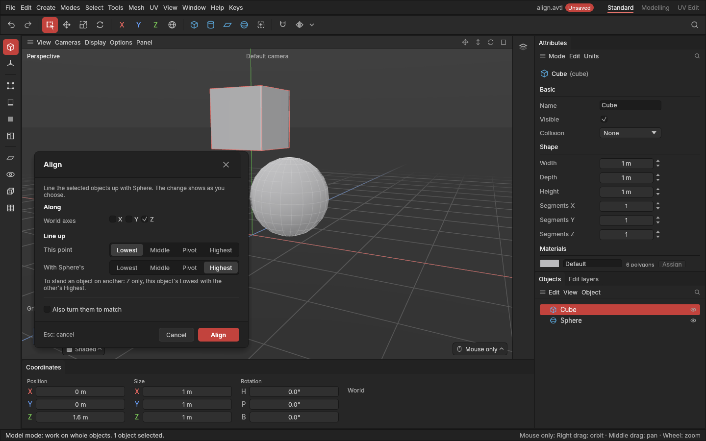

# Snap to and Align

> Put objects exactly against another object: **Snap to** moves them onto its pivot in one click; **Align** lines up their sides or middles with it, along the axes you choose.

Placing one part against another by dragging is fiddly: a pipe end onto a tank's outlet, a lid on top of a box, a row of crates sitting on the same floor. These two tools do it exactly. You select what should move, choose the tool, then click the object to line up with (the *target*). They move whole objects, shape and [pivot](concepts.md#objects-and-scenes) together; nothing about the shapes changes. 3ds Max users know them as Quick Align and Align.

## When to use it

- **Snap to:** when the pivots are already where the parts meet. A door whose pivot is on its hinge snaps onto a frame's hinge point; a modular wall piece snaps onto another's corner.
- **Align:** when you want sides or middles to meet. Stand an object on top of another, centre a handle on a drawer, or line up the backs of a row of shelves.
- To move an object's *pivot* to another object's pivot instead (the shape staying put), use **Tools → Pivot to object...** ([Pivots](pivots.md)).

## How to use it

1. In the **Model** mode, select the objects to move.
2. Choose **Tools → Snap to…** or **Tools → Align…**. The status bar asks you to click the target, and the pointer becomes a cross.
3. Click the target object in the viewport. **Esc** cancels.
   - **Snap to** is done: the selected objects' pivots now sit on the target's pivot.
   - **Align** opens its window. The objects move as you change the settings, so you can try them out.
4. In the Align window, click **Align** (or press **Enter**) to keep the result, or **Cancel** (**Esc**) to put everything back.

Each is one undo step (**Ctrl + Z**).

## Settings

The Align window:

| Setting | What it does |
|---|---|
| **World axes** (X, Y, Z) | Which directions to line up along. Untick an axis to leave the objects where they are along it. Z is up. |
| **This point** | The point of the selected objects that moves into place, along each ticked axis: **Lowest** (the left, back or bottom of the box around it), **Middle**, **Pivot** or **Highest** (the right, front or top). |
| **With the target's** | The point of the target it moves to, chosen the same way. |
| **Also turn them to match** | Gives the selected objects the target's rotation as well. |

Some common settings:

| To… | Axes | This point | Target's |
|---|---|---|---|
| Stand it on top | Z | Lowest | Highest |
| Put it underneath | Z | Highest | Lowest |
| Centre it on the target | X, Y, Z | Middle | Middle |
| Line up the fronts | Y | Highest | Highest |
| Same as Snap to | X, Y, Z | Pivot | Pivot |

The window starts with your last settings.

## Shortcuts

| Action | Shortcut |
|---|---|
| Snap to | **Tools → Snap to…**, then click the target |
| Align | **Tools → Align…**, then click the target |
| Keep / cancel in the Align window | **Enter** / **Esc** |
| Cancel waiting for the click | **Esc** |

There are no keys of their own yet.

## Tips and common problems

- **Problem:** "pick an object other than the ones selected". **Why:** the target was one of the objects being moved. **Fix:** click a different object.
- **Tip:** with several objects selected, each is lined up on its own. For example, Z, Lowest to Lowest puts every crate's bottom on the floor's bottom.
- **Tip:** the box used for Lowest, Middle and Highest is the one around the object *as it stands in the world*, including what's inside it and its [live mirror](symmetry.md).
- **Tip:** Align is only shown while its window is open. Making another change in the meantime keeps what Align did so far and closes it.

## Related

- [Pivots and Edit pivot](pivots.md)
- [Move, rotate and scale](transforming.md)
- [Concepts: pivot, world axes](concepts.md#objects-and-scenes)
