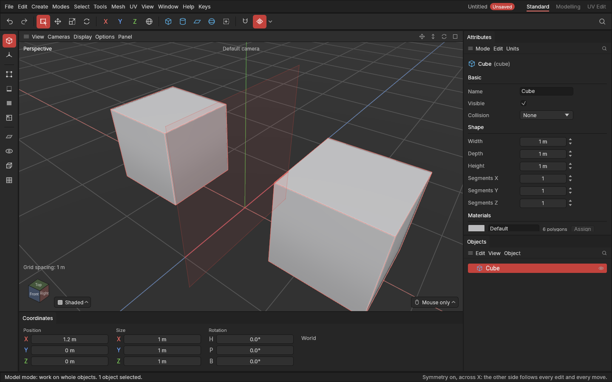
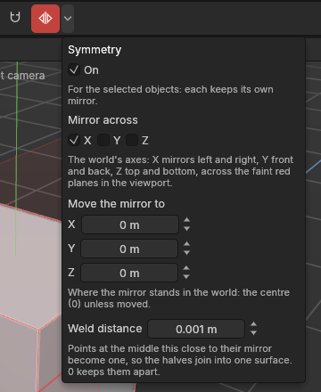

# Symmetry

> Model one half: a live mirror shows the other half, copying every edit, and the two join into one shape. Apply the mirror when you want the other half for real.

Most things are symmetrical: a crate, a gun, a car, a face. With **Symmetry** on, an object gets a **live mirror**: a copy of its shape on the other side of a mirror that stands at the object's [pivot](concepts.md#objects-and-scenes). The mirror belongs to the object: move or turn the object and the mirror goes with it. You only ever work on your half. The mirrored half follows everything you do to it straight away, extrudes, bevels, cuts and moves alike, and where the halves meet at the mirror, they join into one surface.

The mirrored half is part of the object: it is drawn with it, counted in the Export window's numbers, and exported with it as one shape, ready for the game engine or Substance Painter.

## When to use it

- **Building a symmetrical prop:** model the right half of a gun or a car, and see the whole thing as you go.
- **Placing pairs:** a pair of wheels, lamps or handles. Model one to the side of the object's pivot, and its twin sits the same distance on the other side.
- **Keeping both halves matching:** the other side is always an exact mirror, so nothing drifts apart.

## How to use it

1. **Model one half.** The mirror goes through the object's pivot, which for a new shape is the middle of its base, so it cuts the shape down the middle. Start from a half, or delete the half of your shape on the other side of the mirror (in the [Polygons mode](modes.md), select the polygons on that side and press **Delete**). A whole shape would get a whole second copy on top of it.
2. Select the object, and click the **Symmetry** button at the right end of the top palette (or **Tools → Symmetry**). It lights up, the mirrored half appears, and a **faint red sheet** shows where the mirror stands, with a clearer **red line** where it meets the ground.
3. Work on your half as usual: in any mode, with any tool. Each edit is made once, on your half; the other half follows.
4. Move or turn the object (in the Model mode): both halves and the mirror go together, as one object.
5. **When you're done**, you can keep the mirror live for good (it's exported as part of the object), or **apply** it (below) to make the other half real geometry.

Click **Symmetry** again (with the object selected) to switch its mirror off: the mirrored half goes away, and your half is just as you left it. **Ctrl + Z** brings the mirror back.

Each object keeps its own mirror, saved with the project.

### Apply mirror

**Apply mirror** makes the mirrored half a real part of the shape: the halves are joined where they meet, the mirror is gone, and Symmetry is off for that object. From then on each half can be changed on its own, for example to add a detail on one side only.

Select the objects and choose **Apply mirror** in the Symmetry menu (the arrow beside the Symmetry button), or **Mesh → Shape and object → Apply mirror**, or press **Space** and type *apply mirror* ([command search](command-search.md)). It's greyed out until a selected object has symmetry on.

Applying also bakes the object's edits into its shape, as [Bake into shape](objects.md#bake-into-shape) does: the result is a plain mesh, and its edit list starts empty. A shape cut by [booleans](booleans.md) is applied as you see it, cut, and its booleans are baked in the same way (the cutters are hidden). The cut is made before the mirror, so a hole cut in your half shows on both halves. It's one undo step: **Ctrl + Z** brings the mirror, the settings, the edits and the booleans back. [Modifiers](modifiers.md) come after the mirror, so they work on the whole, mirrored shape (a half that is open along the middle is closed once mirrored, so [Remesh](remesh.md) works on it); Apply mirror leaves them on, still live. **Bake into shape** on a shape with modifiers bakes the mirror in too.

### Where the halves meet

Points of your half that sit **on the mirror** join their mirrored copies, so the two halves become one closed surface with no seam. Points within the **Weld distance** of the mirror (0.1 cm as standard) count as on it. So when you model a half, keep its middle points on the mirror: in the Front view, the red line shows exactly where it is. If the mirror isn't where the shape's middle should be, move the object's pivot there with [Edit pivot](pivots.md): the mirror moves with the pivot.

A point you move away from the mirror leaves it again: the weld is live, never fixed into the shape.

### The Symmetry menu

Click the small **arrow** just right of the Symmetry button for its settings. They change the selected objects' mirrors (one undo step while you work in the menu), and are kept for the next object you mirror.

- **On**: the same as the button, for the selected objects.
- **Apply mirror**: make the mirrored half part of the shape and switch symmetry off ([above](#apply-mirror)).
- **Mirror across X, Y, Z**: which of the **object's own** axes to mirror across. X mirrors left and right (the standard), Y front and back, Z top and bottom. Pick two for four quarters, three for eight.
- **Move the mirror to X, Y, Z**: where the mirror stands, measured from the object's pivot along its own axes: at the pivot (0) unless you move it. Moving it moves the twin.
- **Weld distance**: how close to the mirror points must be to join their copies. **0** keeps the halves apart.

The mirror stands along the object's own axes, through its pivot, so it moves and turns with the object. (A mirror in a project made before this version stays where it was, in the middle of the world, along the world's axes.)

## Settings

| Setting | What it does |
|---|---|
| **Symmetry** (palette button, Tools menu, or On in its menu) | Gives the selected objects a live mirror, or takes it away. Each object keeps its own, saved with the project. |
| **Apply mirror** (Symmetry menu, Mesh → Shape and object) | Makes the mirrored half real geometry, bakes the edits in, and switches symmetry off. One undo step. |
| **Mirror across X / Y / Z** (Symmetry menu) | Which of the object's own axes to mirror across. X as standard. |
| **Move the mirror to X / Y / Z** (Symmetry menu) | Where the mirror stands, from the object's pivot. At the pivot (0) as standard. |
| **Weld distance** (Symmetry menu) | How near the mirror points join their copies. 0.1 cm as standard, up to 10 cm; 0 keeps the halves apart. |

## Shortcuts

| Action | Shortcut |
|---|---|
| Symmetry on or off | The Symmetry palette button, or Tools → Symmetry |
| Symmetry settings | The arrow beside the Symmetry button |
| Apply mirror | Symmetry menu, Mesh → Shape and object, or `Space` and type *apply mirror* |

## Tips and common problems

- **Problem:** the shape looks doubled, two copies overlapping. **Why:** the whole shape was mirrored, not half of it. **Fix:** delete the half on the other side of the red sheet, in the Polygons mode.
- **Problem:** a thin crack runs down the middle. **Why:** the middle points are not quite on the mirror. **Fix:** move them onto it (with snapping on, or by typing the same X as the pivot's in the Coordinates panel), or raise the Weld distance a little.
- **Problem:** clicking the mirrored half selects nothing. **Why:** it is a copy; only your half can be clicked and edited. **Fix:** click your half (in the Model mode, or the object's name in the Objects panel); edit the matching part of your half, and the copy follows.
- **Problem:** the twin is far away from my half, or overlaps it. **Why:** the mirror stands at the object's pivot, and the shape isn't next to it. **Fix:** move the pivot to the shape's middle with [Edit pivot](pivots.md), or move the mirror in the Symmetry menu.
- **Problem:** Apply mirror is greyed out. **Why:** no selected object has symmetry on. **Fix:** select the object with the mirror.
- **Tip:** to keep a detail on one side only (a scratch, a logo), apply the mirror first, or make the detail a separate object without a mirror.
- **Tip:** Symmetry is the app's mirror generator: there is no separate mirror modifier. For more than two copies (in a row, or round a wheel), use an [Array](array.md); the mirror comes before it, so the array repeats the whole mirrored shape. To mirror across another object's place, move the mirror there with **Move the mirror to**.
- **Note:** projects made before the live mirror keep their mirrored edits, made on both sides, exactly as they were.

## Related

- [Points, Edges and Polygons modes](modes.md)
- [Move, rotate and scale](transforming.md)
- [Export and import](export-and-import.md): the mirrored half goes out as part of the object
- [Array](array.md): copies in a line, a grid or a ring
- [Concepts: symmetry](concepts.md#objects-and-scenes)
