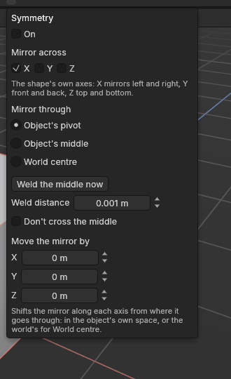

# Symmetry

> Model one half: every edit to points, edges or polygons is made on the other side too, mirrored.

Most things are symmetrical: a crate, a gun, a car, a face. With **Symmetry** on, whatever you do to one side of a shape happens to the matching part of the other side too, mirrored. You can move, rotate or scale points, and also extrude, inset, bevel, loop cut, slit, connect, bridge, weld, delete, dissolve, fill holes, flip, and make edges hard or soft. The two halves stay alike without you doing the work twice.

## When to use it

- Building a symmetrical prop: extrude a panel on the left and the right gets it too; loop cut one side and the cut appears on the other.
- Widening or narrowing a shape evenly from its middle: move one side, and the other side moves out too.
- Cleaning up both halves at once: delete, dissolve or weld on one side.

## How to use it

1. Click the **Symmetry** button at the right end of the top palette (or **Tools → Symmetry**). It lights up.
2. Click the small **arrow** just right of the button for its settings (see below): which way to mirror, and where the mirror sits. **X** (left and right, through the object's pivot) is the standard.
3. In the **Points**, **Edges** or **Polygons** mode, work on one side as usual. The other side follows.

What happens with each kind of edit:
- **Moving, rotating and scaling** move the mirror the mirrored way while you drag.
- **Extrude, inset, bevel, delete, dissolve, fill hole, flip and hard or soft edges** work on your selection and its mirror together. Polygons that touch across the middle move as one piece, as if you had selected both sides yourself.
- **Loop cut, slit, connect, bridge, weld and bent extrudes** are made once on your side and once, mirrored, on the other. A loop cut whose loop already goes round through the middle (its own mirror) is made only once. A bend turns the mirrored way on the other side.
- The edit's settings under **Last edit** belong to both sides: change the Distance or the Cuts and both sides follow. The edit's name ends in "mirrored".

Details:
- Points sitting on the mirror stay on it, so the shape never splits down the middle.
- With two axes on, a corner takes all four corners with it.
- If you select both sides, they still work as mirrors of each other.
- Where the shape isn't symmetrical (no matching point, edge or polygon on the other side), only your side changes.
- Edits on whole objects (in the Model mode), Fix normals and Hard edges by angle aren't mirrored: they already cover the whole shape.

### The Symmetry menu

- **On** switches symmetry on or off, like the button.
- **Mirror across X, Y, Z**: which of the shape's own axes to mirror across. X mirrors left and right, Y front and back, Z top and bottom. Pick more than one for quarters or eighths.
- **Mirror through**: where the mirror sits.
  - **Object's pivot** (the standard): the point the object moves and turns around.
  - **Object's middle**: the middle of the object's box, wherever its pivot is. Handy when the pivot sits at a corner.
  - **World centre**: the middle of the scene, where the red and green lines cross. Handy for a shape built to be symmetrical about the middle of the scene, whatever its pivot.
- **Weld the middle now** joins the two halves of the selected shapes at the middle, once, when you click it: points closer to the middle than the **Weld distance** (0.1 cm as standard) are put exactly on it, and points that meet there become one. So a half modelled with its seam slightly off the middle closes up into one shape, and parts that grew into their own mirror merge instead of overlapping. It's an edit like any other: **Ctrl + Z** takes it back. Nothing is welded on its own, so a point that strays near the middle by accident never gets stuck there. (A live weld, which joins points only while they're close and parts them again when moved away, is planned with the mirror generator in Phase 7.)
- **Don't cross the middle** (off as standard): points stop at the middle instead of passing through to the other side, where they would overlap their mirror. A move stops when the first selected point reaches the middle; after an edit, any point pushed past it is put back on it. Turning and scaling aren't held back.
- **Move the mirror by X, Y, Z**: shifts the mirror from there. The amounts are in the object's own directions, or the world's for World centre.

The mirror always lies along the object's own axes, so a turned object mirrors along its own sides.

## Settings

| Setting | What it does |
|---|---|
| **Symmetry** (palette button, Tools menu, or On in its menu) | On or off. Off as standard. Remembered. |
| **Mirror across X / Y / Z** (Symmetry menu) | Which of the shape's own axes to mirror across. X as standard. Remembered. |
| **Mirror through** (Symmetry menu) | Object's pivot (standard), Object's middle or World centre. Remembered. |
| **Weld the middle now**, **Weld distance** (Symmetry menu) | Join the selected shapes' halves at the middle once: points this close go onto it, and points meeting there become one. 0.1 cm as standard; the distance is remembered. |
| **Don't cross the middle** (Symmetry menu) | Points stop at the middle instead of passing to the other side. Off as standard. Remembered. |
| **Move the mirror by X / Y / Z** (Symmetry menu) | How far the mirror is moved from there. 0 as standard. Remembered. |

## Shortcuts

| Action | Shortcut |
|---|---|
| Symmetry on or off | The Symmetry palette button, or Tools → Symmetry |
| Symmetry settings | The arrow beside the Symmetry button |

## Tips and common problems

- **Tip:** model the half you can see best, with Symmetry on from the start, so both sides always match.
- **Tip:** to keep an edit on one side only (a scratch, a logo), switch Symmetry off for that edit.
- **Problem:** only the selected part changed. **Why:** the other side doesn't have a point in the mirrored spot (within 0.01 cm), for example after an edit on one side only, or the mirror sits somewhere else (check **Mirror through** and the offsets). **Fix:** make the sides match again, or move the mirror to the shape's middle.
- **Problem:** Weld the middle now joined two points I wanted apart. **Why:** they were within the weld distance of the middle. **Fix:** Ctrl + Z, then lower the Weld distance and weld again.
- **Problem:** Weld the middle now says there's nothing to join. **Why:** no point is within the weld distance of the middle. **Fix:** raise the Weld distance a little, or check Mirror through: the middle may not be where you think.
- **Problem:** the middle points won't move sideways. **Why:** points on the mirror stay on it, on purpose. **Fix:** turn Symmetry off to move them off the middle.
- **Problem:** an edit happened twice, overlapping, in the middle. **Why:** rarely, an edit crossing the middle is both made and mirrored. **Fix:** Ctrl + Z, then make it with Symmetry off, selecting both sides yourself.

## Related

- [Move, rotate and scale](transforming.md)
- [Points, Edges and Polygons modes](modes.md)
- [Concepts: symmetry](concepts.md#objects-and-scenes)
