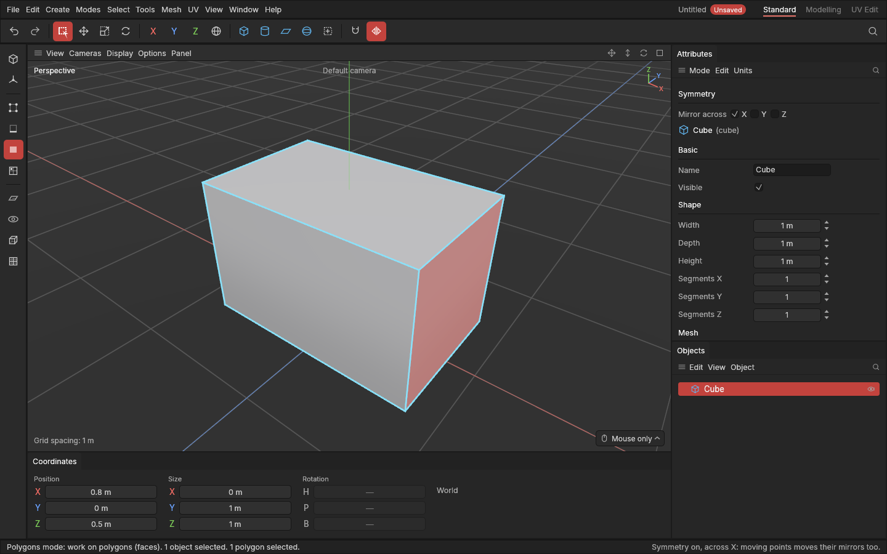

# Symmetry

> Model one half: moving points, edges or polygons moves their mirror on the other side too.

Most things are symmetrical: a crate, a gun, a car, a face. With **Symmetry** on, when you move, rotate or scale part of a shape, the matching part on the other side does the same, mirrored. The two halves stay alike without you doing the work twice.

## When to use it

- Shaping a symmetrical prop by moving points, edges or polygons.
- Widening or narrowing a shape evenly from its middle: move one side, and the other side moves out too.

It works while moving, rotating and scaling (the gizmo and the Coordinates panel). The modelling tools, such as Extrude and Bevel, work on one side only for now: do those on both sides by selecting both.

## How to use it

1. Click the **Symmetry** button at the right end of the top palette (or **Tools → Symmetry**). It lights up.
2. In the Attributes panel, choose which way to mirror under **Symmetry**: **X** (left and right, the standard), **Y** (front and back) or **Z** (top and bottom). The mirror goes through the shape's own middle, along its own axes.
3. In the **Points**, **Edges** or **Polygons** mode, select part of one side and move, rotate or scale it. Its mirror follows.

Details:
- Points sitting on the middle line stay on it, so the shape never splits down the middle.
- With two axes on, a corner takes all four corners with it.
- If you select both sides, they still move as mirrors of each other.
- Where the shape isn't symmetrical (no matching point on the other side), only what you selected moves.

## Settings

| Setting | What it does |
|---|---|
| **Symmetry** (palette button, Tools menu) | On or off. Off as standard. Remembered. |
| **X / Y / Z** (Attributes panel, while Symmetry is on) | Which of the shape's own axes to mirror across. X as standard. Remembered. |

## Shortcuts

| Action | Shortcut |
|---|---|
| Symmetry on or off | The Symmetry palette button, or Tools → Symmetry |

## Tips and common problems

- **Tip:** symmetry mirrors across the shape's *own* middle. If you moved the whole object, it still mirrors around its own axis, not the world's.
- **Problem:** only the selected part moved. **Why:** the other side doesn't have a point in the mirrored spot (within 0.01 cm), for example after an edit on one side only. **Fix:** make the sides match again, or work on both.
- **Problem:** the middle points won't move sideways. **Why:** points on the mirror plane stay on it, on purpose. **Fix:** turn Symmetry off to move them off the middle.
- **Problem:** Extrude or Bevel only changed one side. **Why:** the modelling tools aren't mirrored yet. **Fix:** select both sides before using them.

## Related

- [Move, rotate and scale](transforming.md)
- [Points, Edges and Polygons modes](modes.md)
- [Concepts: symmetry](concepts.md#objects-and-scenes)
