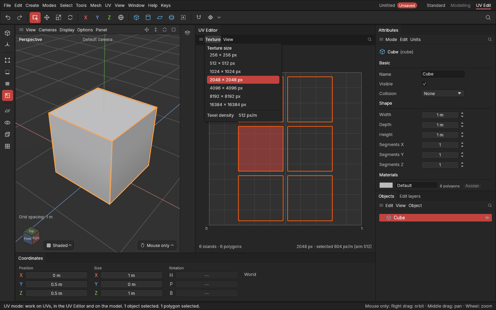

# Texture size and texel density

> Tell the app what texture your UVs are for and how sharp it should be, see each piece's sharpness, and make pieces match.

## When to use it

A texture is a grid of pixels. **Texel density** says how many of those pixels cover a metre of the model's surface. If one part of a prop gets 1000 px/m and another 250 px/m, the second looks four times blurrier. Keeping density even (across one prop, and across all the props of a game) makes everything look equally sharp.

- Set the **texture size** to the size you'll paint at, for example 2048 × 2048 for a hero prop or 512 × 512 for a small one.
- Set the **texel density** you aim for. 512 px/m is common for props seen up close in third-person games; first-person games often use 1024 px/m or more.
- After unwrapping or moving pieces by hand, check and even out their density.

These settings are saved with the project. Changing them doesn't move your UVs; it changes the numbers you see.

## How to use it

**Set the texture:** in the UV Editor, open **Texture** (or **UV → Texture**). Pick a size, and drag or type the **Texel density** (pixels per metre). Each change is one undo step.

**See density:** the UV Editor's bottom right reads, for example, **2048 px · selected 604 px/m (aim 512)**. The density is of the selected polygons (Polygons or UV mode), or of everything shown when none are. Zoom in far enough and the texture's pixels show as a fine grid.

**Change density:**
1. Select pieces (UV mode), polygons or whole objects.
2. Choose **UV → Lay out → Set texel density** to scale each piece to the aim, or **UV → Lay out → Match texel density** to give them all the same density (the average of theirs). Each piece is scaled about its own middle.
3. It's one undo step, and recorded on the object's edit list.

Unwrapping already keeps an object's pieces at one density (see [Unwrap](unwrapping.md)); use these to bring a whole object, or several objects, to the aim.

## Settings

| Setting | What it does |
|---|---|
| **Texture size** (Texture menu) | The square texture the UVs are made for: 256 to 16384 pixels. 2048 as standard. |
| **Texel density** (Texture menu) | The density aimed for, in pixels per metre. 512 as standard. Used by Set texel density, and shown as the aim. |

## Shortcuts

None of their own; everything is in the UV Editor's **Texture** menu and the **UV** menu.

## Tips and common problems

- **Problem:** the density shown changed when I changed the texture size. **Why:** density is in pixels, and a bigger texture has more pixels on the same piece. **Fix:** that's expected; Set texel density to bring pieces back to the aim at the new size.
- **Problem:** Set texel density made pieces overlap. **Why:** each piece grows or shrinks about its own middle. **Fix:** [Pack](packing.md) them.
- **Problem:** "the selection has no UVs to measure". **Why:** the polygons have no area in the texture (squashed flat, as an extrude's new walls are). **Fix:** [Unwrap](unwrapping.md) them first.
- **Tip:** for a set of props that sit together in a game, use the same aim for all of them and Set texel density on each.

## Related

- [Unwrap, Relax and Straighten](unwrapping.md)
- [The UV Editor](uv-editor.md)
- [Concepts: texel density](concepts.md#uvs-and-texturing)
