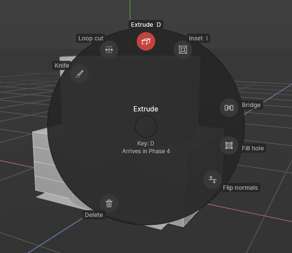

# The tool menu (E)

> Press **E** for the tools of what you're working on, right at the mouse.

## When to use it

Whenever you want a tool and don't remember its key, or don't have one. The tool menu holds the tools that make sense for what you're doing now:

- **In Model mode** (whole objects): move, rotate and scale, frame the selection, make editable, delete, group and ungroup, a new group, and the shape list.
- **In Points, Edges and Polygons mode**: the modelling tools for that kind of element, such as extrude, inset, bevel, loop cut, knife, weld and so on. Move, rotate and scale aren't here, since they're always on the palette at the top.

Every entry shows its key, so the menu also teaches you the keys as you go. Once you know a tool's key, pressing it directly is quicker. The menu is there for everything else.

The modelling tools arrive one by one during Phase 4. Until a tool is built, it's shown dimmed, and choosing it says when it arrives.

## How to use it

1. Point the mouse where you're working and press **E**. The menu opens around the mouse.
2. Choose a tool in whichever way suits you:
   - **Point and click:** point towards a tool and click. In the ring, you don't have to hit the round button: anywhere in the slice towards it counts, so a rough direction is enough.
   - **Keys only:** tap **E** again to step to the next tool (**Shift + E** goes back; the arrow keys work too), then press **Enter** or **Space**.
   - **Hold and flick:** hold **E**, move the mouse towards a tool, and let go. With practice this becomes muscle memory: "extrude is straight up".
3. To close the menu without choosing, press **Esc**, or click in its middle or anywhere away from it.

**Every tool keeps its place.** In Points, Edges and Polygons mode the ring has the same places. A tool that doesn't apply in one mode leaves a gap rather than moving the others, so extrude is always at the top and loop cut always at the top left. The places are grouped:

| Where | What |
|---|---|
| Top right | Building: extrude, inset, bevel, bridge, fill hole |
| Right | Shading: flip normals, hard and soft edges |
| Bottom | Removing: delete, dissolve, weld |
| Left | Cutting and joining: connect, knife, loop cut |

**The middle of the ring** names the highlighted tool, its key, and what it does. If it can't be used right now (Ungroup with no group selected, say), it says why instead, in yellow.

**Two looks.** The ring is the standard. If you prefer a plain list, like Cinema 4D's M menus, choose **List** in **Edit → Settings… → Interface → Tool menu (E)**. Both hold the same tools in the same order, and work with the same keys. The list also shows the tool's key on the right.

## Settings

| Setting | What it does |
|---|---|
| **Tool menu (E)** in **Settings → Interface** | **Radial** (standard): a ring of tools around the mouse. **List**: a list by the mouse, like the shape list (B). |

## Shortcuts

| Action | Shortcut |
|---|---|
| Open the tool menu | `E` |
| Next tool / previous tool | `E` / `Shift + E` (or the arrow keys) |
| Use the highlighted tool | `Enter` or `Space` |
| Use a tool by flicking | Hold `E`, point towards it, let go |
| Close without choosing | `Esc` |
| Extrude / inset / bevel (when built, Phase 4) | `D` / `I` / `V` |

## Tips and common problems

- **Tip:** the menu is also a list of what's coming. Hover over a dimmed tool, or highlight it, to see what it will do.
- **Problem:** pressing E types a letter instead. **Why:** a text field has the keyboard, for example while renaming an object. **Fix:** press Enter or Esc to finish typing first.
- **Problem:** E does nothing but the status bar mentions Phase 8. **Why:** you're in UV mode, whose tools aren't built yet.
- **Problem:** the menu closed and nothing happened. **Why:** the tool can't be used right now, for example Group with nothing selected. **Fix:** the status bar says why. Select what the tool needs and try again.
- **Problem:** Ctrl + E made my shape editable instead of opening the menu. **Why:** that's intended: Ctrl + E is Make editable, and only E on its own opens the menu.

## Related

- [Move, rotate and scale](transforming.md): the tools in Model mode's ring.
- [Points, Edges and Polygons modes](modes.md): which mode you're in decides the menu's tools.
- [Primitives](primitives.md): the shape list (B), which the menu's "Create a shape…" opens.
- [Settings](settings.md): radial or list.
- [Concepts](concepts.md): [mode](concepts.md#objects-and-scenes).
