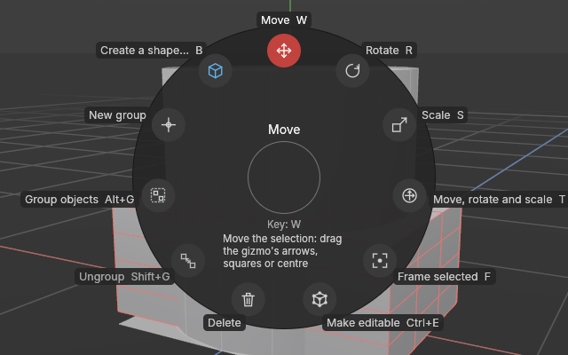
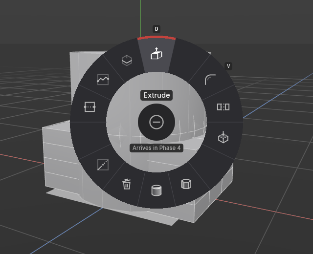
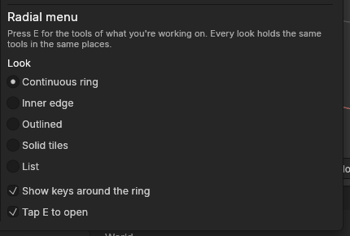
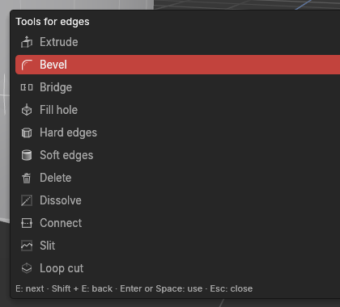

# The tool menu (E)

> Press **E** for the tools of what you're working on, in a ring around the mouse.

## When to use it

Whenever you want a tool and don't remember its key, or it doesn't have one. The tool menu holds the tools that make sense for what you're doing now:

- **In Model mode** (whole objects): Move, Rotate, Scale, Transform (all three gizmos at once), Frame selected, Make editable, Delete, Ungroup, Group objects, New group, and Create a shape… (the shape list).
- **In Object mode** (pivots): the same, except that Scale's place is empty (a pivot has no size) and the four pivot commands take the places of Duplicate, Make editable, Duplicate as instance and Join: **Pivot to centre**, **Pivot to world origin**, **Pivot to object…** and **Object to world origin**. See [Pivots and the Object mode](pivots.md).
- **In Points, Edges and Polygons mode**: the modelling tools for that kind of element, such as Extrude, Inset, Bevel, Loop cut, Slit, Weld and so on. Move, rotate and scale aren't here, since they're always on the palette at the top.
- **Over the UV Editor, and in the UV mode**: the UV tools. The gizmos and Frame selected keep their places from the object ring; then the seam tools (right, see [Seams](seams.md)), [Unwrap, Relax and Straighten](unwrapping.md) (bottom), [Pack](packing.md), **Turn & flip**, [Pin and Unpin](pins.md), and **Stitch & cut** (left). See [Editing UVs by hand](editing-uvs.md).

**The menu follows the mouse.** Press E with the mouse over the UV Editor and you get the UV tools; over the viewport, the tools for your mode. The ring is chosen when it opens, so moving the mouse afterwards doesn't change it.

Each tool's key is shown next to its button, so the menu teaches you the keys as you go. Once you know a key, pressing it directly is quicker. The menu is there for everything else.

The modelling tools arrive one by one during Phase 4; built so far are Extrude, Inset, Bevel, [Groove](groove.md), [Loop cut](loop-cut.md), [Slit](slit.md), [Connect, Bridge and Weld](connect-bridge-weld.md), the [clean-up](clean-up.md) commands (Delete, Dissolve, Fill hole, Flip normals), and [Hard and soft edges](hard-and-soft-edges.md): every modelling command in the ring. In the Model mode the ring also has [Duplicate and Duplicate as instance](copies-and-instances.md), [Join objects](split-and-join.md) and [Apply rotation and scale](apply-transforms.md). Until a tool is built, its icon is dimmed, and choosing it says when it arrives.

## How to use it

1. Point the mouse where you're working and press **E**. The ring opens around the mouse.
2. Choose a tool in whichever way suits you:
   - **Point and click:** point towards a tool and click. You don't have to hit the button itself: anywhere in the slice towards it counts, so a rough direction is enough.
   - **Keys only:** tap **E** again to step to the next tool (**Shift + E** goes back; the arrow keys work too), then press **Enter** or **Space**.
   - **Hold and flick:** hold **E**, move the mouse towards a tool, and let go. With practice this becomes muscle memory: "extrude is straight up".
3. To close the menu without choosing, press **Esc**, or click anywhere away from the ring. Or point at the **cancel sign** in the middle (a circle with a line): it lights up, no tool is highlighted, and clicking, pressing Enter or letting go of E closes the menu without doing anything.

**Some places hold a group.** A place with three small dots under its icon (**Turn & flip** and **Stitch & cut** in the UV ring) holds several tools. Choose it, any way you like, and its tools open on the same ring, side by side around the group's place, so the mouse is already next to them; then choose one as usual. **Esc** (or a click away) closes it, and the next **E** opens the whole ring again. The quad menu lists a group's tools in its place.

**The buttons show only icons.** The middle of the ring names the tool you point at. If it can't be used right now (Ungroup with no group selected, say), the reason shows under the cancel sign, in yellow; for a tool still to come, it says when it arrives.

**Every tool keeps its place, and the ring never changes size.** Every mode's ring has the same 15 places. A tool that doesn't apply in a mode leaves its place empty rather than moving the others, so Extrude is always at the top, and Delete sits in the same place in every mode. The modelling ring is grouped:

| Where | What |
|---|---|
| Top right | Building: Extrude, Inset, Bevel, Bridge, Fill hole |
| Right | Shading: Flip normals, Hard and Soft edges |
| Bottom | Removing: Delete, Dissolve, Weld |
| Left | Cutting and joining: Connect, Slit, Loop cut |
| Top left | Groove |

**Hold only, if you prefer.** As standard a tap of E opens the menu and keeps it open, so you can step through it with E and choose with Enter. That helps anyone who finds holding a key awkward. If you'd rather the menu only show while you hold E, switch off **Tap E to open** in Settings. A tap of E then does nothing. Hold E, point towards a tool and let go to use it, or let go anywhere else to close the menu without doing anything.

## Settings

In **Edit → Settings… → Interface → Radial menu**:

| Setting | What it does |
|---|---|
| **Look** | **Continuous ring** (standard): one solid band split by thin lines, like a dial; the slice you point at lights up, with an accent edge on its outside. **Inner edge**: dark tiles, and the one you point at gets an accent bar along the edge facing the middle. **Outlined**: dark tiles with a crisp edge; the one you point at glows in your accent colour. **Solid tiles**: grey tiles with a white border; the one you point at fills with your accent colour. **List**: a plain list by the mouse, like the shape list (B), with each tool's key on the right. All hold the same tools, in the same order. |
| **Show keys around the ring** | On (standard): each tool's key sits just outside its button. Off: the key shows in the middle, under the name of the tool you point at. |
| **Tap E to open** | On (standard): a tap opens the menu and keeps it open. Off: the menu shows only while you hold E, and letting go over a tool uses it. |

## Shortcuts

| Action | Shortcut |
|---|---|
| Open the tool menu | `E` (or hold `E`, when Tap E to open is off) |
| Next tool / previous tool | `E` / `Shift + E` (or the arrow keys) |
| Use the highlighted tool | `Enter` or `Space` |
| Use a tool by flicking | Hold `E`, point towards it, let go |
| Close without choosing | `Esc`, or click the middle |
| Transform (all three gizmos) | `T` |
| [Extrude](extrude-and-inset.md) / [inset](extrude-and-inset.md) | `D` / `I` |
| [Bevel](bevel.md) | `V` |
| [Groove](groove.md) | `K` |

## Tips and common problems

- **Tip:** the menu is also a list of what's coming. Point at a dimmed tool to see its name and when it arrives.
- **Problem:** pressing E types a letter instead. **Why:** a text field has the keyboard, for example while renaming an object. **Fix:** press Enter or Esc to finish typing first.
- **Problem:** E shows UV tools when I wanted Extrude. **Why:** the mouse was over the UV Editor. **Fix:** press Esc, point at the viewport and press E again.
- **Problem:** E does nothing at all. **Why:** Tap E to open is off, so the menu only shows while E is held. **Fix:** hold E, or switch Tap E to open back on in Settings.
- **Problem:** the menu closed and nothing happened. **Why:** the tool can't be used right now, for example Group with nothing selected. **Fix:** the status bar says why. Select what the tool needs and try again.
- **Problem:** Ctrl + E made my shape editable instead of opening the menu. **Why:** that's intended: Ctrl + E is Make editable, and only E on its own opens the menu.

## Related

- [Move, rotate and scale](transforming.md): the tools in Model mode's ring.
- [Points, Edges and Polygons modes](modes.md): which mode you're in decides the menu's tools.
- [Primitives](primitives.md): the shape list (B), which the menu's "Create a shape…" opens.
- [Settings](settings.md): every preference.
- [Concepts](concepts.md): [tool menu](concepts.md#objects-and-scenes), [mode](concepts.md#objects-and-scenes).
