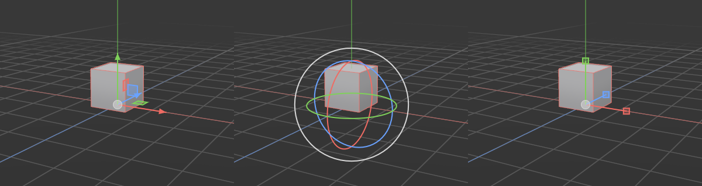
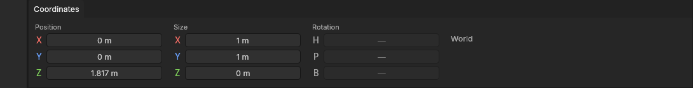

# Move, rotate and scale

> Move, turn and resize what you've selected (whole shapes, or their points, edges and polygons) by dragging the gizmo, or type exact values in the Coordinates panel.

## When to use it

This is how a model takes shape:
- move a shape into place;
- pull a polygon up to make a cube taller;
- turn a panel to an angle;
- squash a row of points flat.

The **gizmo** is the handle that appears on what you've selected. Drag a part of it to change the selection in that direction only, so you never have to guess where "into the screen" is. When you know the exact number ("25 cm up", "45°"), type it in the [Coordinates panel](#typing-exact-values) instead.

What moves depends on the [mode](modes.md):
- In **Model** mode, whole shapes move.
- In **Points**, **Edges** and **Polygons** mode, the selected parts of the selected shapes move. Moving a polygon moves its corners, so the polygons around it stretch to follow.

Changes to points, edges and polygons are recorded on top of the shape's [base](concepts.md#objects-and-scenes). A primitive keeps its settings: change a cube's segments later and your moves are made again on the new cube.

## How to use it

1. **Select** what you want to change (see [Selecting](selecting.md)).
2. **Pick a tool:**
   - **W** to move, **R** to rotate, **S** to scale.
   - **T** shows all three gizmos at once.
   - The same tools are on the top palette and in the **Tools** menu.
3. **Drag a part of the gizmo.** The part under the mouse lights up yellow, so you can see what you're about to grab.
   - **Move:**
     - Drag an **arrow** to move along that axis only (X red, Y blue, Z green).
     - Drag a small **square** between two arrows to move flat in that plane. For example, the green square moves across the ground, keeping the height.
     - Drag the **centre dot** to move freely, facing you.
   - **Rotate:**
     - Drag a **ring** to turn around that axis. The green ring turns around Z, like a turntable.
     - Drag the **outer white ring** to turn around the line you're looking along.
   - **Scale:**
     - Drag a **box** to stretch or squash along that axis.
     - Drag the **centre dot** to scale evenly. Right or up makes it bigger; left or down makes it smaller.
4. **Let go** to keep the change. While you drag, the status bar shows how far you've gone (*Moving: X 0.25 m, Y 0 m, Z 0 m*).
5. **Q** goes back to selecting.

Each drag is one undo step: **Ctrl + Z** takes it back in one go.

**Where the gizmo sits:**
- **One shape:** at its axis, its [pivot](concepts.md#objects-and-scenes). For a primitive, that's the middle of its base.
- **Several shapes:** in the middle of their axes. They all turn and scale around that point.
- **Points, edges and polygons:** in the middle of what's selected.

The gizmo stays the same size on screen however far you zoom.

**Dragging away from the gizmo still selects**, with the box, lasso or brush as usual. So you can select and move without switching tools.

### Fine control, cancelling and locks

- **Hold Shift** while dragging to go ten times slower, for small nudges.
- **Press Esc, or right-click,** while still holding the left button to cancel. Everything goes back where it was.
- **Press X, Y or Z** (or click the X, Y and Z buttons on the top palette) to **lock** that axis. While it's locked, moving, rotating and scaling leave it alone, and its gizmo handles disappear. The button turns red while locked; press the key again to free it. *Example:* lock Z, then drag the centre dot to slide a shape around the floor without lifting it.
- **Press L** (or click the globe button beside the locks) to switch the gizmo between the **world's axes** and the **object's own axes**. Use the object's own axes to move a turned shape along its own length.

### Snapping

Snapping makes a drag jump to exact places instead of going anywhere:

- **Moves** jump to the nearest **point**, then **edge**, then **polygon** under the mouse, if there is one near. Otherwise they jump to the **grid lines** you see: every 1 m, 50 cm or 10 cm, as the grid button is set.
  - With an arrow, only that axis follows the snap. Drag the X arrow towards another shape's corner, and you line up with it along X only.
  - What you're moving never snaps to itself.
- **Rotations** jump in steps of **15°**.
- **Scaling** jumps in steps of **10%**.

The **magnet button** on the top palette (and **Tools → Snapping**) turns snapping on and off. **Hold Ctrl while dragging** to flip it for that one drag: snap when it's off, move freely when it's on. If you'd rather only use the button, switch off **Holding Ctrl while dragging flips snapping** in **Edit → Settings… → Viewport → Snapping**. That's also where you choose what moves snap to and the rotate and scale steps.

### Typing exact values

The **Coordinates** panel under the viewport shows the selection's **Position**, **Size** and **Rotation**. Click a number, type a new value and press **Enter**, or drag the number sideways.
- Positions are in the world: where the shape's axis is, or the middle of the selected points.
- Sizes and positions use your units (metres as standard).
- Rotation is in degrees: **H** (heading) turns around Z, **P** (pitch) tilts, **B** (bank) rolls.

Each typed value or drag is one undo step.

What the fields show:
- **One shape:** its axis's position, its own size (along its own axes) and its rotation.
- **Several shapes, or points, edges and polygons:** the middle of the selection and the size of the box around it. There's no rotation; use the rotate gizmo instead.

## Settings

| Setting | What it does |
|---|---|
| **Snapping** (palette button, Tools menu, Settings) | On or off. |
| **Holding Ctrl while dragging flips snapping** | On (standard): Ctrl snaps for one drag, or stops snapping if it's on. Off: only the button. Settings → Viewport → Snapping. |
| **Moves snap to** | Points, Edges, Polygons, Grid lines (all on as standard). |
| **Turns snap every / scaling every** | 15° and 10% as standard. |
| **Lock X / Y / Z** | An axis that can't change. Remembered between sessions. |
| **World or object axes** | Which way the gizmo's arrows point. Remembered. |

## Shortcuts

| Action | Shortcut |
|---|---|
| Move / rotate / scale / all three | `W` / `R` / `S` / `T` |
| Back to selecting | `Q` |
| Ten times slower | Hold `Shift` while dragging |
| Snap for this drag (or not, if snapping is on) | Hold `Ctrl` while dragging |
| Cancel a drag | `Esc` or right-click, while still dragging |
| Lock or free X / Y / Z | `X` / `Y` / `Z` |
| World or object axes | `L` |
| Undo a move | `Ctrl + Z` |

## Tips and common problems

- **Problem:** pressing W shows no gizmo. **Why:** nothing is selected, or (in Points, Edges or Polygons mode) no points, edges or polygons are. **Fix:** select something first.
- **Problem:** an arrow is missing. **Why:** it points almost straight at you, so it would be too short to grab, or its axis is locked. **Fix:** orbit the view a little, or unlock the axis.
- **Problem:** scaling a turned shape along X looks skewed or wrong. **Why:** with the world's axes, X isn't the shape's own length. **Fix:** press **L** for the object's own axes.
- **Problem:** a move won't land between grid lines. **Why:** snapping is on. **Fix:** hold **Ctrl** while dragging, or turn snapping off.
- **Tip:** to lift a polygon straight up, select it in Polygons mode, press **W** and drag the green arrow. The polygons around it stretch to follow, which is the start of many hard-surface shapes.
- **Tip:** to flatten points (to make them all the same height), select them, press **S**, lock X and Y, and drag the centre dot left until the status bar says 0%. With snapping on it stops neatly on 0%.

## Related

- [Selecting](selecting.md)
- [Points, Edges and Polygons modes](modes.md)
- [Concepts: pivot, axes and grid](concepts.md#objects-and-scenes)
- [Settings](settings.md)
